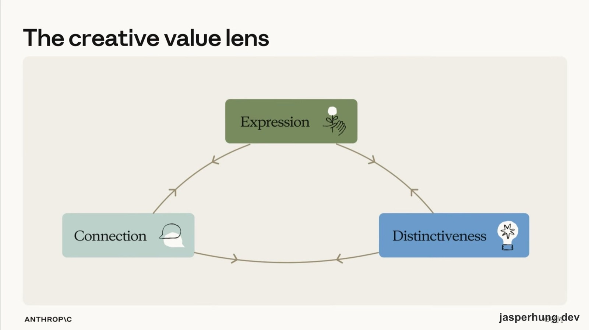
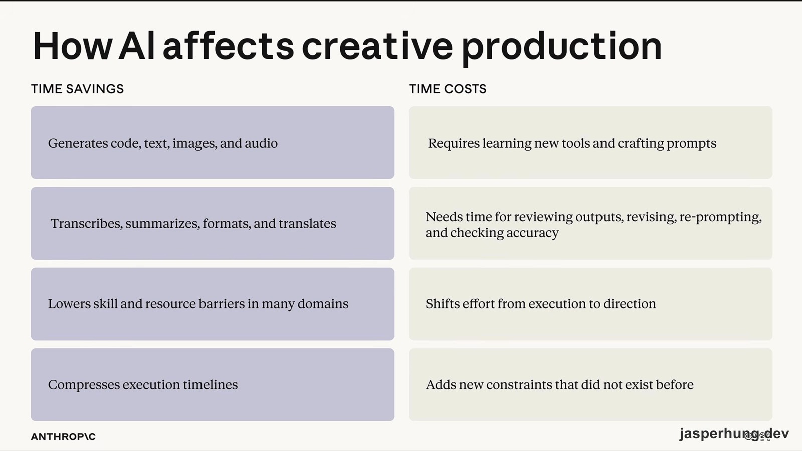
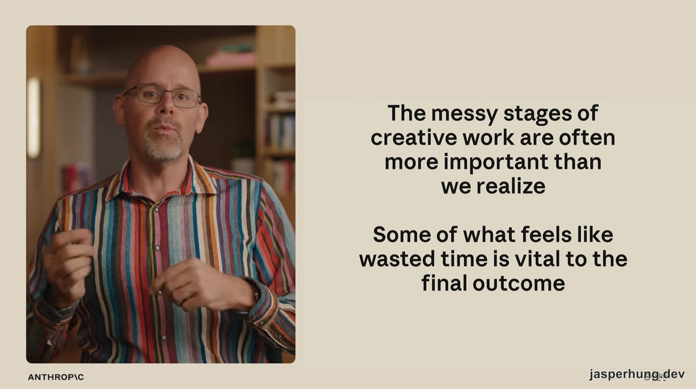
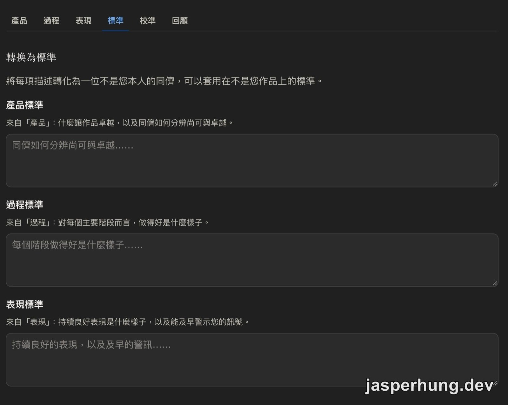
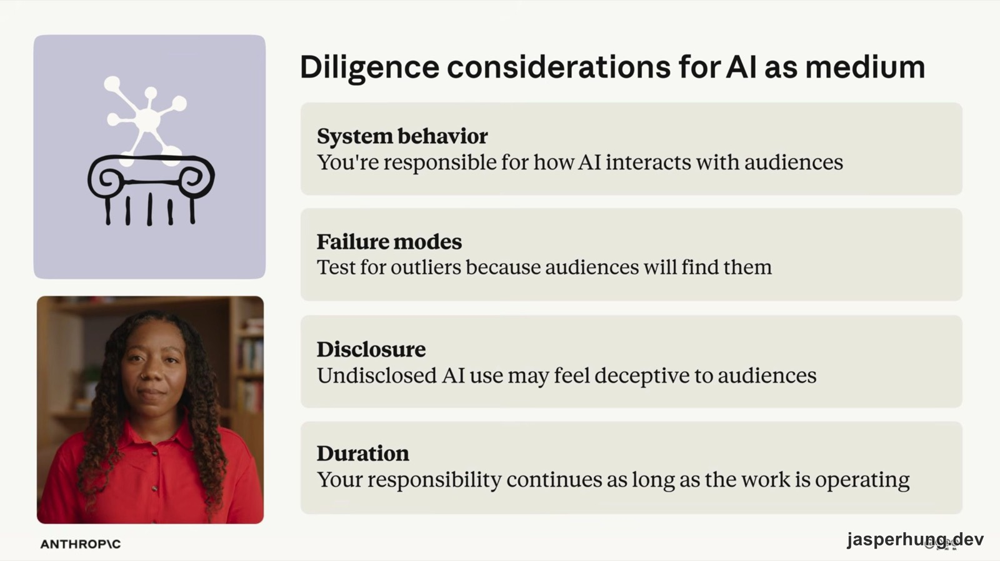
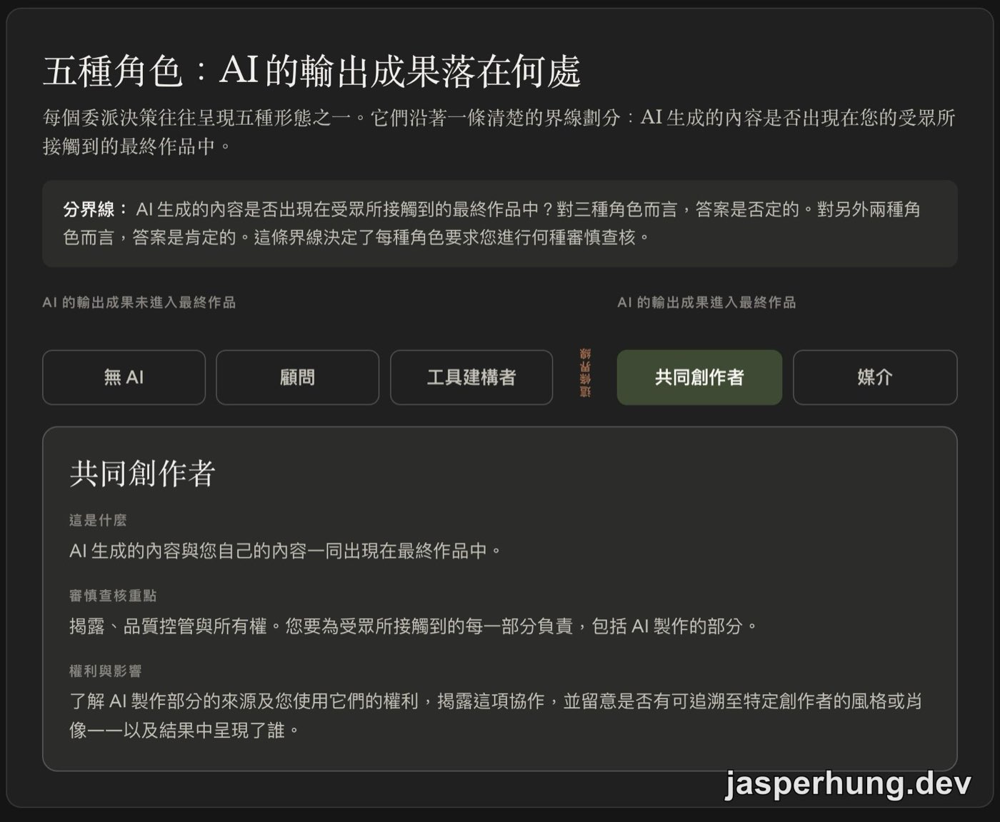

<KeyTakeaways>
  

    AI Fluency for creative work 在教什麼？它用 Creative Value Lens、生產視角與
    4D Framework，把「要不要用
    AI」拆成作品價值、製作成本、任務委派與審慎責任的連續判斷；本文整理 8 堂課、8
    個互相接續的練習與 9 題測驗，也補上我對部落格創作的實際思考。
  

</KeyTakeaways>

當 AI 幾秒鐘就能產出一篇文章、一張圖或一段音樂，創作者還剩下什麼？我打開 Claude Academy 的 [AI Fluency for creative work](https://academy.claude.com/zh-TW/courses/ai-fluency-for-creative-work) 時，以為會看到一套讓創意工作更快的 AI 使用技巧。第一個練習卻要我先寫下自己的顧慮：真實性焦慮、依賴、對「夠好就好」的滿足、劣質內容疲勞與「我做的事毫無價值」。

這門課從工具之前開始，逼你先回答作品為什麼存在、它要對誰說話，以及什麼東西讓它仍然像你的作品。

## 課程資訊一覽

| 項目           | 內容                                                                                                                                   |
| -------------- | -------------------------------------------------------------------------------------------------------------------------------------- |
| 官方課名       | 創意工作的 AI Fluency / AI Fluency for creative work                                                                                   |
| 堂數           | 官方標示 8 堂課（outline 另含 1 個測驗與 1 個徽章頁，共 10 個可點項目）                                                                |
| 官方標示總時長 | 5 小時                                                                                                                                 |
| 影片總分鐘     | 77 分鐘                                                                                                                                |
| 練習預估總分鐘 | 官方未列；8 堂課每堂都有練習                                                                                                           |
| 測驗數與題數   | 1 個測驗，9 題，頁面標示 6 分鐘                                                                                                        |
| 通過門檻       | 官方未列                                                                                                                               |
| 完成徽章       | 有，完成課程測驗後取得                                                                                                                 |
| 先決條件       | 建議先完成 AI Fluency: Framework & Foundations；另準備一個可實作的 AI 工具，官方範例是 Claude.ai，但任何 AI 助理都可以                 |
| 適合對象       | 創作者、作家、插畫家、設計師、音樂家、電影製作人、遊戲開發者、表演者，以及正在釐清生成式 AI 對技藝、生計與創作者自我認同意味著什麼的人 |
| 課程來源       | Anthropic 與 Ringling College of Art and Design 的 Rick Dakan 教授、University College Cork 的 Joseph Feller 教授合作開發              |

## Introduction（簡介）

### 1. Welcome to AI Fluency for creative work（歡迎來到創意工作的 AI 流暢度）

課程先建立一個很容易被誤解、卻非常重要的起始立場：**先從不使用 AI 開始，再透過分析決定是否以及如何選擇加入。** 這句話的重點，在於把決策的主導權留在創作者手上；它沒有要求所有創作者拒絕 AI。

第一個練習叫做「起始立場快照」。要先寫下目前和 AI 的關係，再從五項顧慮挑出最有共鳴的一項，最後完成一句話：「在本課程結束時，我希望能夠……」

| 顧慮                                               | 課程後續處理的位置         |
| -------------------------------------------------- | -------------------------- |
| 真實性焦慮：「如果 AI 碰過它，它還算我的作品嗎？」 | 創意價值透鏡中的人際連結   |
| 依賴性：「我會不會失去多年來培養的技能？」         | 委派與審慎中的長期檢查     |
| 滿足於「夠好就好」                                 | 描述與辨別中的標準建立     |
| 劣質內容疲勞與連帶愧疚感                           | 貫穿全課的詞彙與思維方式   |
| 「我所做的事毫無價值」                             | 重新理解創作者角色如何改變 |

這幾題很像靈魂拷問，因為它們沒有停在「AI 有哪些功能」。課程把問題往前推：如果還沒想清楚要做什麼、為誰做，以及什麼叫做好，提示技巧再熟也很難替你決定方向。

## The Creative Lenses（創意透鏡）

### 2. The creative value lens（創意價值透鏡）

第一項工具回答的是：**這件作品究竟創造了什麼價值？** Creative Value Lens 有三個同時運作的維度，沒有一個固定排在最前面。

  圖：Creative Value Lens 用創意表達、人際連結與獨特性三個維度分析作品。

| 維度                   | 它在看什麼                                                                         |
| ---------------------- | ---------------------------------------------------------------------------------- |
| 創意表達 Expression    | 作品讓創作者與受眾經驗到什麼；可以是引人入勝的反應，也可以是清楚、準確、好用的功能 |
| 人際連結 Connection    | 作品如何促成人與人之間的關係，以及受眾是否感覺到一個特定的人在作品背後             |
| 獨特性 Distinctiveness | 作品靠什麼和其他作品區分開來，包括內容或執行的原創性，以及具體呈現上的特殊性       |

這三個維度會互相拉扯。社區藝術節的海報可以選擇非常陌生、醒目的視覺，增加獨特性；也可以使用在地熟悉的意象，讓人際連結更強。透鏡提供的是取捨的語言，最後往哪裡走仍然要回到作品的目的與受眾。

課程對真實性的分析也分成兩層。第一層是作品本身：它是否反映創作者做過的決策、技巧與表達，創作者能不能誠實說明創作過程。第二層是作品和受眾之間的連結：觀眾感知到的 AI 參與方式，會影響他們如何理解作者與作品的關係。

所以「AI 碰過之後還算不算我的作品」沒有一個脫離情境的答案。作品是否忠實反映你的決策，和受眾如何感知這個創作過程，都要一起放進判斷裡。

### 3. The production lens（生產視角）

第二項工具回答的是：**製作這件作品需要付出什麼代價？** 生產視角把成本拆成三項生產限制：時間、精力、資源，再觀察技術複雜度如何作用在這些限制上。

  圖：AI 可能縮短執行時間，也會帶來學習工具、檢查輸出、修改與重新提示的成本。

技術很少只是在減少限制，它也會重新安排限制。AI 可能把精力從執行轉移到方向：你少花時間處理重複動作，卻要花更多時間選擇、比較、校準與辨認品質。當基本產出變得便宜，作品的目的與獨特性會變得更重要。

課程用錄製唱片的變化來說明這一點。過去需要錄音室、設備、錄音師、調音師，甚至一整支樂隊；現在一台電腦、一支麥克風和一個想法，可能就能開始製作。但學樂器、學音樂軟體、安排樂器、把腦中的想法變成聲音，仍然需要時間、精力和資源。

  圖：課程提醒，創意工作中看似混亂或浪費的階段，可能是最後成果的重要部分。

> The messy stages of creative work are often more important than we realize.
>
> Some of what feels like wasted time is vital to the final outcome.

這兩句話讓我停了一下。AI 可以很快給出草稿，但創作裡那些來回修改、暫時做不出成果、甚至看起來像在繞路的時間，可能正是作品逐漸長出方向的過程。工具變快之後，這些階段更需要被辨認，不然很容易把「看起來有效率」誤認成「真的更接近好作品」。

## The AI Fluency Framework（AI Fluency 框架）

### 4. The 4D Framework（4D 框架）

這一堂和 [AI Fluency: Framework & Foundations](https://academy.claude.com/zh-TW/courses/ai-fluency-framework-foundations) 的框架課重複，影片可以快速瀏覽，但創意工作的練習是全新的，官方明確建議即使跳過影片，也要完成練習。

4D Framework 的四項能力是：

| 能力             | 在創意工作裡處理的問題                       |
| ---------------- | -------------------------------------------- |
| 委派 Delegation  | 哪些工作要交給 AI，哪些工作要留在自己手上    |
| 描述 Description | 你要做什麼、怎麼做，以及你如何作為創作者工作 |
| 辨別 Discernment | 如何依明確標準判斷輸出品質                   |
| 審慎 Diligence   | 如何對創作、透明度、部署與最終結果負責       |

課程把四項能力組成兩個巢狀迴圈：**內迴圈是描述與辨別，圍繞著工作本身運作；外迴圈是委派與審慎，圍繞著工作分配與責任運作。** 這也解釋了為什麼課程把框架放在兩個創意透鏡之後：先看作品的價值與成本，再決定如何讓 AI 介入。

## The Inner Loop（內迴圈）

### 5. Description and Discernment（描述與辨別力）

這一堂把內迴圈轉向自己的實踐。AI 很難服務一個還沒有被描述清楚的工作；沒有明確標準，也很難判斷 AI 交回來的結果究竟有沒有幫上忙。

| 層次             | 課程要你描述的內容                                                         |
| ---------------- | -------------------------------------------------------------------------- |
| 產品 Product     | 你製作什麼：形式、脈絡、受眾與範圍                                         |
| 過程 Process     | 你怎麼製作；流程標準要落到具體步驟，才能判斷某個步驟中的 AI 是幫助還是損害 |
| 表現 Performance | 你作為一名創作者如何工作；這一層會隨時間受到 AI 最深的影響                 |

課程的「實踐闡述工作手冊」有六個 tab：產品、過程、表現、標準、校準、回顧。先描述自己的實踐，再把描述轉成同儕也能套用在其他作品上的標準，接著拿一件舊作品測試標準，最後保存回顧。

  圖：工作手冊要求把描述轉成可以套用在其他作品上的產品、過程與表現標準。

這裡有兩條很實用的規則：寫具體的作品，不要只寫類別；避免「感覺對了」「一看就知道」這類無法驗證的句子。對我來說，這直接連到部落格寫作：文章的受眾是誰、它為什麼值得存在、它的核心概念怎麼用一句話說完，這些都要在動筆前講清楚。

如果這些前提沒有先定義，AI 可以把模糊想法整理得更像一篇文章，卻無法替你決定那篇文章應該成為什麼。

## The Outer Loop（外迴圈）

### 6. Delegation and Diligence（委派與審慎）

外迴圈把前面的工具放進一個真實決策：這件作品該不該用 AI、用在哪裡、以及誰對結果負責。課程給的順序很清楚：

1. **問題意識優先**：先釐清真正要解決的問題，以及好結果長什麼樣子。
2. **平台意識**：先了解工具能做什麼、不能做什麼，再決定要交付什麼。
3. **任務委派**：逐階段分配工作，寫清楚 AI 參與的程度與理由。
4. **審慎檢查**：從創作 Creation、透明度 Transparency、部署 Deployment 三個面向檢查委派決定。
5. **依自己的標準檢查成果**：完成的作品仍然要回到前一堂建立的標準。

  圖：當 AI
  生成內容進入最終作品，創作者仍要檢查系統行為、失敗模式、揭露方式與責任持續多久。

課程把陷阱分成兩種時間尺度。長期要留意趨同化與技能退化；立即的風險則是還沒想清楚自己要什麼，就先向 AI 求助。這也回應了我在課程前面的感受：工具的速度很容易讓人跳過那些看似慢、卻負責定義方向的階段。

## Putting it all together（整合應用）

### 7. AI roles as Delegation outcomes（AI 角色作為委派結果）

委派決策最後會落在五種角色之一。切分它們的關鍵問題是：**AI 生成的內容是否出現在受眾接觸到的最終作品裡？**

| AI 生成內容是否進入最終作品 | 角色                                                  |
| --------------------------- | ----------------------------------------------------- |
| 不進入                      | 無 AI No AI、顧問 Consultant、工具建構者 Tool Builder |
| 進入                        | 共同創作者 Co-creator、媒介 Medium                    |

  圖：五種 AI 角色以「生成內容是否進入受眾接觸的最終作品」作為分界。

這些角色是做決策時使用的詞彙，每個角色都有不同的審慎檔案。它們也讓「AI 只是幫忙」變得不夠精確：AI 可能只提供建議，也可能參與生成最後會被看見的內容，兩種情況需要面對的揭露、品質與權利問題並不相同。

練習還要求你標出所有 AI 接觸點，包括研究、行政工作與資料蒐集，再分別寫下「實際角色」和「原本以為的角色」。靠近角色分界的地方叫做絆線（trip wire），它提醒你注意委派決定何時悄悄偏移。

### 8. Putting it all together（整合所有內容）

最後一堂用插畫家的作品與工作流程走完整條分析：先闡明實踐，再用兩個透鏡分析作品，接著套用委派與審慎，讓不同作品得到不同的 AI 使用結果。

課程最後要產出一份簽署並註明日期的個人 AI 使用政策，內容包括：

- 每種工作模式或階段採用哪個 AI 角色，以及原因。
- 要向每個受眾揭露什麼、在什麼時機揭露。
- 哪些事件會觸發政策重新檢視。
- 用三個真實情境做壓力測試。

我在這裡重新看自己的部落格。我的主要方向偏向讓文章成為 Agent 搜尋得到、能作為問題解答參考的內容；同時，我也希望人類讀者能讀到我處理問題的方式與寫作特質。這代表文章要把問題、答案與限制寫清楚，卻不能只剩下可被抽取的結論。

如果 AI 參與整理、改寫，最後文字也出現在讀者看到的文章裡，我就需要誠實面對它在作品中的角色，依自己的標準檢查每一段，並保留真正的經驗、判斷與責任。對我來說，這是一種借力實力的分享：把解決問題的過程記錄下來，再用 AI 協助整理成可被人和 Agent 找到的文章。工具降低了製作限制，作品為什麼值得存在的問題仍然留在我手上。

## 課程練習地圖

這門課的 8 個練習會互相接續，前一個練習的輸出會成為下一個決策的材料：

| 課程 | 練習                         | 接到下一步的產出                                         |
| ---- | ---------------------------- | -------------------------------------------------------- |
| 1    | 起始立場快照                 | 目前的 AI 關係、最有共鳴的顧慮，以及課程目標             |
| 2    | 透過透鏡看您的作品           | 三件作品的表達、連結、獨特性評估與一次取捨               |
| 3    | 生產視角稽核                 | 專案階段、時間／精力／資源限制，以及 AI 新增或轉移的成本 |
| 4    | 循環的運作、找出您自己的循環 | 內迴圈與外迴圈如何出現在自己的協作經驗裡                 |
| 5    | 實踐闡述工作手冊             | 產品、過程、表現的描述，以及可校準的工作標準             |
| 6    | 決策備忘錄                   | 一份能說明問題、工具、任務分工與審慎檢查的一頁計畫       |
| 7    | 您的實務實際所在之處         | AI 接觸點、實際角色、原本以為的角色與絆線                |
| 8    | 您的個人 AI 使用政策         | 角色、揭露、修訂觸發條件、壓力測試與簽署後的政策         |

這種設計讓課程更像一條工作流：從直覺立場開始，逐步建立價值判斷、生產分析、品質標準與委派責任，最後才寫出自己的政策。每一題都在要求你把「我覺得」往前推成「我可以說明為什麼」。

## Course Quiz（課程測驗）

有 9 題。官方頁面本身是繁中，以下保留實際題目與正確答案。

### 1. 一位音樂人不確定自己想讓一首曲子成為什麼樣子，於是求助 AI 來決定。本課程給出什麼建議？

答案：**退一步，先清楚了解問題所在**

### 2. 根據生產視角，技術通常對生產限制（時間、精力和資源）做了什麼？

答案：**重新安排它們，而不僅僅是移除它們**

### 3. 本課程將 AI 的使用分為五種角色，從「無 AI」到「媒介」。劃分這五種角色的是哪一個問題？

答案：**是否有任何 AI 生成的內容出現在受眾接觸到的最終作品中**

### 4. 4D 框架中的四項能力是什麼？

答案：**委派、描述、辨別、勤勉**

### 5. 本課程建議任何創意專案的起始立場是：

答案：**不使用 AI，然後透過分析決定是否以及如何選擇加入**

### 6. 在分享一份由 AI 協助創作的完成作品之前，勤勉要求您做什麼？

答案：**依據您自己的標準來評判它，以作者身份為其負責，並對 AI 參與的部分保持透明**

### 7. 一位作家問：「如果 AI 碰過這篇文章，它還是我的嗎？」根據本課程，是什麼讓這篇文章仍然屬於這位作家？

答案：**這位作家做出了各項決定，並能誠實說明作品是如何完成的**

### 8. 一位作家發現 AI 幾秒鐘就能產出草稿，但完成這篇文章仍然需要很長時間。本課程認為時間花在哪裡？

答案：**審閱、修改以及重新提示這些草稿**

### 9. 一位設計師唯一的標準是「見之即知」。在使用 AI 時，這為什麼會是個問題？

答案：**沒有任何明確的依據可用來評判輸出結果**

## 小結

這門課最特別的地方，是它把練習題放在非常核心的位置。每一題都像靈魂拷問，逼你定義作品的受眾、目的、獨特性與呈現價值。一開始就要回答自己目前在創意工作中和 AI 的關係，再從五項顧慮裡挑出最有共鳴的一項：真實性焦慮、依賴、滿足於「夠好就好」、劣質內容疲勞與連帶愧疚感，以及「我所做的事毫無價值」。這些都是創意工作者很真實的問題，課程一開場就把它們攤在桌上。

接著，課程要求你先從不使用 AI 開始，再透過分析決定是否以及如何選擇加入。Creative Value Lens 用創意表達、人際連結與獨特性三個維度，幫你判斷一件作品在乎什麼，也幫你思考 AI 應該在哪個階段介入、參與到什麼程度。真實性焦慮可以寫成：「如果 AI 碰過它，它還算是我的作品嗎？」依賴性則是：「如果我依賴 AI，我會不會失去多年來培養的技能？」當 AI 能生成圖像時，也很容易冒出另一個問題：「那我做的事情還有價值嗎？」

生產視角把這些焦慮拉回成本：製作創意作品的基本成本，是時間、精力與資源；技術複雜度則描述技術如何作用在這些限制上。AI 會降低某些門檻，也會增加學習工具、訂閱服務、檢查輸出與重新修改的成本。課程裡用錄製唱片來比喻：過去需要錄音室、錄音設備、錄音師、調音師，甚至一整支樂隊；現在一台電腦、一支麥克風和一個想法，就可能開始製作。但學樂器、學音樂與錄音軟體、安排聲部，以及把想法實現出來，仍然需要投入時間與精力。

所以問題最後還是會回到最早的地方：這張唱片為什麼要產生？過去很多人都在寫歌，作品沒有被選進專輯，不代表他們沒有能力完成；現在工具讓一個人可以完成更多工作，作品的目的、獨特性，以及受眾為什麼願意買單，仍然需要被回答。改變的是工具與生產方式，價值會更集中在仍然稀缺的部分：判斷、決策、觀點，以及讓作品成為這個作品的特徵。

受眾知道 AI 參與之後會不會買單，則是另一個問題。這很像手工製品和機器製品：有人偏好手工，因為它有人的痕跡；機器製品則可能更穩定、更便宜、更容易大量取得。手工品如果貴上五倍，受眾是否願意支付，會影響最後的選擇。放回創意工作裡，AI 參與不只改變製作者的流程，也可能改變受眾對作品的感受與期待。

課程裡我最喜歡的兩句話是：

> The messy stages of creative work are often more important than we realize.
>
> Some of what feels like wasted time is vital to the final outcome.

這也讓我重新看自己的寫作。作品產生之前，我通常已經知道自己想處理什麼問題，只是還沒有把它做出來。既然如此，我本來就應該先定義這篇文章的風格、受眾、核心概念與一句話目的：我要告訴讀者某個工具很好用、這解決什麼問題，使用體驗如何，還是我試過之後發現原本的方法更適合？這個觀點要先存在，AI 才能做為文章核心有依據的協助我把文章整理完成。

課程最後談問題意識、平台意識、任務委派，以及創作、透明度、部署的審慎檢查。這個順序剛好也回答了我對部落格的定義：我比較偏向讓文章成為 Agent 搜尋得到、可以作為問題解答參考的內容。AEO 和其他搜尋方式會增加被找到的機會，但文章仍然要有清楚的問題、可驗證的過程與作者自己的判斷，不能只剩下方便抽取的答案。

因此，我現在比較能接受自己使用 AI 協助寫文章。這可以降低整理與改寫的心智負擔，讓我把解決問題的過程順手記錄下來，再發布到網路上；文章可能被人讀到，也可能被 Agent 搜尋到，成為某個問題的參考資料。但我更在意的是，最後留下來的文字仍然能說明我做過什麼、怎麼判斷，以及我想傳達的觀點。

這門課沒有替我決定 AI 應該用多少，也沒有要求所有作品採用同一種答案，它留下一個評斷方式一個指標一個界定與模式告訴我 AI 如何參與如何協助我的作品。

也一直提醒著我：工具可以分擔生產限制，但是作品為什麼要存在、它為什麼獨特、我要對誰負責，這些問題仍然需要由我自己先回答出來。
