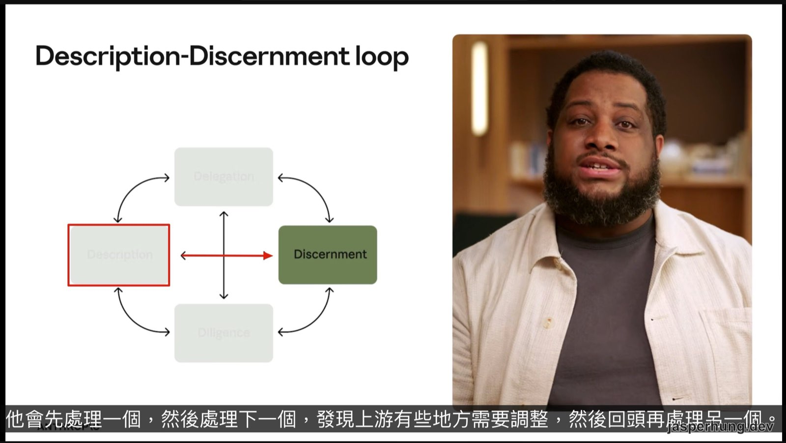
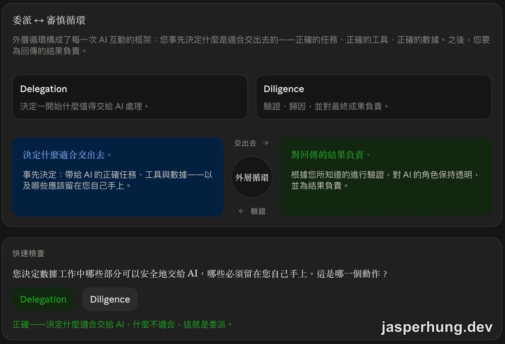
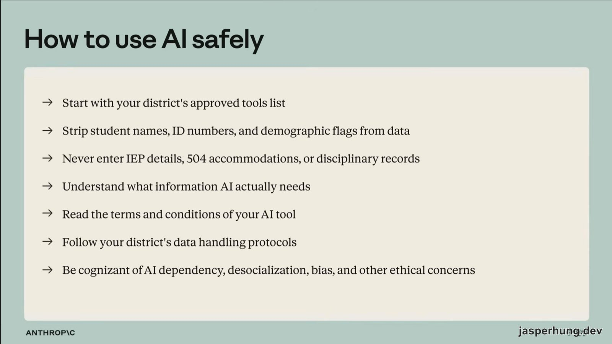

<KeyTakeaways>
  

    教育工作者該怎麼把 AI 放進教學工作，又保留自己的教學判斷？ 
    <a href="https://academy.claude.com/zh-TW/courses/ai-fluency-for-k-12-educators">AI Fluency for pK–12 educators</a> 用 Delegation、Description、Discernment、Diligence 組成的 4D Framework，帶著教育工作者從差異化教材、學生資料到真實任務跑完一輪；課程以 Claude.ai 為例，但資料處理仍要依學區核准工具與適用規範決定。
  

</KeyTakeaways>

前兩天的課程分別從建構者的角度談 AI 協作，再往回拆 4D 框架。今天同一套框架進到教室：面對學生、家長、同事和學校規範，哪些事情可以請 AI 幫忙，哪些判斷仍要留在教育工作者手上？

我打開 [AI Fluency for pK–12 educators](https://academy.claude.com/zh-TW/courses/ai-fluency-for-k-12-educators) 時，最先注意到的不是某個 Prompt 技巧，而是課程一直把「教學現場」放在 AI 前面。先說清楚自己的價值觀、學生與限制，再開始談工具能做什麼。

## 課程資訊一覽

| 項目 | 內容 |
|---|---|
| 官方課名 | 面向 pK–12 教育工作者的 AI Fluency AI Fluency for pK–12 educators |
| 堂數 | 10 堂課（課程測驗與完成徽章不計入） |
| 總時長 | 3 小時 |
| 測驗數與題數 | 1 個測驗，8 題，6 分鐘，80% 以上通過 |
| 課內檢核 | 2 個不計分的 QUICK CHECK 單題 |
| 完成徽章 | 有。通過測驗後可建立完成徽章，並取得可驗證的分享連結 |
| 先決條件 | 建議先修 `AI Fluency：框架與基礎`、`AI 的能力與限制`；能操作一個 AI 工具即可，免費帳號足夠 |
| 適合對象 | pK–12 教育工作者與教職員 |
| 合作夥伴 | Anthropic × Teach For America（TFA） |

官方希望學習者最後能完成七件事：理解 AI Fluency 和 4D 框架、建立可重複使用的情境文件、掌握生成式 AI 的能力邊界、用描述—辨別循環製作差異化教材、用委派—審慎循環處理學生資料與倫理灰色地帶、寫出個人 AI 價值文件，最後在自己的真實任務上跑完端到端 4D 工作流程。

## 課程合作

### 1. How this course was made（本課程的製作方式）

Teach For America 是一個教育領導力發展組織，課程頁面提到它的校友網絡超過 72,000 人。TFA 在這門課裡提供真實的課堂案例，用教學專業檢查教材，也找教師試行練習並收集回饋。

這個合作背景解釋了課程為什麼反覆回到學生、家庭、同事與學區規範。它談 AI 的時候，旁邊一直放著教室裡真正會遇到的責任關係。

## Introduction and AI Fluency framework（簡介與 AI Fluency 框架）

### 2. Welcome to AI Fluency for educators（歡迎來到 AI Fluency 教育工作者課程）

課程把 AI Fluency 定義成以有效、高效、合乎道德且安全的方式使用 AI 的能力。它由技能、知識、洞見與價值觀組成；其中價值觀很重要，因為同一個工具放進不同的教學目標，可能會得到完全不同的使用方式。

第一個練習很簡單：選一個 AI 工具，登入並開啟對話。這個動作讓課程從抽象框架回到實際操作，也提醒學習者，後面所有練習都要在工具裡驗證，不能只停在概念上。

### 3. The 4D Framework（4D 框架）

4D 分成兩個互相連動的循環：委派—審慎循環處理「何時、該不該用 AI，以及誰負責」；描述—辨別循環處理「怎麼和 AI 來回，讓結果逐步接近需求」。

| 能力 | 英文 | 教育現場的問題 |
|---|---|---|
| 委派 | Delegation | 哪些工作適合交給 AI？哪些工作需要由我保留？ |
| 描述 | Description | 我有把對象、目標、限制與成功條件說清楚嗎？ |
| 辨別 | Discernment | 產出準確嗎？適合這些學生嗎？真的解決了問題嗎？ |
| 審慎 | Diligence | 我了解、驗證並願意為最後的結果負責嗎？ |

課程把這四項能力接到教育工作者原本就會做的事：描述接近課程規劃時定義產出與成功標準，辨別接近評估教材與學生作業。練習的重點，是把這些判斷明確寫出來，讓 AI 成為新的協作者。

第一份長期使用的產出是「情境文件」。它從自己的價值觀開始，接著寫角色、學生、教學目標、限制條件，以及 AI 可以和不可以參與的地方。與 AI 對話時不能放入可識別學生身分的細節；完成後再檢查文件裡哪些內容屬於四個 D。

### 4. Explore!（探索！）

這是一個互動工具，不是影片。它把 4D 拆成 24 項可觀察的指標，每項都有教育工作者口吻的範例，以及兩個可以立刻嘗試的行動。

| 能力（工具內譯名） | 指標 |
|---|---|
| 描述（8 項） | 1. 清楚定義輸出內容的受眾。 2. 指定所需的格式與結構。 3. 傳達符合自己風格的語氣與風格。 4. 把複雜任務拆成較小的步驟。 5. 根據先前交流共同精進作品。 6. 提供良好範例作為參考。 7. 告訴 AI 希望它如何互動。 8. 設定 AI 應該做與不應該做的界線。 |
| 委派（7 項） | 9. 請 AI 協助前先釐清目標。 10. 投入執行前先討論如何處理問題。 11. 辨識哪些任務不適合交給 AI。 12. 考量 AI 擅長什麼、在哪些方面有困難。 13. 保持參與，不單純接受 AI 產出。 14. 為工作選擇正確的工具或方法。 15. 隨工作進展調整誰該做什麼。 |
| 判斷（5 項） | 16. 查核重要的事實與主張。 17. 注意 AI 的推理站不住腳的時候。 18. 辨識 AI 可能遺漏的重要脈絡。 19. 評估自己與 AI 是否正在共同取得進展。 20. 注意 AI 的溝通風格不適用的時候。 |
| 審慎（4 項） | 21. 留意自己與 AI 分享了哪些資訊。 22. 在重要時刻誠實說明 AI 的角色。 23. 對分享或提交的內容負責。 24. 考量將作品公開的後果。 |

這張清單的價值，在於它把「我有好好使用 AI 嗎？」拆成可以觀察的行為。例如來回超過三次還沒有進展，就停下來重新界定需求；上傳學生資料前移除姓名、學號與 IEP／504 狀態；公開內容前思考學生、家庭或同事可能怎麼誤讀。

## How AI works（AI 如何運作）

### 5. AI capabilities and limitations（AI 能力與限制）

這堂用一個教育工作者熟悉的方式測試 AI 邊界：挑一個自己熟到能抓錯的主題，請 AI 分別向小二生、七年級生和新老師解釋；再請它推薦具體資源，抽查資源是否真的存在；最後問一個有時效性或地方性的問題，再請它釐清常見誤解。

| 能力或限制 | 放進教學工作時要注意什麼 |
|---|---|
| 多功能性 | 可以在不同任務與受眾之間切換，但切換成功仍要由熟悉主題的人檢查。 |
| 幻覺 | 內容可能聽起來很有自信，資源、事實與例子仍要抽查。 |
| 知識截止日期 | 近期標準、日期與地方規範要另外查證。 |
| 上下文視窗 | 一次能保留的工作記憶有上限，長任務需要整理脈絡。 |
| 複雜推理 | 多步驟推理可能出錯，重要結果不能只看表面流暢度。 |

課程給的委派判準很實用：把 AI 的速度、規模與模式整理能力，接到人的批判性思考、教學判斷、創造力與道德監督。測試 AI 的目的，是知道哪些地方可以讓它先做，哪些地方要保留自己的驗證。

## Using AI responsibly（負責任地使用 AI）

### 6. Creating high quality AI outputs（創造高品質的 AI 輸出）

Okafor 女士是一位七年級科學教師。她要用 AI 為閱讀程度不同的學生草擬差異化資訊性文本，再逐步檢查與修訂。這個案例把描述—辨別循環變得很具體：先把學生需求與教學情境說清楚，收到產出後檢查內容，再用具體的修訂要求進入下一輪。

課程提供四個檢查問題：

1. 內容對學科領域而言準確嗎？
2. 程度與詞彙是否適合學生，且有支援關鍵概念？
3. 內容是否符合學生使用它的方式與課程方向？
4. 對特定學生而言，有沒有可能造成不良影響？

圖：Description–Discernment loop 會在處理一個環節後，依發現回頭調整另一個環節。

我在練習裡請 AI 為三到六歲幼兒建立英文 A–Z 動物或水果單字表，每個單字不超過六個字母。第一版看起來很完整，逐字母檢查後才發現 Iguana、Newt、Quail、Ugli、Viper 和 Yak 對幼兒太冷門，Ice、Nut、Vole 又不符合動物或水果條件，Ox 甚至不是 X 開頭。

下一個 Prompt 於是改成只重做問題字母，其餘內容保持不變；同時補上「提供兩個候選」「附中文與教學理由」「找不到合適答案時直接說明，不要硬湊」等條件。這次練習讓我看到，描述越完整越有幫助，辨別仍然要逐項發生。

### 7. Ethics & responsible AI use（倫理與負責任的 AI 使用）

這堂把委派—審慎循環放進學生資料的情境。委派是在一開始決定什麼可以交給 AI、什麼要留給自己；審慎則包含驗證、透明說明，以及對結果負責。

圖：Delegation–Diligence loop 先決定正確的任務、工具與資料，再為回傳的結果負責。

課程明確提醒，像 FERPA 這類資料保護規範也適用於 AI 工具。涉及學生資訊時，只能使用學區核准的工具；即使去識別化，姓名、學號、健康狀況、情緒資料，以及小班級裡的性別比例，都可能讓人重新推回個人身分。目前學區核准工具仍待向學校資訊人員或學區確認；確認前不把學生資料輸入任何工具。

圖：課程列出的 AI 安全使用方向，包括使用核准工具、移除識別資訊、了解資料需求與遵循學區規範。

課程列出六項教育現場的倫理張力：

| 張力 | 要問的問題 |
|---|---|
| 依賴性 | AI 會不會取代學生本來要自己完成的思考？ |
| 去社會化 | AI 會不會取代人際互動、協作或關係建立？ |
| 偏見 | AI 會不會強化狹隘觀點、刻板印象或既有不平等？ |
| 學生自主性 | 誰掌控 AI 的使用方式：學生、教育者，還是系統？ |
| 使用機會的公平性 | 誰能受益，誰可能因資源不足而被排除？ |
| 環境影響 | 能源使用、運算需求與系統規模如何進入倫理決策？ |

我選擇先處理依賴性與偏見：不把課堂小結或學生推論過程交給 AI，教材與資料整理可以請 AI 協助，但要要求它列出可能的偏見，再由人檢查人物和例子。如果不確定某項使用方式是否合乎倫理，先暫停，查學區指引、問同事，再決定是否試行。

### 8. AI's constitution, pedagogy, and you（AI 的憲法、教學法與您）

這堂是這門身分別課最獨特的內容。它談不同 AI 模型為什麼可能有不同個性，也提醒教育工作者先寫清楚自己會和不會用 AI 做什麼。

課程最有力的一句話是：**「AI 不是教學法——您才是。」** 教學目標、價值觀和學生關係仍由教育工作者掌握，模型的個性只能影響協作方式，不能代替教學判斷。

練習是把前面建立的情境文件與倫理承諾整理成個人 AI 價值文件，分成三塊：

| 區塊 | 要寫什麼 |
|---|---|
| 意圖 | 想用 AI 達成什麼 |
| 原則 | 想堅守的 2–3 條規則 |
| 界線 | 永遠會親自完成的工作 |

我在初版裡寫「不提供個人資料給 AI」，同時又想請 AI 分析學生的成績、情緒、身高體重與健康狀況，兩者放在一起很快就互相衝突。修訂後改成群體層級的前後比較，先去識別化、設定最小人數門檻，健康與情緒資料只在學區核准的工具裡處理；發佈前仍由自己確認資料與課堂理解一致，並為結果負責。

## Putting it all together（整合應用）

### 9. Tying it all together（將一切整合起來）

最後的端到端練習要求挑一項接下來一兩週內到期的真實任務，先寫下「完成」長什麼樣、AI 能協助哪裡、哪些仍由自己負責，再邊做邊記錄五件事：要求怎麼寫、產出哪裡正確或薄弱、保留與修改了什麼、加入了哪些只有自己能提供的內容，以及是否願意在成果上署名。

這裡的 4D 不會每次都按照固定順序走。影片裡的圖讓我更容易理解：4D 有圓形的循環，也有連接 Description 與 Discernment 的對角線。講者會先處理一個環節，再處理下一個；發現上游需要調整，就回頭處理另一個。修改委派，可能牽動辨別；修改描述，也可能讓審慎條件跟著改。

這代表 4D 不能當成一次填好、套用所有任務的固定規則。每個任務的條件不同，第一版的 Prompt 也不會一次就把四個 D 建立完整。AI 可以先幫忙找材料、整理資訊和發想方向，接下來仍要由人閱讀第一版，慢慢把這個循環修到適合當下工作的狀態。第一版可以先完成大部分工作，但這裡的「大部分」是我自己的約 60% 到 70% 估計，剩下的閱讀、補充、驗證與取捨才是人要接回來的部分。

課程用一個很生活化的例子提醒這件事：AI 排出下午 4:30 的課，邏輯上看起來通順，然而那個時段根本沒有課。只有熟悉現場的人能抓到這個落差。審慎就發生在逐字閱讀、確認脈絡、檢查用詞，最後願意署上自己的名字。

## Conclusion and badge（結語與徽章）

### 10. Closure and enrichment（結語與延伸）

結尾把問題從「怎麼完成一項任務」推進到「我真正想解決什麼問題」。課程建議先用三個句型找問題：我希望什麼存在？我花太多時間做什麼？我希望有一種方法可以做什麼？接著做第一版，通過四個 D 的檢查，再依發現迭代。

TFA 的學員作品也把這個方向具體化：

| 工具 | 功能說明 | 解決的問題 |
|---|---|---|
| Your Future Career | 幫助學生將興趣與潛在職業連結起來 | 全校只有一位輔導老師，需要更多職業相關學習 |
| Fun Friday Planner | 幫助教師、行政人員和家長規劃星期五活動 | 星期五是一週中出席率最低的一天 |
| Lyrics to Learning | 以嘻哈音樂生成英語語言藝術（ELA）課程 | 教師想把自己的熱情放進課程規劃 |

完成課程後可以取得徽章，和學校社群開啟 AI Fluency 的對話。課程也把下一步指向 Anthropic 的 [AI Fluency: Framework & Foundations](https://academy.claude.com/zh-TW/courses/ai-fluency-framework-foundations)，讓教育工作者在需要時回頭補更完整的框架內容。

## 課程練習地圖

把十堂課的練習放在一起看，它們共同累積出一份可反覆使用的工作脈絡：

| 課程 | 練習 | 接到下一步的產出 |
|---|---|---|
| 1 | 認識 Anthropic 與 Teach For America 的合作，以及課程如何製作 | 知道案例與練習的教育脈絡 |
| 2 | 選擇 AI 工具並建立第一個對話 | 開始實際操作，準備建立情境文件 |
| 3 | 從價值觀出發建立情境文件，標記四個 D | 一份可重複提供給 AI 的角色、學生、目標與限制 |
| 4 | 用「探索！」檢查 24 項可觀察指標 | 找到自己在描述、委派、辨別與審慎上的練習方向 |
| 5 | 用熟悉主題測試多功能性、幻覺、知識截止日期與推理 | 知道哪些回答可以當起點，哪些必須查證 |
| 6 | 產出差異化教材，依 Okafor 女士的四問檢查並提出修訂 Prompt | 把第一版教材帶進下一輪描述—辨別循環 |
| 7 | 從六項倫理張力選出關注項目，寫成自己的承諾 | 補上資料處理、工具選擇與責任邊界 |
| 8 | 把情境文件與倫理承諾整理成 AI 價值文件 | 形成「意圖、原則、界線」三段式的個人規範 |
| 9 | 為真實任務跑完整 4D 工作流程，記錄修改與責任 | 把框架帶回自己的工作，留下可檢視的過程紀錄 |
| 10 | 從任務往上找問題，建立解決方案並持續迭代 | 從完成一份產出，走向解決一個真實問題 |

這條練習鏈也說明了課程和一般 Prompt 教學的差異：Prompt 只是工作流程中間的一段，前後還有價值觀、資料邊界、受眾脈絡、驗證方式與發布責任。

## Course Quiz（課程測驗）

有 8 題。官方頁面本身是繁中，以下保留實際題目與正確答案。

### 1. 以下哪項任務最適合讓 AI 參與？

答案：**產生不同難度等級的練習題**。

### 2. 一位國中數學老師希望 AI 協助建立差異化練習題。以下何者是「描述（Description）」的最佳範例？

答案：**老師寫道：「為六年級學生建立 10 道關於比例的應用題，分三個難度等級。使用烹飪和運動等真實情境。避免使用金錢情境，因為我們上週已經教過了。」**

### 3. 在將學生表現資料輸入 AI 工具之前，根據《家庭教育權利和隱私法》（FERPA），哪項行動最能保護學生隱私？

答案：**將學生姓名和 ID 替換為您自行掌控的隨機指定代碼。**

### 4. 一位四年級老師收到一份 AI 為其班級產生的書單。「辨別（Discernment）」看起來會是什麼樣子？

答案：**他確認書名確實存在，並移除不適合他的學生和／或內容的書籍。**

### 5. 一位高中老師正在準備一個單元。以下何者最能描述「委派（Delegation）」的行為？

答案：**老師讓 AI 產生理解測驗和詞彙表，但決定自己撰寫反思提示。**

### 6. 什麼是 AI 流暢度？

答案：**有效率、有效果、合乎倫理且安全地使用 AI**。

### 7. 一位學校輔導員使用 AI 草擬一封關於即將到來的活動的家長信。以下何者最能代表「勤勉（Diligence）」？

答案：**她核實日期，仔細閱讀並在寄出前自行做出任何修改，並對最終信件負責，同時揭露她使用了 AI。**

### 8. 以下何者「不是」本課程撰寫當時現有生成式 AI 模型的限制？

答案：**LLM 無法創造新資訊，只能分析現有資料。**

## 小結

我原本把 AI 想成降低心智負擔的工具，也是可以一起討論的思考夥伴。這門課讓我重新理解 4D 的「循環」：它有外層和內層，也有對角線的交叉修正。第一版不會一次完成，更不會直接成為所有任務都能套用的最終版；每次工作的條件不同，都要依照新的發現繼續迭代。

AI 很適合幫我找材料、整理資訊和發想靈感。材料攤在桌上之後，我要決定哪些值得留下、怎麼組織成課程，以及哪些地方需要改成更適合學生的例子。第一版產出後，我仍然要逐字閱讀，找出不合理或不適合的地方。課程裡也示範過同一個原理如何換成更簡單的框架，讓國中生在有限時間裡仍然能理解；這種調整需要熟悉教學現場的人來做。

所以現在開始一項工作前，我會更在意年級、班級規模、受眾、性別比例、地理與在地條件，以及資料邊界。這些細節會影響 AI 找到的素材，也會影響最後的課程編排。當對象是二十幾位真實學生時，資料清洗更需要審慎；即使沒有姓名，班級組成、健康或情緒資訊仍可能讓人回推出個人身分。

這也改變了我對 AI 協作的期待。AI 沒有辦法靠一兩次提示就完美做出教具、簡報或報告，我要和它一起把成果拼出來；最後則要驗證整份產出的邏輯、文字錯誤與用詞，確認自己願意署名並宣告發佈。速度可以快起來，責任仍在原位。

這件事也讓我想起之前在公司內部準備 AI 分享簡報時的經驗。HR 在第一次 rehearsal 時給我的第一個回饋是：一開始聽不懂 `session` 是什麼，後來才知道我指的是「和 AI 對話的這一段視窗過程」。對熟悉 AI 的人來說，這個詞很自然；對剛接觸 AI，甚至對 AI 抱持保留的人來說，它可能完全沒有意義。若早一點用 4D 檢查受眾、用詞與脈絡，當時應該能少繞一段路。之後有合適的機會，我也會把這門課的做法和同事分享，看看它在不同工作裡能帶來什麼幫助。
