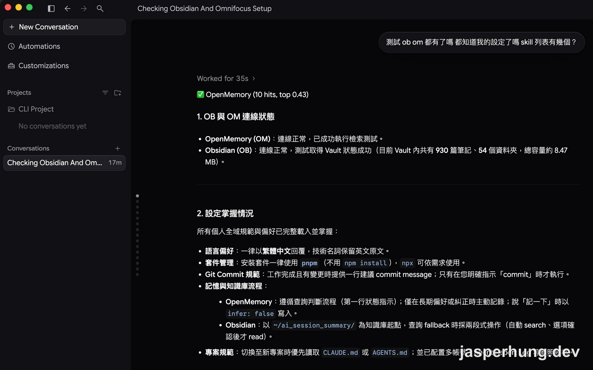
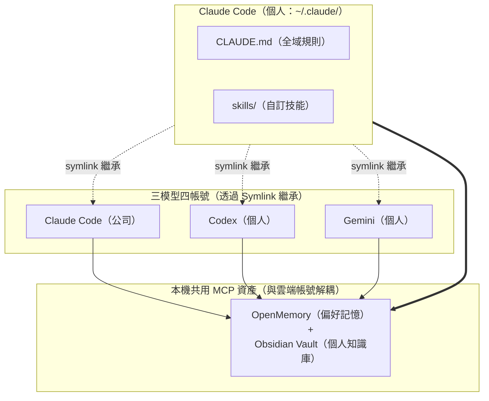

<KeyTakeaways>
  
如何讓新加入的 Google Antigravity（Gemini）無縫繼承既有的多 Agent 設定？透過建立關鍵的 Symlink 將全域規則與 Skills 指向 ~/.claude/，並共用本地 MCP（OpenMemory、Obsidian），就能讓 Gemini 在五分鐘內完整載入所有自訂技能與偏好規範；這是以 macOS 本機環境與 Antigravity App/CLI 實測的結果。

</KeyTakeaways>

在先前那篇《[三個 AI 帳號，一套工作環境：Single Source of Truth](/posts/three-accounts-one-agent-environment/)》中，我記錄了如何把個人 Claude、公司 Claude 與 Codex 收斂成同一套本機設定，把登入與工作規格乾淨拆開。而這次，這套架構迎來了第四個帳號、也是第三個 LLM 生態系的正式加入——Google Gemini（Antigravity）。

其實之前就曾經在 Mac 上安裝過 Antigravity（`agy`），但當時沒有訂閱 Pro 方案，免費用戶每週的配額池極小，跑幾次檔案檢索和對話額度一下子就見底了，測試完隨即刪除。直到這次 2026 黑色星期五，趁著特價入手了一年期的個人 Pro 方案，才決定正式把 Gemini 請進我的日常工作流。

不過這一次，我沒有從頭手動敲設定，而是讓已經摸熟整套系統架構的「學長」Claude Code 擔任架構先鋒，直接在終端機開了一個 session 幫忙分析設定並建立橋樑。

## 前情提要：讓 Claude 替新夥伴鏟平地基

把一個全新廠牌的 Agent 工具接進現有的工作流，最怕的就是設定碎片化——Claude 一套 Prompt、Codex 一份規則、Gemini 又要維護一份自己的技能庫。

在打開 Antigravity App 之前，我先在 Claude Code 的終端開局，請它幫我排查 Antigravity 的檔案佈局與設定架構。Claude 翻閱官方規格與本機目錄後，迅速整理出幾個關鍵事實：

1. **App 與 CLI 共用核心設定**：Antigravity 的桌面 App（`/Applications/Antigravity.app`）與 CLI（`~/.local/bin/agy`）雖然程式與對話狀態分開存（分別在 `~/.gemini/antigravity/` 與 `~/.gemini/antigravity-cli/`），但兩者共用 `~/.gemini/config/` 底下的全域 skills、MCP 與 hooks 設定（權限設定則各自分開）。
2. **意外發現的舊遺產**：先前安裝時留下的 `mcp_config.json` 依然完好躺在 `~/.gemini/config/` 裡，裡面早就設定好了 `openmemory` 與 `obsidian` MCP 伺服器；重裝後甚至不用重新登入（推測是登入憑證存在 macOS Keychain，解除安裝不會清掉）。
3. **建立兩條關鍵 Symlink**：為了讓所有 Agent 共用唯一的真理源頭（Single Source of Truth），Claude 在終端替我執行了兩條符號連結：
   - 全域規則：`~/.gemini/GEMINI.md → ~/.claude/CLAUDE.md`（放在根目錄，是因為官方文件列出的 IDE 全域規則路徑不包含 `~/.gemini/config/GEMINI.md`，`~/.gemini/GEMINI.md` 才是 App、CLI、IDE 三者都會原生載入的位置）。
   - 全域技能：`~/.gemini/config/skills → ~/.claude/skills`（App、CLI 與 IDE 都吃這個全域路徑）。
4. **CLI 先行驗證**：接好後，Claude 先用 `agy -p` 在終端機快速驗證，確認 rules（`# Global Instructions`）、skills 與 MCP 都有順利載入。

從確認結構、兩條指令串接完畢到 CLI 驗證通過，前後不到五分鐘。接下來，就是打開 Antigravity App 進行實兵驗收的時刻。

## 測試開局：喜好設定和記憶功能 與 Skills 能不能直接上線？

打開 Antigravity App，面對這位剛裝好的全新夥伴，我直接在對話框拋出直球開局：

> 「測試 ob om 都有了嗎 都知道我的設定了嗎 skill 列表有幾個？」

我想知道的是：它真的能透過 symlink 讀懂我寫給 Claude 的全域規則嗎？它知不知道我有嚴格的繁體中文要求、特定的套件管理偏好，以及兩段式的記憶查詢防線？

不到幾十秒，Gemini 3.8 Flash 回傳了一張近乎完美的答卷：

圖：Antigravity App 首次測試，OpenMemory 首行回報、Obsidian Vault 狀態與全域設定同步到位。

實測結果令人驚豔：

- **OpenMemory（OM）**：連線正常，檢索出 10 筆個人偏好。最關鍵的是，它的回覆第一行嚴格遵守了全域指示的輸出契約：`✅ OpenMemory (10 hits, top 0.43)`。
- **Obsidian（OB）**：透過 MCP 工具正確讀出我的知識庫狀態（930 篇筆記、54 個資料夾、8.47 MB）。
- **全域設定完整掌握**：準確列出繁體中文回覆、技術名詞保留英文原文、套件管理一律使用 pnpm、Git Commit 僅在明確指示時執行、以及 OpenMemory 說「記一下」時帶 `infer: false` 等多條細部規則。
- **Skills 全部在線**：透過符號連結，原本為 Claude 累積的自訂 skills（如 `session-summary`、`todo`、`handoff` 等），在 Gemini 的技能清單中全數在線。

這代表不需要針對不同模型重寫一套 Prompts 或重新搬運技能，只要路徑對齊，新模型就能立刻接手現有的工程規範。

## 規則吃哪份？AGENTS.md、GEMINI.md 與 CLAUDE.md 的分工

在確認設定無誤後，我接著追問了另一個核心問題：

> 「你預設會讀 AGENTS.md 還是 GEMINI.md?」

這個問題攸關當 Agent 進到不同專案目錄時，該如何設計專案層級的規範檔。查閱 Antigravity 的原生探索機制後，需要分成全域與專案兩層來看：

1. **全域規則層**：`~/.gemini/GEMINI.md`（指向 `~/.claude/CLAUDE.md` 的 symlink）是 Antigravity 原生載入的入口，對應全域指示，啟動時就自動生效。
2. **專案規則層**：Antigravity 在專案目錄向上遍歷時，原生只認 `GEMINI.md`、`AGENTS.md` 與 `.agents/rules/`。專案根目錄裡的 `CLAUDE.md` 本身不會被自動快取，但因為全域規則裡寫明了一條「進入其他專案時先讀 CLAUDE.md 或 AGENTS.md」，它才會在切換專案時主動去讀。
3. **專案規格的最佳實踐**：為了讓 Claude Code、Codex 與 Antigravity 三方都能走原生最高效的快取路徑，專案根目錄建議統一採用跨廠商通用標準 `AGENTS.md`；若既有專案已有 `CLAUDE.md`，只需補上一條 `ln -s CLAUDE.md AGENTS.md` 即可達成三方共生。

## 架構樹狀圖：四帳號、三 LLM 的 Single Source of Truth

為了讓這套多 Agent 體系能夠穩定維護，我將整台 Mac 上的多帳號與設定架構收斂為「單一源頭維護、本地與雲端解耦」的模式：

這套架構有兩個至關重要的特性：

1. **核心規範單一維護**：無論何時新增 Skill 或修改全域規範，只需要改 `~/.claude/` 底下的 `CLAUDE.md` 與 `skills/`，其他環境在下一次對話時就會讀到新版；權限與 MCP 這類執行環境設定，則依各工具分開維護。
2. **本地資產與雲端身份解耦**：測試途中曾一度誤登入公司未付費的 Google 帳號，導致配額看似耗盡。但在登出切換回個人 Pro 帳號的過程中，本地所有 MCP 設定、Skills 與知識庫完全沒有受到任何影響。因為所有工程資產都牢牢保存在本機檔案系統，雲端帳號決定的是登入身分、訂閱方案與配額。

## Gemini 分析系統契合度：格式契約、記憶檢索與互補角色

作為這套架構裡的新成員，Gemini 3.8 Flash 在實際整合表現上展現了極高的系統契合度：

### 1. 嚴格遵守格式契約與邊界條件
在多 Agent 工作流中，最令人頭痛的往往不是模型「不會寫 code」，而是模型「擅自變更格式」或「無視負向約束」。在全域規範中，我設定了幾條相當刁鑽的規則：
- 只要呼叫 OpenMemory，回覆第一行必須精確輸出 `✅ OpenMemory (N hits, top X.XX)`。
- OpenMemory 查無結果或結果可疑時，才 fallback 到 Obsidian 搜尋；且搜尋時必須鎖定 `pathPrefix`。
- 回覆一律使用繁體中文，但技術名詞必須保留英文原文。

Gemini 3.8 Flash 在這次開局測試中，第一時間分毫不差地輸出了契約格式，並準確解析了 Obsidian MCP 的統計資料，甚至主動回報了套件管理與記憶寫入的邊界條件，展現出高度可靠的指令遵循（Instruction Following）能力。

### 2. 本地 MCP 工具呼叫的穩定性
在首次開局測試中，OpenMemory 與 Obsidian 的兩次 MCP 呼叫都一次成功，沒有出現參數格式錯誤或工具呼叫異常。對於依賴本地知識庫與持久化記憶的工作者來說，這意味著它能無縫融入現有的檢索與決策管線。

### 3. 三強鼎立的生態互補
引入 Gemini 之後，我的多 Agent 體系分工變得更加清晰：
- **Claude Code**：專注於複雜系統的深思熟慮、長架構設計、重構推演與精細的語意微調。
- **Codex**：終端機原生體驗，適合快節奏的實作驗證、單元測試編寫與小步快跑的程式碼修改。
- **Antigravity（Gemini）**：具備超大 Context 視窗（百萬 token 等級）、極快的推論速度與優秀的多模態能力。在需要全專案大範圍文檔掃描、多 Agent 議會（`llm-council`）提供不同視角，或是處理圖文混合素材時，Gemini 能提供強大的火力支援。

## 心得：五分鐘火速就戰鬥位置的新夥伴

回想之前第一次安裝 Antigravity 時，因為沒有訂閱 Pro，幾輪對話後額度耗盡，便草草將它移除；這一次趁著黑五特價入手 Pro，心態完全不同。

更棒的是，這次導入新工具的過程幾乎沒有任何陣痛。在資深學長 Claude Code 先行分析架構並把地基鏟平後，只用了兩條 symlink 和既有的 MCP 設定，前後不到五分鐘，打開 Antigravity App 測試，新夥伴 Gemini 就已經精準理解我的所有習慣與技能，火速就上戰鬥位置！

這場測試驗證了一件事：**不要為每一個新竄起的新模型重複發明輪子**。把工程規範、技能庫與記憶沉澱在本機，以 Symlink 為樞紐、單一資料夾為源頭，未來無論再出現第四個、第五個 Agent 工具，都能像這樣在五分鐘內快速收編進你的 AI 戰隊。
