<KeyTakeaways>
  
把 ASCII Sharks 放進 Astro 部落格首頁，會碰到背景定位、文字可讀性、手機載入和 light mode 配色等細節。我最後保留四種鯊魚、停用彩色閃爍與格線，並用 CSS 反轉原本固定黑底的畫面；效能沒有做 benchmark。

</KeyTakeaways>

我是在 Threads 上看到 ASCII Sharks 這個專案的。幾隻 ASCII Sharks 在黑色海面游動，看起來滿有趣；我看了下原始碼，感覺 lib 不大，第一個念頭是把它放到 Blog 首頁，應該可以增加一點互動性，也不太會影響效能。

我把這個想法拿去跟 agent 討論，也先看原始碼評估它適不適合放進首頁。當時只有讀程式碼，沒有跑 benchmark，所以「不太會影響效能」只是我願意試試看的理由。把動畫放進首頁之後，真正花時間的反而是怎麼讓它跟文章一起看起來舒服：背景要鋪在哪裡、面板要多透明、亮色會不會分心，還有 light mode 為什麼變得這麼奇怪。

我看的原始專案是 [stackedlol/ascii-sharks](https://github.com/stackedlol/ascii-sharks)。GitHub 頁面在 2026 年 10 月 26 日顯示 903 顆星：

| Repo | Stars |
|---|---:|
| [stackedlol/ascii-sharks](https://github.com/stackedlol/ascii-sharks) | 903 ⭐ |

## 整頁背景：從首頁套入開始

我想，就套在首頁吧。於是加上一塊 Canvas，用 fixed 定位鋪滿首頁內容區。

這塊 Canvas 的範圍跟著 <code>&lt;main&gt;</code> 的位置和寬度走，不蓋到 topbar 和 sidebar；sidebar 收合時，<code>ResizeObserver</code> 會重新計算內容區大小。這裡也踩到一個 stacking 的細節：負的 z-index 不保證背景 canvas 一定看得到，<code>body</code> 自己的背景色仍可能把它蓋掉，所以首頁要讓 body 背景透明。

文章列表前面留一段空間，讓鯊魚有地方游；列表和浮島 banner 則放進半透明面板。我把 border 拿掉，調成 <code>bg-bg/60</code> 和 <code>backdrop-blur-sm</code>，希望海還看得見，但讀標題和摘要時不會被底下的動畫干擾。

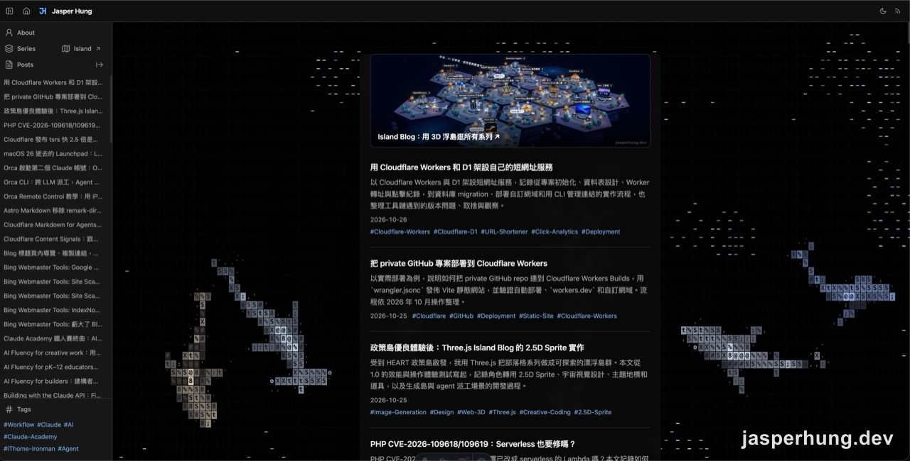

圖：第一次把海洋當成首頁整頁背景時，黑色海面和文章面板一起出現在內容區。

點擊也有一點細節。Canvas 不攔截滑鼠事件，但原作會從 window 接收 pointer event；如果使用者點到文章連結也濺出水花，互動就會跑到不該去的地方。最後讓連結、按鈕和實心面板略過水花事件，點海面才有反應。

第一輪看起來不太搭，我一度把還沒 commit 的改動清掉。後來想把首頁狀態截圖留存，只好把實作恢復，再從畫面繼續調整。重新看截圖時，我才發現鯊魚身上會閃的彩色字母很搶眼，這也是畫面看起來不搭的一個原因。

## 鯊魚一直閃彩色，影響閱讀

剛看到這個效果時滿新鮮，但放在標題和摘要後面，視線就會一直被彩色字格拉走。我想讓海洋安靜地游在背景，所以加了 <code>shimmer</code> 開關，首頁固定關閉閃色。

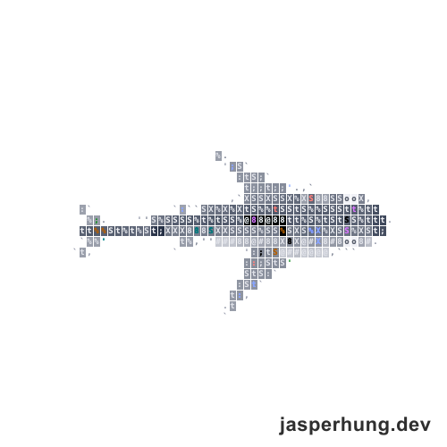

圖：classic 鯊魚開啟原版閃色後，字格裡會出現多種亮色。

關掉閃色後，鯊魚還是會因為物種不同而有色調差異。這不是同一件事：原版每個種類有自己的 RGB tint，乘在灰階亮度上；shimmer 則是額外隨機閃出 accent 色或白色。我想把兩者分開看，於是把原作的八種鯊魚各自截圖，逐隻比較體型、顏色和辨識方式。

## 八種鯊魚，逐隻看一遍

下面的個別截圖是測試頁的單隻放大畫面，格線還在；每隻的 tint 是原始碼裡的 RGB 倍率，不是 RGB 色碼。看起來只有一點點差別，乘上每格的灰階亮度後，視覺上的藍、金、紫就明顯多了。

### classic 經典款

原作沒有替它指定物種，我就叫它經典款。tint 是 (0.92, 0.97, 1.05)，看起來偏冷藍灰，外型也最像腦中熟悉的鯊魚。它留在首頁，size 倍率是 0.800。

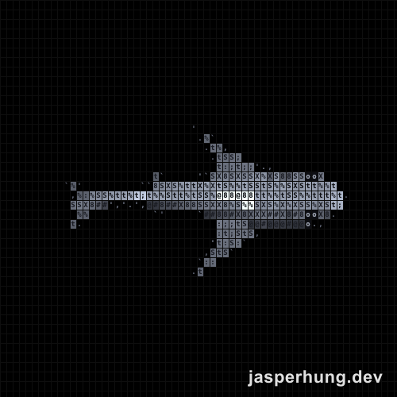

圖：classic，原作沒有指定具體物種，外型是典型的流線鯊魚。

### hammerhead 雙髻鯊

hammerhead 的頭部兩側往後彎，形成明顯的 T 字輪廓。tint 是 (0.96, 0.98, 0.90)，原作註解是青銅橄欖灰，畫面上接近中性灰。首頁最後沒有留它，因為另一種大雙髻鯊也有相近的頭型，我想留一隻代表就好。

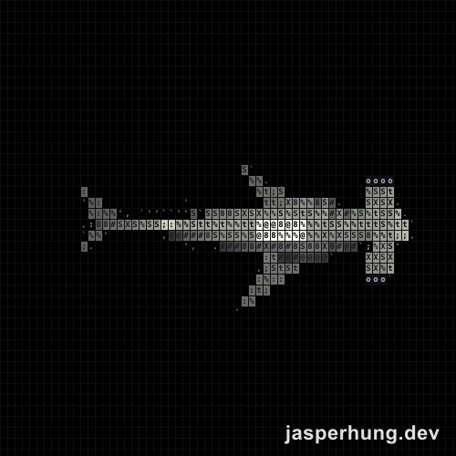

圖：hammerhead，頭部兩側往後彎，呈現雙髻鯊的輪廓。

### greathammer 大雙髻鯊

greathammer 的頭前緣比較平，中間有凹口，第一背鰭也特別高。tint 是 (0.86, 0.93, 1.02)，偏冷的板岩藍灰。兩種雙髻鯊比過之後，我選了它留下：外型和 classic 有差異，顏色也仍然在灰藍色系。首頁 size 倍率是 0.764。

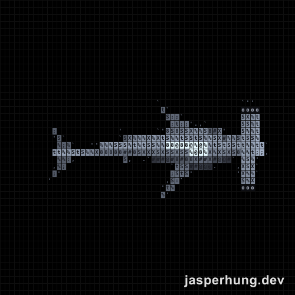

圖：greathammer，頭前緣較平，中間有凹口，第一背鰭很高。

### tiger 虎鯊

tiger 有比較方鈍的頭和粗壯身體，背上還有明顯條紋。tint 是 (1.02, 0.95, 0.84)，原作註解寫暖灰棕；放在畫面上看起來帶金色，條紋也讓牠很好認。我想要幾隻不同色調的鯊魚，所以把它留下。首頁 size 倍率是 0.728。

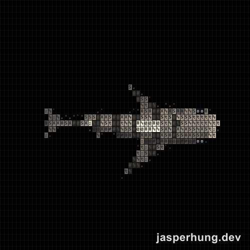

圖：tiger，背上的深色條紋是最容易辨認的特徵。

### zebra 斑馬鯊（豹紋鯊）

zebra 的身體比較短，後半段拖著長長的緞帶尾，身上也有深色斑點。tint 是 (1.08, 0.97, 0.74)，看起來偏沙黃。它的輪廓很特別；逐隻比較後，我最後沒有把它放進首頁留下的四隻裡。

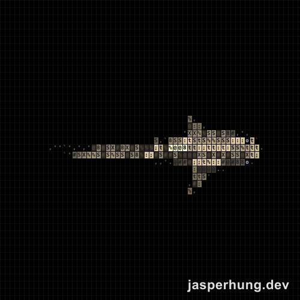

圖：zebra，身體後半接著很長的緞帶狀尾巴，身上有深色斑點。

### mako 灰鯖鯊

mako 有尖長的吻、像魚雷一樣的身體，尾巴則是新月形。tint 是 (0.78, 0.90, 1.20)，是八種裡最明顯的金屬靛藍。這個藍色和其他灰色鯊魚很好區分，所以也留在首頁。size 倍率是 0.692。

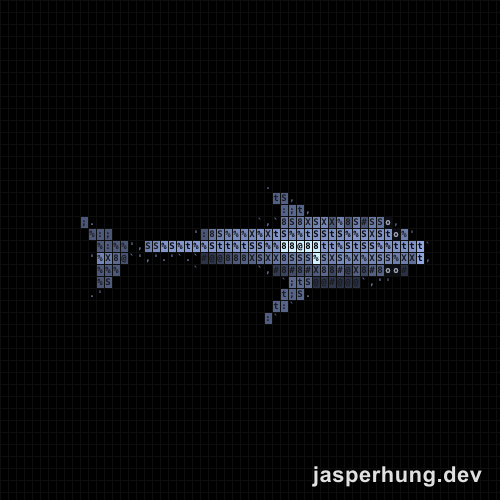

圖：mako，尖長的吻和新月形尾讓牠看起來很俐落。

### thresher 長尾鯊

thresher 的身體集中在前半，最醒目的是像鞭子一樣長的上尾葉。tint 是 (1.00, 0.90, 1.08)，原作註解是青銅帶紫，實際看起來偏粉紫。它很有特色，但和整個首頁想要的冷灰、藍、金配色不太合，最後沒有留下。

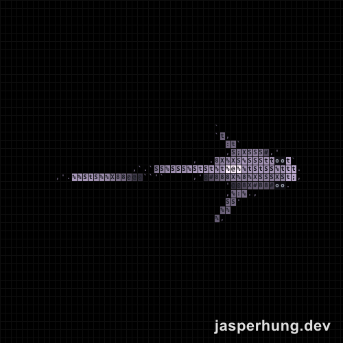

圖：thresher，身體後方有一片特別長的上尾葉。

### nurse 鉸口鯊

nurse 的頭比較寬鈍，身體扁粗，兩片背鰭都靠近後方。tint 是 (1.10, 0.96, 0.76)，偏黃褐色，看起來也有金色感。首頁已經有金色的 tiger，我想讓四隻在形狀和顏色上更容易分辨，因此把 nurse 刪掉。

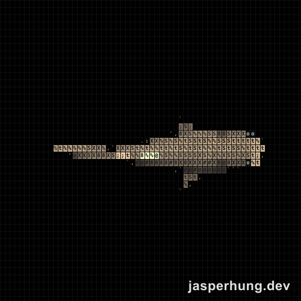

圖：nurse，頭部寬而鈍，兩片背鰭的位置比較靠後。

最後留下 classic、greathammer、tiger 和 mako：兩隻灰藍系、一隻帶金色、一隻偏藍。這不是效能測試後的最佳數量，而是我看著首頁畫面挑出來的組合。

| 首頁保留種類 | size 倍率 |
|---|---:|
| classic | 0.800 |
| greathammer | 0.764 |
| tiger | 0.728 |
| mako | 0.692 |

## 手機版不需要載入整片海

首頁背景是氣氛動畫，但手機上可用空間比較小，也沒有滑鼠游標互動。我把 Canvas 和面板樣式限制在 769px 以上，並在符合寬度時才動態載入動畫引擎；手機版連引擎 chunk 都不會下載。

我實際看過 390px 和 1280px 的頁面：手機看不到 Canvas，也沒有載入引擎檔；桌機則正常顯示動畫。這讓首頁原本的手機閱讀版面維持簡單，動畫只在有空間的螢幕出現。

## light mode 悲劇：海底寫死黑色

切到 light mode 後才發現，黑底不是外層 CSS 設定，而是 renderer 每次畫面更新時都會在 Canvas 上塗黑色。白色半透明面板疊在黑底上，整塊就變成灰色，跟 Blog 原本的白底不一致。

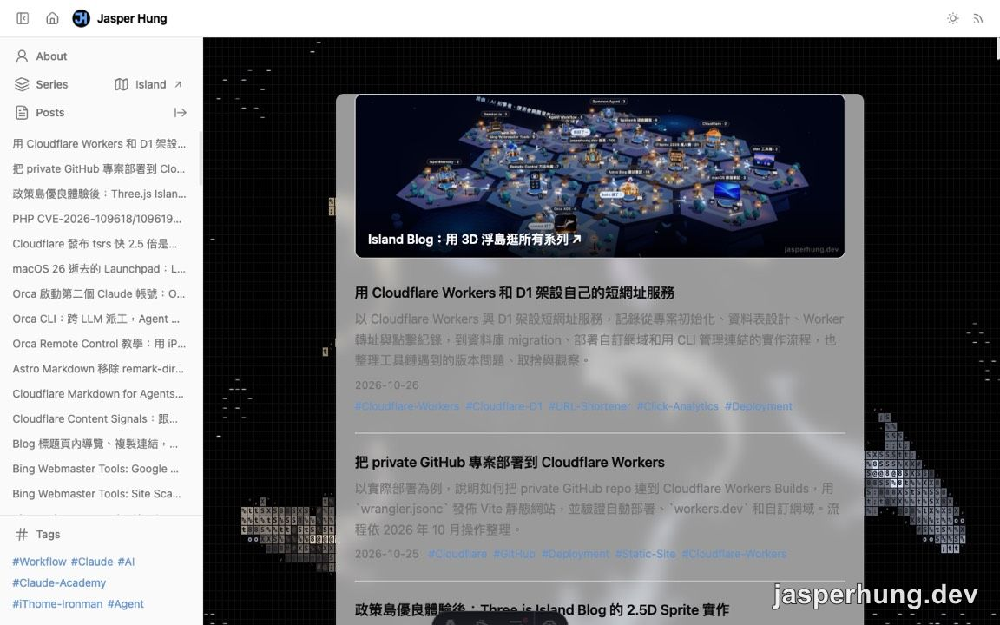

圖：CSS 反轉前，黑海透過面板的透明度影響 light mode，內容區看起來偏灰。

我先試 CSS filter：用 <code>invert(1)</code> 把黑海翻成白底，再加 <code>hue-rotate(180deg)</code> 把色相轉回來。這樣不用重寫原本以黑底設計的 renderer，鯊魚和魚群也保留了原來的色調。面板疊在白底上後，灰色問題也一起消失。

## 反轉後格線又太明顯

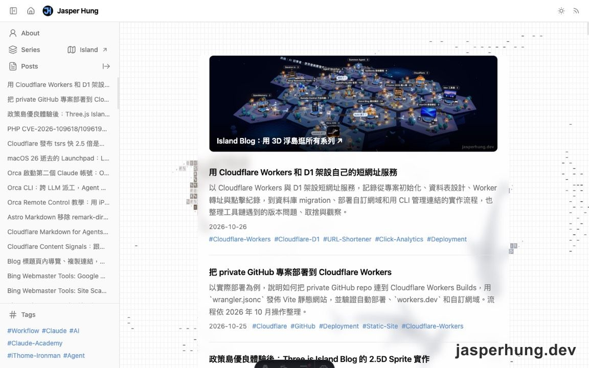

圖：黑海反轉成白底後，原本不明顯的格線變得容易注意到。

格線其實一直都在。黑底時它只是很淡的白線，幾乎看不出來；反轉到白底後，同一組線變成淺灰色，空白區又很大，視覺上就變得太明顯。最後我替 renderer 加上 <code>grid</code> 開關，在 light 和 dark mode 都把格線關掉。

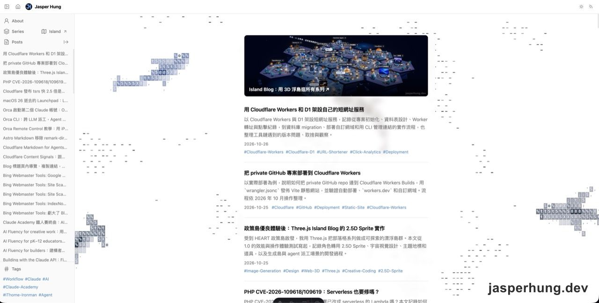

圖：關掉格線後的首頁。四隻鯊魚留在桌機背景，中央面板保留閱讀空間。

### 心得

原本以為只是把一個小動畫套進首頁，後來才發現毛玻璃也調了好一陣子。我想看得到鯊魚從面板後面游過去，又不希望背景影響閱讀；現在牠們靜靜地游，文字還是看得清楚，這個平衡我滿喜歡的。

首頁最後留下四隻：灰色系的 classic 和 greathammer 比較有經典鯊魚的感覺，所以我想留著；藍色的 mako 和偏金色的 tiger 則多一點變化，也比較容易區分。尤其 tiger 身上的條紋很明顯，一眼就認得出來。

那些小小的「-」原來都是魚，我一開始還以為是海浪 XD。點一下魚旁邊的海面，魚群會被嚇跑；附近有鯊魚時，牠有時會游過去追魚。鯊魚身上閃紅，我猜就是剛吃到魚。偶爾不看文章，只打開首頁看牠們游來游去，還滿療癒的。
