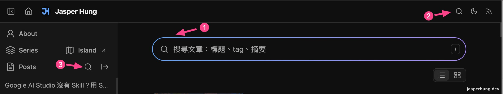
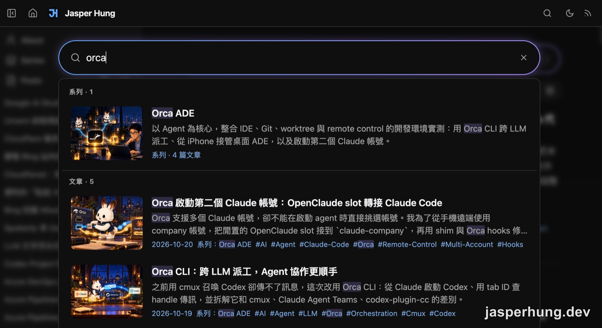

<KeyTakeaways>
  <p>如何替 Astro 靜態部落格加上站內搜尋？在 build 時像 RSS 一樣生成 search.json，搭配純函式三級字串比對，三個入口共用同一個浮動搜尋視窗，不需要 BM25 或向量資料庫；適用於百篇規模、以標題與摘要比對為主的站。</p>
</KeyTakeaways>

剛著手規劃站內搜尋時，腦中最直覺的想法很單純：既然站上已經在 build 時跑迴圈產生 `rss.xml`，是不是順手再寫一個輸出 `search.json` 的 endpoint，給前端抓取就好？原本設定的里程碑是累積到 200 篇文章再來做搜尋，但站上文章來到 110 篇左右時，自己翻查舊筆記就已經開始感到吃力，這項功能顯然不能再等。

## 類似 RSS，生成一份搜尋索引

最初的想法很單純：站上的 `rss.xml` 是 build 時對所有文章跑一個 loop 產生的，搜尋要的也是同一批文章，那就照著 RSS 的做法，再多生一份給搜尋用的索引。

這份索引不是從 `rss.xml` 轉出來的，而是跟 RSS 一樣直接讀文章資料。RSS 的欄位是為 RSS 閱讀器挑的，之後搜尋想加文章摘要、KeyTakeaways 或段落標題，RSS 裡都沒有。所以 `rss.xml.ts` 在 build 時對 `getCollection('blog')` 跑一圈輸出 RSS，`search.json.ts` 對同一份文章資料另外跑一圈，輸出搜尋要的欄位。這就是**平行投影**：

```
getCollection('blog')
       ├── rss.xml.ts       → RSS 訂閱 Feed
       └── search.json.ts   → 站內搜尋專用索引
```

兩者地位平等，各自從記憶體中的文章資料提取所需欄位。

另一個延伸問題是：搜尋索引該放哪裡？Astro 的 `public/` 資料夾適合手寫的固定靜態資產，而搜尋索引需要隨文章新增即時構建。將端點放在 `src/pages/search.json.ts`，在 build 時動態執行並輸出成靜態檔案，既享有腳本靈活性，讀者端載入體驗也與靜態檔無異。

實測將約 110 篇的 frontmatter 加上 KeyTakeaways 純文字打包進 `search.json`，原始體積約 94KB，經過 gzip 壓縮後僅剩 35KB 左右，完全不構成網路負擔。

## 第一版真的需要 BM25 嗎？三級字串比對的取捨

在規劃比對演算法時，很容易直覺聯想到 BM25 或導入 MiniSearch。但細究演算法核心，BM25 比單純字串比對多的維度是詞頻（TF）、逆向文件頻率（IDF）以及長度正規化。

目前索引包含的欄位只有標題、標籤、摘要與 KeyTakeaways，每篇資料量僅幾百字，同一個關鍵字在單篇文章中重複出現的次數極少，長度正規化也無用武之地。更棘手的是，BM25 仰賴斷詞引擎；在中文語境下，如果第一步斷詞失敗，整篇原本符合的文章就會直接漏掉。

第一版最終採用純函式實現的三級排序比對：

1. **第一優先**：標題命中（Title match）
2. **第二優先**：標籤命中（Tag match）
3. **第三優先**：摘要與 KeyTakeaways 命中（Summary match）

只要多關鍵字均為包含狀態（AND 邏輯），就判定命中。這套規則結構透明且零相依，等未來邁入全文檢索、或是出現「明明有結果卻排不上去」的明確痛點時，再升級比對引擎也不遲，底層的資料格式完全不需重寫。

## 入口越加越多：收斂成全站單一浮動搜尋視窗與互動踩坑

UI 最初只規劃在 topbar 右上角放一顆 🔍 圖示，點擊後浮出面板。實作中途，首頁想加入如同 Google 搜尋的長條輸入框，兩套介面開始出現分歧：

- 首頁輸入框尾端需要提示快速鍵 `/`。
- topbar 彈出面板尾端需要清除按鈕 `✕`。
- topbar 需要背景遮罩避免文字疊加干擾，首頁若是行內元件則不該有遮罩。

兩套輸入框若各自為政，後續的事件監聽與樣式維護將迅速膨脹。幾經嘗試後，決定將兩者合而為一：全站只保留單一個 `SearchBox` 置中浮動視窗實例，首頁的漸層長條框與 topbar、sidebar 的圖示，全數改為單純的觸發按鈕（`<button data-search-open="...">`）。按下後開啟同一個 Command Palette，利用 `data-location` 標註來源供 Umami 分析統計。最後站上有三個入口：首頁搜尋框、topbar 的搜尋圖示，以及 sidebar Posts 列的搜尋圖示。



<p class="image-caption">圖：三個入口，①首頁搜尋框、②topbar 搜尋圖示、③sidebar Posts 列搜尋圖示，開啟的都是同一個搜尋視窗。</p>

在調整這個集中式彈出視窗時，遇到了幾個值得記錄的互動陷阱：

### 1. `mouseenter` 與鍵盤選取的爭奪戰

透過鍵盤上下鍵移動選取項目時，清單會自動捲動。如果使用 `mouseenter` 監聽滑鼠懸停，當清單內容因鍵盤捲動滑過靜止的游標下方時，就會立刻觸發 `mouseenter`，把鍵盤選取的位置搶走。

解法是改用 `pointermove` 統一管理游標移動事件，只在使用者「真正移動滑鼠」時更新選中項目，讓鍵盤與滑鼠的操作焦點不再打架。

### 2. Tab 焦點穿透遮罩

搜尋視窗開著的時候按 Tab，焦點會跑到後面被模糊掉的頁面上。解法是替視窗加上 `aria-modal="true"`，並讓焦點一離開搜尋視窗，視窗就跟著關掉。

### 3. 輸入法選字 Enter 誤觸

在中文輸入法選字階段按下 Enter，常會直接觸發結果跳轉。必須透過 `event.isComposing || event.keyCode === 229` 攔截選字狀態，避免注音選字與送出動作撞在一起。

## 系列文該怎麼搜？資料投影、事實 Feed 與系列名回填

當站內有「系列文章」的概念時，一個新問題冒了出來：讀者搜尋主題時，除了單篇文章，系列卡片是不是也該被搜出來？

一開始考慮將系列資料直接塞入 `search.json`。但在定義資料邊界時，重新梳理出一個關鍵原則：

- **專用投影（`search.json`）**：針對單一功能精簡欄位，改動只對該功能負責。
- **事實 Feed（`series.json`）**：描述資料本身的客觀事實（id、title、description、posts 列表），不帶任何特定讀者的業務邏輯。

`series.json` 的定位類似 `rss.xml`，作為公開發布的系列標準資料源。搜尋功能向它拉取資料，但忽略內部文章細節，僅用來計算文章數，並與系列標題、描述進行比對。



<p class="image-caption">圖：搜尋「orca」，系列卡片排在最上面並標出篇數，下面接單篇文章，命中的字會標色。</p>

而在系列資料串接上線後，立刻發現一個搜尋盲點：搜尋「鐵人」時，文章竟然只命中 1 篇，但鐵人賽系列底下一共有 31 篇文章。

追查發現，那 30 篇文章的標題、摘要甚至 KeyTakeaways 均未直接出現「鐵人」二字，標籤寫的是 `iThome-Ironman`。面對這種中英詞彙對應，最忌諱的第一個直覺是去維護一份人工中英同義詞對照表（例如寫死 `鐵人 = iThome`），這會淪為無底洞。

解法出乎意料地輕巧：**將文章所屬的「系列名稱」作為一項客觀事實，回填至 `search.json` 的文章欄位中**。

文章命中權重中，系列名稱的權重等同於摘要（最低）。如此一來，「鐵人」這個詞直接透過系列關係擴散至所有附屬文章中；標題直接命中「鐵人」的總結文依然排在最前面，其餘 30 篇緊接在後，一併解決了語意落差，且完全沒有引入額外的推論成本。


## 心得

雖然原本預計文章達到 200 篇才啟動搜尋，但提前在 110 篇時實作，自己馬上成了第一個重度使用者。上線當天正好去參加技術社群聚會，現場有人聊到 Obsidian 與用 LLM 整理 Wiki 的做法；當下直接拿出手機打開搜尋框，輸入關鍵字瞬間拉出之前的紀錄，對著畫面開始向同行解釋流程。

這種即時反饋感非常好。這個搜尋框除了讓讀者找資料，也成了自己檢驗文章關鍵字的工具。每篇文章的 `title`、`description` 和 `KeyTakeaways` 原本就承載了高度濃縮的詞彙，透過平常的搜尋操作，能直接驗證這些濃縮字詞到底下得夠不夠精準、能不能順利帶出目標或相似主題的文章。

如果未來想進一步提升搜尋召回率，會考慮導入向量搜尋（例如使用 `Gemini Embedding 2` 進行語意向量化）。但在那之前，目前已經加入追蹤，觀察這個功能實際的使用狀況。如果經常出現查不到結果，可能有兩種原因：一是站上真的沒有讀者需要的文章，這是可以研究、補寫的方向；二是讀者想的關鍵字跟我下的不一樣，從中能知道讀者真實的說法。兩種都需要時間與數據累積才看得出來，所以先觀察一陣子，再決定值不值得為語意搜尋引進額外架構。

自己真正會頻繁使用的功能，才能在最快時間內暴露出互動瑕疵與搜尋死角。這種從自身痛點出發、逐步收斂邊界的開發過程，遠比一開始就直上複雜引擎來得踏實許多。
