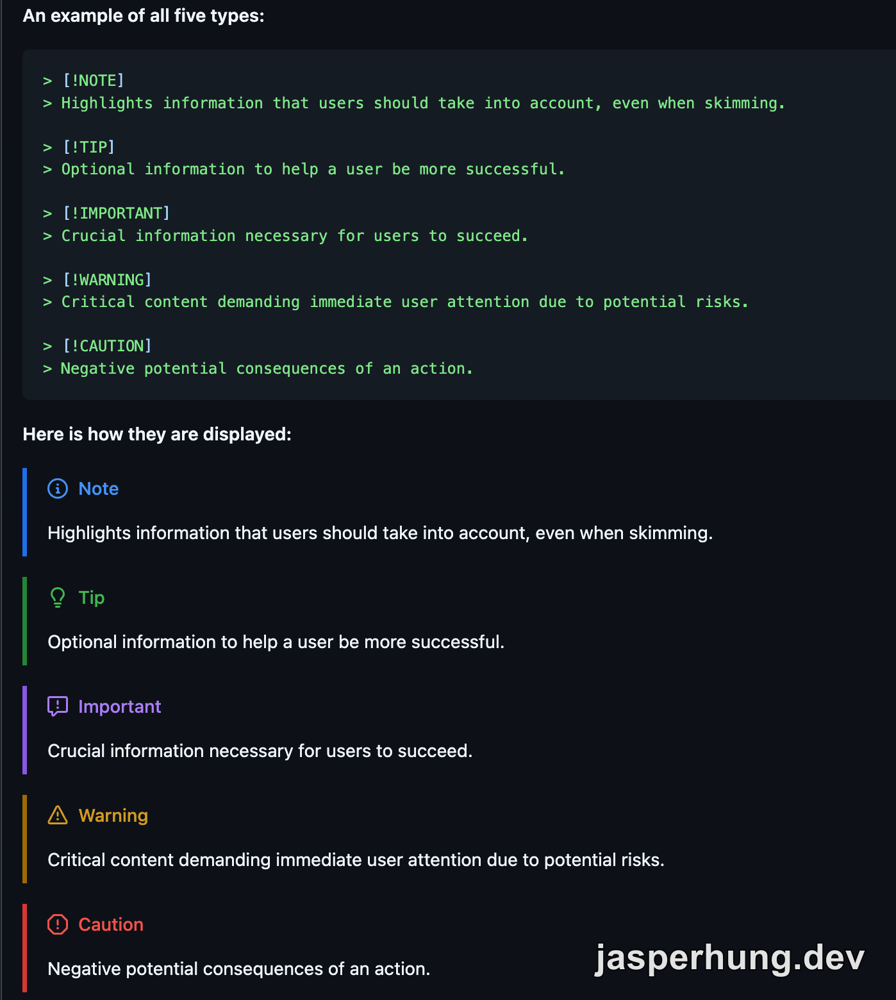

<KeyTakeaways>
  <p>原本的提示框是用 `:::{info}` 這種 remark-directive 語法寫在 Markdown 裡。這次改成 GitHub Alerts 使用的 blockquote 格式：先寫 `> [!NOTE]` 標記，再用 `>` 寫提示內容；Astro 則保留自寫 remark plugin，套用網站原有樣式。</p>
</KeyTakeaways>

整理給 Agent 讀的 Markdown（`.md`）endpoint 時，我注意到文章裡的提示框仍以 `:::{info}` 輸出。這種寫法要靠 `remark-directive` 才能解析，Astro 網站才能把它轉成醒目的提示元件；Agent 或 GitHub 直接讀到的，則是沒有通用提示框語意的 directive 標記。我開始找一種更容易跨工具辨識的 Markdown 寫法，最後選了 GitHub Alerts 使用的 blockquote 格式。

## Markdown 提示框原本用什麼語法？

文章原本用 `remark-directive` 支援的 container directive 寫提示框，例如：

```md
:::{info}
這是一段提示內容。
:::
```

`remark-directive` 會解析這種 `:::` 語法，網站再把它轉成提示框 HTML。可是提供給 Agent 閱讀的 `.md` endpoint 會留下原始標記；GitHub 也不會把 `:::{info}` 顯示成提示框。

GitHub Alerts 改用一般 Markdown blockquote，並在第一行放提示類型標記：

```md
> [!NOTE]
> 這是一段提示內容。
```

這裡的 `>` 是 Markdown 引用語法，`[!NOTE]` 則是 GitHub 和 Obsidian 用來辨識提示框的標記。兩者都支援這種寫法，不過一般 Markdown renderer 未必會把它渲染成彩色提示框。[GitHub Alerts 文件](https://docs.github.com/en/get-started/writing-on-github/getting-started-with-writing-and-formatting-on-github/basic-writing-and-formatting-syntax#alerts)；[Obsidian Callouts 文件](https://help.obsidian.md/Editing+and+formatting/Callouts)



<p class="image-caption">圖：GitHub 文件列出的 NOTE、TIP、IMPORTANT、WARNING 與 CAUTION。</p>

## 轉換放在 endpoint，還是直接改 source？

我一開始想在 build 時加一層 replace plugin，保留 source 裡的 `:::{info}`，輸出 `.md` 時再把它轉成 GitHub alert。這樣 Agent 能讀到 blockquote 格式，但 source 本身仍保留另一套 directive 語法。

我回頭想了一下，既然這個 Markdown 來源會同時被 Obsidian、Astro 和 `.md` endpoint 使用，那就把提示框語法直接改在來源，endpoint 不必再多做一次轉換。最後將 42 個 admonition 改成 `> [!TYPE]`，同時移除 `remark-directive` 和三個已不再使用的 AST utility。

這次移除的套件都和舊 directive 語法解析或序列化有關。表中的 GitHub Stars 只是遷移時的套件背景資料，不是移除依賴的依據；真正原因是改用 blockquote 後，這些 directive 套件不再被使用。

| Repo | Stars |
|---|---:|
| [remarkjs/remark-directive](https://github.com/remarkjs/remark-directive) | 428 ⭐ |
| [syntax-tree/mdast-util-directive](https://github.com/syntax-tree/mdast-util-directive) | 20 ⭐ |
| [syntax-tree/mdast-util-to-markdown](https://github.com/syntax-tree/mdast-util-to-markdown) | 141 ⭐ |
| [syntax-tree/mdast-util-to-string](https://github.com/syntax-tree/mdast-util-to-string) | 47 ⭐ |

## Astro 還是需要自己的 plugin

改成 GitHub alert 語法，不代表 Astro 會自動幫它套用 GitHub 的提示框樣式。沒有自訂處理時，`> [!TIP]` 仍然只是一般 blockquote，第一行會把 `[!TIP]` 顯示出來。

我沒有再裝一個第三方 alert renderer，而是改寫網站原本負責提示框的 remark plugin，讓它解析這種 GitHub alert 寫法。Markdown parser 會先把文章轉成 AST（抽象語法樹）：可以把它想成由標題、段落、引用等節點組成的內容結構，讓 plugin 能依照內容類型處理文章。plugin 找到以 `[!TYPE]` 開頭的引用區塊，移除標記後轉成網站原有的 `<aside class="admonition">` 結構。CSS 不必跟著改，網站上的提示框也就能維持原樣。這次拿掉的是 directive parser 依賴；負責 Astro 呈現的自寫 plugin 還留著。

## HTML 比對還抓到一個舊 parser 的誤判

改動前，我先把有 admonition 的 production HTML 存成 baseline；遷移後重新 build，再逐檔比對：28 篇輸出逐 byte 相同，另 1 篇有差異。追下去才發現，原本的 `remark-directive` parser pipeline 會把 `og:image`、`16:9`、`1:1` 裡的冒號內容當成 text directive；我們自己的 directive 處理邏輯還原文字時多插了換行和空格。換掉 parser 後，這些文字也恢復正常。

## 心得

原本我打算在 build 時加一層 replace plugin，把 `:::{info}` 轉成 GitHub alert 的 blockquote，讓 `.md` endpoint 輸出 Agent 能辨識的 Markdown。後來我直接把 Markdown source 改成 GitHub alert 語法，讓 endpoint 原樣提供 `> [!TYPE]`；Astro 網站的提示框樣式則交給自寫 plugin 處理。這樣從 source 改掉舊提示框語法，endpoint 不必再多一層格式轉換，`remark-directive` 也就能移除。
