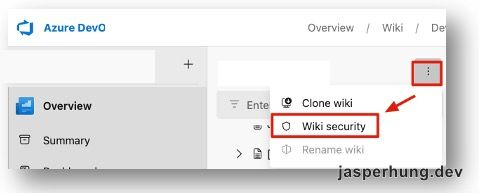
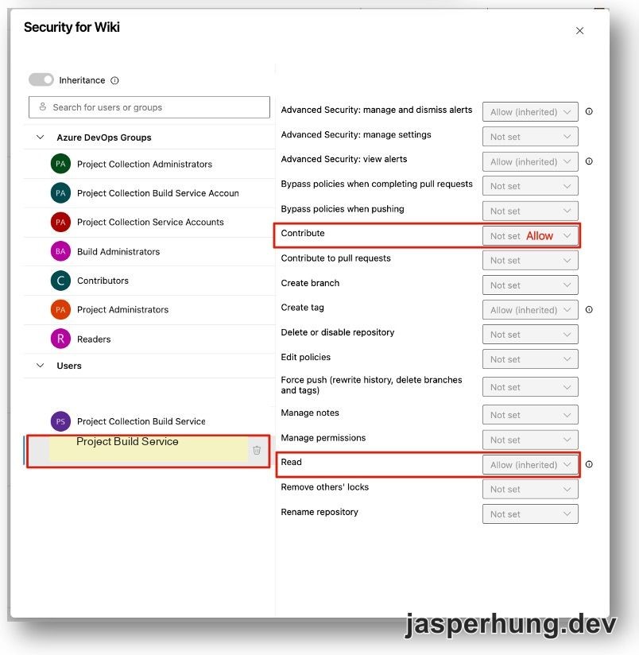
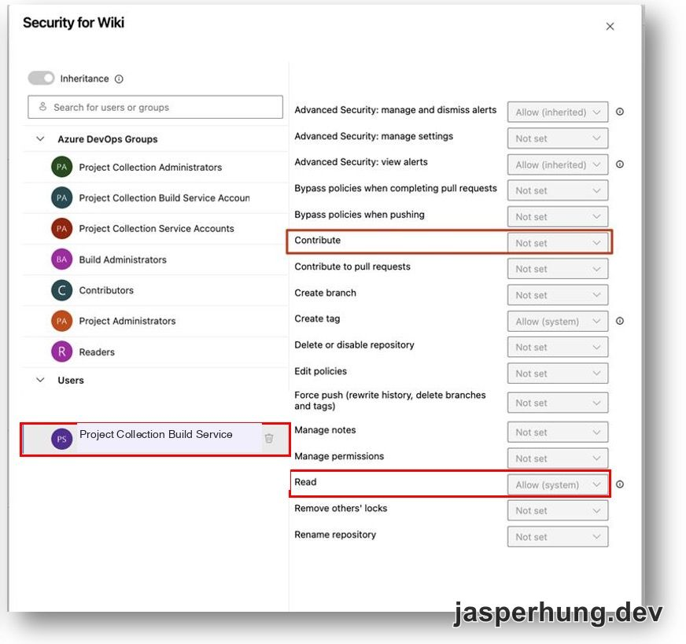

<KeyTakeaways>
  <p>Release pipeline 要把 release note 寫回 Azure DevOps Wiki 時，可以先用 <code>GET</code> 確認目標頁面是否已有內容：既有頁面讀取 response 的 <code>ETag</code>，再於 <code>PUT</code> 帶上 <code>If-Match</code>；新頁面則不帶這個 header。使用 <code>System.AccessToken</code> 時，還要在 Wiki security 授權 pipeline 對應的 Build Service identity。</p>
</KeyTakeaways>

Release pipeline 發佈版本後，除了部署程式，也會把 release note 寫回 Azure DevOps Wiki。這個自動化原本需要一個有 Wiki 寫入權的身分；改用 pipeline 的 `System.AccessToken` 後，發佈者會是 Build Service identity，不必依賴某位團隊成員的個人 PAT。

寫入既有頁面時，Wiki API 要求帶上頁面版本。`ETag`／`If-Match` 讓更新請求以讀取到的版本為依據。

## Wiki API 更新頁面前，先取得 ETag

release note 可能是第一次建立，也可能是在既有頁面上更新。程式會先對目標路徑送出 `GET`：頁面存在時，從 response header 取得 `ETag`；接著用 `PUT` 寫入內容，並把讀到的版本放進 `If-Match`。

```ts
const existingPage = await getWikiPage(coreApi, pagePath);

await createOrUpdateWikiPage(coreApi, {
  path: pagePath,
  content,
  etag: existingPage?.etag,
});
```

寫入 helper 只有在拿到 `ETag` 時才加入 `If-Match`：

```ts
additionalHeaders: {
  ...(etag ? { 'If-Match': etag } : {}),
}
```

因此兩種情況會走同一個 `PUT` endpoint，但 request header 不同：

| 頁面狀態 | 寫入方式 |
| --- | --- |
| 頁面已存在 | 先讀取 `ETag`，再以 `If-Match: <ETag>` 更新 |
| 頁面尚未建立 | 沒有 `ETag`，不帶 `If-Match`，直接建立 |

Wiki API 的 `GET` response 會回傳 `ETag`；更新既有頁面時，API 要求把頁面版本放在 `If-Match`。建立頁面成功也會回傳新 `ETag`，可供之後更新使用。[Get Page API](https://learn.microsoft.com/en-us/rest/api/azure/devops/wiki/pages/get-page?view=azure-devops-rest-7.1) [Create or Update API](https://learn.microsoft.com/en-us/rest/api/azure/devops/wiki/pages/create-or-update?view=azure-devops-rest-7.1)

release note 流程會分別處理版本資料夾頁面和該版本的 release note 頁面；兩個路徑都先讀取各自的 `ETag`，再決定 `PUT` 是否帶 `If-Match`。這樣建立新版本頁面時不需要捏造版本值，而更新已存在的頁面時則會附上讀到的版本。

程式把 `GET` 回應 `404` 的情況視為沒有既有頁面，因此 `etag` 會是空值，後續 `PUT` 不帶 `If-Match`。不過 ADO 文件也列出 Wiki 停用、刪除或使用者無權存取等 `404` 情況；排查時不能只憑 `404` 就斷定頁面一定不存在。[Get Page API](https://learn.microsoft.com/en-us/rest/api/azure/devops/wiki/pages/get-page?view=azure-devops-rest-7.1)

## Wiki 權限設在 Wiki 本身

原本自動回寫 release note 的請求收到 HTTP 400：

```text
The wiki page operation failed with message:
User does not have write permissions for this wiki.
```

這次錯誤的排查重點是找出 job token 對應的 Build Service identity，並在目標 Wiki 授權。`System.AccessToken` 代表哪個 Build Service identity，取決於 pipeline 的 job authorization scope：[Project scope](https://learn.microsoft.com/azure/devops/pipelines/process/access-tokens) 使用 Project Build Service；Project Collection scope 則使用 Project Collection Build Service。先確認 pipeline 的 scope，再到目標 Wiki 的 **Wiki security** 授權相符的 identity。

這項權限不等同於 Git repository Security 或 pipeline-level permission。[Microsoft 的 Wiki 權限文件](https://learn.microsoft.com/en-us/azure/devops/project/wiki/manage-readme-wiki-permissions?view=azure-devops)說明，可以在 Wiki 的 **Wiki security** 管理使用者和群組權限。操作步驟如下：

1. 開啟 release note 要寫入的 Wiki。
2. 從 Wiki 的 **More actions** 選單選擇 **Wiki security**。
3. 找到與 job authorization scope 相符的 Build Service identity。
4. 將 `Read` 與 `Contribute` 設為 Allow。



<p class="image-caption">圖：從 Wiki 的 More actions 開啟 Wiki security；畫面中的識別資訊已遮蔽。</p>

案例也留下兩種 scope 的權限設定畫面：



<p class="image-caption">圖：Project-scoped Build Service identity 的 Wiki 權限設定。</p>



<p class="image-caption">圖：Project Collection Build Service identity 的 Wiki 權限設定。</p>

當時的 Wiki security 同時為 Project Build Service 和 Project Collection Build Service 開啟 `Read`、`Contribute`，之後 release note 建頁成功。這是該次排查留下的設定，不代表每條 pipeline 都要同時授權兩種 identity；通常先按 job authorization scope 找到對應身分即可。若仍失敗，再檢查權限繼承、Deny 設定，以及 `GET` 使用的 Wiki 路徑是否正確。

## 驗證建立與更新

重新執行 release pipeline，確認 release note 頁面有建立或更新，並檢查回傳的頁面網址。若更新失敗，重新讀取頁面取得最新 `ETag`，確認目標內容後再送出更新；若收到相同的 Wiki 寫入權限錯誤，則回到 Wiki security 檢查 Build Service identity。

## 心得

本來以為只是讓 release pipeline 發佈後寫一頁 release note，權限調了老半天，最後才發現 Wiki 頁面裡還有自己的 **Wiki security**。再加上更新既有頁面要先取得 `ETag`，`PUT` 時帶上 `If-Match`，看起來簡單的回寫，設定和 API 各有一套規則。

好在最後成功讓 pipeline 用 `System.AccessToken` 寫回 Wiki。以後其他 pipeline 要留 log 或執行紀錄，也可以沿用這個方式，不必拿團隊成員的 PAT 當發布者。

相關文章：[用 System.AccessToken 移除 PR reviewer](/posts/azure-pipelines-system-access-token-remove-reviewer/)、[定時彙整 Active PR 審查進度到 Slack](/posts/azure-pipelines-system-access-token-cross-repo-prs/)。
