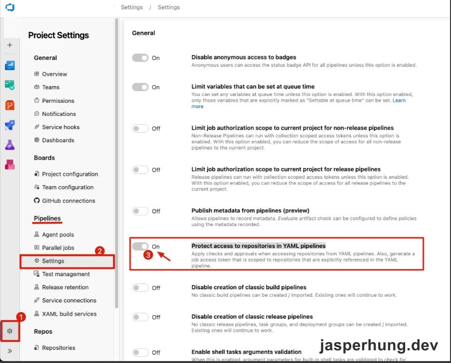

<KeyTakeaways>
  <p>這條排程在平日 09:00、14:00、16:00（UTC+8）讀取一個設定 repo 的 Active PR，排除 Draft，再把每個 PR 的 Approve 票數和兩人門檻貼到 Slack。成員能一眼看出哪些 PR 已有人審閱，比較容易點開接續 review，降低判斷和開始審查的心智負擔。pipeline 將 <code>System.AccessToken</code> 傳給 script，以 Build Service identity 呼叫 Azure DevOps API；程式可以擴充成查多個 repo，但團隊建議每個通知流程維持一個 repo 設定。</p>
</KeyTakeaways>

團隊維護多個 repository，PR review 的通知分散在不同地方、不同時間出現。大家很難快速看出目前還有多少 PR 等待審查，也不容易知道每個 PR 距離合併所需的核准數還差多少。我想把這些資訊固定整理到 Slack，讓團隊有一份定時更新的審查清單。

## 在固定時段整理 Active PR

這條 CI pipeline 在平日 09:00、14:00、16:00（UTC+8）執行，並只從指定的開發分支排程。它呼叫 TypeScript script，查詢設定好的 repository 中狀態為 Active 的 PR，再排除 `isDraft` 不為 `false` 的項目。留下來的 PR 依 PR ID 排序，讓每次 Slack 摘要的排列穩定。

每個 PR 會列出目前的核准數和團隊採用的兩人門檻，例如：

```text
1. [1/2] PR title A
2. [0/2] PR title B
3. [2/2] PR title C
```

`[1/2]` 表示目前有一個 reviewer 投下 `Approve`，門檻是兩個核准；換算後還差一個。`[0/2]` 表示尚未收到核准，`[2/2]` 則已達到這份摘要採用的核准數。訊息中的 PR 標題會連回 Azure DevOps，團隊可以直接前往查看。

核心程式會先向 Azure DevOps 取得 Active PR，排除 Draft，再把每個 PR 的核准數整理成 Slack 連結。以下節錄主要流程；repository、URL 和 Slack channel 都改用設定值，不含內部識別資訊：

```ts
const [err, resPRs] = await to<GitPullRequest[], Error>(
  gitApi.getPullRequests(
    REPO_ID,
    { status: PullRequestStatus.Active },
    PROJECT
  )
);

if (err || !resPRs) return;

const filteredPRs = resPRs
  .filter(pr => pr.isDraft === false && !!pr.pullRequestId)
  .sort((a, b) => (a.pullRequestId ?? 0) - (b.pullRequestId ?? 0));

if (filteredPRs.length === 0) return;

const slackMsg = filteredPRs
  .map((pr, index) => {
    const url = `${ORG_URL}/${encodeURIComponent(PROJECT)}/_git/${REPO_NAME}/pullrequest/${pr.pullRequestId}`;
    const approveCount = pr.reviewers?.filter(reviewer => reviewer.vote === 10).length;

    return `${index + 1}. [${approveCount}/2] <${url}|${pr.title}>`;
  })
  .join('\n');

await sendSlackMessage(SLACK_CHANNEL, slackMsg);
```

這段把 merge 門檻 `2` 固定放在訊息格式中，和上面說明的 `[核准數/2]` 相同。實際 script 另有 token、connection 與錯誤 log 設定；排程 YAML 將 `System.AccessToken` 傳入 `AZURE_DEVOPS_TOKEN`，供前面的 Git API connection 使用。

程式目前只讀取一個 repo 設定。技術上可以把設定擴充成多個 repo，但團隊建議每個通知流程維持一個 repo；文章依照這個做法呈現，不把多 repo 擴充寫成推薦設定。單一 repo 的 Slack 訊息以 PR 為主，不需要額外再按 repo 分組。

## 為什麼要顯示核准進度？

script 只計算 reviewer vote 為 `Approve` 的人數，再用固定的 `2` 作為分母。把這個進度放進 Slack，成員不用先逐一打開 PR 才知道有沒有人審過。看到 `[1/2]`，就知道已有一位 reviewer 投下核准；這能降低點開 PR 的判斷成本，讓成員更容易先看已有審查進度的 PR，接續推進 review。

這裡的 `/2` 是團隊摘要採用的兩人核准目標，程式把它固定寫在訊息格式中；branch policy 若調整，顯示門檻也要同步更新。PR 實際能否完成仍由 Azure DevOps 的政策檢查決定。

當篩選後沒有需要 review 的 PR，script 會結束，不另外送出空白 Slack 訊息。這樣排程照常執行，但頻道只會在有待處理項目時收到摘要。

## 用 System.AccessToken 以 pipeline 身分查詢

排程 job 把 Azure Pipelines 的 `System.AccessToken` 映射到 script 使用的環境變數：

```yaml
- script: pnpm exec-ts ./scripts/git/get-active-prs.ts
  displayName: 'Get Active PRs'
  env:
    AZURE_DEVOPS_TOKEN: $(System.AccessToken)
```

script 讀取 `AZURE_DEVOPS_TOKEN` 後，透過 Azure DevOps Node API 呼叫 [Get Pull Requests REST API](https://learn.microsoft.com/en-us/rest/api/azure/devops/git/pull-requests/get-pull-requests?view=azure-devops-rest-7.1)，查詢指定 repository 的 Active PR。`System.AccessToken` 讓 pipeline 使用 job 對應的 Build Service identity，不需要把團隊成員的個人 PAT 放進排程設定。[Microsoft 的 job access token 文件](https://learn.microsoft.com/azure/devops/pipelines/process/access-tokens)說明 token 的 scope 和 Build Service identity 如何決定。

這個 identity 仍須有讀取目標 repository 的權限。Project-scoped job 要確認 `{Project} Build Service` 的 repository `Read` 權限；Collection-scoped job 則檢查 `Project Collection Build Service`。權限應授予實際 job 使用的 identity，並以需要讀取的 repository 為範圍。[Microsoft 的 Git permissions 參考](https://learn.microsoft.com/en-us/azure/devops/organizations/security/permissions)列出 repository 的 Read 權限。

## 跨 repo 查詢還會受到 YAML repository protection 限制

目前這條 Active PR 排程依團隊建議只查一個設定 repo。原本的跨 repo 查詢問題則發生在另一段會讀取多個 repository 的 PR 流程：自己的 repo 查詢成功，其他 repo 回傳 `Failed to fetch PRs: null`。排查時找到 **Project settings → Pipelines → Settings → Protect access to repositories in YAML pipelines**。這項保護會限制 YAML pipeline job access token 可存取的 repository；原案例將它關閉後，先前失敗的查詢才成功。



<p class="image-caption">圖：Project settings 中的 Protect access to repositories in YAML pipelines 設定；專案與組織識別資訊已遮蔽。</p>

關閉保護是原案例驗證過的 workaround，但會放寬 YAML pipeline 對 repository 的存取限制。若確實要讓一個 job 查詢多個 repo，可以保持保護開啟，明確宣告需要的 repository resource，並在 job 的 `uses.repositories` 列出 alias；Build Service identity 仍要在每個目標 repo 有 `Read` 權限：

```yaml
resources:
  repositories:
    - repository: repoToQuery
      type: git
      name: ProjectName/RepositoryName

jobs:
  - job: queryPullRequests
    uses:
      repositories:
        - self
        - repoToQuery
    steps:
      # 呼叫 PR API 的步驟
```

[Microsoft 的 repository protection 文件](https://learn.microsoft.com/en-us/azure/devops/pipelines/security/secure-access-to-repos)說明 YAML pipeline 如何限制 repository 存取；`resources.repositories` 與 [`uses.repositories`](https://learn.microsoft.com/en-us/azure/devops/pipelines/yaml-schema/jobs-job-uses?view=azure-pipelines)則用來明確列出 job 要使用的 repository。這個多 repo 設定是延伸情境；目前的 Active PR 摘要仍照團隊建議，一個通知流程設定一個 repo。

原始截圖裡，限制 job authorization scope 到目前 Project 的選項也處於 Off。因此，「關閉 repository protection 後查詢成功」只代表當時那組 scope 和 repository 權限下的結果，不能推論跨 Project 存取只要關閉這一項就會成立。

## 讓審查進度有固定的入口

這個摘要解決的是可見度和開始審查的成本：review 通知照常從各自的 PR 流程產生，而 Slack 定時提供一份 Active PR 清單，讓成員看到哪些 PR 已有人 review、目前進度到哪裡。看見已有審查進度的 PR，成員更容易點開接續處理，減少拼湊通知狀態的心智負擔，也讓 PR review 更快往前推進。

`System.AccessToken` 是這個流程的認證方式；排程、PR 狀態篩選和核准數格式則決定摘要何時出現、包含哪些項目。把這些責任分清楚，後續要調整排程或審查門檻時，就能知道應修改 pipeline 設定還是摘要 script。

下一篇會看如何用 `System.AccessToken` 觸發另一條 pipeline：[Azure Pipelines 觸發另一條 Pipeline 的權限設定](/posts/azure-pipelines-system-access-token-trigger-pipeline/)。
