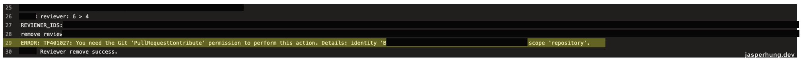
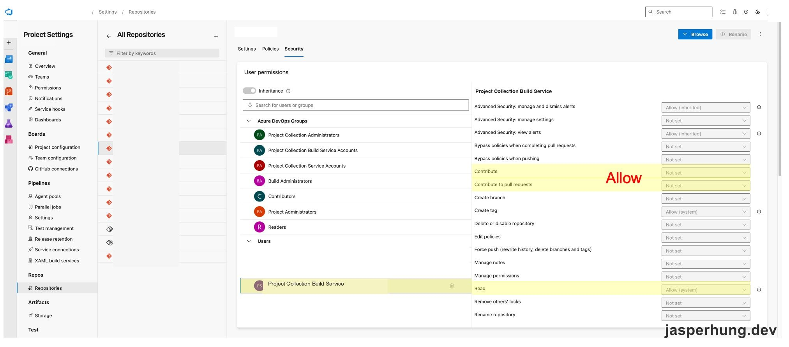

<KeyTakeaways>
  <p>團隊用一條週一到週五凌晨執行的 pipeline 掃描 Draft PR，並移除尚未準備好接受審查的 reviewer 指派，讓審查清單集中在目前需要處理的 PR。這條 pipeline 以 <code>Project Collection Build Service</code> 的 <code>System.AccessToken</code> 呼叫 Git API；若遇到 <code>TF401027</code> 與 <code>PullRequestContribute</code>，要檢查這個 identity 在目標 repository 的權限。原案例開啟 Read、Contribute、Contribute to pull requests；其中錯誤直接指出的是最後一項。</p>
</KeyTakeaways>

當時團隊的 Pull Request（PR）審查清單裡，有人會先把自己的 PR 標成 Draft，表示內容還沒準備好接受審查；但 reviewer 指派仍留在 PR 上。有些 Draft PR 放了好幾天沒有更新，reviewer 每次看清單都得再辨認哪些現在不用處理。我想解決的不是 PR 數量本身，而是這些未準備好的 PR 讓每個人都多了一層判斷，增加心智負擔。

## 讓 Draft PR 暫時離開審查清單

我的做法是一條固定排程的 CI pipeline，在週一到週五凌晨 00:00 執行。它會讀取 repository 裡的 PR 清單、找出 Draft PR，再移除這些 PR 上的 reviewer 指派。負責呼叫 Git API 的身分是 `Project Collection Build Service`，認證使用 pipeline job 的 `System.AccessToken`，不需要保存某位團隊成員的個人 PAT。

這樣 reviewer 打開清單時，就能把注意力放在目前需要審查的 PR。等 PR 作者把 Draft 轉回可審查狀態，團隊流程會自動把 reviewer 加回來；reviewer 不必在 PR 暫停期間一直看著那張卡，也不會因為 reviewer 名單被清理就遺失後續審查安排。

## System.AccessToken 已經帶上，為什麼移除 reviewer 還是失敗？

自動化的 API request 已帶上 `System.AccessToken`，仍收到 `TF401027`：

> You need the Git 'PullRequestContribute' permission to perform this action.



<p class="image-caption">圖：API 呼叫已通過身分驗證，但目前的 Build Service identity 沒有執行 reviewer 操作所需的 repository 權限。</p>

這類錯誤很容易讓人先懷疑 token 有沒有傳入。這裡真正缺的是授權：token 代表的身分已經被辨認出來，但該身分在目標 Git repository 沒有足夠權限。

## 先確認 job token 代表哪個 Build Service identity

Azure Pipelines 會為 job 建立 job access token。token 能做什麼，取決於兩層設定：pipeline 的 job authorization scope，以及 Build Service identity 在目標資源上的權限。[Microsoft 的 job access token 文件](https://learn.microsoft.com/azure/devops/pipelines/process/access-tokens)說明，scope 可以限制在目前 Project，或擴大到整個 Project Collection。

因此，設定 repository 權限前，先確認這條 pipeline 的 job authorization scope：

| Job authorization scope | 通常對應的 Build Service identity |
| --- | --- |
| Project scope | `{Project} Build Service ({Organization})` |
| Project Collection scope | `Project Collection Build Service ({Organization})` |

如果 pipeline 是 Project-scoped，卻把權限加給 Collection-scoped identity，job token 仍然不會因此取得該權限。反過來也一樣。實際顯示名稱可能依組織與專案名稱不同，請在權限頁確認 identity 和 job scope 相符。

呼叫 script 也要把系統變數明確映射進環境變數，例如：

```yaml
- bash: |
    curl --fail --request DELETE \
      --header "Authorization: Bearer $SYSTEM_ACCESSTOKEN" \
      "$REVIEWER_API_URL"
  env:
    SYSTEM_ACCESSTOKEN: $(System.AccessToken)
    REVIEWER_API_URL: $(ReviewerApiUrl)
```

這段只示範 token 的傳遞方式；實際 API URL、PR、repository 與 reviewer 參數要由 pipeline 自己提供。若 API 回報的是明確的 permission 錯誤，就接著檢查 token 代表的 identity 在目標資源上的權限。

## 在目標 repository 開啟 PullRequestContribute

這次缺少的是 Git 的 `PullRequestContribute`。它控制 repository 中 PR 的貢獻操作；Microsoft 的[權限參考](https://learn.microsoft.com/en-us/azure/devops/organizations/security/permissions)列出 Git repository 權限與其用途。原始案例的處理方式是在 repository security 為 Project Collection Build Service 開啟三項權限：

1. 到 **Project settings → Repos → Repositories**。
2. 選擇 PR 所在的 repository，再開啟 **Security**。
3. 找到與 job authorization scope 相符的 Build Service identity。
4. 對該 identity 設定 `Read`、`Contribute`、`Contribute to pull requests`。



<p class="image-caption">圖：在目標 repository 的 Security 頁面調整 Build Service identity 權限；畫面中的組織與專案識別資訊已遮蔽。</p>

原案例開啟三項後，移除 reviewer 成功。這是有效的實測設定，但不表示每個 reviewer 操作都要一併授予三項。錯誤訊息直接指出 `PullRequestContribute`；`Contribute` 的範圍更廣，應先確認它是否已由其他群組繼承，或是否是 pipeline 的其他 Git 操作所需，再決定要不要新增。

## 從 Draft 到可審查狀態，驗證整個流程

權限調整後，先用一筆測試 PR 驗證排程 job 能移除 reviewer，確認 log 不再出現 `TF401027`，Draft PR 上的 reviewer 指派也已清除。接著將 PR 轉回可審查狀態，確認團隊原有流程會把 reviewer 加回來。這兩個狀態都確認後，才算驗證了「暫停時不佔審查注意力、準備好後仍回到審查流程」的完整做法。

如果移除步驟仍失敗，依序核對：

- job 實際使用 Project 還是 Project Collection scope；
- 被授權的 identity 是否與 scope 相符；
- 權限是否設在 PR 所屬的 repository；
- `PullRequestContribute` 是否為 Allow，且沒有被更高層級的 Deny 覆蓋。

reviewer 變更可以用 Azure DevOps 的 [Delete Pull Request Reviewer REST API](https://learn.microsoft.com/en-us/rest/api/azure/devops/git/pull-request-reviewers/delete?view=azure-devops-rest-7.1) 操作。API 使用 `System.AccessToken` 只解決「以誰呼叫」；repository security 則決定「這個身分能不能做」。

## 心得

這套排程讓團隊不必每天逐筆確認哪些 PR 還是 Draft，也不用為尚未準備好的 PR 保留 reviewer 指派。背後的關鍵是讓 pipeline 以自己的 job token 執行 reviewer 清理，再把 `Project Collection Build Service` 在目標 repository 上需要的權限設正確。遇到 `TF401027` 時，不必換成個人 PAT；沿著錯誤指出的 `PullRequestContribute` 檢查 Build Service identity，就能讓自動化完成它該做的工作。

下一篇會看 `System.AccessToken` 呼叫 Wiki API 建頁時，為什麼 Git repository 權限設定好了仍會收到寫入權限錯誤：[Azure Pipelines 用 System.AccessToken 建立 Wiki 頁面](/posts/azure-pipelines-system-access-token-create-wiki/)。
