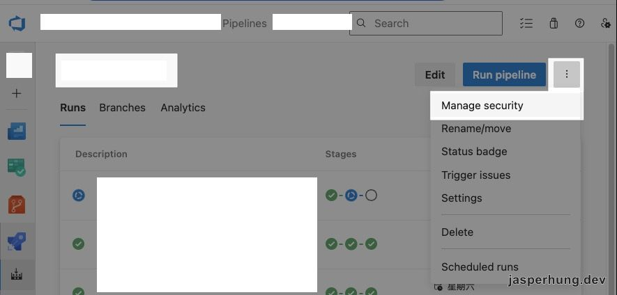
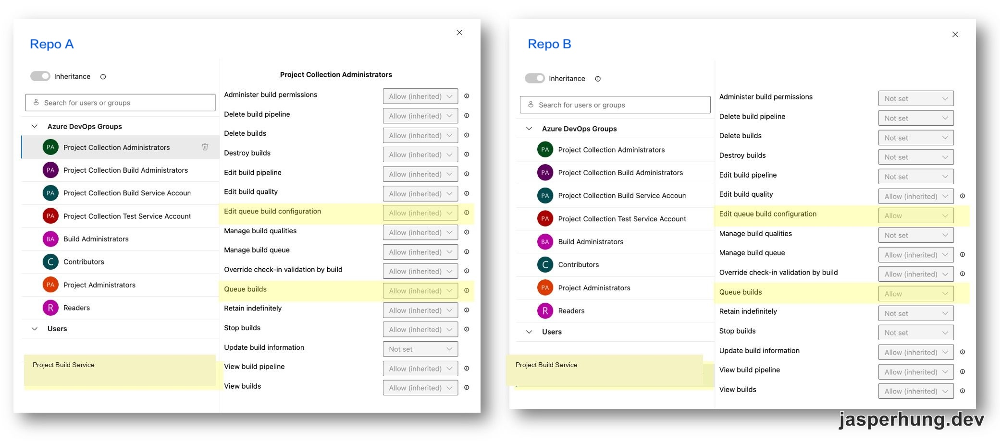

<KeyTakeaways>
  <p>用 <code>System.AccessToken</code> 呼叫 Azure DevOps Build API queue 另一條 pipeline 時，<code>The repository … could not be retrieved</code> 可能是 pipeline security 權限不足。先依 job authorization scope 找出正確的 Build Service identity，再確認目標 pipeline 的 <code>Queue builds</code>。原案例也在來源與目標 pipeline 授予 <code>Edit queue build configuration</code>；Microsoft 將它用於 queue-time variables 與自由文字參數，是否需要應依實際傳入的 queue 參數判斷。</p>
</KeyTakeaways>

Azure Pipelines 的 Build REST API 可以讓一條 pipeline 排入另一條 pipeline 的執行。這次我們用它把 Web 發版和 Android App 打包流程接起來：Web 發版完成後，觸發 Android pipeline，把這次的 Web 版本打包進 Android App。Android App 由另一個團隊負責，打包時間得配合 Web 發版；過去每次都要確認版本狀態、協調時間，再把交接資訊傳給對方。

我們約定好發版時間，確認 Android 團隊目前可以接手後，就能從 Web pipeline 發版並觸發 Android pipeline，讓對方接續處理打包。我們仍會發 PR 請 Android 團隊審核，審核通過後再進行後續打包。這條 CI 串接減少了兩邊來回確認的負擔，也保留了對方的審核步驟。

來源 pipeline 使用 `System.AccessToken` 觸發另一個 repository 的 pipeline，以 pipeline 的 Build Service identity 授權，不必保存個人 PAT；請求卻得到：

```text
The repository … could not be retrieved.
Verify the name and credentials being used and permissions.
```

這段訊息看起來像 repository 不存在或 Git 權限不足，但排查結果是在 Pipeline 的 **Manage security** 授權 Build Service identity 後，觸發才成功。使用 `System.AccessToken` 不等於自動取得 queue pipeline 的權限；API 仍會依 token 身分檢查 pipeline-level permission。

## 確認 token 對應的 Build Service identity

job access token 對應哪個身分，取決於 job authorization scope。[Microsoft 文件](https://learn.microsoft.com/azure/devops/pipelines/process/access-tokens)說明兩種常見 scope：

| Job authorization scope | 要檢查的 identity |
| --- | --- |
| Project scope | `{Project} Build Service ({Organization})` |
| Project Collection scope | `Project Collection Build Service ({Organization})` |

先確認來源 pipeline 的 scope，再到 Pipeline security 設定相符的 identity。不要只因為錯誤訊息提到 repository，就把權限加到另一個同名帳號或無關的 Git repository。觸發 Build API 時還要確認 request 指向的 project、pipeline definition 和目標 pipeline 都正確。

原始案例使用的是 Project-scoped `{Project} Build Service`；截圖保留了 `Project Build Service` 這個身分類型，專案與組織名稱已遮蔽。如果目前 pipeline 改用 Project Collection scope，就要依 scope 找到對應的 Collection Build Service identity，不要照抄案例的帳號名稱。

## 在 Manage security 授權 Queue builds

打開來源 pipeline 和目標 pipeline 的 **Manage security**，找到與 job token 對應的 Build Service identity。原始案例在兩條 pipeline 上都確認以下權限可用：

### Permission

1. `Edit queue build configuration`：控制 queue-time variables 與自由文字 runtime parameters。[Microsoft 的說明](https://learn.microsoft.com/en-us/azure/devops/release-notes/2024/pipelines/sprint-237-update)列出這項權限涵蓋的設定範圍。
2. `Queue builds`：允許 identity 將新的 run 排入執行，是排入目標 pipeline 所需的核心權限。[Queue a build REST API](https://learn.microsoft.com/en-us/rest/api/azure/devops/build/builds/queue?view=azure-devops-rest-7.1)說明如何以 API 建立新的 build。
3. 原案例在來源和目標 pipeline 都確認這兩項權限為 `Allow`，並驗證觸發成功。若請求沒有修改 queue-time variables 或自由文字參數，可以先只授予 `Queue builds` 測試；確認 API 確實需要調整這些值時，再授予 `Edit queue build configuration`。



<p class="image-caption">圖：從 pipeline 管理頁面開啟 Manage security；組織、專案與 pipeline 名稱已遮蔽。</p>



<p class="image-caption">圖：Repo A 與 Repo B 的 pipeline 都要確認 Edit queue build configuration 和 Queue builds 權限有效（Allow）。Repo A 是繼承的 Allow，Repo B 則是明確設定為 Allow。</p>

原案例的兩個 pipeline 都確認有可用權限，不代表所有拓樸都必須一律在兩邊明確設定相同權限。實作時先確認錯誤發生在哪個 pipeline definition 的 security check；只授予該流程真正需要的 identity 和 permission。

## 以一次 pipeline run 驗證

更新權限後，從來源 pipeline 重新執行觸發流程，確認目標 pipeline 出現在 Runs，並檢查傳入的 branch、parameters 與 variables 是否正確。若仍出現 repository retrieval 錯誤，再核對：

- 來源 job 的 `System.AccessToken` 確實映射到 API request；
- Build Service identity 和來源 job scope 相符；
- 權限加在呼叫所涉及的 pipeline definition，而不是只加在 repo；
- `Queue builds` 沒有被 Deny 或更高層級的設定覆蓋；
- 目標 pipeline 所在 Project 和 pipeline ID 與 request 相符。

## 心得

觸發其他 pipeline 是跨越 pipeline definition 的操作，所以就算 token 已經能讀取 repository，也不代表它能 queue build。這次錯誤文字把排查方向帶向 repository；真正有效的線索是比較 pipeline security 的 Build Service 權限。使用 job token 時，先辨認 identity，再到被操作的 pipeline 檢查 `Queue builds`，比改用個人 PAT 更容易追蹤，也能清楚限定自動化的權限。

這四篇都在處理同一個原則：`System.AccessToken` 提供 pipeline 自己的身分，實際可操作範圍則由 job scope 和目標資源的權限共同決定。可從[移除 PR reviewer](/posts/azure-pipelines-system-access-token-remove-reviewer/)或[定時彙整 Active PR 審查進度到 Slack](/posts/azure-pipelines-system-access-token-cross-repo-prs/)看另外兩種自動化案例。
