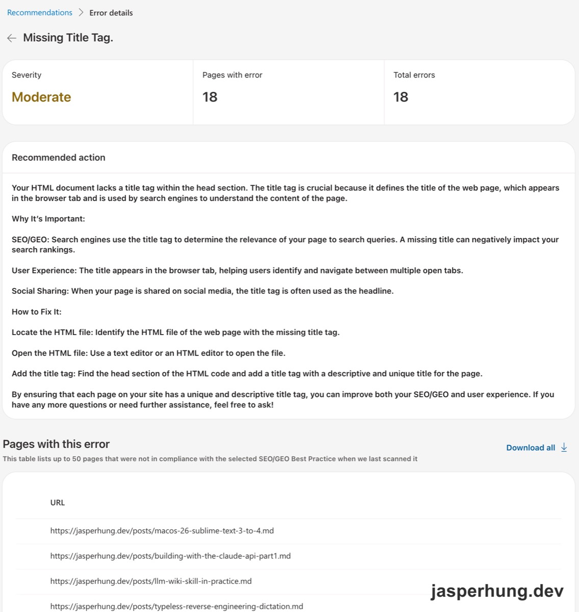
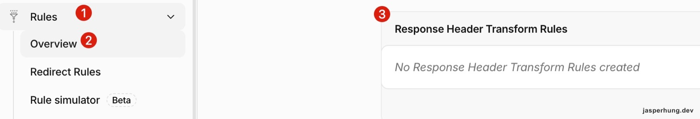
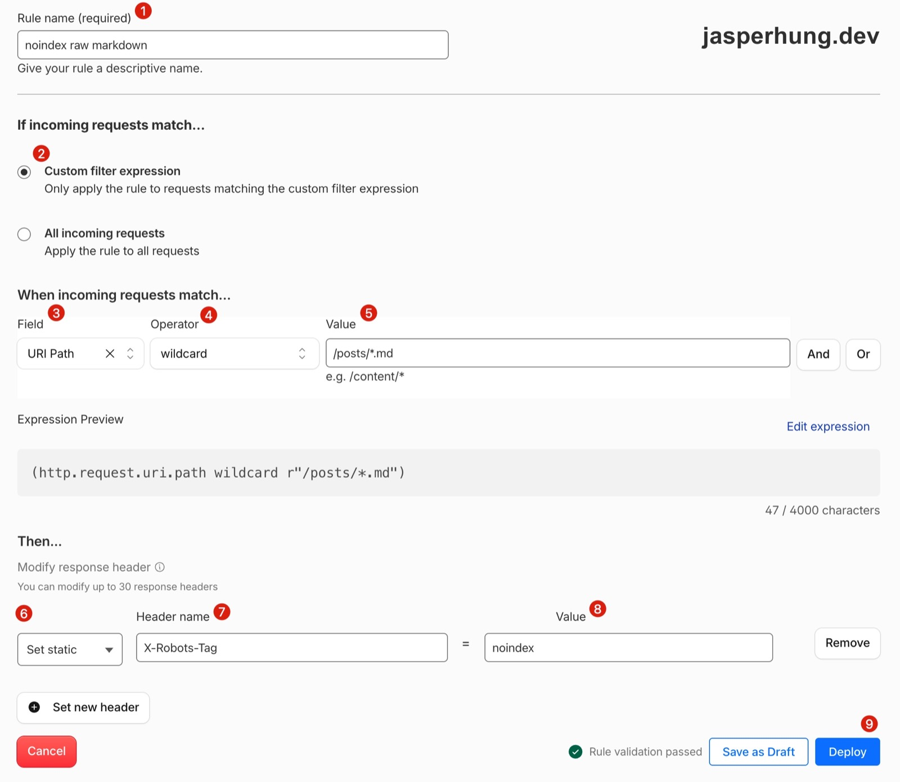
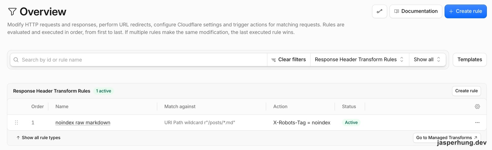

<KeyTakeaways>
  <p>Bing 回報 Missing Title，其實是 raw markdown 端點被誤判為缺少標籤的 HTML？利用 Cloudflare Response Header Transform Rules 注入 <code>X-Robots-Tag: noindex</code>；適用於使用 GitHub Pages 等無法自訂回應標頭的靜態託管環境，且不影響 AI 爬蟲直接抓取內文。</p>
</KeyTakeaways>

Bing Webmaster Tools 的 Recommendations 多了一項 Moderate 的 Missing Title Tag：18 個頁面、18 個錯誤。清單裡的網址都以 `.md` 結尾，直覺以為是哪次發布漏掉了 `<title>` 標籤，原本預期五分鐘內修完模板就能收工。



<p class="image-caption">圖：Bing Webmaster Tools 將 18 個 .md 網址列為 Missing Title Tag。</p>

## 文章頁的 title template 有被改壞嗎？

把可能性拆成兩個：最近的 HTML 模板變更移除了 `<title>`，或是 Bing 正在檢查另一種回應。它查了 raw Markdown endpoint 的程式與近期 Git history：`src/pages/posts/[slug].md.ts` 從建立以來輸出 `text/markdown`，最近的兩次修改也只動到 endpoint，沒有碰文章 HTML 模板。`src/layouts/BlogLayout.astro` 裡的 `<title>{pageTitle}</title>` 仍然存在。

```bash
curl -I https://example.com/posts/rss-gsc-aeo/
curl -I https://example.com/posts/rss-gsc-aeo.md
```

這些證據沒有顯示模板被改壞。Missing Title Tag 的說明是在講 HTML 文件缺少 title，但被列出的 URL 回傳的不是 HTML。網站同時提供 HTML 文章頁和給 Agent 閱讀的 Markdown endpoint，Bing 報告指向的是後者。

## Bing 為什麼會找到 .md endpoint？

我們找出 Bing 能看到 `.md` 網址的原因。它注意到每篇 HTML 文章都有 `<link rel="alternate" type="text/markdown">`，topbar 也有通往 `.md` 的連結。這兩個地方都公開了 Markdown 網址，足以解釋 Bing 怎麼能找到這些 endpoint；但我們沒有查出為什麼它現在才把這些網址列進 Missing Title 報告。

網站同時提供獨立 `.md` 網址和 HTML 文章頁，是為了讓不同讀者能直接取得 Markdown。我之前也整理過 [Cloudflare Markdown for Agents 與獨立 Markdown URL 的差異](/posts/cloudflare-markdown-for-agents/)；這次遇到的是另一個問題：如何讓 Bing 知道這些非 HTML 回應不該當成搜尋結果收錄。

## 解法權衡：為什麼選擇 X-Robots-Tag？

AI 把修法整理成幾個選項。Bing 對非 HTML 檔案的指引，是用 `X-Robots-Tag: noindex`，並讓 Bingbot 能讀到回應標頭。[Bing Webmaster Tools 的移除說明](https://www.bing.com/webmasters/help/?topicid=37c07477) 因此我們要找的不是讓 `.md` 無法存取的設定，而是能保留原始回應、同時傳達索引意圖的方式。

1. **在 `.md` 內容最上方加入 `<title>`**：不採用。這會把 HTML 標籤放進原本提供給 Agent 閱讀的純 Markdown；而且 `text/markdown` 回應也不是 HTML 文件的 `<head>`。
2. **在 `robots.txt` 封鎖 `.md` 路徑**：不採用。Bingbot 被擋在外面，就讀不到 `X-Robots-Tag`。現有 `robots.txt` 也宣告了 `Content-Signal: ai-input=yes`，全面擋掉 Markdown 路徑會改變這些 endpoint 對爬蟲的可讀性。
3. **忽略 Moderate 報告**：可行。如果只在意文章 HTML 頁的搜尋結果，這份報告本身沒有證明那些 HTML 頁缺少 title。
4. **加上 `X-Robots-Tag: noindex`**：最後採用。這不會關閉 `.md` URL 或拒絕下載，其他 Agent 仍可直接請求 endpoint；但 Bing 指出，處理 noindex 後，網址可能不再出現在 Bing 搜尋或依賴 Bing 索引的 Copilot 體驗。直接讀取仍可行，不代表 Bing 自家的 AI 體驗一定會繼續使用這些內容。

## Cloudflare 真實設定流程

GitHub Pages 不能替單一路徑設定 HTTP response header，所以我用 Cloudflare 的 Response Header Transform Rules，在回應送出前加上 noindex。

### 入口

進入目標網域的 **Rules → Overview**，找到 **Response Header Transform Rules**，再點 **Create rule**。這次要修改回給訪客的 response header。



<p class="image-caption">圖：Cloudflare Rules Overview 顯示尚未建立 Response Header Transform Rule。</p>

### 設定

規則名稱填 `noindex raw markdown`。在 **When incoming requests match** 選 **Custom filter expression**，點 **Edit expression** 後貼上：

```text
(http.request.uri.path wildcard r"/posts/*.md")
```

這個條件等同於 **Field: URI Path / Operator: wildcard / Value: `/posts/*.md`**，只比對文章 Markdown endpoint。

### 設定值

在 **Modify response header** 設定：

- **Type**：Set static
- **Header name**：`X-Robots-Tag`
- **Value**：`noindex`

Cloudflare 的 Response Header Transform Rules 可依 request 條件修改 response header；`Set static` 會以固定值新增或覆寫 header。[Cloudflare Dashboard 設定說明](https://developers.cloudflare.com/rules/transform/response-header-modification/create-dashboard/) Wildcard 會比對整個欄位值，`http.request.uri.path` 是 request 的路徑欄位。[Cloudflare Rules 語法文件](https://developers.cloudflare.com/ruleset-engine/rules-language/operators/) [URI Path 欄位說明](https://developers.cloudflare.com/ruleset-engine/rules-language/fields/reference/http.request.uri.path/)



<p class="image-caption">圖：表單設定 /posts/*.md 條件，並以 Set static 加入 X-Robots-Tag: noindex。</p>

> [!CAUTION]
> ### 部署前核對 Expression Preview
> 這次預覽曾出現多一個前導空格的 48 字元版本；正確 expression 是 47 個字元。即使畫面顯示 Rule validation passed，也要確認預覽內容完全相同，避免條件合法但路徑比對不到。

### Deploy

確認 Expression Preview 是 47 個字元後，點擊 **Deploy**。規則狀態轉為 **Active**。



<p class="image-caption">圖：Response Header Transform Rules 清單顯示 noindex raw markdown 已啟用。</p>

### Result & Test

部署完成後，我用 `curl -I` 抽查兩個 `.md` 網址和一個 HTML 文章頁：

```bash
curl -I https://jasperhung.dev/posts/rss-gsc-aeo.md
curl -I https://jasperhung.dev/posts/macos-26-betterdisplay-cpu-bug.md
curl -I https://jasperhung.dev/posts/rss-gsc-aeo/
```

| 網址類型 | HTTP | `X-Robots-Tag` |
|---|---:|---|
| `/posts/rss-gsc-aeo.md` | 200 | `noindex` |
| `/posts/macos-26-betterdisplay-cpu-bug.md` | 200 | `noindex` |
| `/posts/rss-gsc-aeo/`（HTML） | 200 | 無 |

markdown 端點成功帶上了 `noindex` 標頭，原本的 HTML 文章頁面則完全不受影響，依然維持公開索引狀態。

## Bing 重爬後，Missing Title 診斷會消失嗎？

Bing 的文件說，Bingbot 重爬並讀到 noindex 後，會更新索引；但這不能直接證明 Webmaster Tools 的 Missing Title 診斷也會跟著消失。我還沒有查到這項診斷會不會排除 noindex 的非 HTML endpoint，所以那 18 筆是否清除仍要等下一輪報告確認。

## 心得

Bing Webmaster Tools 對我來說是個很特別的工具。它不像 GSC 每天回報數據給我，更多時候像是默默在檢查 blog 的健康度。這次的錯誤也是其他工具沒有回報給我的；從一個看起來像模板問題的警告，一路查到 Markdown endpoint、response header 和 Cloudflare expression，最後真的學到新的東西，這種感覺很棒。至於 Bing 會不會清掉 Missing Title 報告，我還在過幾天要等它重爬才知道。
