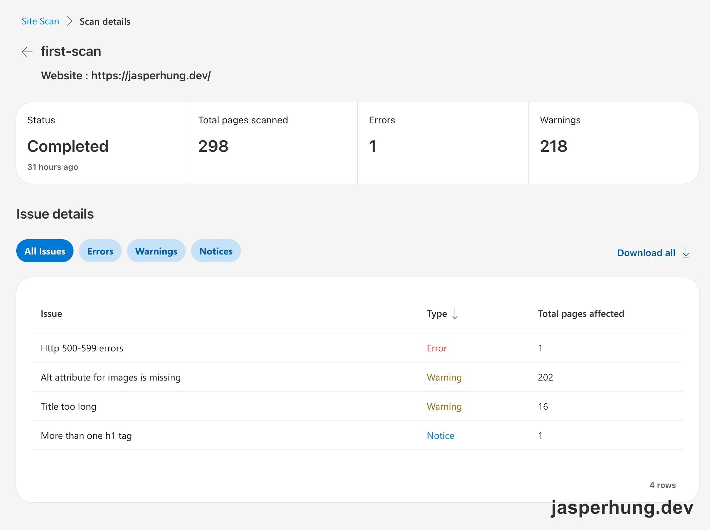

<KeyTakeaways>
  <p>Site Scan 是怎麼幫 blog 找問題的？它把整站結果變成待驗證線索；我再用 Astro build 產物對帳，最後把測試頁排除整理成 production 不建置的 <code>draft</code> loader feature。這是我在自己的 Astro blog 上做的實測。</p>
</KeyTakeaways>

我在 Bing Webmaster Tools 打開 `first-scan` 的報告時，先看到的是一組很有壓迫感的數字：298 頁掃完，1 個 Error，218 個 Warnings。畫面列出四項問題，我一開始沒有預設哪一項一定要修，只想知道它們各自對應到 blog 的哪個部分。



<p class="image-caption">圖：Bing Webmaster Tools 的 Site Scan first-scan 報告。</p>

## 先把掃描結果對回 build 產物

我沒有直接照著截圖逐項改，而是先在 blog 專案執行 `pnpm build`，再寫一段 Python 掃描 `dist/` 裡的 HTML。這次實際掃到 177 個 HTML，檢查每個 `` 的 `alt`、`<title>` 的長度，以及頁面裡有幾個 `<h1>`。

這一步很快把問題從「Bing 報了 218 個 warning」縮成幾個能動手驗證的問題：

| Site Scan 問題 | build 產物裡找到的狀況 | 判斷 |
|---|---|---|
| Http 500-599 errors | 靜態 build 看不出 5xx；線上 URL 之後回報為 `/tags/Claude-Code/` | 先視為掃描當下的偶發錯誤，等下一輪驗證 |
| Alt attribute for images is missing | 177 頁都有同一張 `alt=""` 的品牌圖，來源是 `BlogLayout.astro` | 不是 177 個獨立問題，要先分辨裝飾圖與內容圖 |
| Title too long | layout 固定在 title 後面加上 ` — Jasper Hung` | 改成依 suffix 實際長度決定是否加上 |
| More than one h1 tag | `markdown-style-test` 真的有兩個 h1；另一個頁面的 regex 結果是程式碼字串誤判 | 修測試頁，並重新檢查它是否還被網站公開引用 |

這裡有一個小提醒：scanner 的頁數和我掃到的 HTML 數量不一樣，title 的頁數也和本地計算不同。這些差異沒有被硬湊成同一個數字，因為目前還不知道 Bing 的計數門檻和我的字元計算是不是完全相同。Site Scan 適合提供線索，但 build 產物才是我能直接驗證的證據。

## 空的 alt 不一定是該填上的錯

202 頁的 warning 看起來很嚴重，追下去卻只找到同一張品牌圖：topbar 裡的 favicon。它旁邊已經有可見的 `Jasper Hung` 文字，所以這張圖本來就是裝飾用途，`alt=""` 反而是無障礙上合理的寫法。

如果為了讓 Bing 不再報 warning，直接填上 `alt="Jasper Hung"`，螢幕閱讀器可能會把品牌名稱念兩次。這個修法會讓 scanner 的數字變漂亮，卻讓實際使用變差，所以我沒有選它。

最後的做法是把 780 bytes 的 `favicon.svg` 直接 inline 成新的 `BrandMark.astro`，加上 `aria-hidden="true"` 和 `focusable="false"`。頁面上不再有這張 ``，Bing 沒有空 alt 可以報，閱讀器也只會念一次旁邊的品牌名稱；series 列表的封面圖則補上真正描述圖片內容的 alt。

重跑 build 後，空 alt 從 177 頁降到 0。這個結果比較像是把 HTML 結構修到符合原本的語意，而不是替 scanner 填一個看似正確的文字。

## Title suffix 要用算的

第二個值得直接修的問題是 title 長度。`BlogLayout.astro` 原本固定把 ` — Jasper Hung` 接在文章標題後面，這讓標題本身沒有超過上限，最後的 `<title>` 卻可能太長。

我一開始把問題理解成「suffix 是 14 個字元」，後來改成不寫死這個數字。站名、分隔符或未來的品牌名稱只要變動，規則都應該跟著重新計算：

```ts
const SITE_NAME = 'Jasper Hung';
const TITLE_SUFFIX = ` — ${SITE_NAME}`;
const MAX_TITLE_LENGTH = 60;

const pageTitle =
  `${title}${TITLE_SUFFIX}`.length <= MAX_TITLE_LENGTH
    ? `${title}${TITLE_SUFFIX}`
    : title;
```

這樣改完，超過 60 個字元的 title 從 27 篇降到 3 篇。剩下的三篇是標題本身就太長，屬於內容層的決定，不再由 layout 偷偷替它們加長。

## 一個 h1 Notice 怎麼挖出測試文章

`markdown-style-test` 原本看起來只是 Site Scan 裡的一個 h1 notice。我先想到的做法，是比照既有的 `NAV_EXCLUDE`，把它從首頁、RSS、sitemap 和 tag 頁排除，再補上 `noindex`。

但往回 grep 之後，問題比 h1 多一層：這篇測試文章仍然出現在首頁文章列表、RSS，以及 `/posts/markdown-style-test.md` raw endpoint。它不是只被搜尋引擎看到，而是讀者與訂閱者都可能碰到。

這時候我想討論一個更根本的問題：既然這篇文章本來就不想讓 production 讀者看到，是不是乾脆不要 build？

對 Astro 這個 SSG blog 來說，答案是對的。`noindex` 是「頁面已經存在，只請搜尋引擎不要收錄」；`draft` 則是「production 根本不產生這一頁」。後者更接近真正的意圖，也不需要在每一個出口各寫一次排除條件。

## 從 `getPosts()` 到 loader 層的轉折

第一個實作方向是新增共用的 `getPosts()` helper，把 11 個 `getCollection('blog')` 呼叫點全部換掉。它可以運作，但也留下了一個很明確的風險：只要未來新增一個頁面忘了用 helper，draft 文章就可能從那個出口漏出去。

所以我又追問 Astro content collection 有沒有更統一的入口。查過之後，Astro 沒有內建 draft 過濾；但 Astro 6 的 `glob()` 回傳的是一個可以包裝的 loader 物件。原本 `defineCollection` 裡的 loader 只有一行，直接用 glob 指向文章資料夾。這次改成先保留 glob，再包一層 loader；schema 也加上 `draft` 欄位：

```diff title="src/content.config.ts — loader 核心概念"
 import { defineCollection, z } from 'astro:content';
 import { glob } from 'astro/loaders';
 
-const blog = defineCollection({
-  loader: glob({ pattern: '**/*.{md,mdx}', base: './src/content/blog' }),
+const blogGlob = glob({ pattern: '**/*.{md,mdx}', base: './src/content/blog' });
+
+const blog = defineCollection({
+  loader: {
+    name: 'blog-glob-without-drafts',
+    load: async (context) => {
+      await blogGlob.load(context);
+      if (!import.meta.env.PROD) return;
+      for (const [id, entry] of context.store.entries()) {
+        if (entry.data.draft) context.store.delete(id);
+      }
+    },
+  },
   schema: z.object({
     title: z.string(),
     date: z.date(),
+    draft: z.boolean().default(false),
   }),
 });
```

這段不是每次 `getCollection()` 都執行的 callback，而是 Astro 在 content sync 的時機呼叫的 Loader 介面。dev 模式保留 draft，production build 才刪除；因此所有既有的 `getCollection('blog')` 呼叫點都不用改，文章頁、raw Markdown、OG 圖、首頁、RSS、sitemap、tag 和 series 頁會自然拿到同一份乾淨的資料。

驗證結果也很直接：production `dist` 裡完全找不到 `markdown-style-test`，但用 `pnpm dev` 時仍然可以開啟測試頁。原本為了處理單一 h1 notice 的修正，最後變成一個之後可以隨時使用的 `draft` 下架開關。

## 心得

我現在會把 Bing Site Scan 當成一個很棒的網站驗收工具。Google Search Console、Cloudflare 或其他工具沒有抓到的問題，這次反而被 Site Scan 照了出來；從提交 sitemap，到 bug fix，再到 bug to feature，整個過程走了一遍。

這些修復未來也可能在網站資料量長大後，慢慢反映成可以觀察的成長。對我來說，修復不只是把 warning 消掉，過程也在一點一點補足對網站的知識，最後形成一個正向循環。
