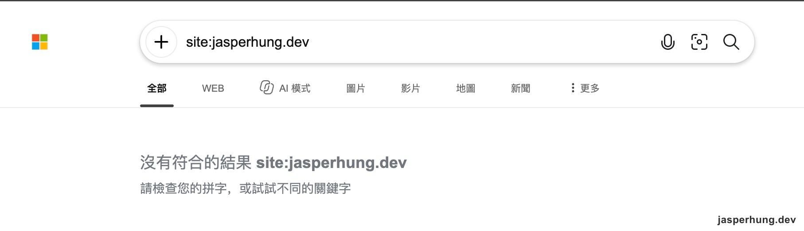
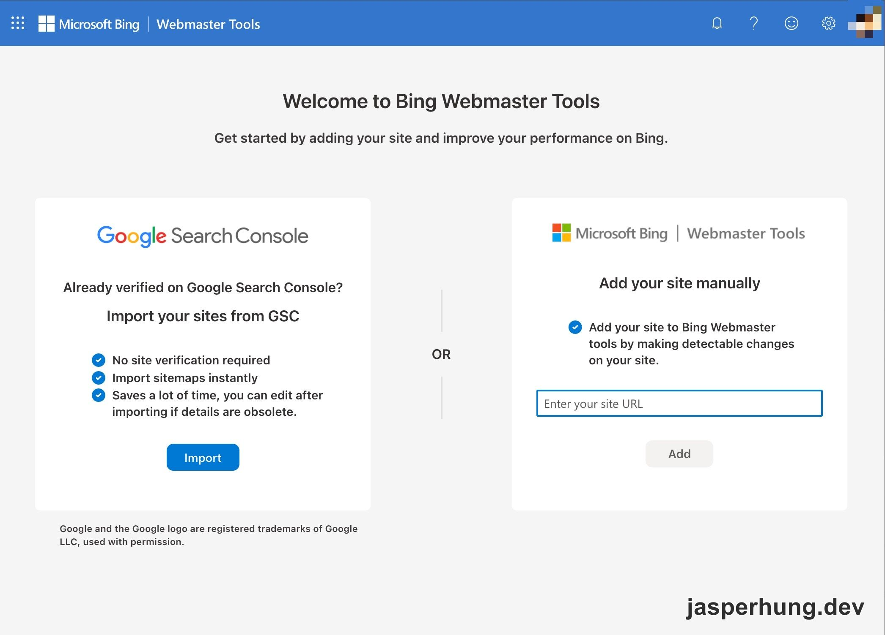
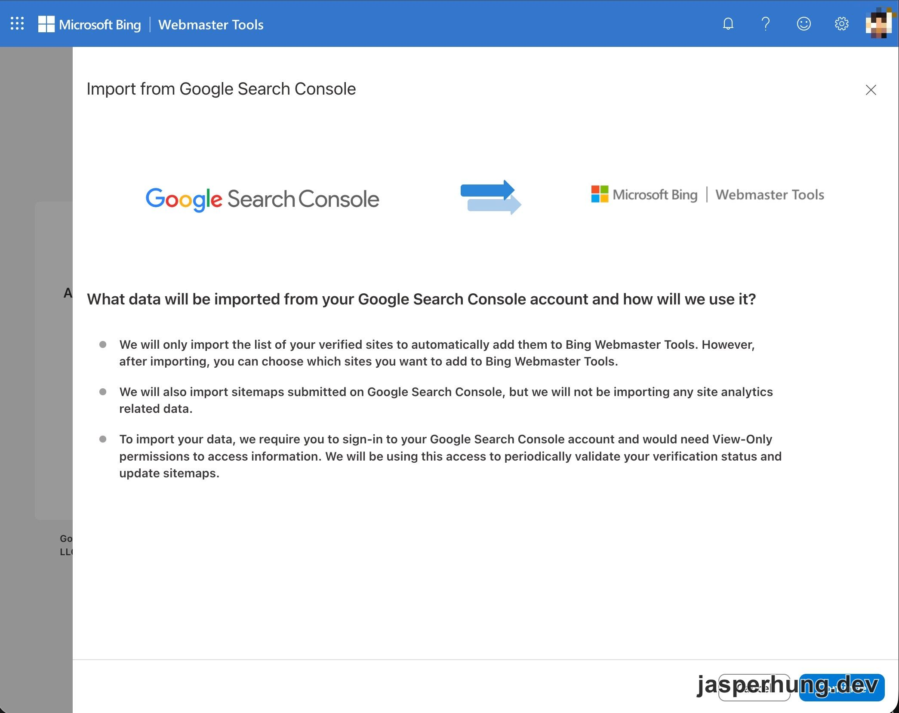
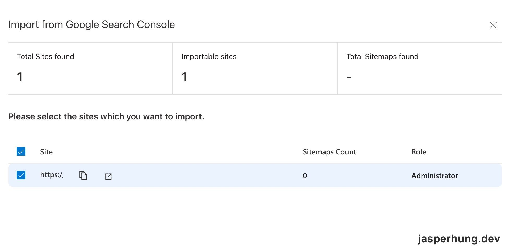
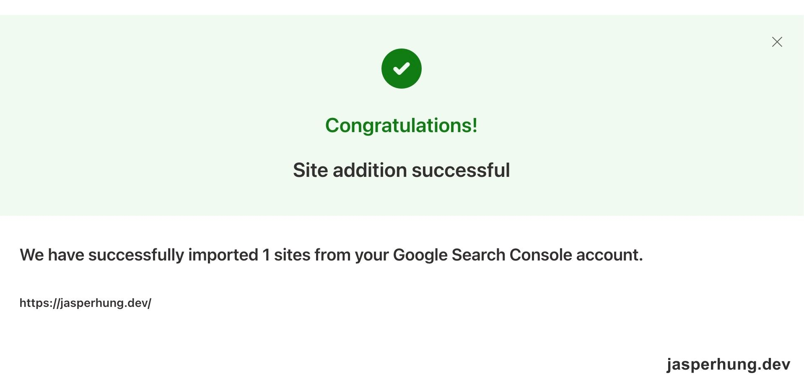
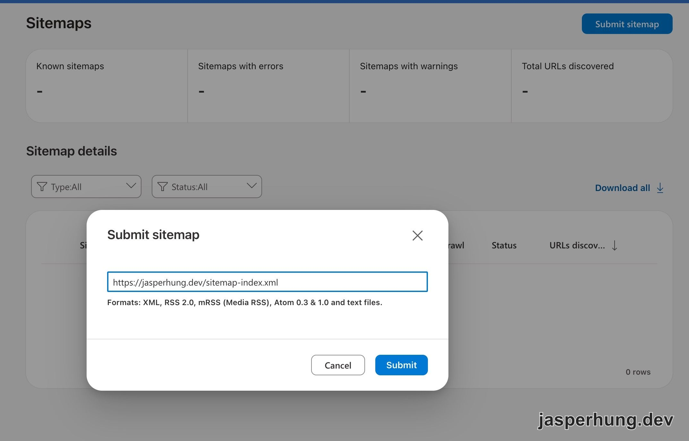

<KeyTakeaways>
  
把網站交給 Bing 對 GEO 有幫助嗎？值得做，而且成本很低，但 Bing 不是唯一入口；這次實測也發現，<code>site:</code> 查不到結果時，還是要用 URL Inspection 確認索引狀態。這是我在自己的 Astro 部落格上的觀察，Crawler Hints 後續送出 IndexNow 的時效仍待驗證。

</KeyTakeaways>

起點是在 Threads 看到一篇文章：「做 GEO，先把網站交給 Bing。ChatGPT 的搜尋有用到 Bing 資料，Bing 沒收錄的頁面，AI 搜尋也比較難找到你。」文中給了三步：Bing Webmaster Tools（BWT）從 Google Search Console（GSC）匯入、提交 sitemap、開啟 IndexNow。我的疑問很直接：這說法是真的嗎？我的 Astro 部落格也適用嗎？我自己的站到底有沒有被 Bing 收錄？

## 先查原文：方向對，但不能講得太滿

我先把文中提到的做法逐一拆開看。BWT 確實可以從 GSC 匯入網站，連驗證狀態一起帶過去；提交 sitemap 是把網站 URL 清單交給搜尋引擎，IndexNow 則是網站有新內容或 URL 變動時，主動送出通知。

但這裡有三個需要打折的地方：OpenAI 也有自己的 `OAI-SearchBot`，Bing 不是唯一入口；IndexNow 是通知搜尋引擎「這個 URL 變了」，不是收錄保證；Google 也不使用 IndexNow。至於 ChatGPT Search 和 Bing 的關係，我查到的資料支持「Bing 是其中一個重要來源」，但不能把它簡化成「只要交給 Bing，AI 搜尋就一定找得到」。[Yoast 的整理](https://yoast.com/chatgpt-search/) 和 [Scrunch 的更新說明](https://scrunch.com/blog/2025-03-significant-updates-to-chatgpt-search-are-coming) 也都比較接近這個版本。

所以我把這件事定義成一個低成本的保底動作，而不是 GEO 的主要槓桿。

## 先去 Bing 用 `site:` 查詢看看

2026 年 10 月 15 日，我在 Bing 搜尋列輸入 `site:jasperhung.dev`，先看到的是「沒有符合的結果」：

圖：Bing 的 site:jasperhung.dev 查詢顯示沒有符合的結果。

看到 `site:jasperhung.dev` 沒有結果時，真的很囧！歐買尬，真的像文章說的，少做了一個成本很低、可以加速搜尋引擎發現網站的動作。這次不是網站壞掉，而是我讓 Bing 自己慢慢找；Google 那邊一開始就已經提交 sitemap 了，但 BWT 沒有跟著帶進來，這真的很虧。下面開始著手把 sitemap 提交給 BWT 吧。

接著我們做一連串檢查：

1. `robots.txt` 是 `Allow: /`。
2. 有宣告 sitemap；Astro `@astrojs/sitemap` 產生的 sitemap index 底下也有 `sitemap-0.xml`。
3. 首頁有 canonical。
4. 沒有 `noindex`。

這讓我們先得到一個暫時假設：網站本身沒有被 `robots.txt` 或 `noindex` 擋住，問題比較可能是 BWT 沒有拿到 sitemap，Bing 還沒有完整發現這個網站。

## 設定步驟：把 Astro 部落格交給 Bing

我把它拆成 BWT 匯入、提交 sitemap，以及 URL Inspection 三步。

### 1. 從 GSC 匯入網站

BWT 首頁把兩條路徑放在一起：從 GSC 匯入，或手動新增網站。我選前者，因為網站已經在 GSC 驗證過了。

從 GSC 匯入的好處是不用再在 BWT 重新做一次網站驗證。

圖：BWT 提供從 Google Search Console 匯入或手動新增網站。

Import from GSC 的說明寫得很清楚：它會帶入已驗證的網站，也會帶入已提交到 GSC 的 sitemap，但不會帶入 Search Console 的分析資料。

圖：BWT 說明從 GSC 匯入的資料範圍。

下一個畫面出現一個很有用的數字：`Total Sitemaps found` 是空白，網站那列的 `Sitemaps Count` 是 `0`。

圖：GSC 裡雖然有網站，但這次匯入到 BWT 的結果沒有帶到 sitemap。

我知道 GSC 一開始就已經提交 sitemap，但這次匯入結果的 `Sitemaps Count` 仍然是 `0`。所以我不再把它解讀成「GSC 沒有提交」，而是把問題縮小成：BWT 這邊沒有拿到 sitemap，最後還是得在 BWT 另外提交一次。

網站匯入本身先順利完成：

圖：BWT 成功匯入 jasperhung.dev。

### 2. 在 BWT 提交 Blog 的 sitemap

接著到 Sitemaps 頁面，手動提交 Astro 產生的 `https://jasperhung.dev/sitemap-index.xml`：

圖：BWT 的 sitemap 提交介面，填入 Astro 產生的 sitemap index。

### 3. 用 URL Inspection 檢查首頁

提交 sitemap 後，我用 BWT 的 URL Inspection 檢查首頁。結果顯示 **Indexed successfully**。

這代表兩個結果並不矛盾：`site:jasperhung.dev` 沒有回傳結果，只能說這個搜尋查詢沒有列出首頁；URL Inspection 則直接告訴我，首頁當時已經在 Bing 索引裡。這不等於整個部落格的每一篇文章都已收錄，但至少可以確認首頁已經進去了。

## IndexNow 是什麼？

IndexNow 是一個讓網站主動通知搜尋引擎「這個 URL 新增了、更新了或刪除了」的協定。它的作用是送出變更訊息，讓搜尋引擎更快知道哪裡值得重新爬取；它不是收錄保證，也不會取代 sitemap。

簡單說：sitemap 是把網站的 URL 清單交出去，IndexNow 是內容變動時再發一封通知。這次先把 sitemap 提交完成，Cloudflare Crawler Hints 和 BWT 的後續設定留到實際操作後再補。

## Bing 之外，還要把 sitemap 交給誰？

做到這裡，我又問了一個更實際的問題：Bing 要另外提交，那是不是每個搜尋引擎都要再做一次 sitemap 設定，讓 crawler 來找我的文章？

以台灣讀者為主的部落格，我會先把 Google 和 Bing 做好，其他入口再依它們的工作方式處理：

| 搜尋入口 | 做法 | 誰在用 |
|---|---|---|
| Google | 在 GSC 提交 sitemap。 | Google Search、AI Overviews、AI Mode |
| Bing | 在 BWT 提交 sitemap。 | Bing、Yahoo、DuckDuckGo、Ecosia、Copilot，以及部分 ChatGPT Search |
| Brave Search、Perplexity、Applebot | 沒有共同的 sitemap 提交入口，重點是不要擋 crawler，並讓網站有外部連結可以被發現。 | Brave Search、Perplexity、Apple 的搜尋服務 |
| Yandex、Naver、Seznam | 各自有對應工具；IndexNow 的一次通知也可以涵蓋這幾個搜尋引擎。 | Yandex（俄羅斯）、Naver（韓國）、Seznam（捷克） |

所以不是每個搜尋引擎都要各自填一次表單。該提交的地方提交，沒有提交入口的，就把 robots、sitemap、外部連結和 crawler 防護顧好。

## 設定完成後，部落格真的被 Bing 收進去了嗎？

到目前為止，最基本的設定完成了：至少已經提交 sitemap，讓 Bing 有明確的入口去爬取和收錄，應該會增加部落格被搜尋到的機會。URL Inspection 也顯示首頁 **Indexed successfully**，所以至少首頁已經進去了。接下來就等幾天，讓 Bing crawler 慢慢來爬 Blog 裡的後續文章吧。

所以，平常滑 Threads 文章其實也蠻有用的。這次就是看到一篇 GEO 分享，才發現自己的部落格少做了一個很簡單、很酷、也可能提升曝光率的設定。

後續還有 Cloudflare 上的其他設定，以及 BWT 裡的相關檢查。等實際操作完，再慢慢把後續整理成文章寫上來。
