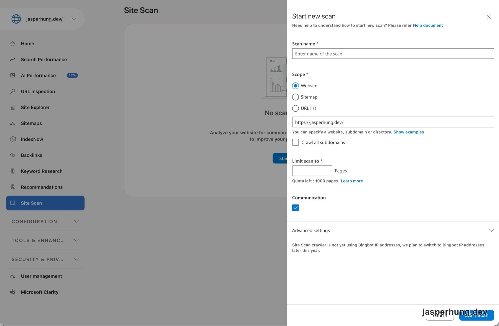

<KeyTakeaways>
  <p>Bing Webmaster Tools 的 Site Scan 是什麼？它會依照指定範圍爬取網站，整理常見的 SEO 問題；對靜態 Astro 部落格來說，設定 Website scope、給足頁數上限，並確認 Cloudflare 沒有誤擋 crawler，是開始掃描前最重要的幾件事。</p>
</KeyTakeaways>

我在 Bing Webmaster Tools（BWT）的左側選單看到一個叫 Site Scan 的工具。它不像 URL Inspection 只看一個網址，而是可以把檢查範圍拉到整個網站；對剛開始整理 SEO 的部落格來說，這個入口很值得打開看一下。

## Site Scan 是什麼？

Site Scan 是 BWT 裡的全站 SEO 健檢工具。它會依照你指定的範圍爬取頁面，再整理出可以改善的常見問題。這和 sitemap 提交是不同的工作：sitemap 是把網址清單交給 Bing，Site Scan 則是逐頁檢查網站內容與設定。

對部落格而言，Site Scan 的價值在於它可以一次看到首頁、文章，以及 tags、series 這類頁面可能出現的問題。不過它不會無限爬取，掃描範圍和頁數上限都要在開始前先設定好。

## 先設定 Site Scan 的掃描範圍

我在 BWT 選擇開始新的掃描，畫面會要求填寫幾個欄位：

1. **Scan name**：填一個容易辨識的名稱，之後回頭看報告時才知道是哪一輪掃描。
2. **Scope**：這次選 `Website`，並填入 `https://jasperhung.dev/`。
3. **Crawl all subdomains**：沒有要一起檢查其他 subdomain 時先不要勾選。

`Scope` 另外還有 `Sitemap` 和 `URL list` 兩個選項。如果目標是檢查整個網站，`Website` 比較符合這次的用途；另外兩種則適合已經知道要限制在特定網址集合的情況。



<p class="image-caption">圖：Site Scan 的新掃描設定，這次以 Website scope 掃描 jasperhung.dev。</p>

## Limit scan to 不要直接留白

畫面中的 `Limit scan to` 是這次設定裡最需要留意的欄位。BWT 顯示目前額度是 1,000 pages；我把掃描上限從 100 調到 300，讓部落格的 tags 和 series 頁也有機會被涵蓋。

這個數字沒有通用答案，應該看網站實際頁數決定。設定太小，掃描結果可能只代表首頁和一部分文章；設定太大，則會更快用掉額度。對目前規模的靜態部落格來說，先用 300 頁做一輪檢查，是一個比較實際的起點。

Communication 區塊則是選擇要不要收到掃描更新通知。這和掃描範圍無關，可以依照自己的工作習慣決定；我這次勾選後，確實收到 Bing Webmaster Team 的 Email，通知 `first-scan` 已經可以查看，信中也附上前往掃描報告的連結。`Advanced settings` 這次先維持預設值即可。

收到的通知內容如下，原信中的報告連結則以 `{scan link}` 代替：

```text
Scan initiated in Bing Webmaster with name first-scan is now available.
You can view the scan report by clicking this link
{scan link}

Regards,
Bing Webmaster Team
```

## Site Scan crawler 還不是 Bingbot

表單最下方有一段容易被忽略的提醒：Site Scan crawler 目前還沒有使用 Bingbot 的 IP address，官方預計在今年稍晚切換。

這也是我接著檢查 Cloudflare bot 設定的原因。對靜態部落格來說，Bot Fight Mode 和 AI Labyrinth 都維持關閉比較合適；前者可能誤擋 Site Scan、部分 AI crawler 或 RSS reader，而 Free plan 也不能替個別 crawler 設定例外。AI Labyrinth 則是用來處理忽略 `robots.txt` 的爬蟲，和希望被搜尋引擎或 AI 找到的網站方向不一致。

另外也要確認 Block AI bots 類的設定沒有開啟。這些不是 Site Scan 表單裡的欄位，卻可能直接影響 crawler 能不能順利完成掃描。

:::tip
Site Scan 的 crawler 還不是 Bingbot 時，不要只因為「Bingbot 已經放行」就假設掃描一定不會被擋。先看 Cloudflare 的 bot 防護設定，通常比較快找到問題。
:::

## 按下 Start Scan 之前

這次的設定路徑很單純：用 `Website` 指定整個 domain，不掃其他 subdomain，把頁數上限調到能涵蓋目前網站規模，再確認 Cloudflare 沒有攔截非 Bingbot IP 的 crawler，最後按下 `Start Scan`。

按下 `Start Scan` 之後，這不是立即完成的設定，而是送出一個一次性的掃描工作。以這次操作的觀察，報告可能需要等待約 1–3 天才跑完；這段時間是在等 crawler 完成檢查，不代表 sitemap 提交或索引更新也會在同一時間完成。勾選 Email 通知後，不需要一直守在 BWT 頁面等結果，報告準備好時會收到通知和報告連結。

Site Scan 也不是排程。這次掃描結束後不會因為寄出 Email 就自動定期重跑；下次想檢查網站時，還要回到 Site Scan 再建立一個新的 scan。用口語來說，可以把它想成「向 BWT 發出一次請求，請它幫我爬過網站並整理健檢結果」；更精確地說，是建立一次性的 crawl job，不是申請 Bing 收錄，也不是開啟長期監控。

所以 Site Scan 對我來說比較像一個需要主動回來使用的網站健檢入口。首頁 title、文章頁結構，或之後新增的 tags 和 series，都可能在網站變大後才出現新的問題。多一個工具交叉看，至少不用等到讀者先發現，才知道網站有一塊一直沒檢查到。
