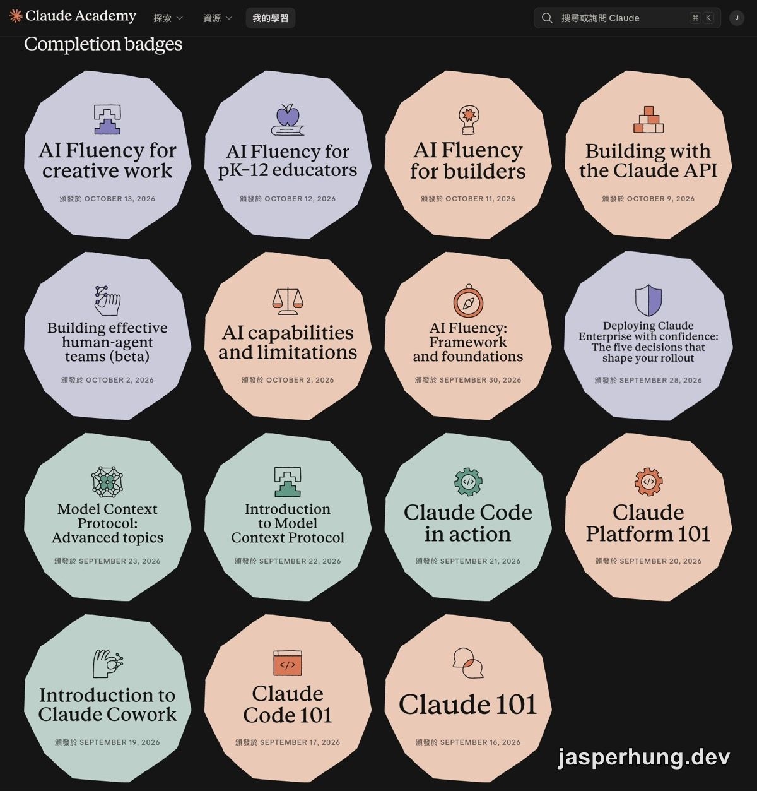

<KeyTakeaways>
  

    Claude Academy 的課該從哪裡開始？所有人先修 AI capabilities and limitations 與 AI Fluency: Framework and
    foundations 兩門必修核心，再依自己是 AI 新手、AI 使用者還是開發者，選對應的產品入口與深化課程；AI
    Fluency 九門身分別課每人選一門就夠。這份路線是我照課程實際走過一輪後整理的個人建議。
  

</KeyTakeaways>

30 天前，我在 [Day 1 的地圖](/posts/claude-academy-30-day-roadmap/) 裡把 Claude Academy 的課依序排進每一天，30 天走下來也一路回頭更新，每一天都補上了對應的 blog 文章與 iThome 鐵人賽文章連結。現在回頭看那張地圖，它回答的是「我要怎麼上完」；這一篇想回答另一個問題：如果你只打算上其中幾門，該從哪裡開始？

## 計畫跟實際差在哪裡

一開始的想法很單純：26 門課直接切成 26 天。實際跑下來，有幾個地方要調整：

- 有些課程內容密度高，一篇寫不完，就拆成上下兩篇，例如 Claude Cowork、Deploying Claude Enterprise with confidence、AI capabilities and limitations。
- Building with the Claude API 篇幅最大，實際上課時一天只能消化一章節，所以從 3 拆成 7 篇，從 Day 20 走到 Day 26。
- AI Fluency 身分別課程共 9 門，內容重複度很高。我挑了 3 門完整上，其餘 6 門只當參考素材。
- 雲端平台版的 Claude 課程（Bedrock、Vertex）要先準備雲端帳號與權限，不適合擠進日程。

30 天下來實際上了 18 門課。少掉的 8 門，6 門是內容和其他身分別課重疊，2 門卡在雲端帳號的前置準備。總覽表裡的 Introduction to Claude Tag 不在原本的 26 門裡，我也還沒上。這個落差讓我確定，Claude Academy 的課不必全部修完，不同身分的人各自挑幾門就夠。

圖：30 天拿到的 15 個 Completion badges。Introduction to subagents、The AI-native SDLC playbook、Introduction to agent skills 三門只有課程完成頁，沒有徽章。

## 學習路徑總覽

| 階段 | 課程 |
|---|---|
| 產品入口 | [Claude 101](https://academy.claude.com/zh-TW/courses/claude-101) [Claude Code 101](https://academy.claude.com/zh-TW/courses/claude-code-101) [Introduction to Claude Cowork](https://academy.claude.com/zh-TW/courses/introduction-to-claude-cowork) [Claude Platform 101](https://academy.claude.com/zh-TW/courses/claude-platform-101) |
| 必修核心 | [AI capabilities and limitations](https://academy.claude.com/zh-TW/courses/ai-capabilities-and-limitations) [AI Fluency: Framework and foundations](https://academy.claude.com/zh-TW/courses/ai-fluency-framework-foundations) |
| 職業選修 | [AI Fluency 九選一](#職業選修ai-fluency-九選一) |
| 深化：AI 使用者 | [Introduction to agent skills](https://academy.claude.com/zh-TW/courses/introduction-to-agent-skills) |
| 深化：團隊導入 | [Deploying Claude Enterprise with confidence](https://academy.claude.com/zh-TW/courses/deploying-claude-enterprise-with-confidence) [Building effective human-agent teams (beta)](https://academy.claude.com/zh-TW/courses/building-effective-human-agent-teams) [Introduction to Claude Tag](https://academy.claude.com/zh-TW/courses/introduction-to-claude-tag) |
| 深化：開發者 | [Claude Code in action](https://academy.claude.com/zh-TW/courses/claude-code-in-action) [Introduction to subagents](https://academy.claude.com/zh-TW/courses/introduction-to-subagents) [The AI-native SDLC playbook](https://academy.claude.com/zh-TW/courses/ai-native-sdlc-playbook) |
| 深化：API 開發 | [Introduction to Model Context Protocol](https://academy.claude.com/zh-TW/courses/introduction-to-model-context-protocol) [Model Context Protocol: Advanced topics](https://academy.claude.com/zh-TW/courses/model-context-protocol-advanced-topics) [Building with the Claude API](https://academy.claude.com/zh-TW/courses/building-with-the-claude-api) |
| 雲端部署加修 | [Claude with Amazon Bedrock](https://academy.claude.com/zh-TW/courses/claude-with-amazon-bedrock) [Claude with Google Cloud's Vertex AI](https://academy.claude.com/zh-TW/courses/claude-with-google-cloud-s-vertex-ai) |

同一格裡的課，由上往下就是建議的順序。深化的路線是往下疊加的，上面列過的課不再重複列。例如開發者也該上 AI 使用者那門 Introduction to agent skills，表格裡就只寫一次。

三種身分怎麼分，看的是你接觸 Claude 的深度，跟職稱無關：

| 身分 | 你現在的狀態 | 起點 |
|---|---|---|
| AI 新手 | 沒用過 AI，或只問過幾次問題 | 先上 Claude 101，再上兩門必修核心 |
| AI 使用者 | 每天用 AI 處理工作，但不寫程式，例如 PM、設計師、行政、業務 | 產品入口挑自己用的工具，再上兩門必修核心 |
| 開發者 | 用 Claude Code 寫程式，或打算用 API 做產品 | Claude Code 101 或 Platform 101，再上兩門必修核心，接著走開發者與 API 開發 |

設計師、PM、老師這些職業差異，交給 AI Fluency 九門身分別課處理。

## 產品入口：開始您的旅程，看你用哪個工具

「開始您的旅程」這個分類有四門課，各自對應一個產品。已經在用 AI 的人不必全上，看自己平常用哪個工具：

| 你主要用 | 上這門 | 文章 |
|---|---|---|
| 聊天介面 | [Claude 101](https://academy.claude.com/zh-TW/courses/claude-101) | [Day 2](/posts/claude-101/) |
| Claude Code | [Claude Code 101](https://academy.claude.com/zh-TW/courses/claude-code-101) | [Day 3](/posts/claude-code-101/) |
| Cowork | [Introduction to Claude Cowork](https://academy.claude.com/zh-TW/courses/introduction-to-claude-cowork) | [Day 4](/posts/introduction-to-claude-cowork/)、[Day 5](/posts/claude-cowork-browser-m365-safety/) |
| API／平台 | [Claude Platform 101](https://academy.claude.com/zh-TW/courses/claude-platform-101) | [Day 6](/posts/claude-platform-101/) |

這四門的共同點是「先讓你知道這個產品能做什麼」，篇幅都不長。跨工具的人可以多上一兩門，順便看清楚 Chat、Cowork、Code 各自適合哪種工作。

## 必修核心：AI 的能力邊界與 4D 框架

產品入口教的是怎麼用某個工具，必修核心教的是不管用哪個工具都適用的兩件事：AI 怎麼運作、極限在哪，以及人跟 AI 怎麼分工。

剛開始用 AI 的人，建議先上 Claude 101 再來上這兩門。框架要有使用經驗才接得住，完全沒用過 AI 就先學，很容易變成背名詞。

| 課程 | 重點 | 文章 |
|---|---|---|
| [AI capabilities and limitations](https://academy.claude.com/zh-TW/courses/ai-capabilities-and-limitations) | 下一個詞元預測、知識邊界、工作記憶與可操控性 | [Day 17](/posts/ai-capabilities-and-limitations-part1/)、[Day 18](/posts/ai-capabilities-and-limitations-part2/) |
| [AI Fluency: Framework and foundations](https://academy.claude.com/zh-TW/courses/ai-fluency-framework-foundations) | 委派 Delegation、描述 Description、辨別 Discernment、審慎 Diligence 四個能力 | [Day 15](/posts/ai-fluency-framework-foundations-delegation/)、[Day 16](/posts/ai-fluency-framework-foundations-description-discernment-diligence/) |

兩門的順序是 AI capabilities and limitations 先上，AI Fluency: Framework and foundations 接在後面：先知道 AI 的極限在哪，再學怎麼跟它分工。

### AI capabilities and limitations

這門課解釋 AI 為什麼會講錯、會忘記、會順著你的話講，所有人都該先上。我覺得它最有用的地方，是把「AI 為什麼會答錯」拆成可以觀察的機制：文字生成會沿著機率路徑往下走，知識會被截止日和訓練資料的範圍限制，工作記憶決定哪些內容還留在上下文裡、哪個新指示正在覆蓋舊的限制。課程再把四種特性兩兩放在一起，用互動模擬器看它們碰撞後的結果，讓「AI 怎麼了」變成可以定位的問題。上完之後遇到 agent 開始產生幻覺，我會先判斷它撞到的是哪兩個特性，再決定要補上下文、查證來源、加檢查點，還是改寫目標，不會只是不斷重問。

### AI Fluency: Framework and foundations

這門課是 AI 使用的心法課，它把人跟 AI 合作拆成四個能力，也就是 4D 框架：

| D | 一句話定義 | 關鍵提問 | 對應判準 |
|---|---|---|---|
| **委派 Delegation** | 決定何時以及如何使用 AI，重點是掌握全局 | 想達成什麼？哪些工作該自己做，哪些 AI 能幫忙？ | 有效、高效 |
| **描述 Description** | 和 AI 清楚溝通 | 目標、輸出格式、處理方式、脈絡和語氣是什麼？ | 有效 |
| **辨別 Discernment** | 批判性評估 AI 的輸出 | 事實準確嗎？推理合理嗎？符合品牌與受眾嗎？真的能幫我往前走嗎？ | 有效 |
| **審慎 Diligence** | 負責任地與 AI 互動 | 如何控制偏見、驗證資訊、保護敏感資料，並對 AI 的參與保持透明？ | 合乎道德、安全 |

四個能力可以記成一句口訣：委派決定要不要交，描述決定怎麼講，辨別決定收不收，審慎決定敢不敢署名。

4D 重要的地方，在於它跟任何一個產品功能都無關。Claude 會改版、按鈕會換位置，但每一次把工作交給 AI，都還是會走過這四步。回頭看這 30 天，後面很多課其實都在練其中一個 D：Agent Skills 是把描述 Description 存下來重複使用，subagents 是把委派 Delegation 拆得更細，AI capabilities and limitations 解釋了為什麼辨別 Discernment 不能省，Deploying Claude Enterprise with confidence 談的治理與權限，則是組織層級的審慎 Diligence。對我來說，它也把平常零散使用 AI 的方法收斂成一套框架：開始之前，先和 AI 討論清楚要做什麼、目的和目標是什麼，反覆釐清到雙方對成果有共同理解，再留下可以回頭檢查的計畫。

我把它列為必修，另一個原因來自九門身分別課的比對：

- 九門裡有 7 門在開頭放了一支 4D 影片。這些影片共 5 個版本，內容都是母課 4D 的精簡版。
- Teaching AI Fluency 官方要求先修過母課。
- AI Fluency for educators 在第 1 堂結尾明寫：修過母課的人可以跳過下一堂的框架回顧。

先修完母課，後面任何一門身分別課的框架段落都能快轉。

## 職業選修：AI Fluency 九選一

AI Fluency 有九門依身分設計的課。九門的影片幾乎不重複（58 支只有 3 支共用），但每一門都會把 4D 與 LLM 基本觀念重講一遍。從課程設計看得出來，官方預設每個人只修一門。

我完整上了三門：

| 課程 | 適合誰 | 文章 |
|---|---|---|
| [AI Fluency for builders](https://academy.claude.com/zh-TW/courses/ai-fluency-for-builders) | 開發者、PM，以及要把想法做成產品的人 | [Day 27](/posts/ai-fluency-for-builders/) |
| [AI Fluency for pK–12 educators](https://academy.claude.com/zh-TW/courses/ai-fluency-for-k-12-educators) | 中小學教師 | [Day 28](/posts/ai-fluency-for-k-12-educators/) |
| [AI Fluency for creative work](https://academy.claude.com/zh-TW/courses/ai-fluency-for-creative-work) | 設計師、寫作者等創作者 | [Day 29](/posts/ai-fluency-for-creative-work/) |

### AI Fluency for builders

這門課把建構拆成同理、設計、架構、實作、判斷、交付六項能力，不限工程師，讓人機分工不再只用「會不會寫程式」來切：實作可以大量委派，設計與架構適合人和 AI 一起做，同理心、判斷和交付則要人把關。九堂課的練習串成同一個診所等候時間專案，從問題簡報、委派計畫、驗收測試一路走到發布前提問，走完會很清楚：原型可以交給 AI 加速，最後要不要掛上自己的名字，還是得自己回答。

### AI Fluency for pK–12 educators

就算不是老師，我也推薦這門。它把 4D 講成一個會反覆轉的循環，有外層、內層，也有對角線的交叉修正；第一版不會一次完成，每次工作條件不同，都要依新的發現繼續迭代。課程也讓我更在意受眾與資料邊界：年級、班級規模、在地條件會影響 AI 找到的素材，學生資料即使沒有姓名，也可能被回推出個人身分。這門課教的是一件很普遍的事：速度可以快起來，責任仍在原位。

### AI Fluency for creative work

經營部落格的人也適合上這門。課程的預設立場是「先從不使用 AI 開始」，再用 Creative Value Lens 的創意表達、人際連結、獨特性三個維度，加上生產視角的時間、精力與資源成本，決定 AI 要不要介入、在哪個階段介入。每一題練習都像靈魂拷問，逼你回答作品為什麼存在、要對誰說話、什麼讓它仍然像你的作品，最後寫成一份自己簽署的 AI 使用政策。

其餘六門沒有整門上，以下整理適合誰與各自的特色：

| 課程 | 適合誰 | 規模 | 特色 |
|---|---|---|---|
| [AI Fluency for students](https://academy.claude.com/zh-TW/courses/ai-fluency-for-students) | 學生、求職者 | 5 堂／影片 31 分鐘 | 職涯探索、履歷改善與模擬面試，是九門裡最能直接拿來用的練習 |
| [AI Fluency for small businesses](https://academy.claude.com/zh-TW/courses/ai-fluency-for-small-businesses) | 小型企業老闆 | 8 堂／影片 55 分鐘 | 以兩位真實業主的訪談為骨幹，最後從老闆的角度寫一份 AI 使用政策 |
| [AI Fluency for nonprofits](https://academy.claude.com/zh-TW/courses/ai-fluency-for-nonprofits) | 非營利組織工作者 | 9 堂／影片 56 分鐘 | 研究、寫作、資料隱私等 7 個場景，17 個練習是九門最多 |
| [AI Fluency for educators](https://academy.claude.com/zh-TW/courses/ai-fluency-for-educators) | 教師、講師 | 4 堂／影片 37 分鐘 | 教學脈絡 → 課程設計 → 學習材料三段流程，還有「請 AI 扮演你的學生」 |
| [Teaching AI Fluency](https://academy.claude.com/zh-TW/courses/teaching-ai-fluency) | 要教別人 AI Fluency 的老師 | 7 堂／影片 66 分鐘 | 九門裡唯一完全不重複的一門，官方要求先修母課 |
| [AI Fluency for pK-12 Train the Trainer](https://academy.claude.com/zh-TW/courses/ai-fluency-for-pk-12-train-the-trainer) | 帶教師研習的培訓師 | 4 單元／零影片 | 50 張簡報＋引導者指南＋學習者手冊的工作坊套件，採 CC BY-NC-SA 4.0 授權 |

教育相關的四門剛好排成一條由淺到深的線：educators 或 pK–12 educators 先讓老師自己會用，Teaching AI Fluency 教你怎麼教學生，Train the Trainer 再教你怎麼帶其他老師。

## 深化：AI 使用者

| 課程 | 重點 | 文章 |
|---|---|---|
| [Introduction to agent skills](https://academy.claude.com/zh-TW/courses/introduction-to-agent-skills) | 把重複的工作方法存成 Skill，不用每次重新交代 | [Day 12](/posts/introduction-to-agent-skills/) |

AI 使用者的深化課只有這一門。Claude Academy 的進階課大多偏向開發與團隊導入；對不寫程式的人來說，深度主要來自產品入口那幾門（尤其是 Cowork），加上 Agent Skills，再配一門貼近自己職業的 AI Fluency 身分別課。

### Introduction to agent skills

推薦給每天都在重複交代同一套做法的人。這門課把 Skill 從「一段比較長的 Prompt」拆成一個可以被發現、配對、載入、分享和驗證的工作單位：`description` 決定它什麼時候出場，`SKILL.md` 放核心規則，細節按需帶進來，分享層級決定它只服務自己、整個 repo，還是整間公司。它也順便回答了一開始最容易卡住的問題：這件事該寫進 `CLAUDE.md`、包成 Skill、交給 Subagent、用 Hooks，還是接 MCP？現在我更常在一段對話做完事情時，趁脈絡還在就把剛剛的做法封裝成 Skill，下次直接重用。

## 深化：團隊導入

| 課程 | 重點 | 文章 |
|---|---|---|
| [Deploying Claude Enterprise with confidence](https://academy.claude.com/zh-TW/courses/deploying-claude-enterprise-with-confidence) | 組織結構、存取權限、治理、支出與可見性這幾個導入決策 | [Day 13](/posts/deploying-claude-enterprise-with-confidence-part1/)、[Day 14](/posts/deploying-claude-enterprise-with-confidence-part2/) |
| [Building effective human-agent teams (beta)](https://academy.claude.com/zh-TW/courses/building-effective-human-agent-teams) | 人跟多個 Agent 一起工作時，責任怎麼分 | [Day 19](/posts/building-effective-human-agent-teams/) |
| [Introduction to Claude Tag](https://academy.claude.com/zh-TW/courses/introduction-to-claude-tag) | 裝在團隊協作空間裡的共享代理，Building effective human-agent teams 的實作路徑之一 | -- |

這條路線適合負責在公司推 Claude 的 IT 或主管：先決定怎麼導入，再看人跟 Agent 怎麼組隊，最後把共享代理實際放進團隊。Introduction to Claude Tag 我沒有上；要注意它需要 Team 或 Enterprise 的組織方案，個人訂閱用不到。

### Deploying Claude Enterprise with confidence

這是給 IT 管理者和 Enterprise Owner 的治理課，要在公司導入 Claude 的人必上。它把 Claude 進入企業後要面對的工作完整攤開：身分與權限、介面與連接器、自訂內容、支出和可見性，產品本身也都準備了對應的控制點。例如後台的使用量分析可以回頭影響設定：某個群組花太多錢，原因只是拿最高階模型處理日常工作，管理員就能調整預設模型、限制 effort，必要時再設使用上限。上完會想把 Enterprise 部署寫成一份持續更新的決策手冊，先定義決策，再看訊號。

### Building effective human-agent teams (beta)

我原本以為這門會教 Claude 的 team 功能，聽到後面才發現，主題是「一位住在團隊裡的 AI 隊友」要怎麼持續工作。資訊要放在共享空間、代理要有自己的身分、目標要寫下來，信任則從可以檢查的小任務慢慢累積。推薦給打算讓 AI 長期參與團隊工作的人；另外要預留時間，把 Claude Tag 與 Managed Agents API 兩條路徑的方案、記憶與計費方式拆開看，這部分比想像中難懂。

## 深化：開發者

| 課程 | 重點 | 文章 |
|---|---|---|
| [Claude Code in action](https://academy.claude.com/zh-TW/courses/claude-code-in-action) | 指令、Hooks 與驗證，讓 Agent 長時間工作 | [Day 7](/posts/claude-code-in-action/) |
| [Introduction to subagents](https://academy.claude.com/zh-TW/courses/introduction-to-subagents) | 在 Claude Code 用 `/agents` 建立 subagent，把探索與程式碼審查拆出去，省下主對話的 context | [Day 10](/posts/introduction-to-subagents/) |
| [Introduction to agent skills](https://academy.claude.com/zh-TW/courses/introduction-to-agent-skills) | Skill 的建立、分享與除錯 | [Day 12](/posts/introduction-to-agent-skills/) |
| [The AI-native SDLC playbook](https://academy.claude.com/zh-TW/courses/ai-native-sdlc-playbook) | AI 大量寫 code 之後，審查、測試與部署怎麼跟上 | [Day 11](/posts/ai-native-sdlc-playbook/) |

Agent Skills 在 AI 使用者已經介紹過，開發者這邊再列一次，是因為它正好接在 subagents 後面：一個處理「把工作拆出去」，一個處理「把做法存下來」。SDLC playbook 放在最後，因為它談的是整個團隊的開發流程，前面幾門的工具都會在這裡出現。

### Claude Code in action

用 Claude Code 寫程式的人建議第一個上。課程裡的指令，大多是開發者平常真的會用到的，而且除了原本的功能，還可以帶上這一輪工作的意圖。例如 `/compact` 可以寫成 `/compact log 只留重要，跟我們接下來要做的目標`，讓 agent 知道哪些資訊要留下來、接下來往哪裡走。

### Introduction to subagents

推薦給已經開始「多叫幾個代理來幫忙」的人。這門課把這件事拆成幾個可以檢查的設計問題：真的需要獨立 context 嗎？輸入有沒有說清楚？輸出有沒有停止點？遇到障礙會不會回報？工具權限是否小到剛好夠用？我實際會把 codebase 搜尋、找 library 這類工作派給搜尋專用的 subagent，QA 也另外交給一個獨立的 agent，主對話只接收整理後的結果。最值得記下的一句是：只要答案就委派，需要看過程、需要回應過程，就把工作留在主執行緒。

### The AI-native SDLC playbook

要把 agent 帶進團隊開發流程，就該上這門。它的視角放在團隊與企業的 SDLC：雲端的 Claude、CI 裡的 `claude -p`、本機的 Claude Code 都只是執行節點，讓流程能被治理的是它們之間留下的 artifact、權限和 gate。它是一份 playbook，沒有附可以照貼的 starter kit。它把視線延伸到 Deploy 和 Maintain，部署後的指標與 incident 會重新餵回 `intent.md`，讓整條 SDLC 形成閉環，這是一般 SDD 討論比較少談到的部分。

## 深化：API 開發

| 課程 | 重點 | 文章 |
|---|---|---|
| [Introduction to Model Context Protocol](https://academy.claude.com/zh-TW/courses/introduction-to-model-context-protocol) | 用 Python SDK 從零寫 MCP 的 client 與 server，讓 Claude 連上外部工具與資料 | [Day 8](/posts/introduction-to-model-context-protocol/) |
| [Model Context Protocol: Advanced topics](https://academy.claude.com/zh-TW/courses/model-context-protocol-advanced-topics) | 取樣與 StreamableHTTP | [Day 9](/posts/model-context-protocol-advanced-topics/) |
| [Building with the Claude API](https://academy.claude.com/zh-TW/courses/building-with-the-claude-api) | 從 API 存取、提示評估、工具使用、RAG 一路到代理工作流程，共 7 篇 | [Day 20](/posts/building-with-the-claude-api-part1/)–[Day 26](/posts/building-with-the-claude-api-part7/) |

要用 API 自己做產品的人，先在產品入口用 Claude Platform 101 看全貌，接著把 MCP 從入門走到進階，最後用 Building with the Claude API 實際寫程式，把前面的觀念串成完整的應用。API 主線走完之後，如果公司的服務架在 AWS 或 GCP 上，下一步就是 Bedrock 與 Vertex。

### Introduction to Model Context Protocol

這門課名叫簡介，內容卻是很硬核的實作課。課程刻意把 Claude Code 已經包好的部分拿掉，從一個獨立的 App 出發，從零打造能接上 MCP 的 client 與 server，每個節點該由誰處理、App 要補哪些 function 都拆開講，最後再用 Inspector 把整個流程跑過一次。推薦給想知道 Claude Code 背後替你做了哪些事的人；走過一次，MCP 的知識才算真的補齊。

### Model Context Protocol: Advanced topics

要自己做 MCP client 或 server 的人，這門是入門課之後的下一步。Sampling、STDIO、StreamableHTTP、SSE 表面上是不同的功能和傳輸方式，實際上都在討論同一件事：client 和 server 怎麼溝通、訊息怎麼雙向流動。Server 能提供工具只是起點，要做成可用的 App，還要處理 sampling callback、logging 與 progress callback、Roots、初始化交握和 session。StreamableHTTP 的雙連線模型值得多看一次，它看起來像「設定打開就好」，實際上每個旗標都在改變協定能做的事。

### Building with the Claude API

Claude Academy 篇幅最大的一門，也是要用 API 做產品的人一定要上的一門。從 API 存取、提示評估、工具使用、RAG、提示快取、MCP，一路寫到代理與工作流程，每一堂都要動手寫程式；我把每堂課的實作都留在 [claude-academy-api-app](https://github.com/hungjie19/claude-academy-api-app)，一堂一個 commit。

最後一段談的是什麼時候該用哪種工作流程，我上課時會反問 agent：這是不是我平常工作流程的某一種形式？把自己的案例帶進去追問，比較快確認自己是真的理解，還是只記住了名詞。

## 雲端部署加修：Bedrock 與 Vertex，看你用哪家雲

[Amazon Bedrock](https://support.claude.com/en/articles/7996918-what-is-amazon-bedrock) 和 Google Cloud 的 [Vertex AI](https://docs.cloud.google.com/vertex-ai/generative-ai/docs/partner-models/use-partner-models) 都是雲端平台上的託管模型服務：Claude 由 Anthropic 提供，跑在 AWS 或 Google Cloud 的平台上，開發者不用自己管理基礎設施，透過平台的 API 就能呼叫。Google Cloud 的文件直接把這種形式叫做 Model as a Service（MaaS），Claude 是其中的合作夥伴模型；Bedrock 的說法是「透過單一 API 提供多家公司基礎模型的全託管服務」，概念相同。

[Claude with Amazon Bedrock](https://academy.claude.com/zh-TW/courses/claude-with-amazon-bedrock) 和 [Claude with Google Cloud's Vertex AI](https://academy.claude.com/zh-TW/courses/claude-with-google-cloud-s-vertex-ai) 這兩門課，大綱幾乎是 Building with the Claude API 的同一套內容，主要把 API 存取換成各平台的版本，例如 Vertex 把「取得 API key」那一堂換成 Vertex AI 的設定。所以分流的依據是雲端供應商：公司已經在用 AWS 或 GCP，而且 Claude 要部署在既有的雲端環境裡，讓資料邊界、採購與合規都走原本的供應商，才需要上這兩門。

兩門課各有 65–66 堂、約 8 小時，但內容和 Building with the Claude API 高度重疊（Bedrock 約 78%、Vertex 約 89%）。真正的差異在結尾的 agent 段落，以及各平台少了哪些 first-party 功能，例如 Bedrock 沒有 web search 那一堂、Vertex 沒有獨立的 PDF 那一堂。先走完 API 主線，再上這兩門，就只需要看差異的部分。

## 小結

整體走完這些課，我最強烈的感覺是：它們教的比較偏向心法與理論，而不是上完就能立刻做出 subagent、Skill 或 MCP 應用的操作課。這不代表課程不實用，反而是它先把更根本的問題講清楚：LLM 是什麼、能做到什麼，以及人在不同工作場景裡，應該用什麼尺度和方式跟它合作。你要決定讓 AI 介入多深，也要能判斷最後的文件或程式是否是自己願意負責的產出。因為不管作品裡有多少 AI 參與，最後的負責人仍然是使用者。

如果要我再挑一條最值得完整走過的路線，我會推薦 API 開發。這一段從 RAG、embeddings、BM25 到 RRF，內容拆得很細；課程編排也不是一開始就把完整架構丟給你，而是先用模擬程式建立概念，再一步一步替換成真正的 API，接著說明 Agent 的 tools 怎麼串接、Protocol 怎麼運作，以及 API 金鑰應該放在哪一端。最後再用幾個小型實作 App，把這些概念完整走過一遍。這是我覺得 Claude Academy 裡最扎實、也最值得動手做的一段。費用也比想像中低：開課前依帳戶流程儲值了 5 USD，上完整門課，API 總支出只有 US$1.61。

九門 AI Fluency 身分別課，我原本也打算只按照自己的職業選一門，最後卻完整看了三門。我覺得這三門是九門裡最值得看的組合，因為它們雖然共享 4D 核心，面對不同使用者時，教學重點仍然不一樣。尤其是 AI Fluency for creative work，裡面的練習非常多，不斷逼你說清楚自己到底想創作什麼，也提供判斷作品價值與 AI 介入程度的尺度：AI 在你的創作流程裡，應該是協作者，還是顧問？

這也是我上完 Claude Academy 後留下來的核心想法：AI 不是拿來取代你的，而是協助你加速日常工作，讓成果更快交付、持續迭代；但是否採用 AI、如何驗證產出，以及最後是否願意替成果署名，決定權仍然在你手上。

因此回頭看一下，跟著 Claude Academy 重新學習 Claude，這件事真的很值得走一遍。實際使用過 Claude 之後再回頭學，會更有感，也更能理解技術背後的理論。推薦給大家。
