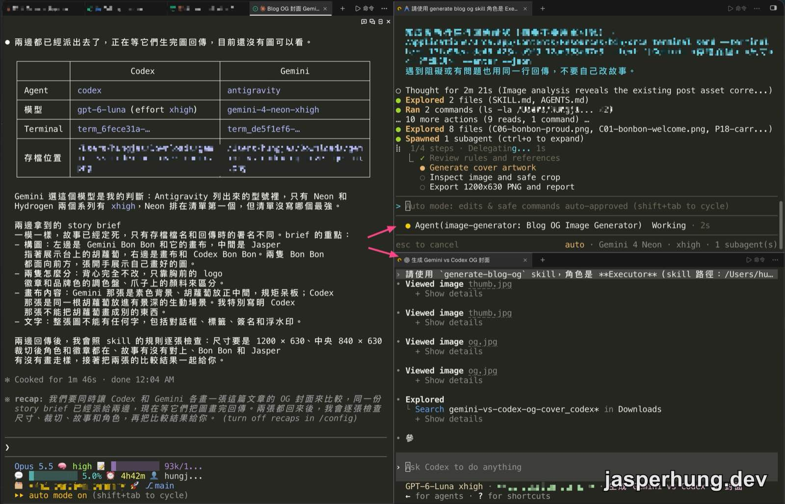
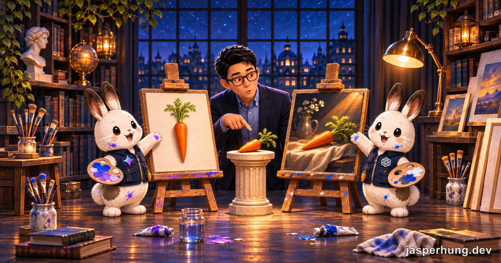
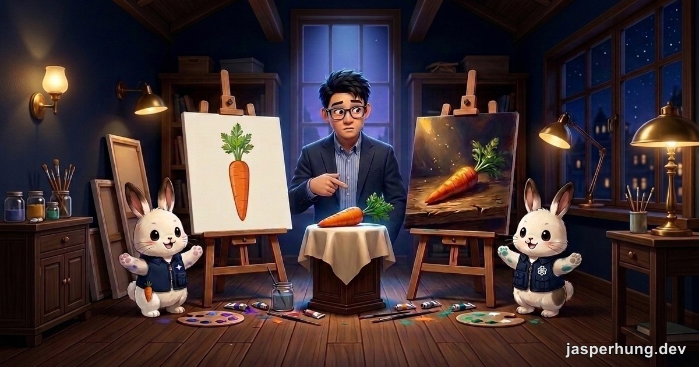
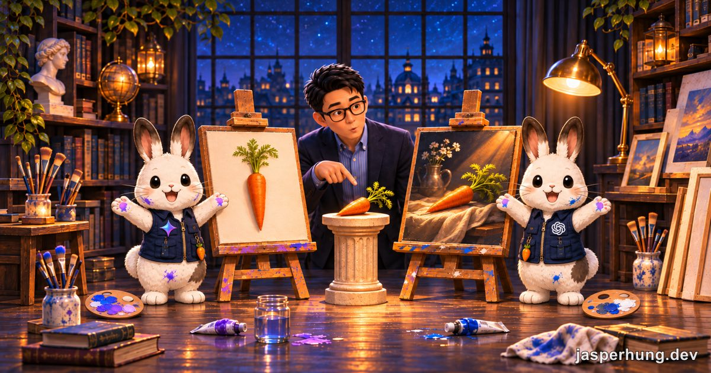
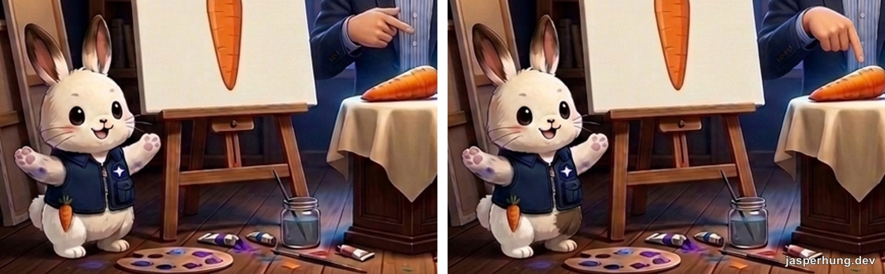

<KeyTakeaways>
  <p>Claude 寫好同一份封面 Brief，同時指揮 Codex 與 Gemini 生成，誰比較好？人物站位和構圖幾乎一樣，Brief 明寫的手勢兩邊各漏了一些；最大的差異在 Brief 沒寫死的畫風與場景密度：Codex 貼近專案既有的 3D 電影感，Gemini 偏 2D、畫面較空但會用光線做重點，我最後選 Codex 的取捨；這是單次實測的觀察。</p>
</KeyTakeaways>

上一篇《[Gemini vs Codex 生成 Blog OG 封面實測](/posts/gemini-vs-codex-og-cover-comparison/)》寫完，計畫裡最後一行留的是：下次想讓 Claude 負責故事發想，再同時叫 Codex 和 Gemini 平行出圖。結果那篇自己的封面，就成了這個實驗的第一個題目。

上一篇比的是「各自發想」，想像力和執行力混在一起，很難說差距來自哪裡。這次把故事交給 Claude 定死，兩個模型只負責畫，看看還剩下什麼差別。

## 跟 Claude 討論構圖，再同時派工

我先把上一篇的 title、description 和 KeyTakeaways 貼給 Claude，跟它討論封面要講什麼故事。這一輪的分工如下：

| 角色 | 工具 | 主對話模型 | 生圖模型 |
|---|---|---|---|
| 構圖討論、寫 Brief、驗收 | Claude Code | Claude Opus 5.5（high） | 無 |
| 執行者 A | Codex CLI | gpt-6-luna（xhigh） | 查不到（工具定義與呼叫紀錄都沒有模型欄位） |
| 執行者 B | Antigravity CLI | Gemini 4 Neon（XHigh） | 查不到（輸出圖的 C2PA 只寫 Google Generative AI） |

Antigravity 這邊，實際呼叫生圖工具的是它內建的生圖子代理，子代理本身的調度模型是 `gemini-4-hydrogen-tiered-high`，但這是負責下指令的 LLM，不是後端畫圖的模型。兩邊的後端生圖模型都是事後請它們自己查 log 回報，都查不到名稱和版本。

Claude 一開始提了三個方向，我選了「同一份 Prompt 交給兩座畫架」，但想把它改得更直接：既然有兩個 agent，畫面裡就放兩隻 Bon Bon，各自代表一個模型。構圖我是直接打字畫給它看的：

```text
gemini   畫布     jasper      畫布    codex
bonbon         指某個東西           bonbon
```

討論中有幾個決定：

- 我原本想讓兩隻 Bon Bon 穿不同顏色的背心，比較好分。Claude 指出角色設定裡明寫背心設計不能改，一張圖裡有兩隻、模型又容易畫走樣，背心再換色可能直接被畫成兩個不同角色。最後改成背心不動，胸前別各自的 logo 徽章，調色盤和爪子上的顏料用品牌色區分。
- 中間 Jasper 指的實物，Claude 建議從花瓶改成胡蘿蔔，比較有 Bon Bon 世界的味道，也有現成的道具參考圖。
- 圖上完全不放字，兩隻 Bon Bon 面向前方張開手，表示「畫好了」。
- 兩張畫布的內容也由 Claude 定：Gemini 那張是素色背景、胡蘿蔔放正中間的規矩構圖；Codex 那張是同一根胡蘿蔔放進有景深的生動場景，而且不能畫成別的東西。

Brief 寫好後，Claude 透過 Orca 同時開了一個 Codex 分頁和一個 Antigravity 分頁，兩邊拿到的內容一字不差，只有存檔檔名的後綴不同（`_codex`、`_gemini`），做完再各自把結果傳回 Claude 的分頁。



<p class="image-caption">圖：Claude 透過 Orca 同時派工，右上的 Gemini 和右下的 Codex 拿著同一份 Brief 各自開工。</p>

## 第一輪

### Codex



<p class="image-caption">圖：Codex 第一輪。場景塞得很滿，畫風延續既有封面的 3D 電影感。</p>

Codex 回來的這張，一看就是專案原本那套 Blue-Gold 夜間畫室：書架、石膏像、地球儀、黃銅檯燈、窗外城堡夜景，前中後景都有東西。右邊那張畫還自己加了花瓶和亞麻布，變成一幅古典靜物畫，但主角仍是同一根胡蘿蔔。Jasper 前傾指著石柱上的胡蘿蔔，表情是帶點錯愕的「欸？」。

Claude 驗收時挑出兩個問題。一是左邊那隻 Bon Bon 的咖啡色斑點畫在右後腿，角色設定規定只能在左後腿、不能左右對調。二是兩隻 Bon Bon 都一手指畫、一手拿調色盤，不是 Brief 要的雙手張開。

### Gemini



<p class="image-caption">圖：Gemini 第一輪。兩隻 Bon Bon 照 Brief 雙手張開，但 Jasper 的手指沒對準胡蘿蔔；畫風偏 2D，畫面比較空。</p>

Gemini 這張打開，我第一個反應是「好扯，這次測試很準」：同樣的工作環境，人物站位、角度跟 Codex 那張幾乎一樣，兩隻 Bon Bon 甚至比 Codex 更聽話，乖乖雙手張開。但畫風完全是另一回事，偏 2D 數位繪畫，閣樓裡道具不多，地板和牆面留了很多空。

不過它沒有輸太多。Jasper 背後剛好框著一扇發亮的藍色窗戶，輪廓一下就被拉出來，暖色檯燈打在兩張畫布和兩隻 Bon Bon 身上，背景壓暗，有點舞台聚光燈的效果。縮成小圖時，三組角色反而比 Codex 那張好認。

它的問題是左邊那隻 Bon Bon 完全沒畫斑點，Jasper 的手指也指向側邊，沒有對準胡蘿蔔。

## 第二輪：只修指定的地方

第二輪是局部修圖，Claude 給兩邊的指令都是「在你剛才那張上修，其他全部保留，另存新檔」：

- Codex：左邊 Bon Bon 的斑點移到左後腿；兩隻都改成雙手張開，調色盤放地上。
- Gemini：左邊 Bon Bon 的左後腿補上斑點；Jasper 的手指改成指著胡蘿蔔。

### Codex



<p class="image-caption">圖：Codex 第二輪。斑點和姿勢改對了，但整張被重畫，兩隻 Bon Bon 變成左右鏡像。</p>

斑點和姿勢都改對了，但這張我看了覺得沒有比較好：

- 兩隻 Bon Bon 張大嘴笑，露出小尖牙，角色設定裡 Bon Bon 是不露牙的小嘴。
- 兩隻的姿勢、表情、調色盤位置完全對稱，像同一隻複製貼上再鏡像，很無聊。這有一部分是指令造成的，兩隻都被要求「雙手張開」，Codex 就做成一模一樣的兩份。
- 檔案尺寸變成 1731 × 909，不是封面要的 1200 × 630。
- Codex 自己在回報裡承認，這張把 Jasper、畫布和背景都重畫了，超出指定範圍，準備再修一次。Gemini 後來在互評裡把兩張縮成同尺寸逐像素比對，有 54.6% 的像素變動超過門檻。

我看完直接決定不修了，封面就用 Codex 第一輪，所以 Claude 叫 Codex 停下來。

### Gemini



<p class="image-caption">圖：Gemini 第一輪（左）與第二輪（右）的局部對照，只有手指和斑點兩處不同。</p>

Gemini 第二輪乍看修得非常乾淨。Claude 把兩張逐像素比對，差異只集中在 Jasper 的手和左邊 Bon Bon 的腿，其他地方完全沒變。上一篇的結論是「Codex 局部修圖比較穩」，這次看起來剛好相反。

但翻 Gemini 自己的對話紀錄，過程是這樣的：

1. 先叫生圖模型整張修了三次，每次都會漂移，輸出尺寸還變成 1376 × 768，三張都沒用。
2. 改成把要修的地方切成小方塊，只讓生圖模型修那一塊。Jasper 的手修了一塊，Bon Bon 的腿修了兩塊，第三次修腿時撞上生圖額度上限（HTTP 429），沒有再試。
3. 最後用 Python 拼回原圖。Jasper 的手是生圖模型修好的那一小塊，用遮罩貼回去；Bon Bon 的斑點則沒用生圖結果，是程式從右邊那隻 Bon Bon 的斑點取顏色、算明暗比例，直接把那一區毛色染成咖啡色。

所以「只動到 1% 像素」是程式控制出來的，不是生圖模型本身做得到。兩邊的生圖模型整張修補時其實都會漂移，差別在 Gemini 換了一條工程上的路把範圍守住，Codex 則是交出了整張重畫的結果。

## 用量與互評

兩張圖定案後，我請 Claude 再派一則訊息給兩邊：回報每一輪花了多少時間、用了多少 token，然後看對方的圖互評，選一張最適合當封面的。

生成時間如下，生圖工具耗時是工具呼叫本身的時間，不含讀規範、檢查圖片這些步驟：

| 輪次 | Codex 生圖工具耗時 | Gemini 總耗時 | Gemini 生圖工具耗時 |
|---|---|---|---|
| 第一輪 | 126 秒（2 次） | 11 分 15 秒 | 68 秒（6 次） |
| 第二輪 | 約 145 秒（含 v2 之後自己多試的幾次） | 9 分 53 秒 | 72 秒（7 次，其中 1 次撞額度上限） |

Token 只有 Gemini 看得到。它從主對話和生圖子代理的對話紀錄加總：

| 輪次 | 未快取 input | 快取 input | output | 不含快取合計 |
|---|---|---|---|---|
| 第一輪 | 238,984 | 1,916,219 | 57,016 | 296,000 |
| 第二輪 | 115,628 | 4,184,765 | 40,008 | 155,636 |

Codex 的生圖工具不回報 token，它這個 session 也查不到用量；Claude 這邊我也看不到自己用了多少，所以這兩邊都不列。

互評的結果是兩邊都選了對方的圖：

- **Codex 選 Gemini 第二輪**。理由是 Bon Bon 的小巧比例和雙手張開更貼 Brief，第二輪的修改範圍守得最好；它也直接點出自己第一輪的斑點左右畫反，是明確違反角色設定的錯誤。
- **Gemini 選 Codex 第一輪**。理由是 OG 封面看的是縮圖第一眼，Codex 第一輪的畫風、光影、Jasper 的表情和胸前徽章的辨識度全面勝過自己畫風偏平的兩張；斑點畫反和沒張開雙手算小瑕疵。

原本以為互評會偏袒自己，結果兩邊都很直接。我的解讀是，它們這次都拿著角色設定圖和 Brief 逐項對照，有具體規格可以比，評分就比較客觀；反過來，Codex 第一輪交圖時的回報並沒有提到斑點畫反。

> [!NOTE]
> ### 互評條件不完全對等
> 送互評訊息時，Claude 給 Gemini 的那則多附了一句「Codex 第二輪尺寸是 1731 × 909，而且它自己承認重畫了指定範圍以外的地方」，Codex 那邊沒有拿到對等的提示。這些都是查得到的事實，但 Gemini 對 Codex 第二輪的評價可能因此比較嚴。

## 我選 Codex 第一輪

最後上一篇的封面用的是 Codex 第一輪。它有兩個確定的瑕疵：左邊 Bon Bon 斑點畫反、沒有雙手張開，我都接受。

Codex 選 Gemini 第二輪，是照 Brief 和角色設定逐條打分；Gemini 選 Codex 第一輪，看的是縮圖的第一眼印象。我的選法比較接近後者，但理由多一層：這個專案的封面一直是 3D 電影感的夜間畫室，Codex 第一輪放進這系列的封面裡，風格是連貫的；Gemini 那張構圖有想法，但放進去會像另一個系列。

## 心得

Gemini 其實沒有輸，構圖上它會用窗戶和燈光做人物強調，只是整體風格跟專案的工作環境對不上。真正比較忠於專案環境和風格設定的是 Codex，所以這次我比較喜歡 Codex 的取捨。

這次測試很乾淨，也很好玩。故事由 Claude 定死之後，兩個模型生出來的是同一個構圖，人物位置、角度幾乎一樣，場景和風格卻完全不同。差異出在 Brief 沒寫死的地方，這比上一篇「各自發想」的比較好看懂多了。
