<KeyTakeaways>
  <p>後台只有自己或少數人要用，要怎麼不自己寫登入就把它擋起來？啟用 Cloudflare Zero Trust Free，建一個只放自己 email 的 Policy，再建 Self-hosted Application，用 hostname 加 path 只保護 /admin 與 /api/admin，公開頁維持不用登入；這是 2026 年 11 月照當時 Dashboard 操作的紀錄，Free 方案上限 50 個 seat。</p>
</KeyTakeaways>

我在把一個小專案放上線：user 進入不用登入，但建立活動、管名單、刪除等等的這些需要一個後台管理。目前先粗估管理者只有我一個，我知道有幾種做法 OAuth, 或用 local 連上去 db 做就好，但這次想試試看 Cloudflare Zero Trust 畢竟 api 跟 web 都掛在上面了

這篇照實際點過的畫面，記下 Zero Trust Free 從啟用到建好 Access Application 的每一步，以及途中容易點錯的地方。

## 前置條件：Access 擋的是網址，後台要收在固定前綴底下

[Cloudflare Access](https://developers.cloudflare.com/cloudflare-one/access-controls/policies/) 是 Cloudflare Zero Trust 裡的一個功能：請求先在 Cloudflare 的 edge 被攔下，符合 policy 的人（例如指定 email 收 OTP 驗證碼）才放行到你的服務。對只有一個管理者的情況，它比自己寫登入划算很多：

- 不用做帳號表、密碼雜湊、session
- 身份綁在 email 上，換電腦照樣登得進去
- 要把後台交給別人時，在 policy 加上對方的 email 就好

本文假設的環境：

- 網域已經在 Cloudflare 上，下文用 `your-project.example.com` 代表
- 一個 Worker 同時負責 SPA 靜態檔（Workers Static Assets）與 `/api/*`，掛在這個 custom domain 上。同源的好處是不用處理 CORS，Access 登入後的 cookie，前端頁面和 API 都吃得到
- Worker 的部署方式可參考 [把 private GitHub 專案部署到 Cloudflare Workers](/posts/private-github-cloudflare-workers-deploy/)

開始設定前要先處理一件事：**Access 是用網址（hostname + path）決定保護範圍的**。我原本的後台散在各處，例如首頁 `/` 是管理用的列表、單一項目的管理頁在 `/items/:id/admin`。擋 `/` 等於整個網站都要登入，所以先把路由按權限分區，後台全部收進 `/admin` 前綴：

```text
/admin            ← 後台頁（Access）
/admin/items/:id  ← 單一項目管理（Access）
/api/admin/*      ← 後台 API（Access）
/items/:id        ← 公開頁面
/api/*            ← 公開 API
/                 ← 公開首頁
```

這樣 Dashboard 上只要設兩條路徑。[Application paths](https://developers.cloudflare.com/cloudflare-one/access-controls/policies/app-paths/) 文件寫到 path 中間其實可以放 wildcard，`w/*/admin` 這種寫法理論上可行，我沒有實測。我還是選固定前綴：之後加的後台頁只要放在 `/admin` 底下就自動被保護，不用每多一種路徑就回 Dashboard 補一條。

設定完成後，大致是這樣：訪客直接進到 Worker；管理者打開後台時，會先被帶去 Cloudflare 登入驗證，通過後才回到後台。

### 圖一：後台登入的大致流程

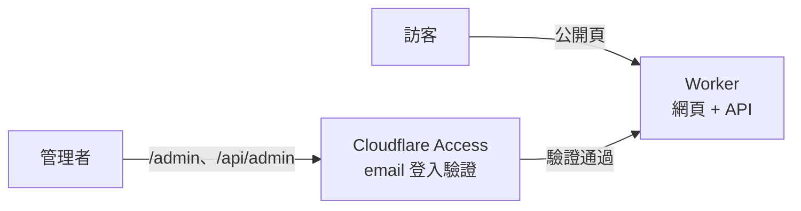

## 啟用 Zero Trust Free：方案與付款勾選框

在 Cloudflare Dashboard 左側選 **Zero Trust → Overview**，按 **Get started**。

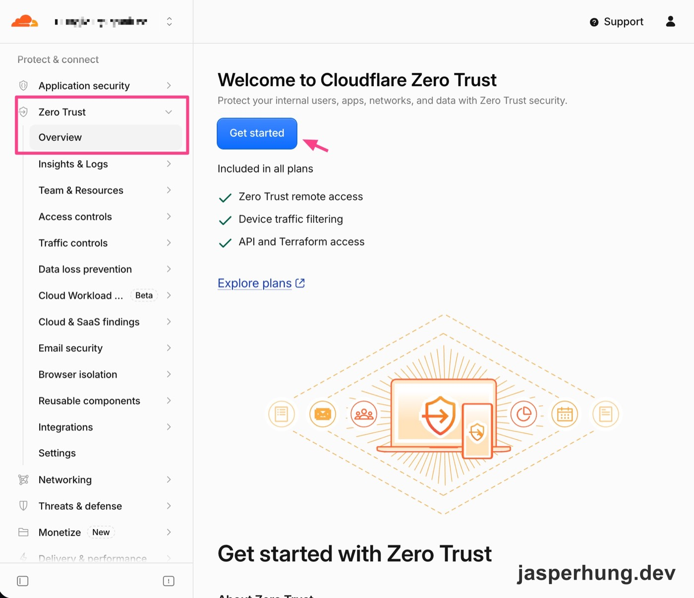

<p class="image-caption">圖：從 Zero Trust 的 Overview 開始啟用。</p>

方案選 **Zero Trust Free**，畫面上寫著 50 seat limit。

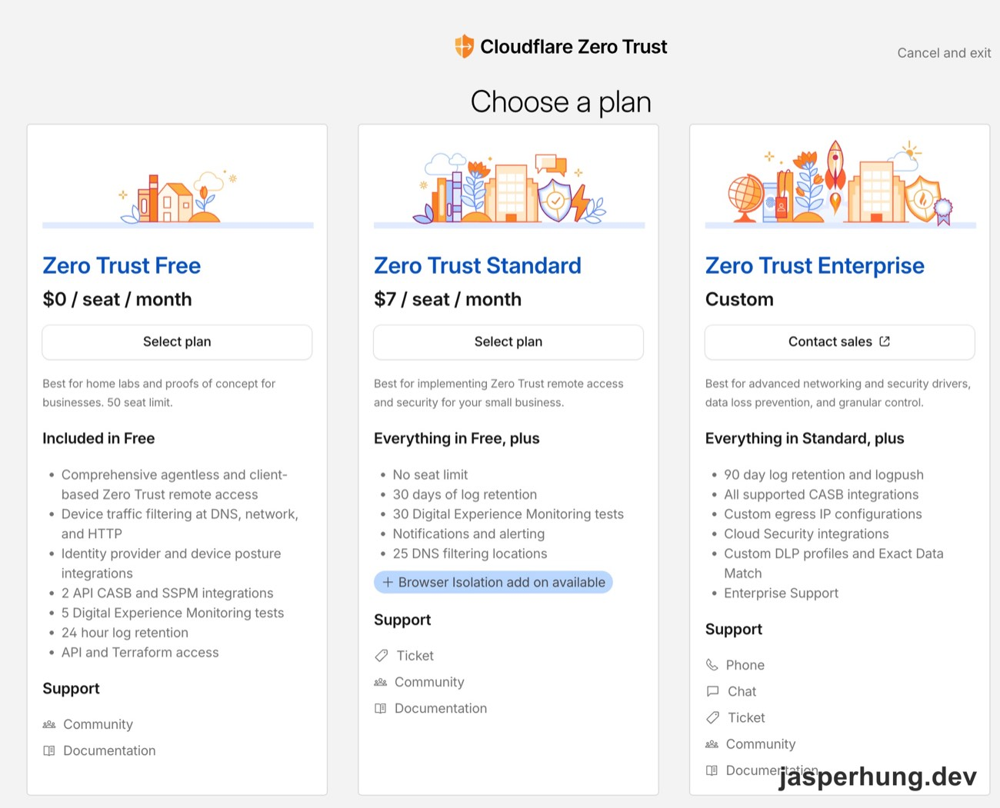

<p class="image-caption">圖：Free 方案有 50 seat 上限，自用綽綽有餘。</p>

接著要綁信用卡，最後有兩個勾選框。第二個寫的是「I authorize Cloudflare to charge this card for usage that exceeds free limits」，看到時我第一個反應是「這是不是會自動扣錢」。

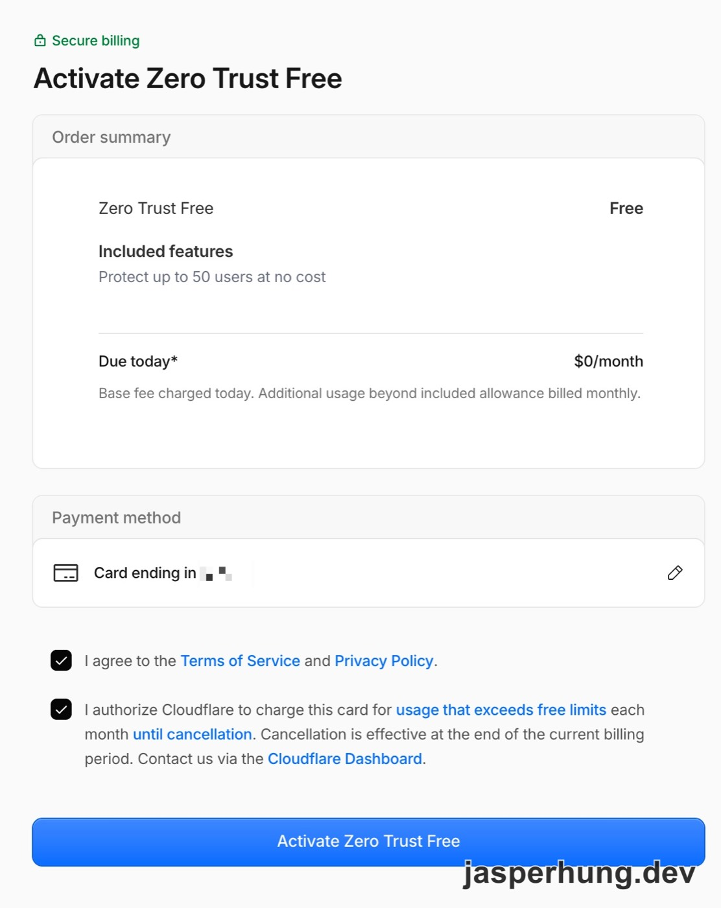

<p class="image-caption">圖：第二個勾選框授權的是超出免費額度後的扣款。</p>

這個框看起來是啟用的必要條件。它授權的是「超出免費額度才扣款」，Free 方案按 seat 計算，policy 只放自己的 email 就只會用到 1 個 seat，碰不到 50 的上限。

## Team domain：整個帳號共用，不要用專案名

啟用之後，Cloudflare One 首頁右側的 Account details 會顯示一個系統隨機給的 Team name，我拿到的是 `super-dream-6a8b`。

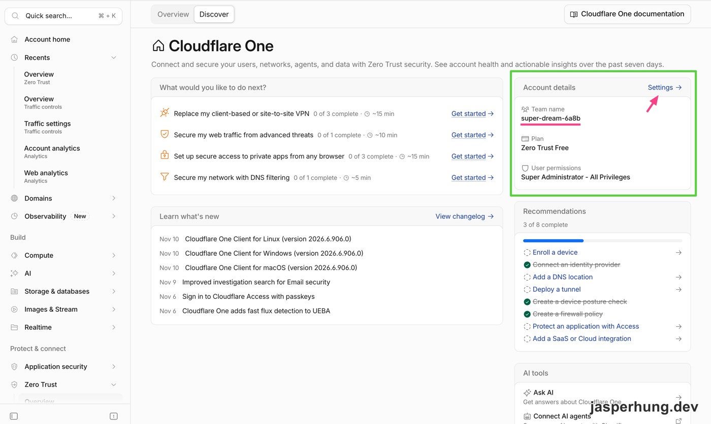

<p class="image-caption">圖：Team name 是啟用時隨機產生的，可以到 Settings 改。</p>

我原本想改成專案名，但 team name 是**整個 Cloudflare 帳號共用**的：Zero Trust 一個帳號一個，app 是一個一個加，每個 app 有自己的 AUD tag，但登入頁的網域 `<team>.cloudflareaccess.com` 全部共用。以後其他 app 的登入頁也會出現這個名字，所以最後取了跟專案無關的名字（我用自己的名字）。下文用 `your-team` 代表。

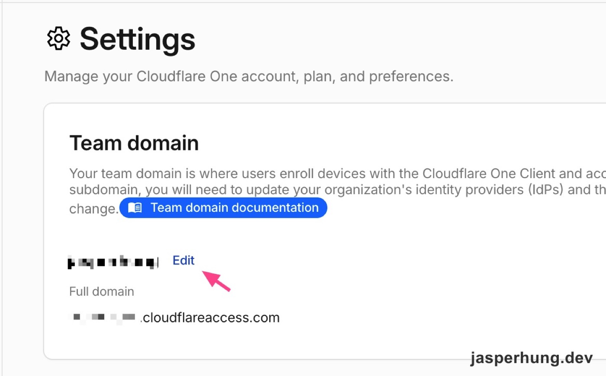

<p class="image-caption">圖：在 Settings 的 Team domain 修改，取一個不綁專案的名字。</p>

## 先建 Policy：位置在 Access controls → Policies

Policy 決定「誰可以進來」。先把它建好，等一下建 application 時直接掛上去。

位置在 **Zero Trust → Access controls → Policies**。這一步 AI 一開始指錯了位置，說在 Reusable components，結果我照著找、截到的畫面是 Gateway 的 DNS policies，那是管 DNS 過濾的，跟 Access 無關。Dashboard 一直在改版，認明 Access controls 底下的 Policies 就對了，頁面標題是 **Reusable policies**。

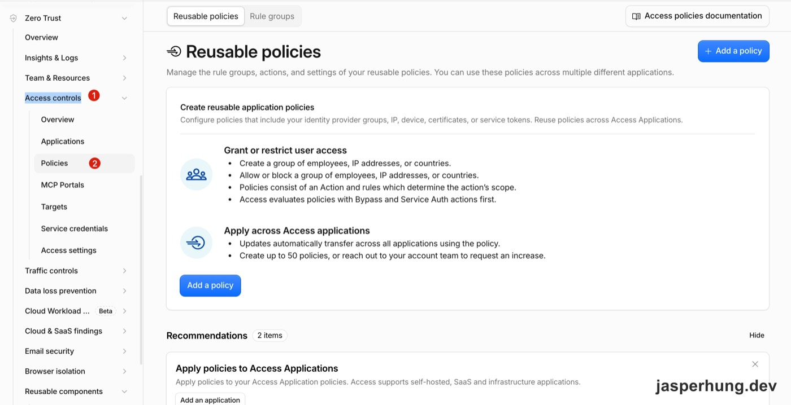

<p class="image-caption">圖：Access 的 policy 在 Access controls 底下，不在 Gateway。</p>

按 **Add a policy**，填這幾項：

- **Policy Name**：`Only me`
- **Action**：`Allow`
- **Include**：選 `Emails`，填自己的 email
- **Policy session duration**：我選 `1 week`，一週收一次 OTP 就好

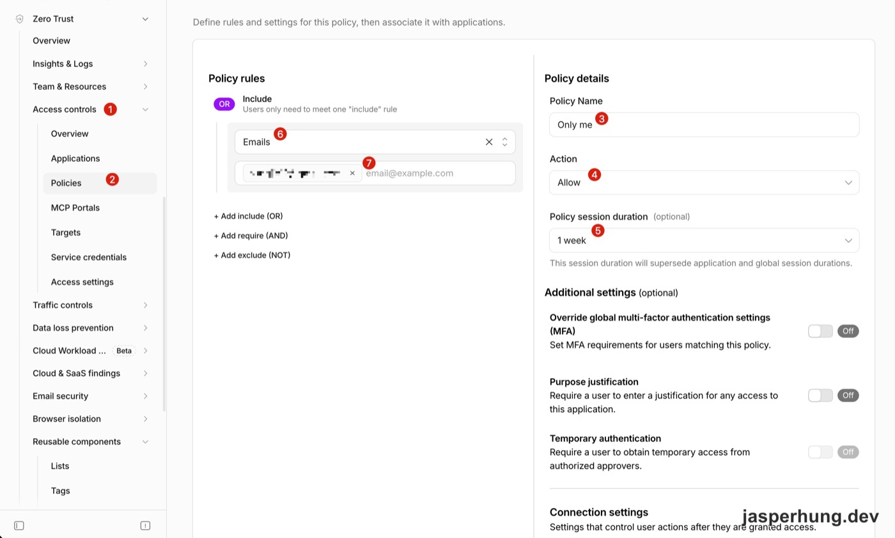

<p class="image-caption">圖：只放自己 email 的 Allow policy，session 設一週。</p>

Session duration 旁邊有一行說明：「This session duration will supersede application and global session durations.」也就是 policy 上的設定會蓋過 application 層的設定。存檔後列表裡會有一筆 `Only me`，此時 Used by applications 還是 0。

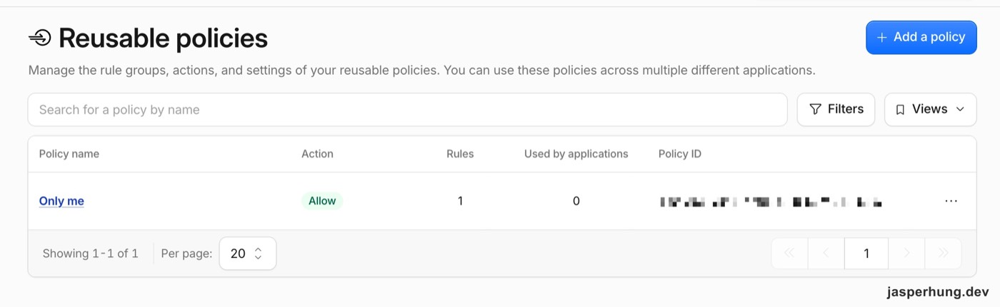

<p class="image-caption">圖：policy 建好了，還沒有任何 application 使用它。</p>

## 建 Application：走 Public DNS 加 Path，不要按 `+ Add Workers`

到 **Access controls → Applications**，按 **Create new application**。

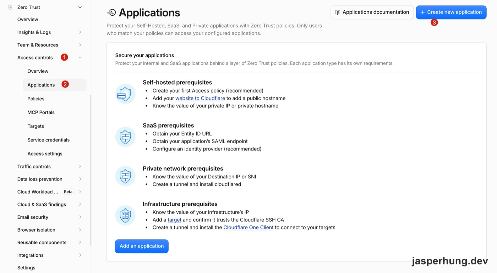

<p class="image-caption">圖：從 Applications 建立新的 application。</p>

類型選 **Self-hosted and private**，下方的分頁選 **Public DNS**，按 **Continue with Self-hosted and private**。

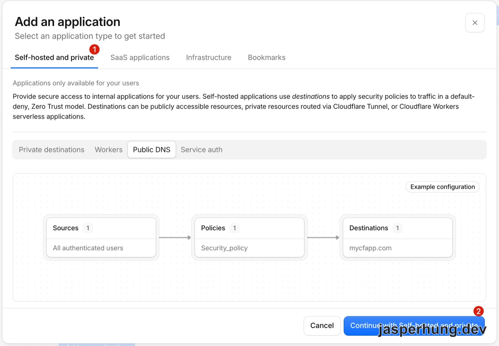

<p class="image-caption">圖：選 Self-hosted and private，再選 Public DNS。</p>

在 **Destinations** 的 Public hostnames 加兩筆，subdomain 填 `your-project`、domain 選 `example.com`，path 分別填：

- `admin`
- `api/admin`

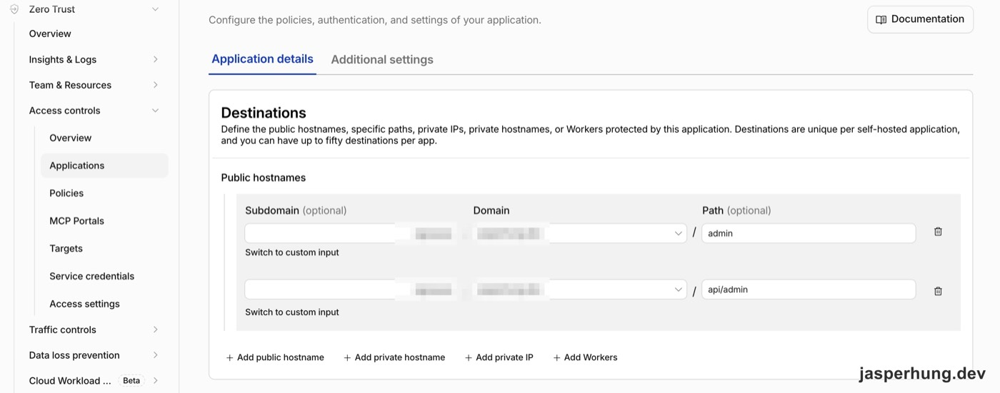

<p class="image-caption">圖：用 hostname 加 path 只保護後台頁與後台 API。</p>

> [!CAUTION]
> ### 不要按 `+ Add Workers`
> Destinations 下方有一顆 `+ Add Workers`，專案明明就是 Worker，看起來最貼切。但它保護的是整個 Worker，連公開頁面都會要求登入，一般使用者就進不來了。這裡要用 public hostname 加 path。

path 我填的是不帶 wildcard 的 `admin`。文件寫明 `alpha/*` 不包含 `alpha` 本身，所以如果寫成 `admin/*`，`/admin` 這一頁反而會漏掉。不帶 wildcard 的 path 會不會涵蓋子路徑，文件沒有直接寫，我是部署後用 curl 確認的：`/admin` 和 `/api/admin/*` 都會被擋（見最後一段）。照著做的話，建議也實際打一個子路徑確認。

往下捲到 **Access policies**，從 Add existing policy 選剛剛建的 `Only me`。

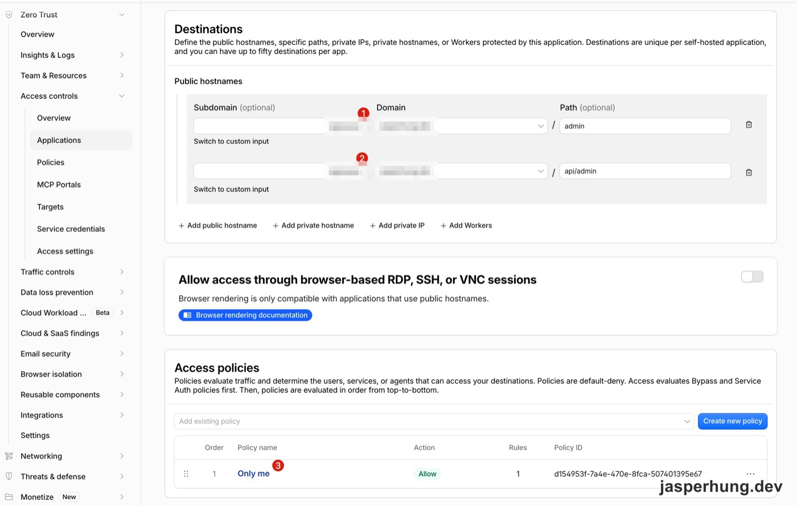

<p class="image-caption">圖：把 Only me 掛到這個 application。</p>

這張表最右邊有一欄 **Policy ID**，格式是 UUID。它不是後面 Worker 要用的 AUD tag，兩個很容易搞混。

最後在 Details 取名（我用「專案名 admin」），按 **Create**。這裡的 Session Duration 預設 24 hours，下方說明寫著「Policy and global session durations override the application session duration.」，跟 policy 頁的說法一致：policy 已經設了 1 week，這裡不用動。

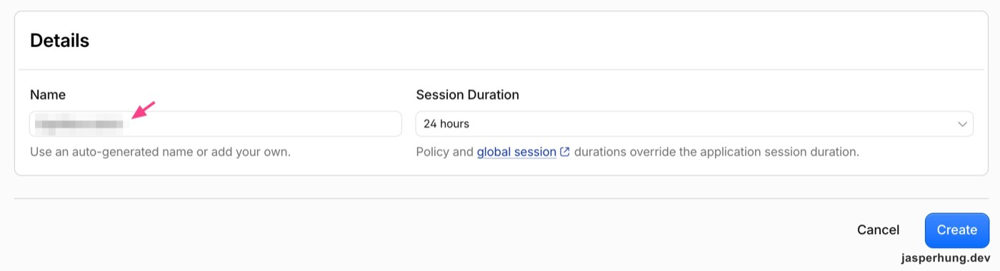

<p class="image-caption">圖：application 的 session duration 會被 policy 的設定覆蓋。</p>

建好後，列表會顯示 destination 是 `your-project.example.com/admin` 加另一個網域（`api/admin` 那條），policy 是 `Only me`。

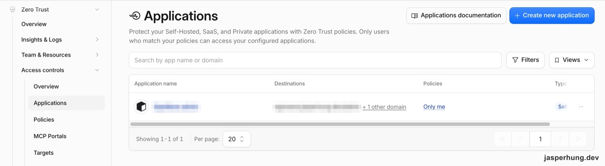

<p class="image-caption">圖：application 建好了，兩個後台路徑都掛著 Only me。</p>

## 拿 AUD tag：在 Additional settings 裡

打開剛建好的 application，切到 **Additional settings** 分頁，選 **AUD tag**，會看到一串 64 字元的 hex。這是 Worker 驗 JWT 時要比對的值，確認 token 是發給這個 application 的。

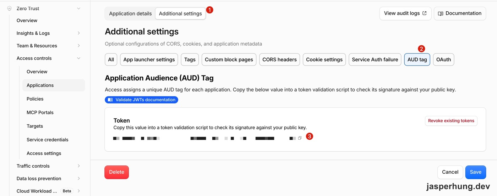

<p class="image-caption">圖：AUD tag 在 Additional settings 裡，application 存檔後才會出現。</p>

兩個容易犯的錯：

- 我截圖給 AI 時，一開始傳的是 policy 表上那串 UUID，那是 Policy ID。AUD 標示的是 application，Policy ID 標示的是 policy，兩者不一樣。
- 旁邊紅色的 **Revoke existing tokens** 不要按，它會讓所有已登入的人登出。

## 設完之後還要做的兩件事

Dashboard 設定到這裡就完成了。不過 Access 只保護 `your-project.example.com` 這個 hostname，Worker 這邊還要補兩件事，後台才算真的鎖好。

**1. 關掉繞過通道。** Worker 預設還能從 `<worker>.<account>.workers.dev` 和各版本的 preview URL 打到，這兩條路不在剛剛的 destination 裡。我用不到它們，直接在 `wrangler.jsonc` 關掉：

```jsonc
{
  "name": "your-project",
  "routes": [{ "pattern": "your-project.example.com", "custom_domain": true }],
  "workers_dev": false,
  "preview_urls": false
}
```

兩個都要寫。[workers.dev 文件](https://developers.cloudflare.com/workers/configuration/routing/workers-dev/)寫明關掉 workers.dev 不會連帶關掉 preview URL；在 Dashboard 上關掉的 workers.dev，下次用 Wrangler 部署時也會被打開，所以要寫進設定檔。

**2. Worker 內再驗一次 JWT。** edge 的保護完全取決於 Dashboard 的設定，哪天刪錯一條 destination，後台 API 就直接暴露出來。請求通過 Access 後，header 會帶 `Cf-Access-Jwt-Assertion`，Worker 收到 `/api/admin/*` 時用 team domain 的公鑰驗簽，並比對 `iss` 與 `aud`。只解開 payload 檢查欄位是不夠的，任何人都能自己組一個沒有合法簽章的 JWT。

管理者第一次打開後台時，整趟請求是這樣走的：

### 圖二：Access 登入與 JWT 驗證的請求順序

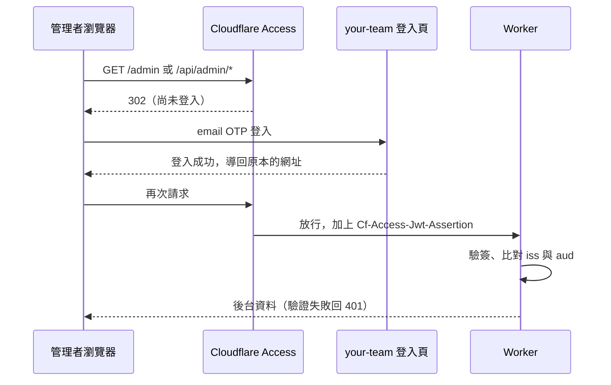

以下是簡短範例，用 [jose](https://github.com/panva/jose)：

```ts
import { createRemoteJWKSet, jwtVerify } from 'jose';

const TEAM_DOMAIN = 'https://your-team.cloudflareaccess.com';
const JWKS = createRemoteJWKSet(new URL('/cdn-cgi/access/certs', TEAM_DOMAIN));

export const verifyAccessJwt = async (token: string | undefined, audience: string) => {
  if (!token || !audience) return null; // fail closed：沒設定好就一律不給過
  try {
    const { payload } = await jwtVerify(token, JWKS, { issuer: TEAM_DOMAIN, audience });
    return typeof payload.email === 'string' ? { email: payload.email } : null;
  } catch {
    return null;
  }
};

// 在 /api/admin/* 的 middleware 裡：
// const identity = await verifyAccessJwt(request.headers.get('Cf-Access-Jwt-Assertion'), env.ACCESS_AUD);
// if (!identity) return new Response('unauthorized', { status: 401 });
```

做法跟[官方的驗證文件](https://developers.cloudflare.com/cloudflare-one/access-controls/applications/http-apps/authorization-cookie/validating-json/)一致：驗 header 而不是 `CF_Authorization` cookie，公鑰從 certs endpoint 抓，不寫死在程式碼裡（Access 大約每 6 週輪替一次金鑰）。

部署後用 curl 從外面確認：

```bash
# 後台頁：302 導向 your-team.cloudflareaccess.com 的登入頁
curl -sI https://your-project.example.com/admin

# 後台 API：帶假的 JWT 一樣是 302，請求在 edge 就被擋下，到不了 Worker
curl -sI -H "Cf-Access-Jwt-Assertion: fake.jwt.token" \
  https://your-project.example.com/api/admin/anything
```

帶假 header 的請求不會進到 Worker，所以 Worker 的 401 從外面測不到。這是預期中的結果：Worker 這道防線本來就是給「edge 設定出錯」時用的，它的行為要靠 Worker 自己的 test 驗證。

最後一步 curl 做不到，要用瀏覽器：打開 `/admin`，收 email OTP 登入，再打開後台 API。我實測可以正常拿到資料，代表 Access 簽發的 JWT 通過了 Worker 的驗證，AUD 和 team domain 都設對了。

## 心得

之前就聽說 Zero Trust 蠻好設定的，這次實際走過一次，步驟雖然不少，但介面都還蠻清新的，一步一步看得懂。

最讓我意外的是，一個帳號只要設定一次 Zero Trust，之後所有的 app 都可以掛在同一個帳號底下：team domain 共用，每個 app 各自設定 destination、policy，也各自有一組 AUD tag。而且 Free 方案很佛心地給了 50 個 seat，這 50 個是整個帳號共用、算的是登入的人數而不是 app 數，拿來做 side project 很夠用。

要開放給外部的人自己註冊時，就需要真正的帳號系統了，到時候再說。
