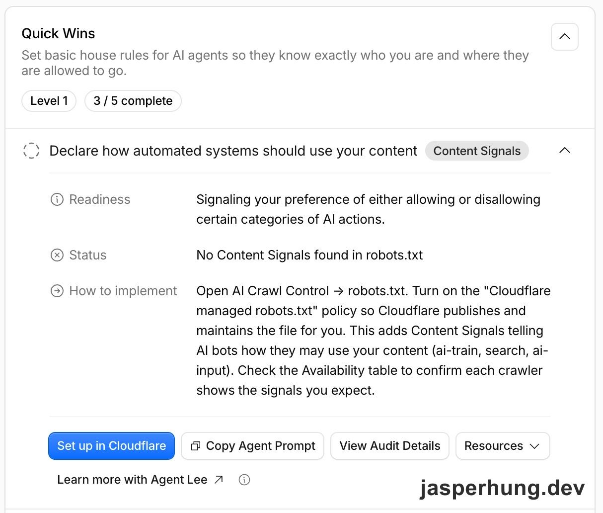

<KeyTakeaways>
  <p>Content Signals 讓網站用 <code>robots.txt</code> 表達內容是否可用於 <code>search</code>、<code>ai-input</code> 和 <code>ai-train</code>。我依照部落格希望被搜尋、被 AI 即時引用，但不提供模型訓練的目標，設定成 <code>search=yes, ai-input=yes, ai-train=no</code>；這是用途宣告，不會強制 crawler 遵守，也不能保證 AEO 成效。</p>
</KeyTakeaways>

某次我打開 Cloudflare 看部落格的檢查建議，Quick Wins 顯示 `3 / 5 complete`。其中一項寫著「Declare how automated systems should use your content」，狀態是 `No Content Signals found in robots.txt`。我原本只是想知道這個紅色項目是什麼，結果一路追到 AI 搜尋、內容訓練，最後還動手改了網站設定。



<p class="image-caption">圖：Cloudflare Diagnostics 提醒我在 robots.txt 宣告自動化系統可以如何使用網站內容。</p>

## 這個檢查項目要我在 robots.txt 宣告什麼？

展開項目後，Cloudflare 建議我開啟 managed `robots.txt`，由它代為發布和維護檔案。旁邊的 `Copy Agent Prompt` 範例則是：

```text
Content-Signal: ai-train=no, search=yes, ai-input=no
```

我先去看這三個欄位各自代表什麼。Cloudflare 的[官方說明](https://developers.cloudflare.com/bots/additional-configurations/managed-robots-txt/)把它們分成三種用途：

| Signal | 用途 |
|---|---|
| `search` | 建立傳統搜尋索引，並在結果提供連結和短摘要。 |
| `ai-input` | 即時把內容提供給 AI 回答問題，例如 RAG、AI Overviews，或 ChatGPT、Perplexity 搜尋後引用。 |
| `ai-train` | 用於訓練或微調 AI 模型。 |

Cloudflare 特別註明，`search` 不包含 AI 生成的搜尋摘要；即時把內容提供給 AI 回答，屬於 `ai-input`。

在下設定前，我也比對了 repo 裡的 `public/robots.txt` 和線上版本。兩邊相同，只有允許爬取網站的規則和 sitemap，沒有任何 Content Signals；Cloudflare 顯示的狀態確實對得上實際內容。

這三個 signal 補充的是「內容可以怎麼用」。`robots.txt` 裡的 `Allow` 和 `Disallow` 則是爬蟲對路徑的存取偏好。兩者都不是網路層級的硬性封鎖：Cloudflare 也說明，`robots.txt` 是自願遵守的宣告；真的要阻擋特定 crawler，還要使用 [AI Crawl Control](https://developers.cloudflare.com/ai-crawl-control/features/track-robots-txt/) 或其他存取控制。

看到範例裡有 `ai-input=no`，我停下來想了一下：我的部落格已經在做 AEO，也希望 AI 能讀文章、在回答問題時引用內容；這個值是不是和我的方向相反？照抄提示詞之前，我先把這三種用途和自己的網站目標對了一遍。

## Managed robots.txt，還是自己改 repo？

Cloudflare 給了兩條路：開啟 managed `robots.txt`，讓它發布和維護檔案；或是直接修改 repo 裡的 `public/robots.txt`。[官方文件](https://developers.cloudflare.com/bots/additional-configurations/managed-robots-txt/)說 managed 規則會併到既有檔案前面，也可能附上針對特定 AI crawler 的 `Disallow`。如果選這條路，線上回應會多出由 Cloudflare 管理的內容。

我選擇直接改 repo，因為希望每個值都能在原始檔案裡看到、一起版控，也想清楚知道線上會發布什麼。這個決定先定下來後，我又回頭確認另一個問題：既然我想讓 AI 使用文章，`ai-train=no` 會不會也把 AEO 一起關掉？

## `ai-train=no` 會不會影響 AEO？

把用途拆開後，我的理解是：`ai-train=no` 表達不希望內容拿去訓練或微調模型；`ai-input` 才是 AI 即時取用內容來回答問題。Cloudflare 也特別註明，`search` 指搜尋索引和傳統搜尋結果，不包含 AI 生成的搜尋摘要。之前我也寫過[如何用 answer-first 摘要讓讀者和 Agent 先判斷文章值不值得讀](/posts/aeo-answer-first-summary/)；這次我希望保留一般搜尋索引，也允許 AI 即時讀取並引用，訓練則是另一個選擇。

因此我沒有照抄範例，而是把自己的偏好寫成：

```text
User-agent: *
Content-Signal: search=yes, ai-input=yes, ai-train=no
Allow: /

Sitemap: https://jasperhung.dev/sitemap-index.xml
```

[Cloudflare 文件](https://developers.cloudflare.com/bots/additional-configurations/managed-robots-txt/)目前也提到一個測試中的 `use` 擴充欄位，用來描述內容被取用後可以如何保留與再利用；它沒有出現在這次 Quick Win 的三欄建議裡，所以我沒有把它混進這次設定。這組值是我依照網站用途做的判斷，不是 AEO 效果測試；哪些 crawler 會讀取並遵守、設定後是否改變文章被引用的機會，我都還沒有驗證。

部署後，我還要回 Cloudflare Diagnostics 重新掃描，確認它有讀到 Content Signals。即使檢查項目變成完成，也只代表掃描工具看見這行設定，不代表每家 crawler 都會遵守它。

## 給 AI 的規範，也需要有人先把意思弄清楚

這次是跟著 Cloudflare 的檢查建議，才第一次認真看 `robots.txt` 裡還能宣告內容用途。對我來說，這是 agent 時代把網站內容交給 AI 使用時，多出來的一層選擇：搜尋、即時回答和模型訓練可以分開表達，不必全部綁在一起。

它像一道「君子鎖」——不能真的把不守規矩的 crawler 擋在門外，但至少讓網站清楚說出自己的偏好，也提供一種大家可以參考的規範。這種跟著工具提示、再一路把背後意思弄懂的學習方式，我覺得很讚。
