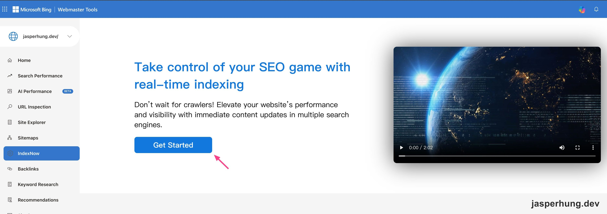
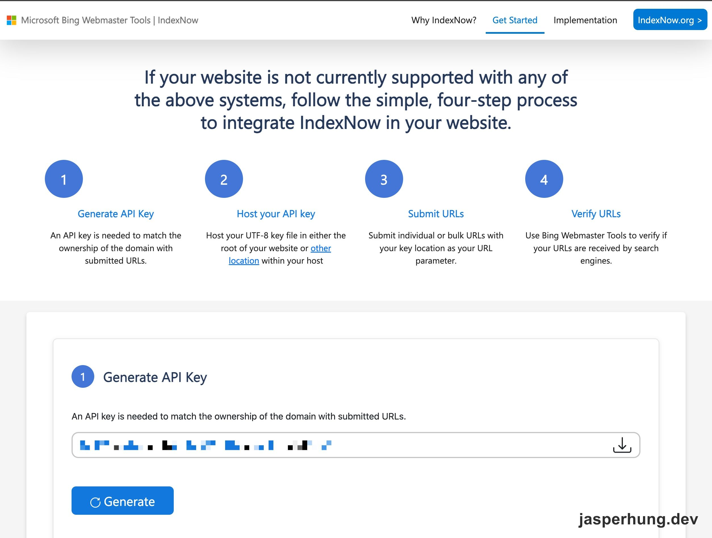
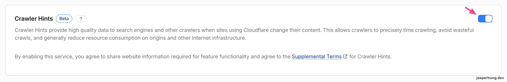
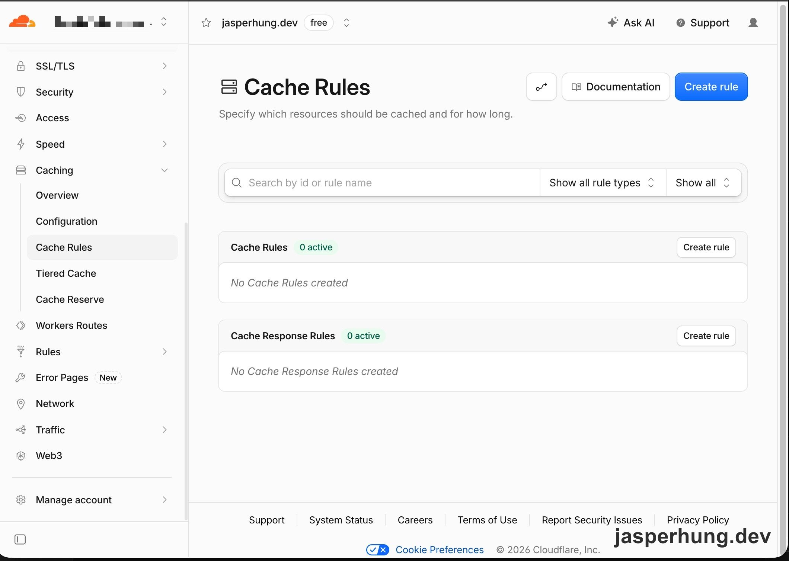
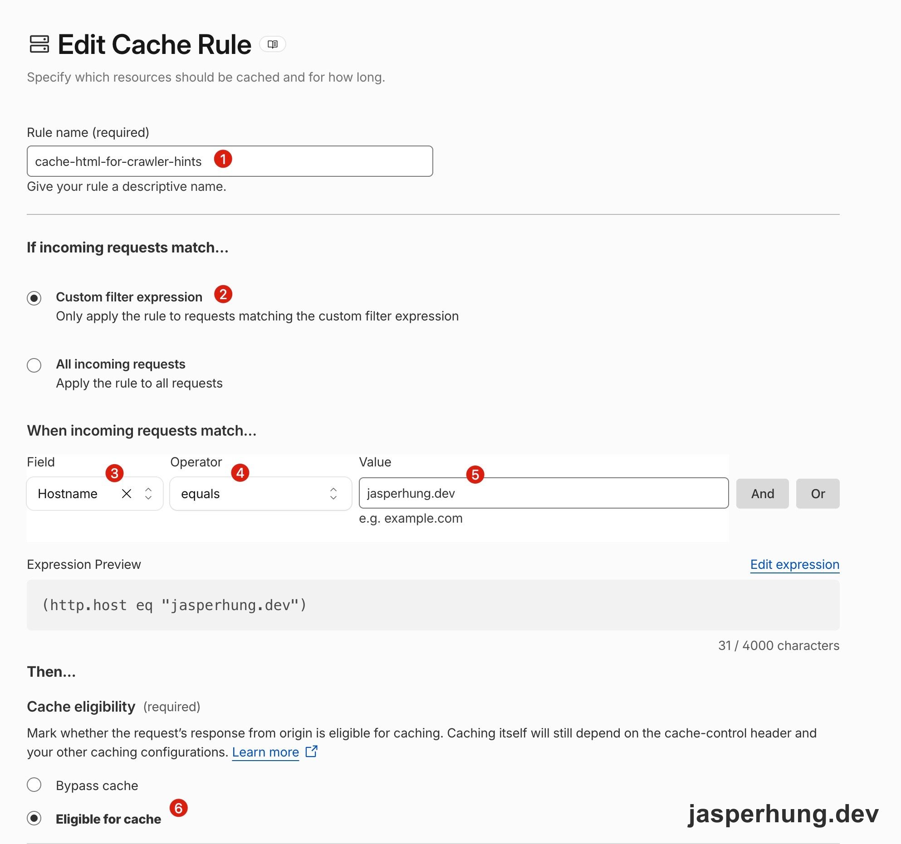
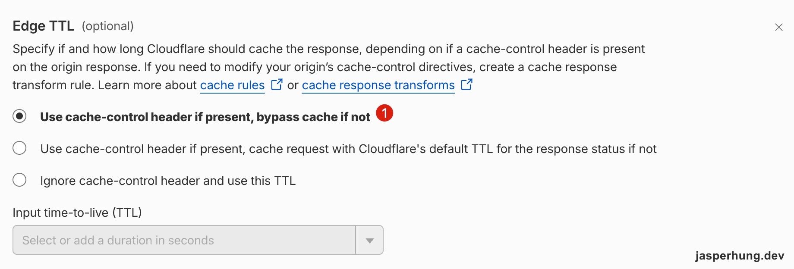

<KeyTakeaways>
  <p>IndexNow 沒有立刻看到新 URL，我先確認是否需要設定 IndexNow API key，再發現 Cloudflare Crawler Hints 沒開；開啟後檢查 HTML，發現回傳 <code>DYNAMIC</code>，最後用 Cache Rule 讓 GitHub Pages 的文章頁具備快取資格。</p>
</KeyTakeaways>

我接著[前一天把 sitemap 交給 Bing Webmaster Tools 的設定](/posts/bing-webmaster-tools-geo-setup/)，打開 [Bing 的 IndexNow Get Started 頁面](https://www.bing.com/indexnow/getstarted)，卻發現 IndexNow 報表還沒有新 URL。看到「產生 IndexNow API key、放 `{key}.txt`、呼叫 API」那串教學時，我先懷疑是不是漏做了什麼：IndexNow 怎麼還沒開始通知？

查完 API key 的問題後，我回到 Cloudflare 的設定；這時才發現，文章頁還有另一層問題——HTML 根本沒有被 Cloudflare 快取。

## IndexNow API key 要自己設定嗎？

我在 Bing Webmaster Tools 左側選 `IndexNow`，再按首頁的 `Get Started`，進到 Bing 提供的 IndexNow 說明頁。



<p class="image-caption">圖：從 Bing Webmaster Tools 的 IndexNow 頁面進入 Get Started。</p>

頁面接著列出沒有被平台支援時的四步手動流程：`Generate API Key`、`Host your API key`、`Submit URLs`、`Verify URLs`。



<p class="image-caption">圖：IndexNow 提供的手動 API key 設定流程。</p>

看到這組手動設定教學，我先確認另一件事：是不是要自己產生一組 IndexNow API key，把 `{key}.txt` 放到網站根目錄，讓搜尋引擎確認這個 domain 是我的？這裡的 key 不是 Cloudflare API Token，而是 IndexNow 用來驗證網站擁有權、授權 URL 提交通知的一組字串。假設 key 是 `abcd1234`，檔案就叫 `abcd1234.txt`，內容也放同一組 `abcd1234`。

[IndexNow FAQ](https://www.indexnow.org/faq) 說，當 hosting provider 原生支援 IndexNow 時，不需要自行建立或放置 key file，提交會由平台自動處理。因此，在 Cloudflare 的 Crawler Hints 原生整合裡，我不用走這條手動驗證路徑；從使用者角度，GitHub Pages 也不用新增 `{key}.txt`。至於 Cloudflare 內部如何處理 key 與網站驗證，官方沒有公開，我只把結論寫到「不用自己做這段設定」。

## 1. Cloudflare Crawler Hints 開了嗎？

先把 API key file 這條線排除後，我回到 Cloudflare。這次真正先漏掉的設定其實更簡單——Cloudflare Crawler Hints 根本沒有啟用。

:::tip
**Cloudflare 操作路徑**：`Caching → Configuration → Crawler Hints`
:::



<p class="image-caption">圖：追查後把 Cloudflare Crawler Hints 開啟。</p>

IndexNow 也只是通知搜尋引擎 URL 變更，不等於搜尋引擎一定會收錄內容。

## 2. 文章頁還是沒有被快取（`DYNAMIC`）

真正的下一個轉折，是我開始懷疑問題會不會出在網域和主機之間的連線：網域是在 Cloudflare 買的，部落格則架在 GitHub Pages，再透過自訂網域設定連過去。問題會不會就藏在這幾個環節的其中一個？

我先用一個很普通的 `curl` 看 response headers。首頁回傳 `server: cloudflare`，表示請求確實經過 Cloudflare；但 `cf-cache-status: DYNAMIC`。這先排除了「完全沒有經過 Cloudflare」這條線，也讓問題轉向快取設定。接著查 [Cloudflare 的 Crawler Hints 文件](https://developers.cloudflare.com/cache/advanced-configuration/crawler-hints/)，裡面提到它會用 cache status 的 `MISS` 來判斷內容可能已更新。

這讓整條架構變得清楚：

```text
讀者 → Cloudflare edge → GitHub Pages origin
```

Cloudflare 預設會快取 `.png`、`.css`、`.js` 這類靜態檔案，但 HTML 和 `/posts/xxx/` 這種沒有副檔名的路徑通常直接回 origin，所以每次都是 `DYNAMIC`。文件沒有直接說明 `DYNAMIC` 會怎麼被 Crawler Hints 處理，因此「文章頁永遠沒有 MISS，就可能永遠不會被判定為更新」是依文件與 response header 得出的推論，不是官方明文保證。

## 3. 檢查 Cloudflare Cache Rule

到 Cloudflare Dashboard，選擇網站後打開 Cache Rules。先前這個頁面是空的，代表沒有任何額外規則讓 HTML 具備快取資格：

:::tip
**Cloudflare 操作路徑**：`Caching → Cache Rules`
:::



<p class="image-caption">圖：建立規則前，Cache Rules 顯示 0 active。</p>

我建立了一條 `cache-html-for-crawler-hints` 規則，設定如下：

- Custom filter expression：`(http.host eq "jasperhung.dev")`
- Cache eligibility：`Eligible for cache`
- Edge TTL：`Use cache-control header if present, bypass cache if not`



<p class="image-caption">圖：只套用到本站 hostname，並讓符合條件的回應具備快取資格。</p>



<p class="image-caption">圖：Edge TTL 沿用 origin 的 cache-control；沒有 header 時不強行快取。</p>

查一下 [Cloudflare 的 Cache Rules 設定](https://developers.cloudflare.com/cache/how-to/cache-rules/settings/) 後，這條規則的代價其實不是每次 deploy 都要手動 purge。Cache Rule 先讓 HTML 具備快取資格，再讓 Edge TTL 沿用 origin 的 `cache-control`；GitHub Pages 原本就回 `cache-control: max-age=600`，所以 edge 最多保存 10 分鐘，時間到自然重新向 origin 取資料。讀者在部署後最慢可能看到 10 分鐘舊內容，但不需要另外維護 purge script。

## IndexNow 要送去哪？

IndexNow 要送去哪？答案是不用逐一指定。IndexNow FAQ 說，送到任一個參與端點的提交，會在支援 IndexNow 的搜尋引擎之間共享。因此 Cloudflare 不需要讓我填 Bing、Yandex、Naver 或 Seznam 的目的地。

## 怎麼驗證 IndexNow 是否真的送出

Crawler Hints 的開關不會改變 HTML response header，所以不能靠 curl 直接驗證「IndexNow 已送出」。我能驗證的是前一段 Cache Rule 是否真的生效：部署後首頁先出現 `DYNAMIC → MISS → DYNAMIC` 的交錯結果，應該是規則還在不同 edge location 擴散；接著對文章頁做五次 GET，前四次分別打到不同機房，都是 `MISS`，第五次回到同一個機房後變成 `HIT`，並帶有 `age: 5`。

```bash
curl -s -D - -o /dev/null \
  https://your-domain.com/posts/your-post/
```

把網址換成你要檢查的文章頁，就能查看這個頁面的 response headers 與 `cf-cache-status`。

這次也踩到一個小坑：`curl -I` 發出的是 HEAD request，我用它測了兩次都得到 `MISS`；改成真正的 GET，才看見預期的 `MISS → HIT` 行為。至於 Crawler Hints 是否真的把文章 URL 送進 IndexNow，最後仍要回 Bing Webmaster Tools 左側的 IndexNow 報表確認。

目前還留著一個觀察項目：origin 的 TTL 只有 10 分鐘，內容沒有變更也可能頻繁出現 MISS。Cloudflare 是否會分辨「TTL 到期」和「內容真的變了」，以及這會不會造成 IndexNow 重複送出，官方文件沒有交代，得靠後續報表觀察。

## 結論

這一切很有趣！我很喜歡這種從一個怪怪的地方開始追問，再一路挖出背後一連串問題的過程。

一開始我只是想知道：Bing Webmaster Tools 的 IndexNow 為什麼還沒有資料？是不是哪個設定做錯了？看到 Microsoft 的說明頁寫著要申請 key、把檔案放到網站上時，我直覺以為還要把這些設定綁進部落格。

但我記得 Agent 之前不是這樣說的，所以我繼續追問。後來才發現，問題不在於我少放了一個 key file，而是 Cloudflare 根本沒有快取文章頁的 HTML。Domain 只是把請求轉到 GitHub Pages，每次都直接去 origin 拿最新頁面；Cloudflare 只在前面代理，還沒有真正替這些 HTML 承擔 CDN cache 的角色。

雖然現在流量還不高，這仍然是一個很好的學習機會。網站出了問題時，不只是看頁面有沒有打開，也要確認 DNS、Cloudflare edge、GitHub Pages origin，以及 cache status 之間到底怎麼串起來。這次一路從 IndexNow 追到 `DYNAMIC`、`MISS`、`HIT`，也讓我更清楚 CDN 不是「掛上 Cloudflare 就自動完成」；快取規則真的有作用，才算讓它參與到網站的實際運作裡。
