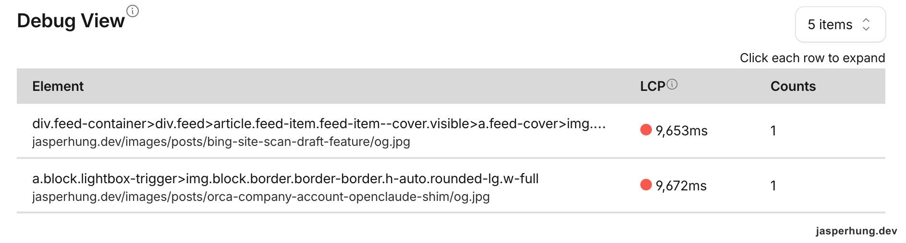

<KeyTakeaways>
  <p>首頁 LCP 慢到 9 秒？經排查為極端網路離群值，但實測抓出首屏動畫拖延 900ms 與卡片模式雙重載入等真問題。解法為 server 端不輸出圖片 src，改由 inline script 依可視範圍與檢視模式動態指派，並將手機預設改回列表。同模式下桌面列表 LCP 降低 65%（1.79 → 0.62 秒）、手機列表 1.26 秒，手動選卡片則約 3.4 秒；首屏判定需依賴 CSS aspect-ratio 撐開方框。</p>
</KeyTakeaways>

在例行巡檢 Cloudflare Web Analytics 的 Debug View 時，兩筆顯眼的數據跳了出來：首頁 feed 的封面圖 LCP 顯示為 9,653ms，另一篇內文頁 hero 則是 9,672ms。兩者的計數都只有 1，載入的都是 og.jpg。

當下的第一個直覺是：Cloudflare 哪裡的快取設定跑掉了，還是這幾張圖在上傳時漏掉了壓縮？



<p class="image-caption">圖：首頁與文章頁各出現一筆約 9.6 秒的 LCP 紀錄。</p>

## 9.6 秒在測試中重現不了，卻帶出首頁兩個問題

檢視文章頁的 hero 圖片，發現它已設為優先載入。首頁 feed 的封面圖則交由瀏覽器延後載入；卡片本身一開始是透明的，並往下偏移 12px，必須等頁面腳本載入、判斷卡片進入視窗，再跑 600ms 的淡入動畫才會完全顯示。

透過 curl 檢查 production 環境，圖片大小約在 119–131KB 之間，快取標頭正常，TTFB 落在 0.58–0.76 秒；首頁 HTML 經過 brotli 壓縮後的實際傳輸量僅有 52KB，容量並沒有失控。

進一步使用 Playwright 在手機視窗（390×844）模擬停用快取，並施加 Slow 4G（1.6Mbps／150ms RTT）與 CPU 降速 4 倍的限制進行實測：

| 頁面 | 不限速 LCP | Slow 4G + CPU 4x LCP |
|---|---|---|
| 首頁 | 1.34s | 2.00s |
| 文章頁 | 0.41s | 2.21s |

即便在 Slow 4G 加 CPU 4 倍降速下，手機首頁 LCP 也只有 2.00 秒，遠低於報表上的 9.6 秒。兩筆紀錄的計數都只有 1 且耗時幾乎完全一致，符合極端不良網路下的單一離群值特徵。

然而實測數據卻暴露了首頁兩個實質問題：

1. **淡入動畫延後了繪製**：限速環境下圖片在 1,073ms 就已下載完成，畫面卻因為動畫過渡硬是拖到 1,996ms 才完全可見，白等了將近 900ms。
2. **第一張封面圖掛著 lazy**：不限速時 HTML 於 522ms 就已抵達，圖片卻因為 lazy 屬性遲至 783ms 才開始發送請求。

第一直覺的解法很簡單：讓靜態產生器在 build 階段把第一屏的篇章直接掛上 `visible` class，跳過動畫，並將前兩篇改為 `eager`。

但這個想法隨即撞牆：**SSG 怎麼可能預先知道第一屏有幾篇？**

## Code review 問：為什麼要量完 120 張卡片？

第一版在 inline script 裡用 `map()` 對首頁 120 篇文章逐一呼叫 `getBoundingClientRect()`，把每篇是否在首屏都算出來。Code review 看過這段後問：「為什麼每張卡片都算一遍？算出首屏顯示範圍就夠了吧？」

Astro 在 build time 產出靜態 HTML，無法預先知道每位訪客的視窗高度與欄數；但列表和卡片目前都是由上而下的 row order，文章項目的 `top` 會持平或遞增。找到第一個 `top` 超出視窗高度的項目後，就知道首屏範圍已經結束，不必再量後面的文章。

因此程式從第一篇開始讀取位置，遇到第一個 `top >= window.innerHeight` 就停止；這次手機列表只量了 5 篇，不再對 120 篇全部量一次。

```js
let firstScreen = 0;
while (firstScreen < items.length && items[firstScreen].getBoundingClientRect().top < vh) {
  firstScreen++;
}
```

得到 `firstScreen` 後，inline script 只替首屏項目加上 `visible` 和 `feed-item--instant`；module script 則只把其餘項目交給 IntersectionObserver。

這段程式先連續讀取位置，全部讀完後才更新 class；中間沒有 DOM 寫入讓排版失效，後續讀取沿用同一次排版結果，不會反覆觸發 reflow。

第一屏的卡片則會加上 `visible`，並用另一個 class 關掉 transition，避免已經套用初始透明樣式的元素又跑一次淡入：

```css
.feed-item.feed-item--instant {
  transition: none;
}
```

後續載入的 module script 則改為只對尚未具備 `visible` 的文章註冊 IntersectionObserver。同一時間，第一屏的圖片在 inline script 裡被設為 `eager`，首張圖片補上 `fetchpriority="high"`。

## 意外發現雙重下載 bug

將邏輯改好後展開第一輪本機驗證。列表模式與桌面卡片的第一屏判定篇數都完全正確，但 Network 面板卻出現異常：桌面卡片模式竟然同時抓了 15 張 thumb 縮圖與 6 張 og 圖。

深入排查發現，這由兩個原因疊加而成：

其一是調整順序時的邏輯疏失：程式碼在迴圈內先將圖片的 `loading` 改為 eager，隨後才置換 `src`。瀏覽器在屬性被設為 eager 的瞬間，就立刻對舊的 thumb 發出了請求。

將屬性賦值順序調整後再次測試，thumb 的下載請求卻依然存在。為了驗證是否改動前就存在這問題，拿 production 作為對照組在 Slow 4G 下測試：

- **Production 桌面卡片**：thumb 15 張 + og 15 張，LCP 6.1 秒。
- **修正順序後的本機**：thumb 15 張 + og 6 張，LCP 1.6 秒。

雙重下載在改動前就存在。原本的 HTML 已經替圖片放入 thumb 的來源；頁面分段解析時，瀏覽器會在讀到 feed 尾端的 inline script 之前就先排版，接近可視範圍的 lazy 圖片因此進入下載佇列。等 script 再把來源換成 og，thumb 和 og 就都被抓了。瀏覽器原生 lazy loading 會在排版時自動預載接近視窗的圖片；只要 HTML 預先寫入了 thumb 的來源，這段提前發出的請求就已經躲不掉。

此時更翻出了一個關鍵設定：`index.astro` 對沒有檢視偏好的訪客，在螢幕寬度小於 640px 時預設為卡片模式。首頁只有卡片模式會抓 og.jpg，這說明報表上記錄到的正是卡片模式被觸發的情境。

> [!CAUTION]
> 這個 feed 的圖片來源取決於訪客選擇的檢視模式；HTML 若先放入固定的圖片來源，瀏覽器可能在模式切換前就開始下載。這次改為等前置 script 確認模式後才指定來源，避免先抓錯圖片。

圖片還沒有來源時，方框由 `width`／`height` 屬性與 CSS `aspect-ratio`（4:3 或 1200:630）撐開，既能避免排版位移（CLS），也讓後續量測得到穩定的位置。

前置 script 確認檢視模式後，先設定載入方式和優先順序，再寫入對應的圖片來源。

### 改動前後的實測結果

以下是在 Slow 4G + CPU 4x 條件下的實測對照：

| 模式 | 改前 thumb／og | 改後 thumb／og | 優化 |
|---|---|---|---|
| 手機卡片 | 5／5 張 | 0／5 張 | 請求數 -50% |
| 桌面卡片 | 15／15 張 | 0／15 張 | 請求數 -50% |
| 桌面列表 | 8／0 張 | 8／0 張 | — |
| 手機列表 | 9／0 張 | 9／0 張 | — |

| 模式 | 改前 LCP 元素 | 改後 LCP 元素 | LCP 時間變化 |
|---|---|---|---|
| 手機卡片 | thumb | og | +57% |
| 桌面卡片 | thumb | og | -32% |
| 桌面列表 | thumb | 文字 | -65% |
| 手機列表 | thumb | 文字 | -22% |

手機卡片在改動後看似慢了 57%，是因為改前瀏覽器量到的是半路被裁切的 thumb，改後量到的才是讀者真正看到的完整 og 封面。

## 動畫元件控制顯示，圖片下載交給瀏覽器

這次排查也把兩種行為拆開來看：動畫元件控制卡片何時從透明狀態淡入；圖片是否延後下載，則由瀏覽器的 lazy loading 機制決定。

`opacity: 0` 會讓卡片透明，但不會阻止圖片請求。只要圖片進入瀏覽器判定的載入距離，即使卡片還沒淡入，圖片仍可能開始下載；`visibility: hidden` 也不會取消這種請求。相較之下，`display: none` 不占版面，瀏覽器通常不會載入其中的 lazy 圖片。

所以動畫和載圖各做各的事：元件負責呈現節奏，瀏覽器依可視距離與頻寬安排 lazy 圖片。卡片先淡入底色和文字，不必等圖片下載完成；標題和摘要已經能讓讀者開始瀏覽。

## 最簡單的解法：手機改回預設列表

修掉雙重下載後，手機卡片模式在 Slow 4G 下的 LCP 仍停在 3.4 秒。這裡發現問題出在大圖小用：手機版位只有 360px 寬，卻硬抓了 1200×630、約 130KB 的 og 圖。

而根本的解方法是重新修改建置流程，為卡片比例額外產出一張縮圖，但這牽涉到重新生成全部文章封面，還要再評估看看，因此目前最划算的解法不是大費周章重產全站圖檔，而是把沒有偏好的手機訪客預設改回列表，卡片模式則保留給主動切換的讀者，這樣一舉兩得。

## 心得

例行檢查 Cloudflare Web Analytics 時，我看到一筆平常沒出現過的 9 秒 LCP。這件事不能放著不管，所以我趕快往下查：先追到雙重下載，再回頭檢視卡片模式的圖片尺寸，才發現不同顯示方式應該配不同大小的圖片，這件事當初漏想了。

手機預設卡片原本是因為這個新功能看起來很吸引人。實際用手機看，卡片畫面一次只能看到很少文章；搜尋可以幫忙找特定文章，卻不能取代列表讓人快速瀏覽的方便。這也是這次先調整手機預設值的原因。

類似的效能問題在工作上也會遇到，但這是自己的產品時，想把它照顧好的感覺更直接。一路追查到雙重下載和圖片尺寸，我覺得是一次很棒的發現。
