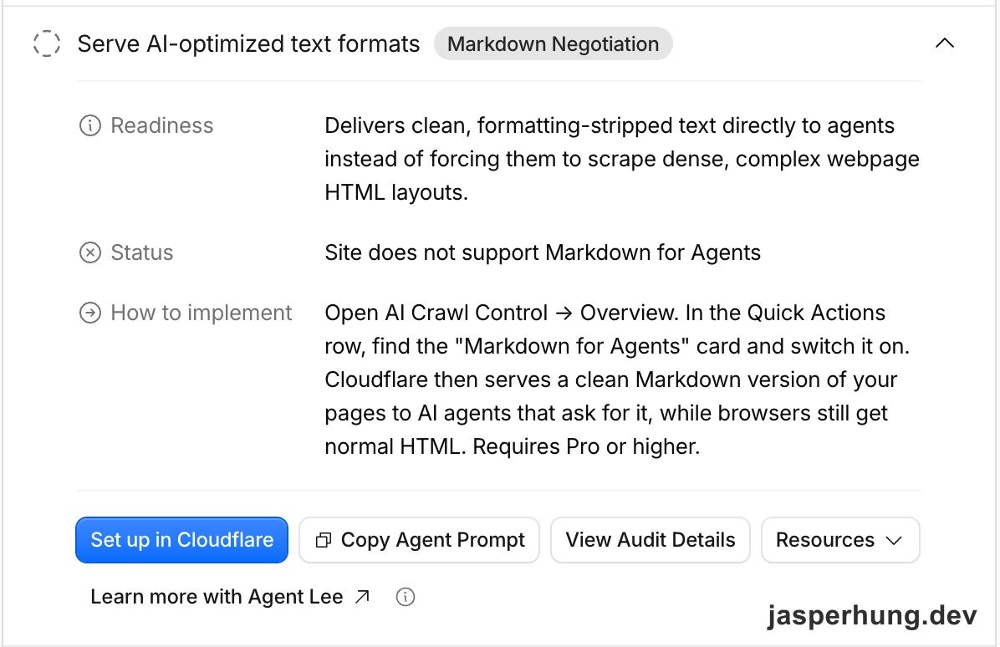

<KeyTakeaways>
  
Cloudflare 的 Markdown for Agents 會依 `Accept: text/markdown` 把同一個頁面的 HTML 轉成 Markdown；另外提供 `.md` URL 是不同機制。這篇記錄診斷為什麼沒過，以及我實際先補上的 endpoint metadata。

</KeyTakeaways>

Cloudflare Diagnostics 的 Quick Wins 有一項「Site does not support Markdown for Agents」。我把整段建議貼給 Agent 時，第一個疑問是：blog 明明已經有 `/posts/[slug].md`，為什麼還被判定不支援？

圖：Cloudflare Diagnostics 建議在 AI Crawl Control 啟用 Markdown for Agents。

## 已經有 .md endpoint，為什麼還說不支援？

我先用兩個 request 比較線上回應。直接請求 `.md` 網址會拿到 Markdown；對文章主網址加上 `Accept: text/markdown`，結果仍然是 HTML。

| Request | 回應 |
|---|---|
| `GET /posts/about-page-author-card.md` | `text/markdown` |
| `GET /posts/about-page-author-card/`，帶 `Accept: text/markdown` | `text/html` |

這兩個網址回答的是不同問題。`.md` endpoint 是額外提供一個 Markdown URL；Content Negotiation 則是同一個 URL 看 request 的 `Accept` header，再決定回 HTML 或 Markdown。從 Cloudflare 提供的啟用方式和 request 實測來看，我判斷這項診斷檢查的是後者，所以它沒有把現有的 `.md` endpoint 算進去。

頁面本身也已經有 `<link rel="alternate" type="text/markdown">` 指向 `.md` 檔，但那只是告訴讀者另一份文件在哪裡，沒有讓文章主網址依 header 改變回應內容。

## Cloudflare Markdown for Agents 做了什麼？

Cloudflare 的 Markdown for Agents 是一項 edge 轉換服務。啟用後，Agent 對原頁面送出 `Accept: text/markdown`，Cloudflare 會從 origin 取得 HTML，再轉成 Markdown 回傳；回應也會帶上 `Vary: Accept`，讓快取分開保存 HTML 與 Markdown 版本。[Cloudflare 官方文件](https://developers.cloudflare.com/fundamentals/reference/markdown-for-agents/)

這項服務能讓一般 HTML 網站不必自己生成 Markdown endpoint，也能回應偏好 Markdown 的請求。不過我的網站已經有一份從文章原始內容產生的 `.md`，所以再把 HTML 轉一次，對我不一定比直接提供整理好的 Markdown 更有價值。這是依照我目前網站架構做的取捨，不是對 Cloudflare 轉換品質的普遍結論。

當時擺在眼前的路有三條：啟用 Cloudflare 內建服務、在 edge 加 Worker 把 `Accept` 請求導到現有 `.md`，或先不處理。Worker 最貼近我手上的 Markdown 來源；如果目標是讓診斷分數通過，這是可行方向。但我還不知道 Agent 讀到 `.md` 後能不能找到適合引用的主網址，於是先追問了另一件事。

## Agent 單獨拿到 .md，知道文章是哪一篇嗎？

接著我問了一個更直接的問題：Agent 是從 `.md` 讀到文章時，最後能不能引用回主網址？如果它對主網址送出 `Accept: text/markdown`，網址本身沒有變，回覆的 Markdown 仍來自文章主網址；如果它另外 fetch `/posts/[slug].md`，那份內容對應的就是 `.md` URL。這不代表每個 Agent 一定會貼哪一種連結，但至少兩種入口提供的引用線索不同。

沿著這個問題去看 `.md` endpoint 的實際內容，我才看到另一個更直接的問題：檔案開頭沒有文章標題、canonical URL 或日期，摘要區塊還保留著 `<KeyTakeaways>` 這種 MDX 元件標籤。Agent 即使順利讀到內容，也得自己猜這是什麼文章、應該連回哪個網址。

所以我先把 endpoint 補成一份能獨立辨識的 Markdown 文件：前面加上包含 `title`、`description`、`url`、`date` 與 `tags` 的 YAML frontmatter，再補一個 H1 標題；`KeyTakeaways` 則輸出成一般 blockquote。`url` 明確指出文章的 canonical URL，但它只能提供引用線索，不能保證每個 Agent 都會採用那個網址。這次也沒有清掉 endpoint 裡所有 HTML：圖片圖說的 `
` 和圖片相對路徑仍是後續要處理的問題。

## 先修 endpoint，再決定要不要追診斷分數

這次沒有實作 Cloudflare 的 content negotiation，也沒有加 Worker。原本的 `.md` URL 繼續提供給能直接讀取它的 Agent，而 endpoint 現在多了辨識文章與摘要所需的資訊。Cloudflare Diagnostics 那項檢查仍然沒有通過，因為它檢查的機制並沒有被啟用。

我原本以為要處理的是一個沒過的分數，後來才發現，分數只是指出「沒有 content negotiation」；真正讓我先動手修的，是 `.md` 檔本身沒有寫清楚文章身分。這兩件事都和 Agent 讀 Markdown 有關，但不必用同一個方案解決。
