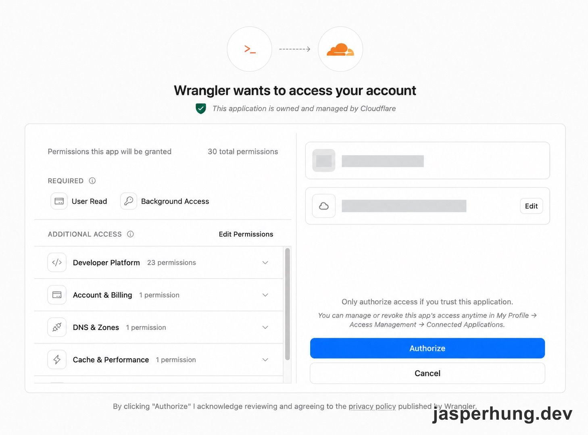
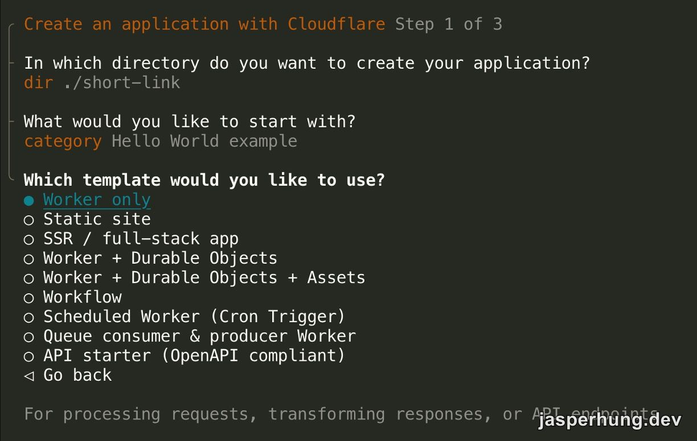
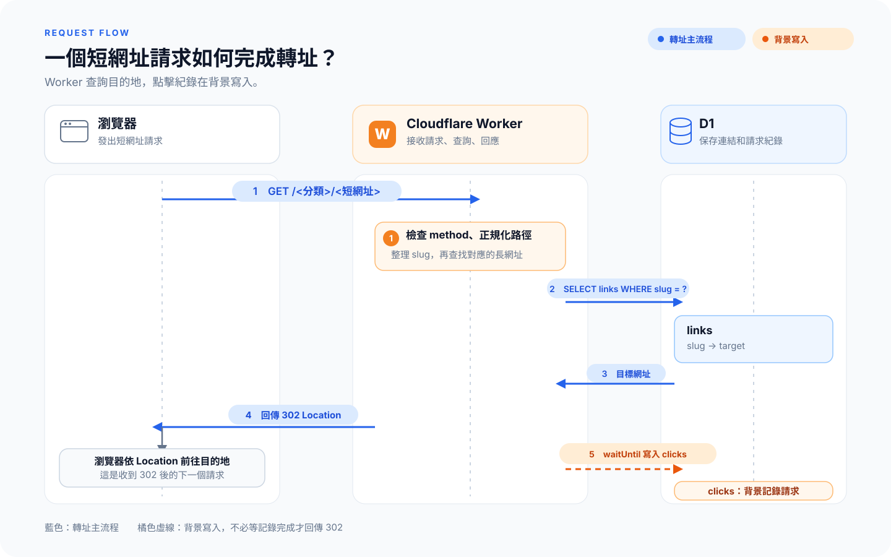

<KeyTakeaways>
  <p>個人短網址服務可以由 Cloudflare Worker 負責查詢和轉址、D1 保存連結與點擊紀錄；部署後也能直接用 Wrangler CLI 管理，第一版不必先做管理介面。</p>
</KeyTakeaways>

我在 Threads 看到有人分享用 Cloudflare 自己做短網址服務，追蹤自己想觀察的各種連結。看完才發現，一個最基本的個人短網址服務好像沒有想像中難；如果還能接在自己的 domain 上，看起來也更正式。我也想親手試一次。

## Wrangler 在這個專案負責什麼？

Wrangler 是 Cloudflare Workers 的[CLI](https://developers.cloudflare.com/workers/wrangler/)。我用它跑本機 Worker、操作 D1、套用 [migration](https://developers.cloudflare.com/d1/wrangler-commands/)，再部署到 Cloudflare。Worker 進入點、D1 binding 和 custom domain 則寫在 [`wrangler.jsonc`](https://developers.cloudflare.com/workers/wrangler/configuration/) 裡。

第一次讓本機 Wrangler 連結 Cloudflare 帳號時，瀏覽器會先開啟授權頁，列出 CLI 要取得的權限。



<p class="image-caption">圖：Wrangler 連結 Cloudflare 帳號時顯示的授權範圍，帳號資訊已遮蔽。</p>

這個專案最後使用的版本組合是：

| 工具 | 專案版本 | 用途 |
|---|---|---|
| Node.js | 22.23.4 | 執行 Wrangler 和專案工具 |
| pnpm | 11.28.8 | 安裝相依套件與執行專案指令 |

第一版的服務也刻意保持精簡：收到短網址後查出目標、回傳轉址、記錄請求。管理 UI 和寫入 API 都先不做；新增或查詢連結時用 Wrangler CLI 執行 SQL 就夠了。

## Node.js 和 pnpm 版本鎖在專案裡

我用 `create-cloudflare` 建立 Worker 專案，先選 Hello World example，再選 Worker only 和 TypeScript。安裝相依套件時遇到 `packages field missing or empty`。當時電腦的預設環境是 Node.js 22.12 和 pnpm 9.15.1；scaffold 產生的 `pnpm-workspace.yaml` 則用了 pnpm 11 才認得的設定。pnpm 9 讀到這份檔案就先失敗，程式還沒開始跑。



<p class="image-caption">圖：建立 Cloudflare 專案時選擇 Worker only template；後續選用 TypeScript。</p>

直接升級全域 pnpm 會影響其他專案，我想把新版本限制在這個 repo。起初試著讓 pnpm 自動切版，但舊版會先解析 workspace 設定；pnpm 11 的[發行說明](https://pnpm.io/blog/releases/11.0)列出 Node.js 22+，而我用 22.12 切版時仍收到至少升到 22.13 的錯誤，這條路行不通。

最後我用 nvm 安裝 Node.js 22.23.4，但不改預設版本；再透過 Corepack 啟用 pnpm 11.28.8，並用 `.nvmrc` 記住專案要用的 Node.js。進入這個資料夾時切到新版本，離開時回到原本的預設環境。nvm 底下每個 Node.js 版本可以有自己的全域工具，因此其他專案仍能繼續用原來的 pnpm 9。

這是整個架設過程裡最先花時間排除的問題。短網址本身的程式很小，工具鏈版本反而先讓專案停在起跑點。

## 連結和點擊紀錄分別保存什麼？

專案跑起來後，我先把資料分成兩類：短網址對應的目標網址，以及每次請求的紀錄。

| 資料表 | 一筆資料代表 | 保存內容 |
|---|---|---|
| `links` | 一條短網址 | `slug`、`target`、由 slug 計算的 `channel`、`label`、`created_at` |
| `clicks` | 一次請求 | `slug`、`ts`、`country`、`asn`、`as_org`、原始 `ua`、`is_bot`、額外的 `extra` JSON |

`channel` 是由 `slug` 第一段自動計算的欄位，不用每次新增連結時再手動填一次，避免路徑和分類不一致。點擊紀錄則不存 IP；原始 UA 留下來，日後如果想多看一種瀏覽器或裝置資訊，仍可以重新解析既有資料。

`clicks` 和 `links` 用 `slug` 對應，但沒有設 foreign key。刪除一條短網址時，過去的點擊紀錄仍然保留，之後還是能查到它曾經收到多少請求。這裡選擇讓歷史紀錄獨立存在，資料關係也比較容易理解。

## 過濾機器人或爬蟲

點擊紀錄會把空白 UA、符合 crawler pattern 的 UA，或來自已知雲端服務 ASN 的請求標成 bot。這個判斷只用來整理統計，不會讓 bot 和一般瀏覽器收到不同目的地。概念上大致是：

```ts
const isBot = !userAgent || crawlerPattern.test(userAgent) || knownCrawlerAsns.has(asn);
```

這只是判斷方向的簡化示意，實際 pattern 和 ASN 清單仍要依服務觀察調整。短網址服務要知道哪些請求可能是自動掃描，但第一版不必為了追求完美辨識，讓轉址流程變複雜。

## Worker 查詢目標，D1 背景留下紀錄

Worker 接到請求後，先檢查 HTTP method、正規化路徑，再用 `slug` 到 D1 找目標網址。找到時回傳 302；點擊紀錄交給 [`ctx.waitUntil()`](https://developers.cloudflare.com/workers/runtime-apis/context/#waituntil) 在背景寫入，避免資料庫寫入拖住轉址回應。沒有對應連結就回 404，不接受的 method 則回 405。



<p class="image-caption">圖：藍線是查詢與轉址的主流程；橘色虛線表示 Worker 透過 `waitUntil` 在背景新增點擊紀錄。</p>

bot 判斷只會影響紀錄上的分類，不會把請求導向另一個目的地。這樣同一條短網址維持相同的轉址行為，點擊紀錄則可以另外區分一般請求和 bot 請求。

在本機用 `wrangler dev` 時，Worker 連到本機的 SQLite；測試也會用 migration 建立新的測試資料庫。這些資料和線上的 D1 分開，改動本機資料不會碰到正式環境。

## 用 migration 和 Wrangler 把服務部署上線

本機流程確認後，我把資料結構變更和新增連結分開處理：新增欄位或索引時用 migration 套用到資料庫；新增短網址則只改資料，不必重新部署 Worker。程式和連結資料可以各自更新。

上線時，我先把 migration 套用到遠端 D1，再用 `wrangler deploy` 部署 Worker。`wrangler.jsonc` 指定程式入口、D1 binding 和 custom domain；綁定 `go.jasperhung.dev` 後，Cloudflare 會依[自訂網域設定](https://developers.cloudflare.com/workers/configuration/routing/custom-domains/)建立 DNS 紀錄並簽發憑證。最後用 `curl` 確認服務回傳 302 和正確的 `Location`，完成 smoke test。

## Worker 和 Lambda 的操作差異

我用 AWS Lambda 的經驗來理解 Worker。下表只對照這次採用的 HTTP 路徑：

| 面向 | Cloudflare Workers + D1 | AWS Lambda + API Gateway |
|---|---|---|
| 程式入口 | Worker 的 [`fetch(request, env, ctx)`](https://developers.cloudflare.com/workers/runtime-apis/handlers/fetch/) 使用標準 `Request` / `Response` | API Gateway 把 HTTP 請求交給 Lambda handler，依整合方式回應（[AWS 文件](https://docs.aws.amazon.com/lambda/latest/dg/services-apigateway.html)） |
| 服務連線 | `wrangler.jsonc` 指定進入點、D1 binding 和 custom domain | Lambda 與 API Gateway 等資源依選定架構設定 |
| 部署操作 | Wrangler CLI 可執行本機開發、D1 migration 和 `wrangler deploy` | 部署與 HTTP 整合分別設定在相應的 AWS 資源中 |

這裡的 Lambda 對照限於 HTTP + API Gateway 這條路徑；AWS 也提供 Lambda Function URL 作為 HTTP endpoint，其他觸發器、資料服務和權限則依架構選擇（[AWS 文件](https://docs.aws.amazon.com/lambda/latest/dg/services-apigateway.html)）。Cloudflare 由 Worker、D1、DNS 和網域各自負責不同工作；Wrangler CLI 把本機開發、資料庫操作和部署收在同一套流程裡，讓我覺得更直接。

## 上線後先查哪些統計？

我先用 [Wrangler CLI](https://developers.cloudflare.com/d1/best-practices/query-d1/) 對遠端 D1 執行 SQL，查看每條短網址累積的請求數。確認這些統計會反覆用到後，我再把查詢包進 `pnpm stats`，用一個指令查看各連結的一般點擊數、bot 點擊數和最近一次請求時間。第一版先用 CLI 看資料，不另外做管理介面。

## 心得

自己架一次短網址服務，讓 system design 裡的資料 mapping、點擊追蹤和轉址流程真的用在自己的需求上。理論有實際服務可以對照，理解起來更具體，印象也深很多。
