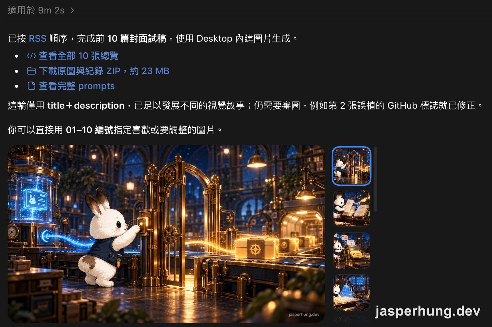
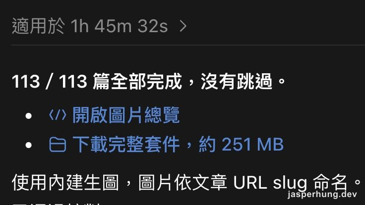
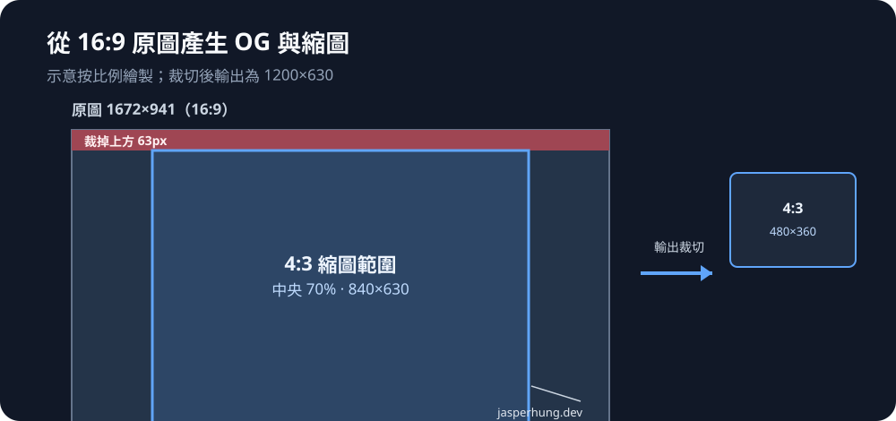
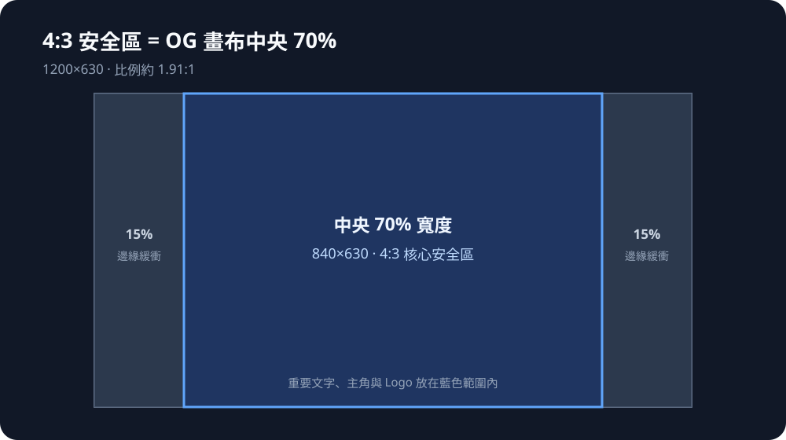

<KeyTakeaways>
  <p>如何把 Codex Project 批次生成的封面圖穩定整合進部落格？先以 RSS 標題與描述完成 10 張試稿，再把主體收在中央 70% 安全區；最後由 Claude 工程端輸出 1.91:1 OG 圖與 4:3 列表縮圖，並只在 OG 圖燒入浮水印。</p>
</KeyTakeaways>

原本以為替 113 篇文章補上封面插圖，得逐篇重讀內容、手寫故事大綱與畫面 Prompt。

在實際執行時，生圖的工作交給了已設定角色風格與場景規範的 Codex Project。先依 RSS 順序提供標題與描述，生成前 10 張試稿，耗時 9 分 2 秒，檢查場景、人物與主題物件是否容易辨識。



<p class="image-caption">圖：首批 10 張試稿用時 9 分 2 秒，先檢查 RSS 標題與描述能否引導出可辨識的場景與人物。</p>

確認方向後，再執行正式的 113 張批次生成。RSS 標題與描述是每篇文章的主要 context；Agent 也能依連結補抓文章內的 `<KeyTakeaways>` 摘要，提煉核心隱喻。正式批次耗時 1 小時 45 分 32 秒；加上首批試稿的 9 分 2 秒，合計 1 小時 54 分 34 秒，約 115 分鐘。



<p class="image-caption">圖：正式批次完成 113 張封面圖，用時 1 小時 45 分 32 秒；首批 10 張試稿另花 9 分 2 秒。</p>

然而，當這批 16:9（1672×941）的原圖整批落到桌面上，準備放進 Repo 正式上線時，真正的工程規格衝突才剛開始。

## 第一批試作暴露規格問題：回頭修 Codex Project instructions

第一批試作的原圖是 16:9（1672×941），但網站的 Open Graph 圖片採用 1.91:1（1200×630）。如果直接置中裁切，上下兩側會各削掉約 3.4% 的畫面。

翻看生圖用的 Prompt 設定，還發現它要求把網域名稱燒在圖片右下角，約在高度 95% 的位置。若置中裁切成 1.91:1，下方的浮水印會被裁掉一部分。這代表問題不只在切圖方式，生圖規格也要先配合網站的輸出尺寸與安全區。

因此先回到 Codex Project，修改 Project instructions，讓後續生圖遵循同一組規格：

| 項目 | 統一要求 |
|---|---|
| 尺寸 | 精確 **1200×630 px** |
| 格式 | **JPG／PNG** |
| 主故事範圍 | 中央 **840×630 px（4:3）**，x＝180～1020；左右各 180 px 僅放可裁切背景 |
| 浮水印 | 生圖與 Codex Project 內後製均不加浮水印或網站署名，包括 `jasperhung.dev` |

這裡的「不加浮水印」約束 Codex Project 的生圖與影像後製階段。網站正式素材則交給 Claude 工程端的 `pnpm cover`，在輸出 OG 圖時統一燒入浮水印；4:3 縮圖沿用不含浮水印的畫面。



<p class="image-caption">圖：舊版 16:9 原圖以貼底裁切保留已燒入的浮水印；4:3 縮圖從 OG 畫布中央擷取 840×630。</p>

## 接進 Astro 的結構約定

確認裁切可行後，需要將封面圖資產規範化進 Astro 專案。

一般靜態圖片在 Astro 可以放在 `src/assets/` 享受自動最佳化，但社群分享卡片（`og:image`）必須提供固定的絕對網址。Astro 在建置時會為 `src/assets/` 的檔名附加上雜湊值，這對於需要穩定 URL 的社群快取機制並不友善。

因此圖片路徑採取慣例結構：

- 檔案統一存放於 `public/images/posts/<slug>/`，每篇文章固定產生兩個用途不同的檔案：
  - `og.jpg`：1200×630、約 1.91:1，用作文章的 `og:image`，也顯示在文章開頭作為 hero image；網站正式版在這張圖上燒入浮水印。
  - `thumb.jpg`：480×360、4:3，用於首頁、tag 與 series 列表縮圖；從未加浮水印的畫面裁切，保持縮圖乾淨。
- Content Collections 的 Schema 原本定義了從未使用的 `image: string`，直接簡化為 `cover: z.boolean()`。
- 文章頁面（`[slug].astro`）在渲染時，只要 `cover` 為 `true`，就自動推導出絕對路徑並覆蓋預設的動態 OG 圖片；若為 `false` 則維持回退機制。

## OG 安全區該守哪條線？從中央正方形退回 4:3

當圖檔就定位後，一個關鍵問題浮上檯面：後續生圖時，到底要把主要視覺限制在多大的安全區內？

社群上針對 Open Graph 裁切的討論眾說紛紜：

- **多圖宣告的限制**：Open Graph 協議規範雖然允許宣告多個 `<meta property="og:image">`，但在實務上，Facebook、X（Twitter）、LinkedIn、Slack 等平台的爬蟲抓取分享卡片時，並不會根據當下版面自動挑選不同比例的圖片。同一個網址基本上只能依賴一張標準的 1200×630 橫幅。
- **正方形縮圖的極端案例**：社群部分文件（例如開源專案的文件庫 PR）主張將核心內容收進中央 1:1 的正方形（630×630，約寬度 52.5%），原因是部分通訊軟體（如 Slack 或 WhatsApp 在特定訊息模式下）會將連結預覽裁成正方形縮圖。
- **平台實際行為**：X 的 `summary_large_image` 是 2:1（1200×600）或 1.91:1（1200×628），1200×630 只會被微幅裁切上下各 15px；Slack 與 Discord 在標準大型預覽下也是完整顯示 1.91:1。正方形裁切通常只發生在特定平台的緊湊模式或小卡模式。

回看首批 10 張試稿，若只保留中央正方形（約 52.5% 寬度），其中 6 張的主角或關鍵文字會被裁切。這是首批試稿的檢查結果，不是正式 113 張圖片的統計；也說明為什麼 Project instructions 最後採用中央 70% 寬度，也就是 4:3 安全區。

最後決定的邊界是：**以站內列表的 4:3 縮圖作為防守線，即保留中央 70% 的寬度**。



<p class="image-caption">圖：中央 70% 的寬度乘上 630px 高度，正好形成 840×630 的 4:3 縮圖範圍。</p>

退回 70% 之後，逐張檢視 113 張裁切預覽，情況大幅簡化：
- **6 張必須重新生成**：代表文章主題的技術 Logo 或關鍵標題被切掉（例如「LLM Wiki」被切成「LLM W」）。
- **10 張邊緣切角**：僅切到無關緊要的背景元素，縮圖尺寸僅約 105×79px，肉眼難以辨識，保留不重做。
- **5 張角色微幅出界**：不影響主題辨識，維持原樣。

針對必須重生的 6 張圖，修改生圖 Prompt，加入明確的安全區指令（限制關鍵物件在中央 70% 寬度，頂部預留 8% 空間），讓畫面主體自然往中間收攏或以景深排列。

## 雙軌架構：收斂成 `pnpm cover` 自動化腳本

重新產出的 6 張圖已遵循更新後的 Project instructions：1200×630，且沒有預先燒錄浮水印。正式整合的 113 篇文章封面分成三批：
1. **舊圖（99 張）**：16:9，右下角已帶有浮水印；以貼底方式裁切，保留原浮水印，不重複燒錄。
2. **新圖（6 張）**：1200×630，沒有浮水印；由 Claude 工程端裁切 4:3 縮圖，並在 `og.jpg` 上燒入浮水印。
3. **先前已處理（8 張）**：在這次全量處理前已完成，沿用同一組 `og.jpg` 與 `thumb.jpg` 輸出規格。

為了不讓每次發布文章都變成手動切圖的記憶考驗，這套邏輯最終被收斂為 `scripts/cover.mjs`，並在專案中建立 `pnpm cover` 指令：

```bash
# 模式 A：全新乾淨圖片（預設：置中裁切、壓製 JPEG 並加上浮水印）
pnpm cover ~/Desktop/raw-cover.png --slug my-post-title

# 模式 B：已經預先燒入浮水印的圖片（貼底裁切、不重覆上浮水印）
pnpm cover ~/Desktop/baked-cover.png --slug my-post-title --baked-watermark
```

腳本的工作流程如下：
1. 依據 `--baked-watermark` 旗標決定裁切原點（底部對齊或幾何置中）。
2. 使用 Sharp 處理圖片縮放與品質壓縮（`og.jpg` 約 100–140KB，`thumb.jpg` 約 30KB）。
3. 輸出至 `public/images/posts/<slug>/`。
4. 自動檢查並更新對應 Markdown 檔案的 Frontmatter，補上 `cover: true`。

腳本完成後，使用兩種來源的原始圖檔重新執行一次，比對產出檔案與先前手工調整的結果，像素差異為 0。

## 心得

利用 RSS 與既有的文章摘要讓 Agent 自動化產圖，大幅降低了內容網站建立視覺識別的門檻，不到兩小時就能備齊百篇文章的基礎圖素。

但真正讓視覺資產順暢融入網站的關鍵，仍在於工程端的約束與容錯。弄清楚社群平台的真實裁切機制，設定合理的 4:3 安全區，並將邊界處理收斂為 CLI 指令，才能在日後新增內容時，繼續維持輕量的發布節奏。
