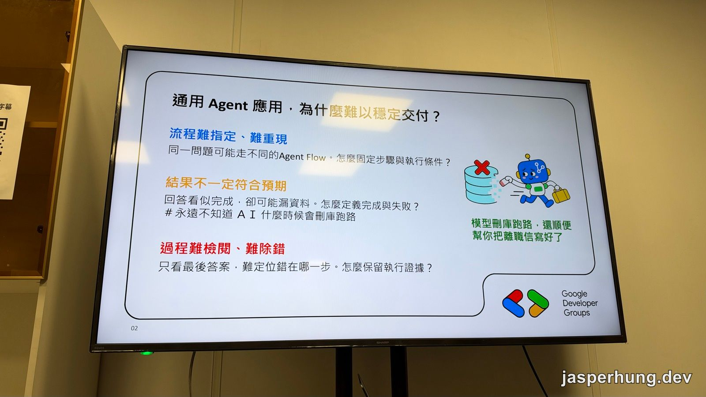
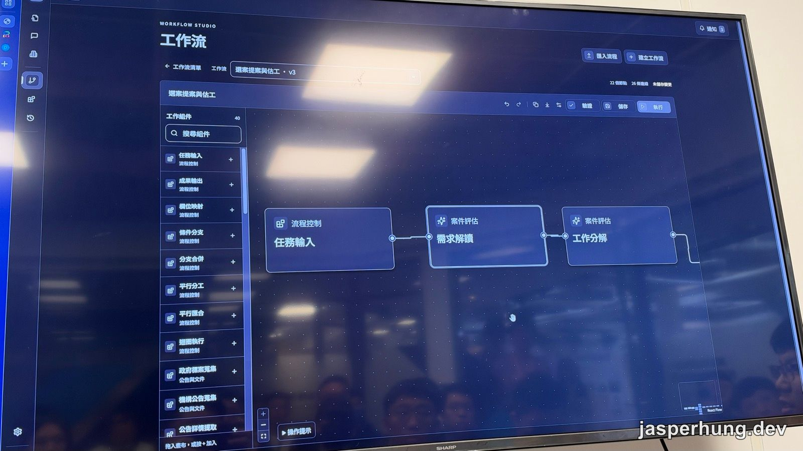
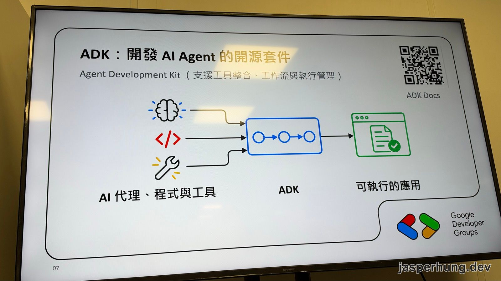
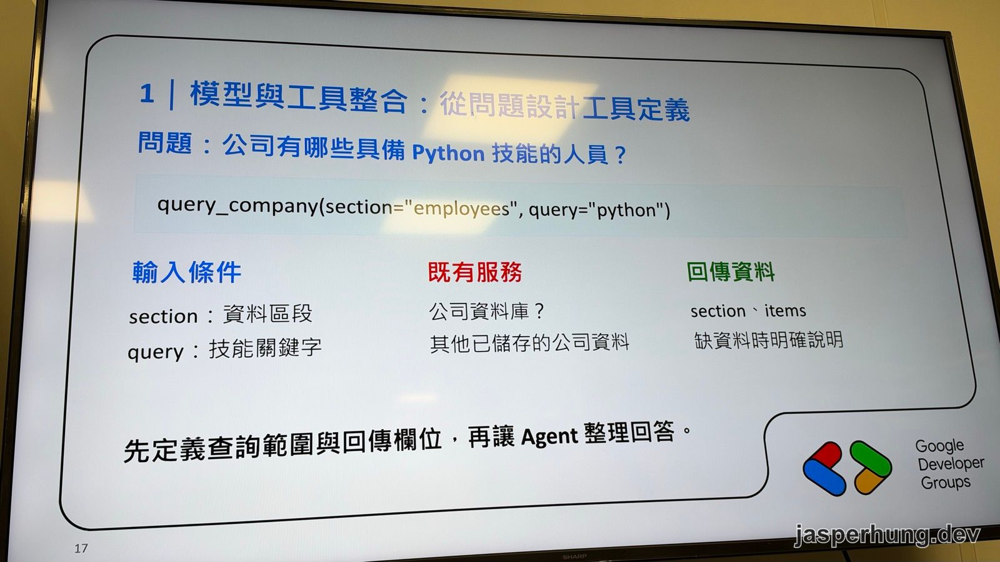
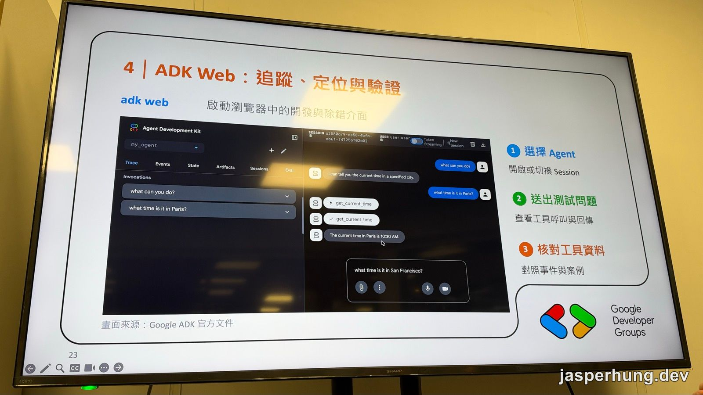

<KeyTakeaways>
  <p>通用 Agent 為什麼很難穩定交付？講者吳楷鈞的答案是：流程難指定、結果難判斷、過程難檢查。他用 Google ADK（Agent Development Kit）把讀標案、寫計畫書的工作拆成小步驟，每一步只給限定的工具，並用 ADK Web 追蹤執行過程；這是講者觀點加上我的現場筆記，系統本身沒有公開。</p>
</KeyTakeaways>

DevFest 高雄 2026 早上 10 點，[開場演講](/posts/devfest-kaohsiung-2026-agentic-era/)剛談完「開發者要學會編排 Multi-Agents」，第二場就有人實際示範了一套。講者吳楷鈞（Kai）用 Google 的 ADK，把自己研究所時期讀標案、寫計畫書的痛點拆成一條 Agent 工作流。

他的第一頁內容投影片，插圖是一台機器人抱著資料庫逃跑，旁邊寫著：「模型刪庫跑路，還順便幫你把離職信寫好了。」

## 通用 Agent 應用，為什麼難以穩定交付？



<p class="image-caption">圖：講者把通用 Agent 的不穩定歸納成三個問題。</p>

講者先列出三個問題：

| 問題 | 講者的說法 |
|---|---|
| 流程難指定、難重現 | 同一個問題可能走不同的 Agent Flow。怎麼固定步驟與執行條件？ |
| 結果不一定符合預期 | 回答看似完成，卻可能漏資料。怎麼定義完成與失敗？ |
| 過程難檢閱、難除錯 | 只看最後答案，很難定位錯在哪一步。怎麼保留執行證據？ |

第一點他用 IKEA 打比方：大家拿到的說明書一模一樣，每個人組出來的家具還是不太一樣。第二點的例子是寫程式：過程中有個小錯，unit test 不一定測得出來，同一段 prompt 也可能某天突然出現反常行為。第三點最常發生在把工作整包丟給 Agent 的時候。大部分人只看最後結果，中間哪裡出錯，常常要等到真正出事才知道。

## 從自己的痛點開始：讀標案、寫計畫書

講者用來示範的是一套自己做的標案助理，沒有公開。起因是他進研究所後要參與標案和產學合作，得讀很多政府文件。這些文件的需求有時寫在最後，有時散在好幾份裡，要全部讀完，才寫得出一份計畫書。

他說這件事很像 LLM 在做的事：讀一段文字，產出一段文字，中間沒什麼空間多想。所以他把系統拆成三塊：

1. **後端**：定義資料與業務邏輯。
2. **AI Chat**：以前要按一顆指定功能的按鈕才會啟動流程，改成用對話啟動，沒有 domain knowledge 的使用者也能用。
3. **工作流**：擷取標案需求 → 查詢公司或實驗室的資料 → 撰寫草稿 → 反覆檢查與修訂。

最後一步是因為 AI 會出錯，草稿出來不一定對，所以要讓它反覆檢查、修訂。要拆成哪幾步、每一步要做什麼，就是講者在這個 domain 的專業知識。他的理由是：**每一步夠小，前後差異就不會太大，比較容易檢查。** 這也是他選 ADK 的原因：它本來就是讓多個步驟串起來執行的工具。



<p class="image-caption">圖：講者系統裡的工作流編輯器，左側組件從流程控制（條件分支、平行分工、迴圈執行）到政府標案蒐集、公告詳情擷取都有。</p>

畫面上這條工作流叫「選案提案與估工 v3」，總共 22 個節點、26 條連線。左側的組件看得出兩類：一類是流程控制，像條件分支、平行分工、迴圈執行；另一類是業務動作，像政府標案蒐集、機構公告蒐集、公告詳情擷取。

講者說，跑一次完整流程、產出一份符合需求的計畫書，成本大概 10 美金。

## ADK 是什麼



<p class="image-caption">圖：ADK 把 AI 代理、程式與工具組成可執行的應用。</p>

ADK 全名是 Agent Development Kit，是 Google 開放原始碼的 AI Agent 開發套件。投影片的副標寫的是「支援工具整合、工作流與執行管理」。講者的說法是：以前要讓網站呼叫 Agent，得自己處理 Agent 的 endpoint 在哪、參數怎麼傳；ADK 把這些底層邏輯包好了，開發者只要想應用要怎麼規劃、怎麼執行。

他把 ADK 的能力分成四塊：模型與工具整合、工作流與多代理、對話狀態管理、事件追蹤與驗證。第四塊是他當初選 ADK 最主要的原因。下面依序整理。

## 用 tool 劃出 Agent 的硬邊界

一個 ADK agent 有四個基本欄位：

| 欄位 | 作用 |
|---|---|
| `model` | 選用的模型與參數 |
| `instruction` | 給 agent 一個角色，也用來規定回答規則和輸出格式 |
| `tools` | 模型本身像一張白紙，雖然會生成文字，要跟外界互動就得靠工具 |
| `name` | 識別這個 agent，讓它可以被組合 |

工具呼叫是一來一回：模型把問題整理成「要呼叫哪個工具、帶什麼參數」，輸出的只是一段文字；ADK 讀到之後實際去執行，把結果交回模型，再由模型整理成回答。講者提醒，這就是一兩年前大家說的 Function Calling，概念跟 MCP 一樣，既有的服務也可以直接包成工具給 ADK 用。



<p class="image-caption">圖：先決定工具的輸入、背後接哪個服務、回傳什麼欄位，再交給模型使用。</p>

他的例子是「公司有哪些具備 Python 技能的人員？」，對應的工具長這樣：

```python
query_company(section="employees", query="python")
```

| 輸入條件 | 既有服務 | 回傳資料 |
|---|---|---|
| `section`：資料區段<br/>`query`：技能關鍵字 | 公司資料庫，或其他已儲存的公司資料 | `section`、`items`；缺資料時要明確說明 |

投影片底下那句話是這段的重點：**先定義查詢範圍與回傳欄位，再讓 Agent 整理回答。** 做法是由下而上：先想清楚希望模型做到什麼，把工具定義好、自己驗證過，再交給模型。

反例是讓工具直接吃一段 SQL。這等於把資料庫的權限整個交給模型，前面那張刪庫跑路的插圖就可能成真。講者呼應開場 Eric 提到的「定義模型的邊界」，在這裡劃邊界的方法很直接：**只能用這幾個工具，不能越界**，這是硬規定。通用 Agent 給的是 command line，幾乎什麼指令都能跑；就算每次都要按一下 Approve，還是有人會打開自動核准模式，然後就有慘劇。

> [!TIP]
> ### 網站先定好邊界，之後升級成 Agent 很省事
> 講者開發網站時，先把每個 server function 的邊界定義好，也就是使用者能對網站做哪些事。之後要加 Agent，只要在最前面多一層：使用者輸入需求，ADK agent 選工具、填參數，後面呼叫的還是同一批 server function，結果回到同一個網頁。整條流程只有前兩步變了。

## 用 Sequential、Parallel、Loop 組流程

ADK 最基本的三種工作流單位是 Sequential（依序）、Parallel（平行）和 Loop（迴圈），可以互相包：Sequential 中間塞一層 Parallel，Parallel 的每個分支本身又是一個 agent。講者說用這三種幾乎能組出想要的任何流程，概念上跟 n8n 拖元件一樣，只是改用程式寫。

他現場示範了一段 Loop：檢查最多跑兩輪，通過就輸出結果；兩輪都沒通過，也會輸出，並明確告訴你「失敗了」。重試次數有上限，失敗也會被明確回報，不會被當成完成。

> [!NOTE]
> ### ADK 官方文件已經把這三種標成 deprecated
> 我回來查 [ADK 官方文件](https://adk.dev/agents/workflow-agents/)，Sequential、Parallel、Loop 這類 template workflows 現在被標成 deprecated。在 ADK 的 Python、TypeScript、Go、Kotlin 版本，官方建議改用更彈性的 graph-based workflows 和 dynamic workflows。講者講的拆步驟觀念不受影響，新專案可以直接從 graph-based workflows 開始看。

## Session 和 State 分開記

ADK 管理對話狀態的四個概念：

| 概念 | 作用 |
|---|---|
| Runner | 一個執行單位，負責協調模型、工具呼叫和事件循環 |
| Session | 一次對話，保留上下文與對話歷史 |
| State | 另外存起來的重要資料，例如目前的 milestone、哪個階段已經完成 |
| Event | 記錄模型輸入、工具呼叫的結果和每一步花的時間，方便事後分析 |

為什麼要把 State 跟 Session 分開？講者的比喻是：重要資訊如果只埋在對話歷史裡，就像要在一本小說裡找某五個字。另外做一張表存起來，下次執行時直接查表就好。[官方文件](https://adk.dev/sessions/state/)的說法也一致：`session.events` 是完整的歷史，`session.state` 是 agent 在這次互動裡的草稿區，tool 可以透過 `tool_context.state` 寫入。

他用標案助理示範兩者怎麼分工：

1. 「幫我找資訊類的標案」：呼叫工具，回傳標案清單和每筆的 ID（T01、T02……）。
2. 「幫我評估第一筆」：agent 從 Session 的上一輪輸出知道「第一筆」是哪一個，查完資料丟給評估工具，再整理成摘要。
3. 評估結果寫進 State，例如 `T01` 的可行性分數 70、`suitable: false`，因為門檻是 85 分。

## ADK Web：每一步都看得到



<p class="image-caption">圖：「adk web」會在瀏覽器開一個開發與除錯介面，每一次工具呼叫和回傳都看得到。畫面取自 Google ADK 官方文件。</p>

`adk web` 會在瀏覽器開一個開發與除錯介面，有 Trace、Events、State、Artifacts、Sessions、Eval 幾個分頁。投影片的例子：問「what can you do?」，模型直接回答；問「what time is it in Paris?」，介面會顯示 agent 呼叫了 `get_current_time`、拿到什麼結果，最後才回答「10:30 AM」。

這就是在回答一開始的第三個問題：過程難檢閱、難除錯。每一步的輸入、輸出和花費時間都留下紀錄，出錯時可以直接回去看是哪一步。

## 什麼時候值得用 ADK

講者給了三種情境：

- **想快速驗證**：現在的對話機器人要掛很多工具才完整，全部用一般程式寫很麻煩。用 ADK 把流程和工具包起來，可以很快驗證能不能跑。
- **專業領域、需要拆成多個小步驟的工作**：他的反例是讓模型直接拿 Google 簡報樣板做簡報，結果一塌糊塗，模型做了很多沒被要求的事，偏離了他想要的流程。domain knowledge 越重要，越適合把步驟一個一個定義好、逐步驗證。
- **需要穩定、持續擴充**：步驟定義好，agent 就照著跑，之後再往工具組裡加新工具。

有人可能會問：流程都固定了，為什麼還要 Agent？講者的回答是：政府文件來源多、格式不一，沒辦法用一個固定的 pattern 解析；自然語言寫成的內容也是。

他最後拿 Skills 來比。Skill 下載下來放進資料夾就能用，很方便，但很多 skill 只是一段文字指引，模型還是可能偏離。ADK 可以把一整個 agent 再包成另一個 agent 的工具，大 agent 掛著各種 agent flow，用起來就像 skill，**而且比只有文字的 skill 更穩定**，因為每一步都被拆開定義了。

Demo 裡還有一個邊界案例：「把公司人數改成某個數字」這種寫入操作，講者不讓 Agent 直接改，而是導回業務介面讓人來操作。產生計畫書草稿時，Agent 也是先提出計畫讓使用者確認，才開始執行。

## 現場我問的兩個問題

**工具、流程、agent 怎麼分？** 看 Workflow Studio 的畫面時，我分不出哪些節點是工具、哪些是 agent，所以舉手問。講者的回答很老實：他自己開發的系統裡也沒有分得很清楚。比較像是他有能力把工作拆成一個個 function，但有些拆出來是一整塊流程，有些則包成了 agent。

**系統部署到哪個程度？** 這套系統有 web 介面，API 和網頁照理都能部署到雲端。我會問是因為 live demo 時有點卡，我猜系統跑在他自己的電腦上，agent 再呼叫雲端的模型 API，延遲可能來自網路。部署到雲端，demo 時的問題可能會少一點，但也會多出登入、權限這些真的要解決的問題。以這套系統的狀況來看，目前比較像是他自己在用、拿來展示的工具，沒有放上伺服器也合理。

演講後半段，講者分享了用 Antigravity 開發這套系統的經驗：先用 plan 模式和 grill-me，把需求跟 AI 詳細討論過，再讓它動手執行。

## 心得

這場最酷的是講者把自己遇到的痛點直接寫成一條流程。讀標案、寫計畫書本來就是很耗時間的苦工，他把要拆成哪幾步、每一步要檢查什麼都寫進工作流，跑一次大概 10 美金。我覺得這就是很好的工作自動化。

我問的那題他也答得很坦白：就算是自己做的系統，工具、流程、agent 的界線也沒那麼清楚。

後半段的 Antigravity 也有可以帶走的東西：先用 plan、grill-me 跟 AI 把需求聊清楚再動手。40 分鐘塞進 ADK 和 Antigravity 兩個主題，份量很足，如果之後有機會，蠻想聽他多講講這兩段是怎麼接起來的。
