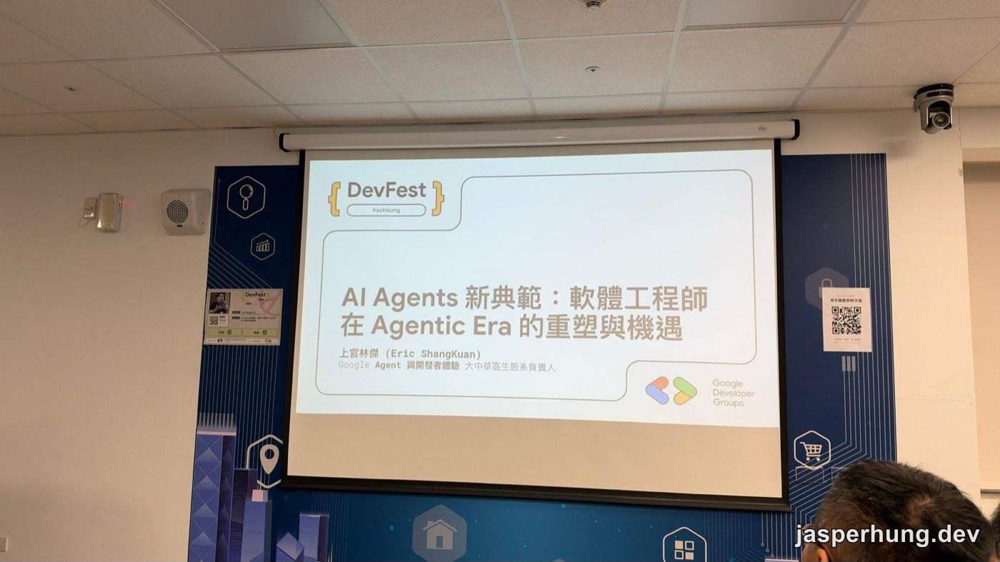
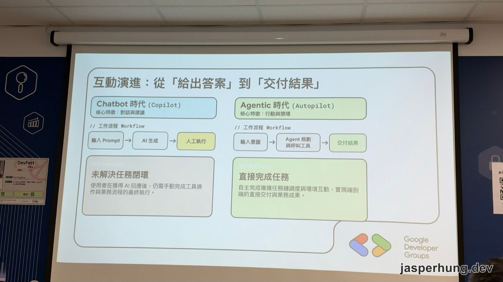
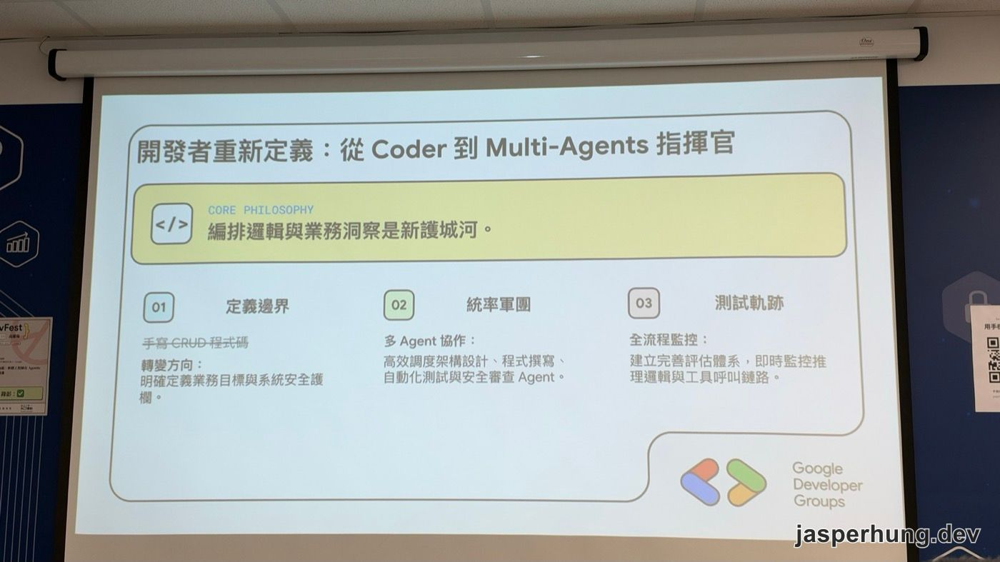
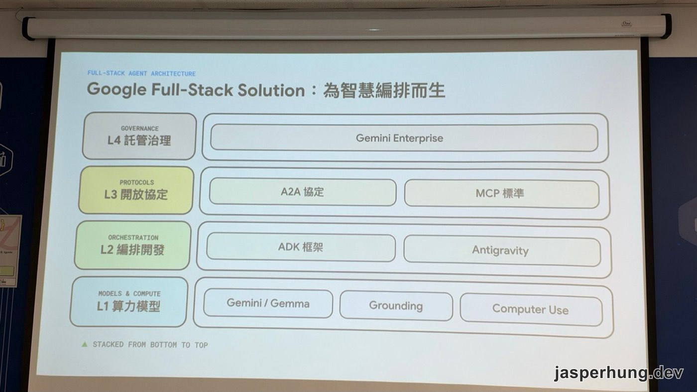

<KeyTakeaways>
  
有了 AI Agent，為什麼工作沒有變輕鬆？Google 的上官林傑在 DevFest 高雄 2026 開場給的答案是：大家只用 AI 加速既有流程的每個環節，流程和組織本身都沒變；他主張開發者要轉成定義邊界、編排多個 Agent 的指揮官，軟體也要改成為 Agent 設計。這篇是講者觀點加上我的現場筆記。

</KeyTakeaways>

DevFest 高雄 2026 早上 9:20 的開場，講者上官林傑（Eric ShangKuan）一上台先問了現場一個問題：「你現在寫的 code，比 Agent 多的請舉手。」

沒有人舉手，我也沒有。2026 年了，在場已經沒有人自己寫的 code 比 Agent 多。這場 30 分鐘的演講，就從這個沒人舉手的畫面開始談：寫 code 的工作交給 Agent 之後，軟體工程師的價值要放在哪裡。

圖：講題「AI Agents 新典範：軟體工程師在 Agentic Era 的重塑與機遇」，講者是 Google Agent 與開發者體驗大中華區生態系負責人。

## 從開發者關係到服務 Agent：Google 為什麼要調整策略

講者的部門過去叫 Developer Relations，簡稱 DevRel，中文叫開發者關係。他用公關來比：公關（Public Relations）面對的是媒體，DevRel 面對的是開發者。

Google 投入 DevRel 的理由很直接：做平台的公司要靠開發者在上面成功，平台才會成功。過去十年是 Android 和 Google Play，你寫好的 App 透過 Google Play 發佈，就能接觸到大量使用者；現在是 Google Cloud，以及各種 AI 模型和工具。

現場沒人舉手，代表策略要跟著調整。以前 DevRel 的工作是讓開發者了解 Google 產品的優勢，選擇在 Google 平台上開發；現在實際動手的越來越常是 Agent。講者說開發者還在，只是角色變了：有人仍然自己寫，有人變成指揮 Agent 做事的人，一個人就是一個團隊。所以 Google 要面對的除了真人開發者，還有這些人操作的 Agent，要讓 Agent 也判斷「部署到 Google Cloud 是好選擇」。他的頭銜也從開發者體驗變成「Agent 與開發者體驗」。

至於具體怎麼做，講者坦白說 Google 也還在摸索，跟大家一樣，不用焦慮。

## 為什麼人手一個 AI，大家卻沒變輕鬆？

講者接著問現場「有了 AI 之後有沒有變輕鬆」，回饋大多是沒有。他的解釋是：**每個環節都加速了，但工作流程本身沒變。**

以前寫 Product Design Document 要自己一個字一個字打，現在 AI 生成、改文法都很快；寫程式也是 AI 一下就寫完。可是你還是照原本的流程做事，只是每一步變快了。

他用汽車工廠打比方：組織架構還是照工廠時代的思維設計，有人做車身、有人做引擎、有人做輪胎。每個部門都用 AI 做出非常漂亮的輪胎、非常厲害的引擎，兜起來就一定是一台更好的車嗎？不一定。

圖：Chatbot 時代的 AI 給出答案，最後一步還是人來執行；Agentic 時代由 Agent 自己規劃、呼叫工具，直接交付結果。

投影片把這個差別整理成兩種互動模式：

| | Chatbot 時代（Copilot） | Agentic 時代（Autopilot） |
|---|---|---|
| 核心特徵 | 對話與建議 | 行動與閉環 |
| 工作流程 | 輸入 Prompt → AI 生成 → 人工執行 | 輸入意圖 → Agent 規劃與呼叫工具 → 交付結果 |
| 關鍵 | 未解決任務閉環：拿到 AI 回應後，仍要手動完成工具操作與業務流程 | 直接完成任務：自主調度複雜任務鏈、與環境互動，端到端交付業務成果 |

ChatGPT 剛出來時，大家一問一答，任務怎麼拆還是自己想好的。講者認為下一步是讓 Agent 知道整個 big picture：這件事要提供什麼價值、要完成什麼任務，而不是你先決定好「照 A、B、C、D、E 五個步驟做」，再一步一步叫它執行。說不定換個角度，整個流程都該重來。

他也講了一個很真實的人性面：本來五天的工作，有了 AI 一天就做完，你會讓老闆知道嗎？大概不會，因為變輕鬆的下場不是被裁，就是能者多勞。所以公司給每個人發一個 AI Agent、各自加速，對整個組織沒有幫助。

## 開發者的新護城河：從 Coder 到 Multi-Agents 指揮官

很多軟體工程師焦慮，講者認為原因是過去把自己的價值放在「寫程式」上。現在 Agent 寫得又快又好，對很多老闆來說還更便宜。PM 也一樣，如果價值只在寫 planning，Agent 一樣能把專案管理做得又快又好。

他給的方向是回到「價值」：以前公司沒人會寫程式，所以會寫程式的人有價值；現在 Agent 會寫了，你提供的是什麼？你是不是比 Agent 更了解你們的業務場景？你的組織要交付的，還是一套軟體嗎？

圖：投影片的核心主張是「編排邏輯與業務洞察是新護城河」。

投影片把指揮官要做的事拆成三項：

1. **定義邊界**：不再手寫 CRUD 程式碼，改成明確定義業務目標與系統的安全護欄。
2. **統率軍團**：讓多個 Agent 協作，分別負責架構設計、程式撰寫、自動化測試與安全審查。
3. **測試軌跡**：建立完善的評估體系，即時監控 Agent 的推理邏輯和工具呼叫鏈路。

講者說要開始「重新定義邊界，重新定義你提供價值的範圍」。過去交付的是一套軟體，現在交付的可能是一套工作流程，或整段由 Agent 自動化的流程。

## 當軟體的頭號使用者變成 Agent

講者提到很多公司都發現的一件事：過去軟體做得漂漂亮亮，是因為使用者是真人。為了不讓人用錯，要做很多 UI/UX 設計，引導人去點哪個按鈕。可是在 Agent 時代，使用你系統的不一定是人，可能是另一個 Agent。

| 為人類設計（UI-Heavy） | 為 Agent 設計（Headless APIs） |
|---|---|
| 聚焦視覺呈現：UI Layout、互動動畫、圖形美觀度 | Headless 架構：提供高效、語意化的介面與結構化狀態碼 |
| 人機互動：靠人眼讀螢幕資訊、手動點擊與拖曳 | UI 角色轉變：前端介面退化為可有可無的監控與稽核面板 |

Headless 指的是不帶畫面、只提供程式介面的架構。講者說，新時代的軟體工程師不一定在寫 UI，而是做讓 Agent 直接呼叫的介面，例如 MCP server（讓 AI 呼叫外部工具的標準介面），或一個 CLI。

軟體形態變了，生意模式也跟著變。投影片把它寫成從 SaaS 到 Service-as-a-Software：

| 過去（SaaS）：販售工具 | 未來（Service-as-a-Software）：交付數位勞動力 |
|---|---|
| 依賴員工手動填單與流程操作 | Agent 自動跨系統協作執行任務 |
| 人類是主要的軟體操作主體 | 從提供工具轉向直接交付業務成果 |

這頁底下還有一條公式：**未來企業 = 人類領域專家 + 專屬 Agent 團隊**。

講者說，要像張無忌學太極拳一樣，先把以前的做法全部忘掉。以前為了 ship 一個產品，從目標反推出開發、PM、測試這些團隊；如果現在交付的不只是軟體，組織也要跟著重新分工。

他對企業導入 AI 的評語很直接：老闆發給每個員工一個 AI Agent，這件事「只有炫富的功能」。對企業最有價值的是重塑企業流程，再把流程做成 Agent。所以他建議替企業做軟體的開發商、資訊公司，可以把方向轉到幫企業開發 Enterprise Agent，不要讓每個員工各搞一套、瞎忙，最後還嫌費用太高、想自己買 GPU server。

## 每個時代都有它的 Full-Stack

講者不認為 AI 寫 code 是一件需要害怕的事，它是每個時代都會發生的典範轉移。2000 年代中期 Web 2.0 出來，最厲害的工程師都去寫 Web App；2010 年 iPhone、Android 出來，寫 App 的工程師成了主流。

| 時代 | 寫什麼 | 帶來什麼 |
|---|---|---|
| Web 時代 | 網頁應用 | 連接資訊與資料 |
| 行動時代 | App | 連接人與真實場景 |
| AI 1.0 時代 | Chatbot | 重塑人機對話互動 |
| Agentic 時代 | 編排 Multi-Agents | 重塑核心生產力 |

2026 年還有人寫傳統桌面程式嗎？有，也有不少是 mission-critical 的系統，但已經不是主流。

他也提醒，這個時代的價值不是「我很會用某個 AI 工具」。現在的開發者對工具幾乎沒有忠誠度，這個月訂這套、下個月換那套，新模型一出就換。每個月都執著於最好的工具和最好的 model 很累，也不一定讓你提供更多價值。講者說，雖然他代表 Google，但 GDG 不是行銷活動，不管你用哪一套工具，都歡迎來交流。

圖：Google 把自家 Agent 技術堆疊整理成四層，由下往上疊起來。

最後是 Google 自己的位置。講者說 Google 是業界少數從模型、工具到平台端到端都有提供的公司，投影片由下往上分成四層：

| 層 | 內容 |
|---|---|
| L4 託管治理（Governance） | Gemini Enterprise |
| L3 開放協定（Protocols） | A2A 協定、MCP 標準 |
| L2 編排開發（Orchestration） | ADK 框架、Antigravity |
| L1 算力模型（Models & Compute） | Gemini / Gemma、Grounding、Computer Use |

Agent 不管用什麼工具寫，總要找地方部署，不能永遠停在工程師最常說的那句「在我電腦上是好的」。企業裡多個 Agent 一起工作時，也需要互相溝通的方式。Google 參與制定的 A2A（Agent-to-Agent）協定就是在處理這件事。講者的比喻是：過去 microservice 用 HTTP 交換訊息，**A2A 就是 Agent 時代的 HTTP**。

## 技術每週都在變，要怎麼對抗焦慮？

演講最後一頁回到焦慮，標題是「當技術每週迭代，我們如何對抗焦慮？」，頁面底下寫著 DevFest 的意義：不談噱頭，只聚焦真實踩坑經驗與未來技術方向。

講者說，避免焦慮的方法就是像現場這樣走出來，聽聽別人在做什麼。有人試過的路失敗了也沒關係，大家一起成長。他介紹了兩個 Google 的社群計畫：GDG（Google Developer Groups）是接地氣的在地開發者社群，適合初學者、技術愛好者和在地開發者；GDE（Google Developer Experts）是全球技術專家網路，當天不少講者就是 GDE。

他也請現場給 GDG 高雄的主辦人 Andy 掌聲，因為 Andy 不只辦這一天，每週都在辦大大小小的社群活動。最後他鼓勵大家別只坐著聽，多找講師聊：AI 可以回答問題，但眼前的專家走過很多冤枉路，那些經驗很寶貴。說完，他把時間交給一起從香港出差回來的同事、Google Cloud 的 Developer Advocate Sylph Lin。

## 心得

講者問的那一題，現場沒有人舉手，我也是。所以這場演講對我來說不是在預告未來，比較像是在描述已經發生的事。

我同意他的方向：該走的就是 agentic。光是讓 AI 把每一步做快一點，原本的流程還是原本的流程；要變輕鬆，得把流程交給 Agent 重新跑一遍。

整場最有感的是最後一頁那句：

> 閉門造車只會放大焦慮；走進社群、真實碰撞，才能把恐懼變成實踐。

這也是我今天會坐在 DevFest 高雄現場的原因。
