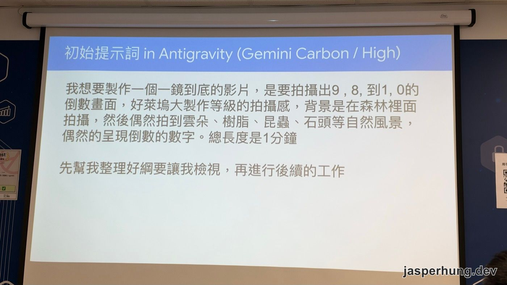
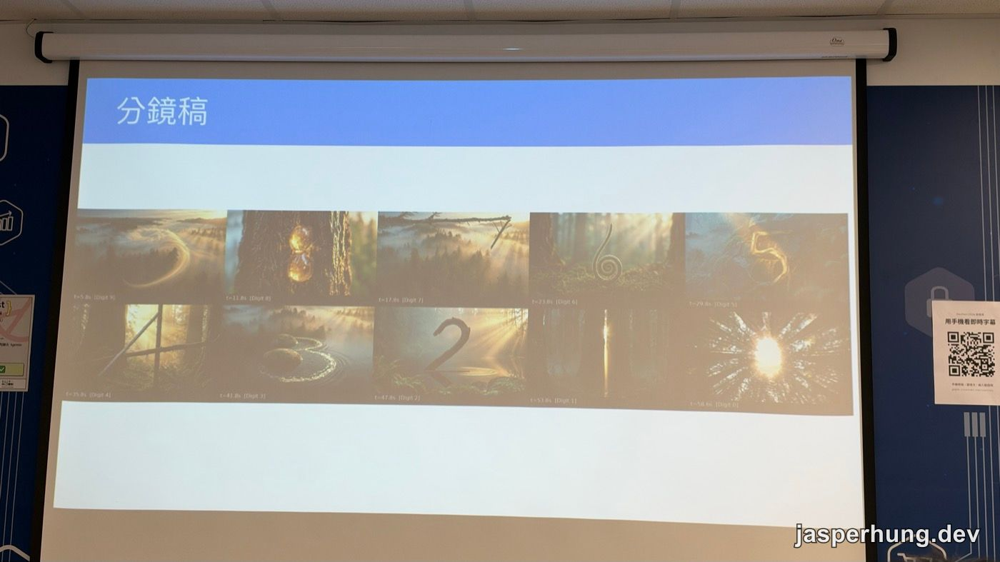
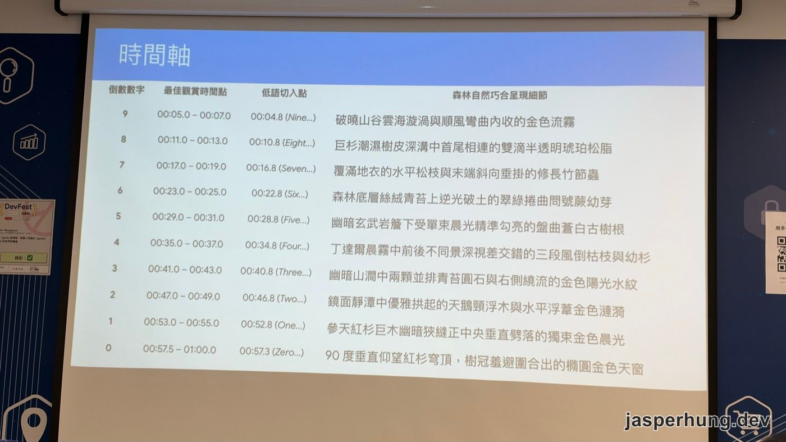
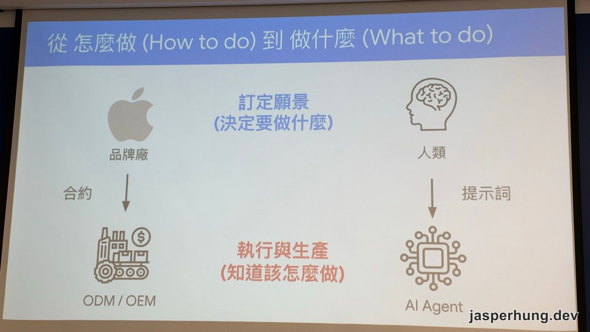
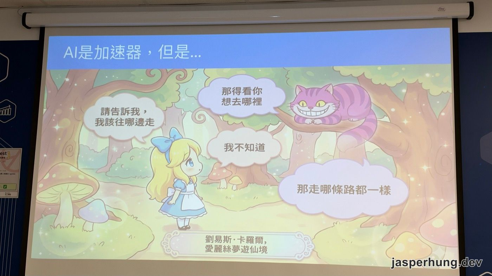

<KeyTakeaways>
  
AI 生成影片現在能做到什麼程度？Google 的 Sylph Lin 在 DevFest 高雄 2026 示範：在 Antigravity 給一段需求，Agent 會先交綱要、分鏡稿和時間軸讓你確認，再自己生成並剪成一支 1 分鐘的影片，連配樂接不起來都自己想辦法；講者主張人的工作從整理 prompt 變成決定方向、判斷成品好壞。這篇是講者觀點加上我的現場筆記。

</KeyTakeaways>

[上一場開場演講](/posts/devfest-kaohsiung-2026-agentic-era/)最後，上官林傑把時間交給一起從香港出差回來的同事、Google Cloud 的 Developer Advocate Sylph Lin（林政君）。

Sylph 接著 Eric 開場那一題往下講。Eric 問「現場還有誰自己寫的 code 比 Agent 多」，沒有人舉手；Sylph 說除了寫程式，他最近更著迷的是另一件事：影片生成。這場演講講的是影片生成也走到了跟寫程式一樣的地方，你給方向，Agent 把整支片做完。

## 寫程式和做影片，都走到「先談 spec」這一步

講者先回顧寫程式的三個階段：

1. **純手工**：他以前習慣用 vi，從頭到尾自己寫。
2. **AI 輔助**：AI 幫你寫一小段程式、整理一下程式碼。
3. **整個交給 Coding Agent**：把想做的東西描述給它，一起把 spec 和相關文件談完，剩下的它自己搞定。檔案怎麼切、函式怎麼開，連命名都不用想，人最後只看結果。

影片生成也走了一樣的路：

1. **自己寫 prompt**：講者手上有一大份 prompt 範本，畫圖的、出影片的都有，還收了模仿 Duolingo、IKEA 廣告風格的 prompt，全靠自己整理。
2. **叫 AI 幫你寫 prompt**：有人把這件事寫成 skill 或 Gem，讓 AI 產生 prompt。
3. **像對 Coding Agent 一樣交代**：給一個大方向，先一起把 spec 和需求談出來，再讓 Agent 去做。

他說以前整理那份範本真的很辛苦，但現在已經不做這件事了。我聽到這裡的感覺是，這跟前兩年大家在講 prompt engineer、後來慢慢沒人提，是同一件事：Agent 會自己把 prompt 寫好，人不用再背咒語。

## 一段提示詞，Agent 先交綱要、分鏡稿和時間軸

講者的例子是一支 1 分鐘的倒數影片，類似 Google 大型活動開場前那種倒數計時，但他想做成有生命感的森林場景。他在上飛機前把需求丟出去，下飛機收到成品，現場直接播了那一分鐘。他自己說還有一些瑕疵。

Antigravity 是 Google 的 agent-first 開發平台，本來是拿來寫程式的。講者用它來做影片，投影片上標的模型是「Gemini Carbon / High」。他給的初始提示詞沒有什麼花招：

圖：講者在 Antigravity 裡送出的初始提示詞，最後一句要求先交綱要再往下做。

> 我想要製作一個一鏡到底的影片，是要拍攝出 9, 8, 到 1, 0 的倒數畫面，好萊塢大製作等級的拍攝感，背景是在森林裡面拍攝，然後偶然拍到雲朵、樹脂、昆蟲、石頭等自然風景，偶然的呈現倒數的數字。總長度是 1 分鐘
>
> 先幫我整理好綱要讓我檢視，再進行後續的工作

關鍵在最後一句。就像叫 Coding Agent 先寫 spec、看過沒問題再動工，講者也要 Agent 先交綱要。Agent 接著會反問一些細節，例如音樂要什麼風格、要不要人聲倒數，問完才把完整綱要交出來。

綱要確認後，Agent 產出分鏡稿：

圖：Agent 產出的分鏡稿，每個數字都藏在一個自然景物裡，每格標著出現的秒數。

每個數字都藏在森林裡的東西上：雲海漩渦是 9、樹皮溝裡兩滴相連的琥珀松脂是 8、松枝末端垂掛的竹節蟲是 7、捲曲的蕨類幼芽是 6、溪石和水紋是 3、靜潭裡拱起的浮木是 2、紅杉縫隙裡劈下來的一束光是 1。哪一格看不順眼，直接說「7 這格不好，換一個」，它就重做那一格。

再來是時間軸：

圖：時間軸把每個數字的出現時間、人聲低語切入點和畫面細節排成一張表。

這張表的細緻程度讓我印象很深。數字每 6 秒出現一次（9 在 00:05、8 在 00:11，一路排到 0 在 00:57.5），人聲低語「Nine…」「Eight…」都比數字出現的時間早 0.2 秒切入。這種節奏上的細節，講者沒有交代，是 Agent 自己排的。

講者說，這些以前用 pipeline 也許也做得到，但跟 Agent 互動的時候，會發現它想得比你細。

## 配樂接不起來，Agent 自己想好了解法

影片不是一次生出來的，而是一段一段生成，最後再接起來，剪接也是 Agent 自己做。這樣做會出現一個問題：每段各自配的音樂接在一起就不連貫。

講者說這件事 Agent 也幫他想好了：為了讓音樂連貫，它先生成**無聲**的影片，再用 Google 的音樂生成模型 [Lyria 3](https://deepmind.google/models/model-cards/lyria-3/) 另外做一整段背景音樂，有人聲的部分再另外疊上去。

> 這根本不是我自己想的，我只是說我最後想要看到一個這樣的東西，其他的細節它就全部幫我弄出來。

我覺得這是整場最能說明「代理」兩個字的地方。使用者只說了終點，中間碰到問題要怎麼拆、要換哪個工具處理，是 Agent 自己判斷的。

## 同一個任務，換模型差在要改幾次

講者也比較了不同模型做同一件事的差別。現場錄音的轉檔把模型名稱辨識得很亂，以下是我對照 Google 近期發布的模型推測的，打問號的是我不確定的部分：

- **Gemini 4 Carbon**：效果最好。Google 在 10 月 28 日[發表 Carbon](https://blog.google/innovation-and-ai/models-and-research/gemini-models/introducing-gemini-4-carbon/)，11 月 10 日[正式開放](https://blog.google/innovation-and-ai/models-and-research/gemini-models/gemini-4-carbon-now-available/)，Google AI Ultra 訂閱者可以在 Antigravity 裡使用。投影片上的「Gemini Carbon / High」應該就是它，High 推測是思考強度的設定。
- **Gemini 4 Hydrogen？或舊的 Gemini 3.8 Flash？**：東西做得出來，但來回修改的次數多很多。[Hydrogen](https://blog.google/innovation-and-ai/models-and-research/gemini-models/introducing-gemini-4-hydrogen/) 是 11 月 12 日才發布、主打速度的日常模型，也就是這場演講的兩天前。

講者的結論是：厲害的模型還是有差。

這點我自己也有感。我之前幫公司生成過 demo 影片，知道現在 AI 生影片已經很強，但成品長什麼樣子還是很看模型；那次做出來的畫面，電玩感和中古世紀風都非常重。

## 從打雜到導演：人要決定做什麼

講者把前面講的收成一句話：不管寫程式還是做影片，人的工作都從打雜變成導演。

以前做影片的辛苦都在打雜：整理一堆 prompt、處理音樂怎麼接、想倒數計時怎麼呈現。現在要做的是把敘事框架想清楚，然後判斷 AI 做出來的東西有沒有美感、符不符合需要。如果講不出哪裡有問題、想怎麼改，AI 每次推薦 1、2、3、4，你就一路 yes、yes、yes，做出來的東西就跟別人沒有差別，因為別人也做得出來。

所以他認為人要練的是兩件事：

- **感受力**：回到基本功，觀察生活裡有趣的事，再交給 AI 實現。
- **品鑑能力**：AI 交出東西之後，你要能像 mentor 一樣，說出怎麼修改、怎麼調整，讓它做得更好。

他用台灣人熟悉的製造業來比喻：

圖：品牌廠用合約交代代工廠，人類用提示詞交代 AI Agent；上層決定做什麼，下層負責怎麼做。

品牌廠決定願景和要做什麼，代工廠負責執行細節。人和 AI 的分工會越來越像這樣：人決定目標，AI 處理細節。

但這個比喻有個前提。假設你想做一副無線耳機，可是你不懂聲學、不懂藍牙，只知道「我要做無線耳機」，那你跟代工廠能講什麼？大概只有「便宜一點」「塑膠換成藍色」。最後代工廠給你一副白牌耳機，你修掉一點小毛病、換個顏色、加個金邊，就這樣了。品牌廠真正要累積的，是願景、方向、感受力，還有判斷好壞的能力。

## 心得

現場播完那一分鐘的森林倒數，我第一個感覺是 Google 生成影片真的很強。分鏡稿那一頁已經很能說明：每個數字都藏在一個合理的自然景物裡，而且是 Agent 自己想出來的。

最大的感受是，生成影片現在也跟寫程式一樣了。給 spec、給願景、給意象，Agent 會拿分鏡稿跟你討論，沒問題就開始做。講者以前收集的那一大份 prompt 範本，現在都用不到了；Agent 發展得太快，很多以前要花工夫學的技巧，不用多久就被它吸收掉。

最後愛麗絲那張投影片太傳神了：

圖：演講最後一頁引用《愛麗絲夢遊仙境》，標題是「AI 是加速器，但是…」。

那隻貓就跟 Agent 一樣。你問它該往哪走，它會反問你想去哪裡；你說不出來，它帶你走哪條路都一樣。Agent 能幫你走得很快，但要去哪裡，你得自己描述得夠清楚。
