<KeyTakeaways>
  <p>企業既有的 REST API 要給 AI agent 用，一定要每個系統各寫一個 MCP Server 嗎？講者的提案是讓 API Gateway 直接把 MCP 請求轉成 REST，沿用原本的驗證、quota 和 log；Google Cloud API Gateway 在 OpenAPI 加幾行註記就能做到，但目前還是 Public Preview。這篇是講者觀點、現場筆記，加上我回來對照官方文件的補充。</p>
</KeyTakeaways>

DevFest 高雄 2026 下午 1 點半這場，講者宋岡諺（Johnny Sung）講〈當 API Gateway 遇上 MCP：讓企業既有 API 變成 AI Agent 的工具〉。

[前一場](/posts/devfest-kaohsiung-2026-webmcp/)的 WebMCP 是讓網頁在瀏覽器裡把功能交給 agent；這場換到後端，談企業手上那一堆 REST API 怎麼變成 agent 能呼叫的 tool。我手邊還沒有要套 MCP 的 API，但覺得這是遲早要面對的事，所以來聽聽看怎麼把現有的 API 套上 MCP。

## API Gateway 本來就在做的事

講者從 API Gateway 為什麼存在講起。系統一多，API 從哪裡進、往哪裡出沒人說得清楚，整張架構圖像一盤義大利麵。API Gateway 就像國道還沒有 ETC 時的收費站：所有車都從這個閘口過，誰進來、往哪去、流量多少，在這裡都看得到。

他列了 Gateway 原本就會幫你做的事：

- **統一驗證**：Gateway 自己發 token 給外部用，後端原本的 token 不用暴露出去。
- **限流**（rate limit）、**稽核 log**、**轉導**到不同後端。
- **統計報表**：哪些 API 被呼叫、成功或失敗。

還沒有 API Gateway 的話，講者建議從小地方開始：找一個要對外開放的 API，準備一份 OpenAPI 的 JSON 文件，就能先試。

接著是今天的另一個主角 MCP（Model Context Protocol）。講者用一隻章魚來比喻：

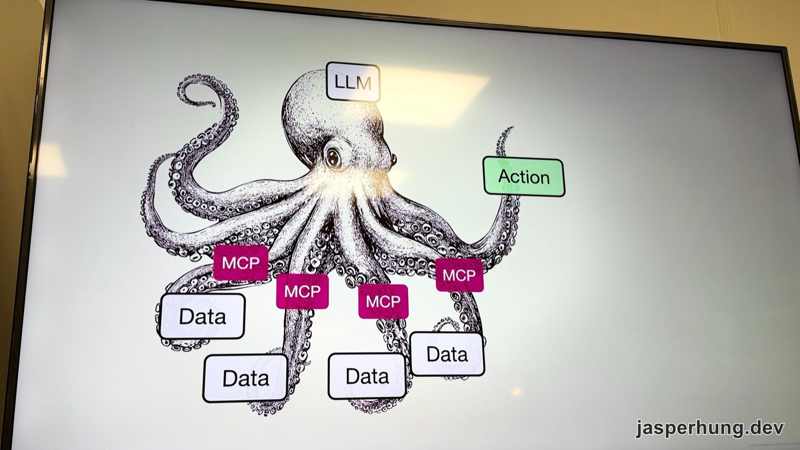

<p class="image-caption">圖：LLM 是大腦，MCP 讓它長出手腳。</p>

LLM 很聰明，但只能在自己的腦袋裡運作。問它現在幾點，它答不出來，頂多回一個訓練資料截止時的時間。MCP 幫它長出手腳：一種是拿資料，例如企業內部的訂單系統、ERP、Jira；一種是做動作（Action），例如發一則 Slack 訊息。

MCP 有兩種傳輸方式：本機的 stdio，以及遠端的 Streamable HTTP。這場講的全部是後者。

## 直覺做法：每個系統寫一個 MCP Server

要讓 agent 用訂單、金流、通知這些系統，最直覺的做法是每個系統各包一個 MCP Server。

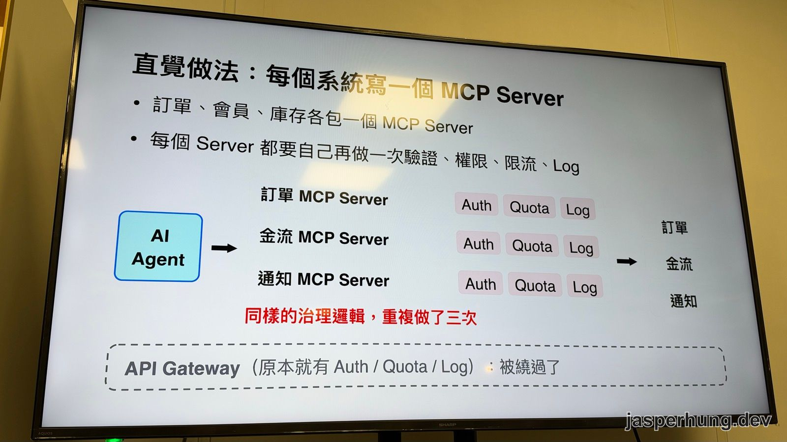

<p class="image-caption">圖：同樣的治理邏輯，重複做了三次。</p>

問題是每個 MCP Server 都要自己再做一次驗證、權限、限流和 log。五個系統就做五次，而公司原本那台 API Gateway 明明就在做這些事，現在反而被繞過了。講者整理了四個代價：

- **開發成本**：多 N 個 Server 要維護。
- **治理分裂**：兩套權限、兩個入口。
- **稽核破洞**：MCP 的流量不在 Gateway 的 log 裡。
- **安全風險**：寫死在 MCP Server 裡的 API key。

投影片上的結論是：「為了接 AI，把 Gateway 重新造一次」。

## 換個角度：讓 Gateway 直接轉譯 MCP

講者的提案是升級原本的 API Gateway：在 Gateway 上多開一個 `/mcp` 路徑，讓它把 MCP 請求轉成 REST。Gateway 的角色從「管理 API」延伸成「API 和 Agent 之間的橋樑」。

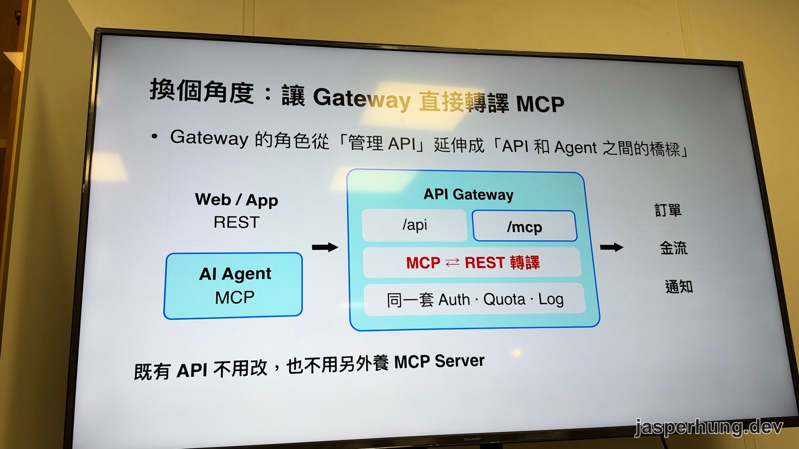

<p class="image-caption">圖：Web、App 和 Agent 走同一個 Gateway，只是入口不同。</p>

一個 `tools/call` 進到 `/mcp` 之後的路徑是：轉譯 → Auth → Quota → Log → 後端的 REST API（demo 裡是 Cloud Run），後端的回應再包成 MCP result 回給 agent。好處有四個：

- **單一入口**：`/mcp` 收 JSON-RPC。
- **轉譯**：轉成對應的 REST 呼叫。
- **共用政策**：跟 REST 用同一份 quota。
- **零部署**：不用另外養 MCP Server。

講者也說這是一個提案，接下來實際看三種做法。

## Google Cloud API Gateway：在 OpenAPI 加註記

第一種是 Google Cloud API Gateway。做法是在你原本就有的 OpenAPI 文件裡加幾行註記，Gateway 就會把每個 operation 變成一個 MCP tool。

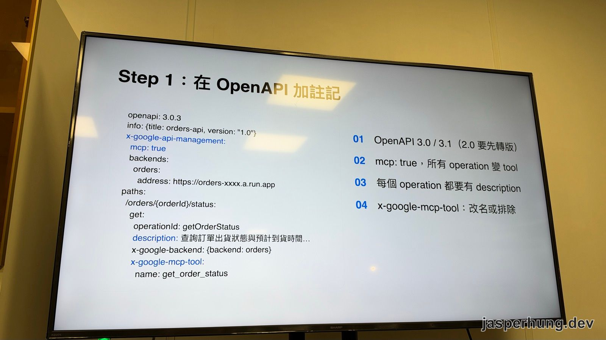

<p class="image-caption">圖：投影片上的範例是一支查詢訂單出貨狀態的 API。</p>

```yaml
openapi: 3.0.3
info: {title: orders-api, version: "1.0"}
x-google-api-management:
  mcp: true
  backends:
    orders:
      address: https://orders-xxxx.a.run.app
paths:
  /orders/{orderId}/status:
    get:
      operationId: getOrderStatus
      description: 查詢訂單出貨狀態與預計到貨時間...
      x-google-backend: {backend: orders}
      x-google-mcp-tool:
        name: get_order_status
```

投影片列的四個重點：

1. OpenAPI 要 3.0 或 3.1，2.0 要先轉版。
2. `mcp: true` 一開，所有 operation 都變成 tool。
3. 每個 operation 都要有 `description`。
4. 用 `x-google-mcp-tool` 改名或排除。

講者特別提到 `description`：它是寫給 agent 看的，要讓 agent 知道這支 API 怎麼用、什麼時候該用，而不是只寫它回傳什麼。寫不清楚，agent 就只能瞎猜。

他用工具箱來比喻 MCP 的運作：agent 先打開工具箱看裡面有什麼（`tools/list`），再拿出要用的那一支（`tools/call`）。這兩件事在 Google API Gateway 是分開保護的：

- `tools/list` 預設不驗證，正式環境要加 JWT。
- `tools/call` 沿用 API 原本的驗證，也跟 REST 共用 quota。

接上 API hub 之後，MCP server 也會自動登錄到 Agent Registry。

### 限制與區域

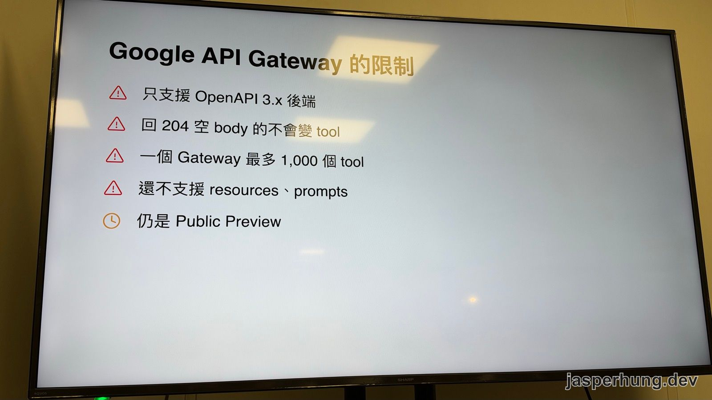

<p class="image-caption">圖：目前還在 Public Preview。</p>

1,000 個 tool 的上限，講者的解讀是：工具箱裡東西太多，agent 一打開也不知道該拿哪一支，就像一個工程師走進堆滿工具的房間。

講者說這個功能目前只有付費帳號能用，也整理了支援的區域和價格帶。他推薦 `us-east1` 和 `us-central1`，比較便宜。台灣的 `asia-east1`（彰濱工業區）不在清單上，有資料落地要求的產業（例如金融業）要特別注意。

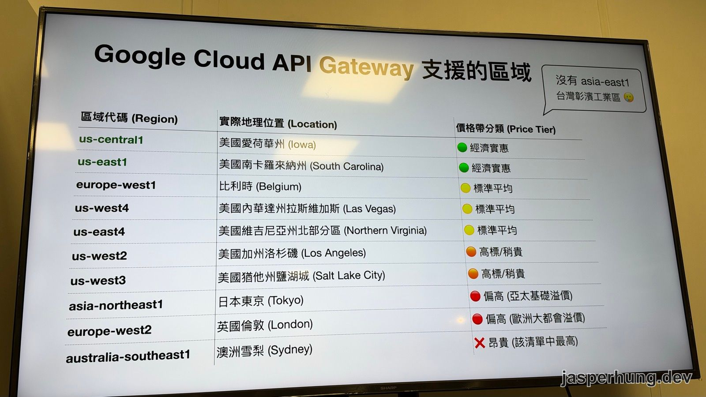

<p class="image-caption">圖：價格帶分類是講者自己整理的。</p>

### 回來對照官方文件：既有 API 到底要加什麼

現場我最想搞懂的是「現有的 API 要加什麼才能變成 tool」，所以回來對照了 Google 在 2026 年 9 月 24 日發的[官方文章](https://developers.googleblog.com/turn-your-rest-apis-into-mcp-tools-with-google-cloud-api-gateway/)和[設定文件](https://docs.cloud.google.com/api-gateway/docs/mcp-configure)。投影片的 Step 1 和官方一致，官方另外寫清楚了幾件事：

| 要做的事 | 官方的說法 |
|---|---|
| OpenAPI 版本 | 要 3.0.x 或 3.1.x，不支援 2.0 |
| 全域開關 | `x-google-api-management.mcp: true`，符合資格的 operation 才會變成 tool |
| 符合資格的 operation | 方法是 GET、POST、PUT、PATCH、DELETE，而且有設定 backend（可以在全域設定，也可以在 operation 層用 `x-google-backend`）；回 204 空 body 的不會變成 tool |
| tool 名稱 | 預設取自 `operationId`，只能用英數字、`_`、`.`、`-`，整份文件內不能重複 |
| tool 描述 | 依序取 `x-google-mcp-tool.description`、operation 的 `description` 或 `summary`，三者都沒有的 operation 會被拒絕 |
| 調整單一 tool | `x-google-mcp-tool` 可以改名稱、改描述，設成 `false` 就不開放 |
| `tools/list` | 預設不驗證，可以用 JWT 或 API key 保護（API key 是 2026-09-30 才加入） |
| `tools/call` | 一律沿用該 REST operation 原本的驗證 |

官方對 description 的說法是：它是 LLM 決定要不要呼叫這個 tool 的主要依據，要寫什麼時候用、為什麼用，不只寫回傳什麼。

> [!CAUTION]
> ### 排除 tool 不等於保護 API
> `x-google-mcp-tool: false` 只是讓這個 operation 不出現在 MCP 裡，REST 那一側還是照樣開著。官方特別提醒，管理用的路由仍然要有自己的 REST 驗證。

## Demo：在 Antigravity 用一句話審核訂單

講者事先在 Google Cloud 部署了一個 demo 用的 API Gateway，後面接兩支 API：列出訂單，以及審核訂單（審核通過才能出貨）。

設定流程大致是：

1. 把加好註記的 OpenAPI 文件放進 Gateway 的 API config。
2. Gateway 產生一個帶 SSL 憑證的網址。用瀏覽器直接開會看到錯誤訊息，因為這個端點不是給瀏覽器用的。
3. 到 Google Cloud 的憑證頁面建立一把 API key。
4. 在 Antigravity 的 Customizations 裡編輯 MCP 設定，填入 server URL 和 API key。不帶 key 直接連是連不上的。
5. 重開 Antigravity，MCP Server 下就出現轉換出來的 tool。

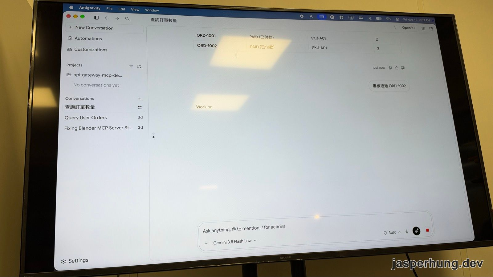

<p class="image-caption">圖：先查訂單，再用一句話審核。</p>

他先問「我現在有哪些訂單」，agent 找到 MCP 上的查詢訂單 tool 去呼叫，回了 ORD-1001 和 ORD-1002 兩張。接著打「審核通過 ORD-1002」，agent 呼叫 MCP Server，Gateway 再轉成對審核 API 的 POST。

最後回到 Google Cloud console：報表上看得到剛剛 API 被呼叫了幾次、哪些回 200、哪些有問題；log 裡也看得到這筆請求在 Gateway 裡怎麼轉譯、怎麼跑。

## Apigee：功能是 GA，講者的試用組織卻卡住

第二種是 Apigee，Google 之前收購的 API 管理平台，MCP 功能已經 GA。做法類似：Agent 先打到 MCP Discovery Proxy，再到 Google 代管的 MCP Server（`ORG_NAME.mcp.apigee.internal`），最後才到你的 REST API。API hub 會自動收錄，標記為 MCP API，每個 operation 變成一個 tool，API 不用改，也不用自己養 MCP Server。

跟 Google API Gateway 不同的是，Apigee 不會幫你配一個帶 SSL 的網址。講者得自己到 Load Balancer 申請固定 IP（要付費），再搭一個暫時的網域和 Google 憑證。設定完可以呼叫，但請求最後會被擋下來。

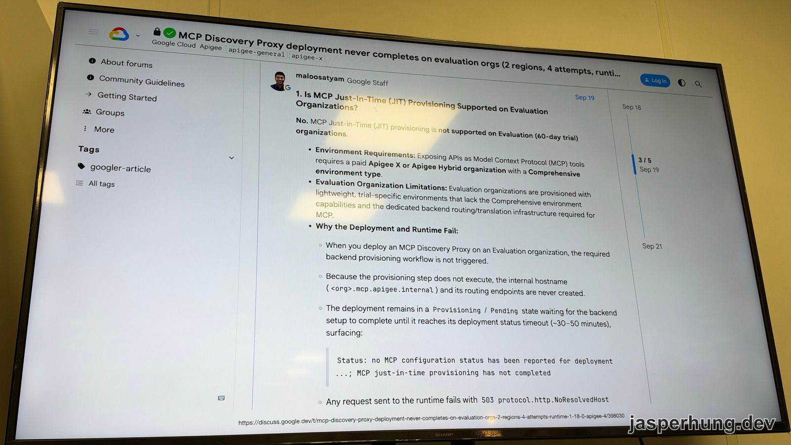

<p class="image-caption">圖：講者在論壇上找到有人踩到同一個坑。</p>

講者在 Google 開發者論壇找到[一則討論](https://discuss.google.dev/t/mcp-discovery-proxy-deployment-never-completes-on-evaluation-orgs-2-regions-4-attempts-runtime-1-18-0-apigee-4/398030)：有人在兩個區域試了四次都部署不起來。Google 員工的回答第一句就是 No，說 MCP 需要付費的 Apigee X 或 Apigee Hybrid 組織，搭配 Comprehensive 環境；60 天的 Evaluation 組織沒有對應的後端轉譯設施，所以部署會一直卡在 Provisioning，請求則回 `503 protocol.http.NoResolvedHost`。

講者的公司不是 Apigee 的付費組織，所以這條路只能停在這裡。這段 demo 他因為時間關係快轉帶過。

> [!TIP]
> ### 實際導入以當下的官方文件為準
> 這幾家的 MCP 功能都還在快速變動，哪種組織能用、驗證方式支援到哪裡，可能幾週後就不一樣了。真的要接的時候，以當下的官方文件（例如 [Apigee MCP overview](https://docs.cloud.google.com/apigee/docs/api-platform/apigee-mcp/apigee-mcp-overview)）和自己實測為準。

## Envoy：管的是 MCP，不是 REST

開源的選項，講者說找了很久，最接近的是 Envoy AI Gateway。這個專案在 2026 年 9 月 10 日改名為 [Agent Router](https://theagentrouter.ai/)，並加入 Agentic AI Foundation，程式碼和 CRD 都沒變。講者也提到，Google API Gateway 本身就是以 Envoy 為基礎強化成企業功能。

Envoy 能做的是：

- 把多個 MCP Server 匯整成一個 `/mcp` 入口，像 REST API 一樣統一管理。
- tool 名稱自動加上 backend 前綴。
- 用 `toolSelector` 決定開放哪些 tool。
- 一樣有視覺化、log 管理。

但它**沒有把 REST 轉成 tool 的功能**，API 前面還是要先有 MCP Server，跟今天的主題剛好差一步。好處是開源、可以自架，代價是沒有企業版的那些功能。

## 三種做法怎麼選

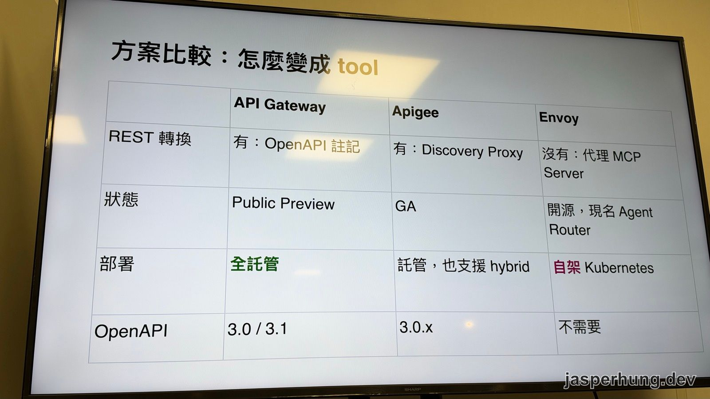

<p class="image-caption">圖：三種方案的比較表。</p>

|  | API Gateway | Apigee | Envoy |
|---|---|---|---|
| REST 轉換 | 有：OpenAPI 註記 | 有：Discovery Proxy | 沒有：代理 MCP Server |
| 狀態 | Public Preview | GA | 開源，現名 Agent Router |
| 部署 | 全託管 | 託管，也支援 hybrid | 自架 Kubernetes |
| OpenAPI | 3.0 / 3.1 | 3.0.x | 不需要 |

講者把三者定位成：Google API Gateway 是**輕量**，加註記就上線；Apigee 是**全套**，代管 MCP 加完整治理，但要付費組織；Envoy 是**開源**，統一管理已經存在的 MCP Server。

他個人推薦 Google API Gateway，理由除了簡單，還有**全託管**：雲端廠商收了錢，就要負一部分責任，壞掉或被攻擊時可以開 ticket 請他們協助。單看成本，自架一定最便宜，但後面還有維運成本：雲端自架要顧系統，地端自架還要管機房、消防、人力，每年還要檢查一輪。

其他廠商也在做類似的事：

- **Kong**：AI MCP Proxy（Enterprise）
- **Azure APIM**：勾選 operation 就變成 tool
- **AWS AgentCore**：API、Lambda 轉成 tool

投影片的結論是：MCP 正在成為 Gateway 的一級 API 類型。講者也提醒，轉成 tool 之後面對的問題跟 API 一樣：怎麼認證、權限開到哪裡、超過限額時怎麼處理。

## 轉成 tool 之後：MCP 協定、OAuth 與權限

後半場講者回頭補 MCP 本身的運作。

MCP 底層是 JSON-RPC，有 request、response、notification 三種訊息。舊版的流程是先握手：client 送 `initialize` 自我介紹（我是誰、版本、能做什麼），server 回應自己的能力，接著 `tools/list` 列出工具箱裡有什麼，最後 `tools/call` 拿一支工具出來用。講者的比喻是：打開工具箱，看到鉗子、十字起子、一字起子，再拿鉗子去修水龍頭。Tool 不存在或執行出錯，就回錯誤，例如 500。

MCP 規格在 2026 年 7 月 28 日改版，拿掉了這段握手，每個請求直接自帶版本和能力，一個請求就能呼叫。

> [!NOTE]
> ### 回來查到的補充
> 依 [MCP 官方部落格](https://blog.modelcontextprotocol.io/posts/2026-07-28-release-candidate/)，2026-07-28 版除了拿掉握手，也移除了 `Mcp-Session-Id` header 和協定層的 session；Streamable HTTP 則要帶上 `Mcp-Method`、`Mcp-Name` 兩個 header，讓中間的 Gateway 不用讀 body 就能依操作路由，版本、client 資訊和能力改放在每個請求的 `_meta` 裡。規格還在持續演進，實際使用時以當下的官方文件為準。

### OAuth：三個階段、九個步驟

API key 像一組密碼，外洩就很麻煩，所以 MCP 的認證通常走 OAuth。

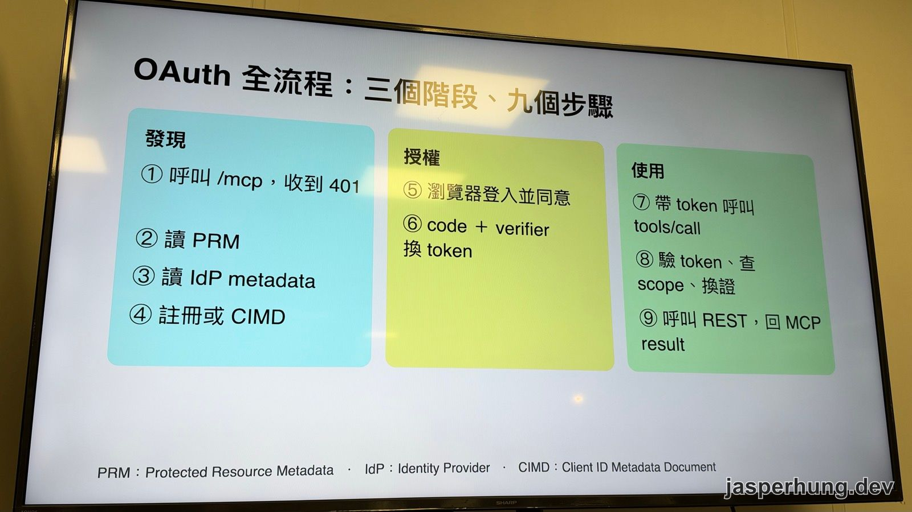

<p class="image-caption">圖：發現、授權、使用三個階段。</p>

1. **發現**：沒帶 token 呼叫 `/mcp` 會收到 401，回應裡會告訴你 resource metadata 在哪。Client 依序讀 PRM（Protected Resource Metadata）、IdP 的 metadata，再註冊或用 CIMD（Client ID Metadata Document）。
2. **授權**：開瀏覽器登入並同意，用 code 加 verifier 換到 token。
3. **使用**：帶 token 呼叫 `tools/call`，Gateway 驗 token、查 scope、換證，再呼叫 REST，回傳 MCP result。

權限不夠時會收到 403，流程跟 401 很接近：再走一次授權，拿到 scope 更大的新 token。

Gateway 在這裡的價值是**換證**：agent 拿的是 token A，Gateway 驗過之後換成自己設定好的 token B 去呼叫後端。後端的憑證不會落到 agent 手上，相對安全。

### 「看得到」和「可以使用」是兩件事

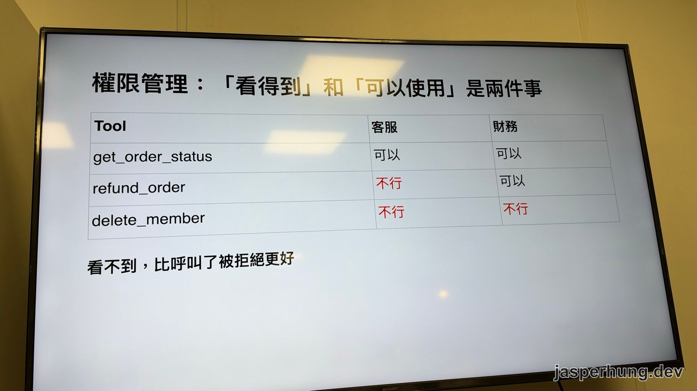

<p class="image-caption">圖：依角色決定工具箱裡有哪些工具。</p>

講者用客服和財務舉例：查訂單狀態兩邊都可以，退款只有財務可以，刪除會員兩邊都不行。更好的做法是讓客服的 `tools/list` 裡根本沒有退款這個 tool，而不是讓 agent 呼叫了才被拒絕。

### 有了 Gateway 才看得到的東西

最後是可觀測性。API 經過 Gateway 之後，可以看到 metrics（成功與否、延遲、呼叫次數）和 trace。Trace 用火焰圖呈現一個請求從系統 A 到系統 B、C 各花多少時間：例如系統 B 花 4 秒、系統 C 花 1 分 20 秒，那系統 C 就是該改善的地方；再往下拆，可能發現其中 1 分鐘花在資料庫。

## 心得

三套做法講者都實際動手試過，連 Apigee 試用版卡住的地方都攤出來，最後再整理成一張比較表，對還在評估的人來說很佛心。

我印象最深的是後段那張權限表。驗證身分之後，每個人拿到的 `tools/list` 就不一樣，沒有權限的人，工具箱裡連那個 tool 都不會出現。我覺得這個思路很好：agent 根本不知道有這個工具可以用，自然不會越過邊界，比呼叫了再被拒絕乾淨得多。
