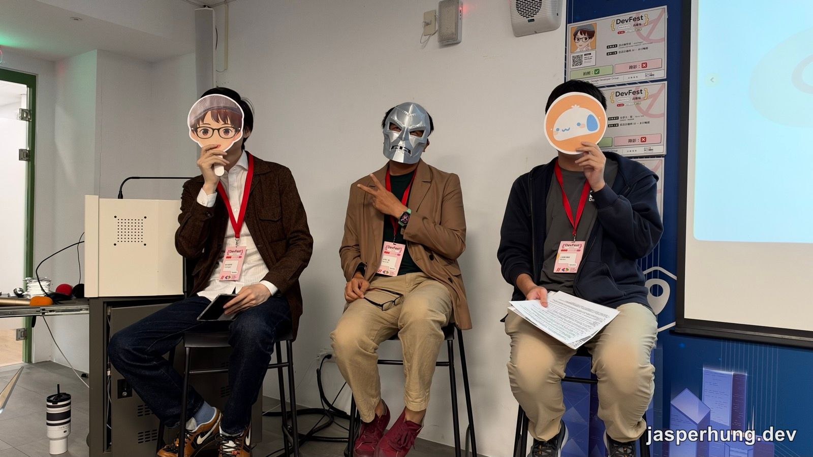
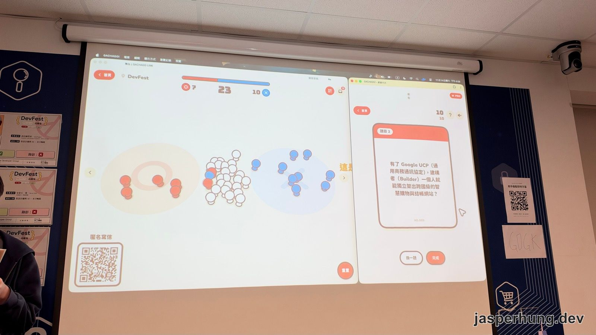
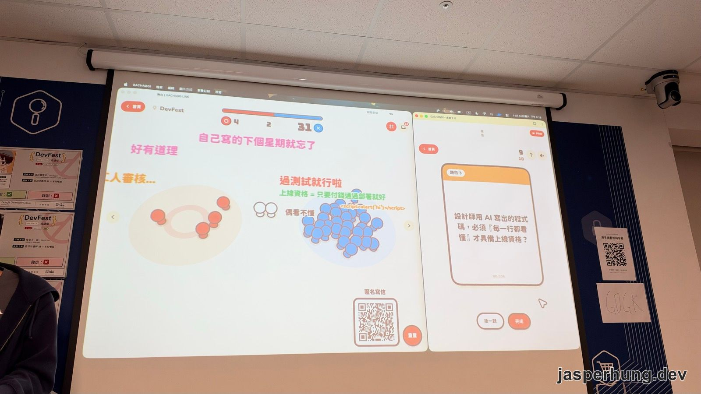
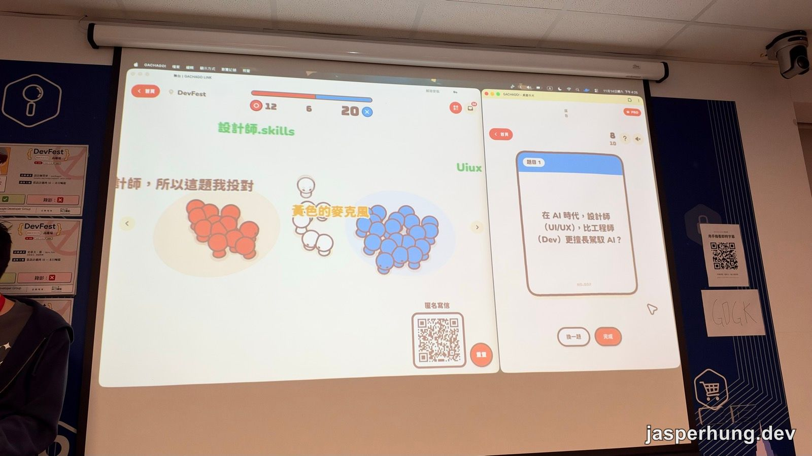
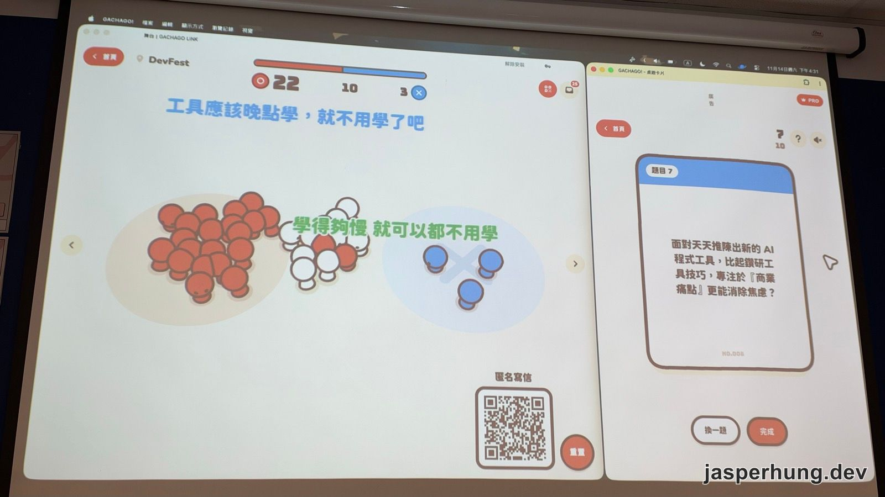
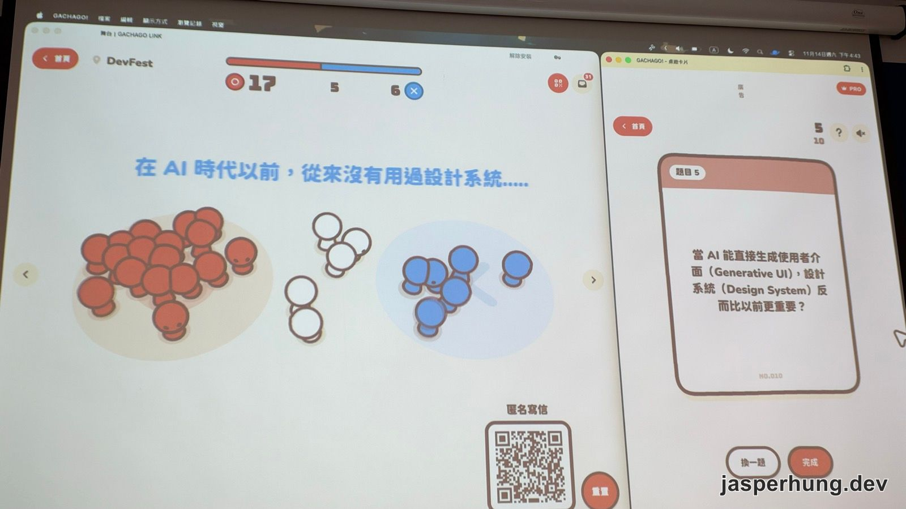
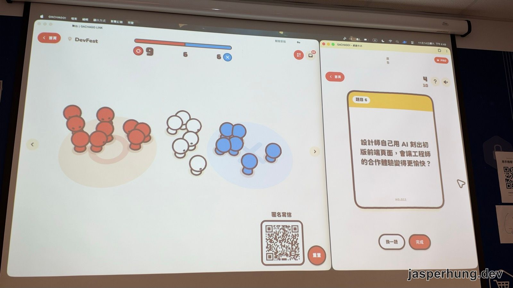
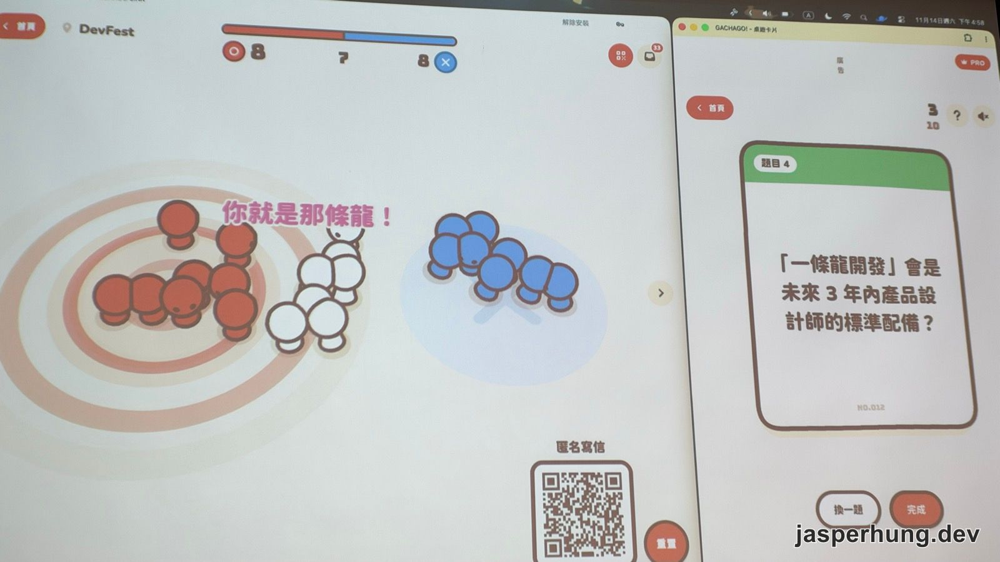
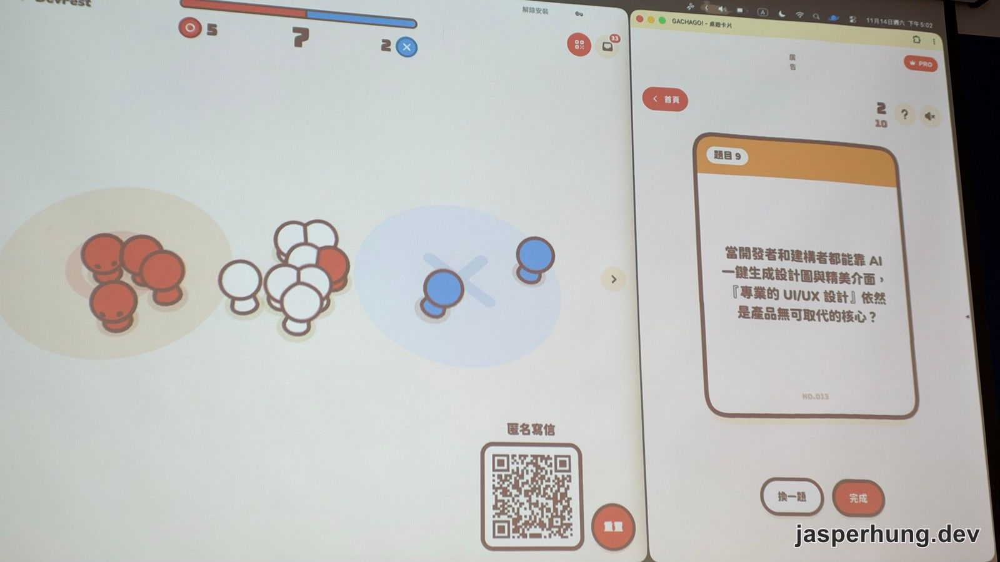
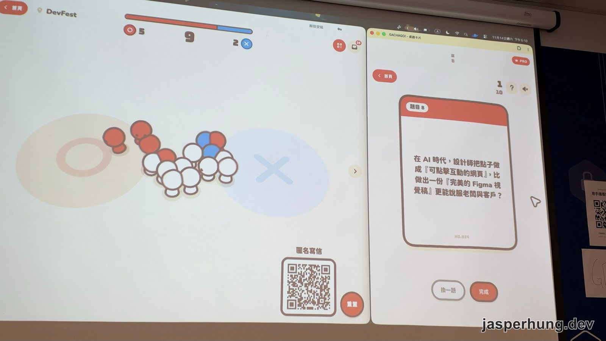

<KeyTakeaways>
  
AI 時代，設計師的工作會被毀滅嗎？DevFest 高雄 2026 這場座談由末日博士與兩位設計師用十題現場投票攻防，比起誰會被取代，三人更在意技術門檻被抹平之後，差異還剩下什麼：發現問題的能力、細節與品味、專業分工；本文依現場錄音整理，內容是講者的個人觀點。

</KeyTakeaways>

{/* 工作稿：內容依錄音逐字稿（已分講者）整理，每題三位講者的立場以錄音為準；投票數取自現場照片 */}

{/* 待作者補：開頭情境（你當天在現場的時刻、為什麼去聽這場） */}

2026 年 11 月 14 日，DevFest 高雄場 16:00–17:30 的座談「當設計遇到 AI — 末日崛起」。台上三個人：史蒂夫•葉扮演漫威反派末日博士，一開場就宣布要「把全台灣的設計圈全部毀滅掉」，看 90 分鐘後是他被擊敗，還是「把在座所有人全部打死」；另外兩位英雄是王晟譯（饅頭）和設計師勞哥。

圖：中間戴面具的是末日博士史蒂夫•葉。

玩法是每一題丟出一個主張，饅頭念出正反兩方的理由，現場觀眾掃 QR Code 選 🟢 或 ❌，畫面上的小人就跑到對應的圈裡；三位講者再輪流說自己選哪邊、為什麼。觀眾也可以匿名寄信，留言會直接飄在投票畫面上。這套投票網站是饅頭自己寫的：

> 我這個網站兩天寫出來，我根本不知道裡面在寫什麼，先做就好了。

## 1. 有了 UCP，一個人就能架出跨國級的購物網站？

圖：現場投票 🟢 7、未表態 23、❌ 10，多數人還不知道 UCP 是什麼。

錄音從反方理由開始：各國金流都有法規，沒辦法那麼簡單就串出來。

**史蒂夫•葉（🟢）**：先問現場有沒有人知道 UCP，答案是「不知道」，於是末日博士親自解惑。UCP 是 Universal Commerce Protocol，他說是 Google 跟 Shopify 制定的商務協定。情境是這樣：想買便宜牛肉，打開 Gemini 問「我家附近有什麼便宜的牛肉」，AI 會優先找到商品資訊符合 UCP 規範的網站，所以就算你家只是牛肉加工廠，被找到的機率也可能比家樂福高。找到之後直接在對話裡下單，不用連去商家網站；有問題時，你的 AI 還可以呼叫商家的 AI 客服，AI 對 AI 把事情解決。他當天早上剛查到，UCP 已經把旅館訂房也接進來，未來保險、買車這類交易可能都會走這套。結論是「重新建立一條賽道」：每個人都可以把想賣的東西做成網站，把商品介紹做成符合 UCP 的規格。

**饅頭（❌）**：東西確實很方便，但他自己沒串接過，認為法規上還是會有限制。

**勞哥（沒有表態）**：自我介紹完就說「我是設計師，對這個東西完全不了解，為什麼會找我來？」，接著把話題轉到法規：他提到台灣今年的身心障礙者權益保障法新規定，一定規模的企業官網、跟大眾利益有關的網站，無障礙要通過檢測，做不好可能違法。所以接下來醫院、公家機關應該會有不少前端案子。至於「AI 不是就能搞定嗎？」，他的回答是台灣的無障礙規範比較特別，可能不在 AI 的知識庫裡，還是需要台灣的專家處理。{/* 待查證：法規名稱與適用範圍是勞哥口述，尚未查證 */}

下一題開始前，史蒂夫•葉問有沒有要公布答案，饅頭說其實沒有答案。末日博士：「沒有答案就是在問大家相信誰。」

## 2. AI 寫的程式碼，要每一行都看得懂才能上線？

圖：🟢 4、未表態 2、❌ 31，幾乎一面倒覺得不用每行都看懂。

正方：資安不能妥協，看不懂的程式碼就是資安和維護的地雷。反方：建構者的核心是驗證功能、交付成果，只要通過 AI 輔助測試和黑箱驗證就能往前推。

**饅頭（❌）**：「其實我也沒有在看程式碼，我自己寫的，下個禮拜就忘了。」這句話後來還出現在觀眾彈幕上。

**勞哥（答不出來，實務上先不看）**：他自己做的時候也是先不看，但後續會跟前後端合作。重點是萬一出錯怎麼辦，所以要分級：公司有敏感資料、或出錯後回滾成本高的，就不能直接上線。vibe coding 適合發想和個人小專案；幫比較嚴肅的公司做開發時，版本管理、環境建置這些軟體工程的基本功還是要考慮。他也替新手說話：很多人說「有很多猴子來弄新東西」，但這些猴子也看到了新風景，等問題砸在身上，自然會回頭向真正的高手請教。

**史蒂夫•葉（❌）**：他覺得這是新秩序的建立。過去做不到的事，現在每個人都可以做設計，不一定要是設計師。他用物理課比喻：開一盞燈的背後有幾百年累積的化學、物理定律，但你不需要知道那些方程式，開關按下去燈就亮了，AI 就是這樣的東西。收尾則是末日博士本色：每個人都是設計師，這就是另一種設計師的末日。饅頭接了一句「我被毀滅了」。

**饅頭補充**：他推薦很多不懂軟體開發的朋友用 AI，朋友寫了一堆遊戲自己玩得很開心；只是做遊戲還好，重要的東西還是要把關。

> [!NOTE]
> ### 現場插曲
> 史蒂夫•葉：「你遊戲要課金的時候就麻煩了。」饅頭：「萬一重複扣款了，這樣對我們來說是好的啊，對不對？」另外，投票畫面上的匿名彈幕有人直接丟了一段 ``，在討論資安的這題剛好應景。

## 3. 設計師比工程師更擅長駕馭 AI？

圖：投票進行中 🟢 12、未表態 6、❌ 20。

正方：AI 缺乏情境和使用者同理心，設計師能給它最精確的系統狀態和邏輯提示。反方：底層程式邏輯和架構認知還是很重要。

**史蒂夫•葉（🟢）**：「科技來自於惰性，惰性越大推進力越強。」AI 在彌補人類的惰性，讓你想要什麼樣的遊戲、什麼樣的東西都真的做得出來。但他提醒，往前推不代表方向對，可能推到更糟的地方，「我們現在只能創造一個 chaos」。

**勞哥（🟢，但不認為是職位問題）**：撇開設計師和工程師的職位，差異在於「腦袋有沒有整理過事情」。很多人以為想法多的人特別會用 AI，他不同意。做設計的都遇過想法很多的老闆：叫他做了七個版本，最後說「其實我還是覺得第一版比較好」，等於浪費了他的 token，反正每個月付他的薪水是固定的。Prompt 下得不精準很常見；變成會用 AI 的人，方法是常常跟別人分享自己的想法，或者試著把一項技術教給別人，教得會就代表你的敘述夠精準。

**饅頭（🟢）**：要先定義什麼叫「擅長駕馭」。如果是使用者同理心，設計師看得到工程師看不到的需求；如果是架構程式碼，那是工程師擅長的駕馭。這題可以分兩個面向，主要還是看使用情境。

> [!NOTE]
> ### 現場插曲
> 勞哥抓到投票網站的 UX 問題：講者手上的圈是藍色的，畫面上的圈卻是紅色的，顏色相反。史蒂夫•葉補刀「UX NG」，饅頭坦承：「其實圈是我畫的。」

## 4. 比起鑽研工具，專注商業痛點更能消除焦慮？

圖：🟢 22、未表態 10、❌ 3，觀眾彈幕寫著「工具應該晚點學，就不用學了吧」。

正方：工具只是手段，解決問題的能力和商業敏銳度才是護城河。反方：要掌握最新的 agent 工具和工作流，技術敏感度不能偏廢。

**饅頭（🟢）**：AI 工具會一直推出，現在沒看到的，之後也會有更快的。與其一直追新技術，不如去了解大家有什麼需求、可以做什麼產品。

**勞哥（先 ❌ 後 🟢）**：先叉後圈。先叉：每個人都應該去試現有的 AI agent 和各種工具。後圈：等你熟悉了，隔壁的人也熟悉了，同樣花七天，差別在你選擇解決哪些問題。他也說，真的喜歡寫程式就去研究，沒什麼好焦慮的；會焦慮通常是因為想賺錢，研究完卻發現賺不到。

**史蒂夫•葉（❌）**：末日博士要唱反調。他用破壞式創新解釋：現在看到的問題，在未來的技術裡可能根本不是問題。一百多年前該研究怎麼把馬養得更壯，還是乾脆發明汽車？AI 不是在解決現在的痛點，而是在創造新的商業模式。企業聘人不是做慈善，是請你來解決問題、幫它賺錢；新模式出現之後，這就是為什麼大家開始講 AI 會取代人的工作。

> [!NOTE]
> ### 現場插曲
> 有人問能不能站中間。饅頭說可以，但比數差不多的時候，畫面上的小人會在中間打架、推來推去。彈幕馬上有人寫：「學得夠慢，就可以都不用學。」

## 5. AI 代理會讓做產品變得更好玩？

{/* 這題沒有題卡照片，題目依饅頭念題整理 */}

題目是：AI 代理的普及不會消滅設計師和開發者，反而會創造更好的產品，做產品的過程也會變得更好玩。正方：繁瑣的重複工作被自動化，精力可以放在創意和發想上。反方：產品迭代越來越快，競爭更激烈，壓力可能比以前更大。現場彈幕：「更好玩不確定，但更累了。」

**饅頭（🟢）**：以前程式寫得很爛，現在有了 AI，寫了一堆很奇怪的遊戲，包括這個投票網站。他花不少時間想還能做什麼，好把剩下的 token 燒光。但他也承認垃圾變多了，像 Steam 上出現一堆品質不太好的 AI 遊戲。

**史蒂夫•葉（❌ 方向）**：「聽起來在座各位都已經財富自由了。」好玩建立在生活壓力還承受得住的前提上，背著房貸、債務的人，好玩這兩個字有點遙遠。他更在意的問題是：AI 時代會不會根本沒有「產品」這種東西？軟體被複製的速度太快，台下有心人回去一小時就能做出一模一樣的，再過幾小時做出更厲害的。產品需要的迭代期、獲利模式，都會被後面的浪潮很快打過去。

**勞哥**：回應史蒂夫•葉，未來推產品可能不會再搶快一次推滿功能，因為你快別人也快，不如分批推出、看反應再推下一項。他認為這題的 🟢 和 ❌ 既是十字路口也是因果。十字路口是因為不是每個設計師都為創意而來，很多人只是來找工作、解決問題；因果是因為創意越多，維護的人越慘。他舉自己以前在知名電動車公司當設計總監的例子：公司突然要做一個條件很複雜的虛擬徽章，要結合大量工程，做完還不能拿去賣，最後花了很多錢卻沒做。

> [!NOTE]
> ### 現場插曲
> 這段錄音開頭三人在算養幾個 AI 訂閱比請人划算，勞哥：「如果我們幹不過四個 AI，也不要幹了。」史蒂夫•葉：「AI 不用一個月前先宣告，馬上就可以換掉。」{/* 待作者確認：錄音辨識為「阿草」，推測是某個 AI 工具的暱稱 */}

## 6. Generative UI 時代，設計系統反而更重要？

圖：🟢 17、未表態 5、❌ 6，彈幕有人說「在 AI 時代以前，從來沒有用過設計系統」。

反方的理由是：即時生成的介面可以打破固定元件的思維，設計系統的形態會徹底改變。

**饅頭（🟢）**：產品還是需要設計系統當核心，沒有規範的話，AI 隨意生成會很混亂。比如做醫療相關的產品，結果畫面跑出一堆彩帶，或者變成他這個投票網站的風格，都不太好。

**史蒂夫•葉（🟢，但重要不等於跟你有關）**：他選圈，但接著丟出更有挑戰性的命題：重要的東西不見得跟你有關。電燈很重要，但它已經建立在人類文明極大化的技術上，跟你我沒什麼關係。他過去帶設計團隊，花好幾年從 Design Token 一路推廣設計系統，讓台灣很多企業知道它的重要性；現在甚至有設計系統發佈時還開發表會。但大家都知道它重要之後，AI 一直 chain 下去，設計系統可能自然就出現了。他想透過這個破壞讓設計師思考：如果不用花大把時間做設計系統，你接下來可以做什麼？

**勞哥（❌）**：「那我來當末日。」他的公司就是專門做設計系統的，但他投叉。設計系統這四個字每個人理解都不一樣：設計師可能覺得是一整套規範，工程師可能覺得是套一個 framework。Generative UI 也不再只是網站或 App，可能出現在對話裡；他舉 Apple 的 App Clip：掃 QR Code 就能直接用，不用下載 App，UI 也不用自己做，只要上傳圖片和文案。對設計公司來說，設計系統本來是品牌延伸的一部分，如果未來介面只剩語音，你直接問 AI「我等一下要住哪裡」它就推薦飯店，那品牌可能變成聲音、變成說話的口吻。

## 7. 設計師用 AI 刻出初版前端，合作會更愉快？

圖：🟢 9、未表態 6、❌ 6。

正方：有互動的真實原型可以減少猜測、加速開發。反方：非專業寫出來的程式沒有架構規劃，公司要重構時反而變成技術債。

**饅頭（🟢）**：現在做出來的東西很像真的能用的產品，交給工程師時，對方一看就知道動態效果、頁面怎麼動，比畫白板、拉線框直覺。以前很多動態介面他不太敢做，現在可以先做個樣子給工程師看。但他也遇過反面：老闆看到原型說「這個好像真的可以用耶，可不可以直接拿去給使用者用？」他得解釋這只是原型，因為實在太像能用的了。

**史蒂夫•葉（❌ 方向）**：「以殘酷的人生現實來講，不管表面上多愉快，私底下一定是吵到翻。」設計師用 AI 做前端，工程師也用 AI 做 UI，大老闆可能說「那我留一個就好」，最後變成誰能交付、誰賺最多錢誰就贏。他講了《絕命毒師》的一段劇情：打雜的小弟跟老闆說「你可以殺了他，我什麼都會」，因為他把男主角的製毒流程全部記下來了。老闆最後選了男主角，但他說不是每個老闆都會這樣選，很多老闆會想：「小弟一個月才兩萬多，又不會跟我吵架。」

**勞哥（❌）**：他原本想投叉，因為重構一直是個問題；雖然現在可以用 AI 去整理原型，工程師接手時的理解範圍也比較廣。但他最後還是投叉：就算用最聰明的 AI，它拆出來的可能是全世界通用的最佳實踐，卻不是你公司用的那套，每次都要重構就是問題。他舉 dashboard 為例：瀏覽器內建下拉重新整理，但 dashboard 表格常要上下捲，一拉就重整很難用；AI 不會主動處理這些，也不一定會做好行動版，偏偏老闆都說想在手機上看。AI 習慣做的「公認好東西」，不一定是你的好東西；競爭力來自別人沒有的那些細節。

## 8. 「一條龍開發」會是 3 年內產品設計師的標配？

圖：🟢 8、未表態 7、❌ 8，彈幕喊著「你就是那條龍！」。

正方：AI 抹平技術門檻，能獨立交付 MVP 會是設計師最強的競爭力。反方：專業分工不會消失，深度的視覺體驗和使用者研究有無可取代的價值。

**饅頭（❌）**：做出 MVP 之後還有很多程式細節，要交給專業工程師；雖然也可以用 AI 審查，但不一定審到真正重要的地方。

**史蒂夫•葉（🟢）**：「我們準備好屠龍刀，把這些龍的頭全部砍掉。」他認為一條龍會成為標準配備，但過程中會看到非常多失敗。末日博士的商業手段是：檯面上大力推廣，等大家知道這件事有漏洞，再從漏洞突破攻擊。要嘛自己變強，要嘛讓對方變弱。

**勞哥（🟢 和 ❌ 是先後問題）**：一條龍很危險，因為出事時那條龍要自己負責，這也是大公司為什麼需要這麼多人。抹平技術門檻聽起來很開心，但同時也抹平了能力差異：如果三個設計師都用 AI 做功能，功能會高度同質化，使用者平均分散，沒人能拿下市場。他說現在幾乎每個網站一看就猜得出是 Claude 做的還是 Gemini 做的，「醜的地方也一樣，錯的地方也一樣」。要在這個平均化的世界做出差異，還是得回到專業分工。

> [!NOTE]
> ### 現場插曲
> 勞哥：「AI 不會幫你負責，要打官司，AI 不會出庭。」史蒂夫•葉補充說美國已經有在做相關的 POC，但都還在很初期。

## 9. 專業的 UI/UX 設計，依然是產品無可取代的核心？

圖：🟢 5、未表態 7、❌ 2。

正方：AI 負責好看和畫面，商業決策、核心動線和同理心由專業設計師把關。反方：AI 工具和標準設計系統已經滿足八成需求，純排版和視覺的門檻正在被吃掉。

**饅頭（🟢）**：AI 可以解決好看、有畫面的部分，但使用者同理心還是要靠設計師。AI 做出來的東西，最後 AI 自己也不知道做了什麼，需要有人把關。

**史蒂夫•葉（What if）**：他引用漫威動畫《What If…?》：我們常說 AI 不會怎樣，但如果明天就發生了呢？現在已經是學生用 AI 寫作業、老師用 AI 審、主任也用 AI。所以問題不是設計師會不會被取代，而是如果設計師繼續存在，你要扮演什麼角色？也許以後不叫設計師，叫 Dream Maker、Creator，比的是誰能發現問題。他認為釐清問題和解決問題，AI 在可預見的未來做得到；AI 能不能「創造問題」，他認為現在還不行，那是人類最後一道防線。

## 10. 可點擊的網頁，比完美的 Figma 視覺稿更能說服老闆？

圖：🟢 5、未表態 9、❌ 2，最後一題。

正方：真實的網頁可以直接操作、驗證商業邏輯，跳過靜態稿的想像落差。反方：品牌調性和細節才是設計核心，粗糙的原型反而會拉低品牌期待。

**勞哥（說服會，但之後呢）**：他趁換頁時先搶答。做出很炫的東西、老闆點頭了，後面接手的人就「點點點」了。他回顧互動提案工具的演變：Sketch 丟到 InVision、Photoshop 做完丟到 AE 做影片給老闆看。但他認為做網頁一開始根本不需要另一個軟體，直接用 HTML 做比較好；1995、1997 年大家都是手寫 HTML，設計軟體是為了溝通才產生的中介。現在一條龍變成一個人，不需要跟團隊溝通，只需要說服老闆，所以包括 Figma 在內的這些軟體可以慢慢拋棄了。史蒂夫•葉補一句：「說服老闆沒有 AI。」

**饅頭（🟢）**：AI 寫的程式碼裡面可能亂七八糟，但它確實能驗證這個產品這樣操作順不順。靜態稿給老闆看時，常常要解釋「這還沒套顏色、這只是版型」，反而多一層溝通。然後老闆就會問：「這個不是明天就可以上線嗎？」不行。

**史蒂夫•葉（🟢，但有一條界線）**：他認為現在出現了一條複雜度的界線，線上線下是天堂與地獄。他以前自己開工作室，做官網、CMS 這類相對單純的案子；後來進大型集團，做的是金融、半導體這類很複雜的系統，例如他今年參與的一個大型金融 App 全面改版，光是弄懂各種金融交易規則就念得像咒語。線以上的大型複雜案子還活得很滋潤；線以下就危險了，老闆不看你設計得怎樣，只問 show me the money。他說已經有好幾個同業活不下去，如果他現在還在開工作室，也想不到出路。「所以才會當末日博士，真的沒救了。」

**勞哥（❌）**：最後他回頭補充對競爭力的看法。以前的競爭力是多花錢把東西做得更好，現在做得更好一下就被抄走，競爭力變成誰更快推出新東西，於是出現一個肉眼可見的趨勢：為了快，放棄細節和品味的堅持。他也看到另一面：花大錢做好的東西只能失敗一次，用 AI 降低品味標準，可以做十次、失敗十次、學到十次。

> [!NOTE]
> ### 現場插曲
> 史蒂夫•葉回憶起 FrontPage 和 Dreamweaver 哪個比較早，勞哥說他就是從 FrontPage 開始的，兩人互相吐槽年紀太大，最後勞哥喊：「好啦，不要偏題了，時間快到了。」十題結束時，饅頭自己承認：「這個網站很多細節，我的 RWD 做得很爛。」

## 現場匿名提問

十題結束後是「抽卡」時間：講者從觀眾的匿名信裡抽問題回答。彈幕還飄過一句「好期待世界失業到一定程度」。

**Q：你們的公司真的有沒有因為 AI 裁掉人，或是開始減少徵新人？**

史蒂夫•葉直接回答：會。他看到的是工程人力往東南亞較便宜的勞動市場移動，而且當地工程師的品質在進步、也很用力在用 AI，「工程師這部分來講，蠻恐怖的」。勞哥從小公司的角度補充：以前一個人接十幾萬的案子，現在 AI 強到一個人可以接兩百萬的案子，原本要外包找兩個工程師的工作就省下來了。

**Q：設計師會怕 AI 把你做的東西學走嗎？**

勞哥覺得設計師本身比較不用怕，但如果把能力寫成 code，就會被拿走。現在很多設計師把自己的技能寫成 Skill，可是 Skill 可以被偷，「所以我不如拿 Skill 去開課」。史蒂夫•葉接著講了一個「殘忍」的案子：客戶只給兩個月做設計，提案前三天才說「你們沒做使用者研究」，要他們 72 小時內生出來。以前不可能，現在有 AI 做得到，客戶看了很開心，但他承認以設計師的眼光看，那份是在極度擠壓下的產物，自己看完都不滿意。

**Q：講者對無條件基本收入的想法？有可能實現嗎？**

勞哥說他沒有深入研究，但覺得像普發補助那樣，每個人補三千，東西就貴三千。饅頭接著問：那每個人發六萬呢？勞哥：「那我的養樂多就變成六萬零十塊。」

**Q：講者會推薦看什麼書，來消除焦慮、拓展對 AI 的認知？**

勞哥：「我都叫 AI 幫我看書。」饅頭補充，勞哥自己做了一個機器人，會定時爬設計相關的資訊。勞哥說他不是亂爬：他在 X（Twitter）上建了一個 list，把覺得厲害的人都加進去，讓機器人爬這個 list，再依他自己的學經歷翻譯、整理成他看得懂的內容。史蒂夫•葉反過來丟一個問題：如果你已經財富自由，買得起小島、可以天天度假，還會想學習知識嗎？勞哥覺得會往有興趣的方向走，像比爾蓋茲去研究新的馬桶。史蒂夫•葉的另一個角度是：沒財富自由的人想先財富自由，而那條路不一定是當設計師，他看到不少設計師決定轉去做別的事，「這也是一種選擇」。

**Q：國內企業擁抱 LLM 很牛步，焦慮的族群到底是哪些？**

這封信字數很長，講者念到一半，史蒂夫•葉說「感覺是抱怨而已吧」，勞哥：「對，抱怨，下一個。」最後還補一句「我很焦慮」。

**Q：2026 年前端工程師已經不是非本科轉職的首選，想踏入資訊產業有什麼建議？**

饅頭說他公司最近也有蠻多非本科系的人進來當工程師。史蒂夫•葉補充他前幾天看到的美國調查，說美國大學生有六成沒有從事本科系的工作。{/* 待查證：史蒂夫•葉口述的調查數字，尚未查到原始來源 */}勞哥的建議是看興趣：以後大家的水準會很平均，水準以上的差異，在於能不能幫公司創造價值或自己創業，那一定要是你有興趣的事。

**Q：Figma 有護城河嗎？**

饅頭覺得 Figma 現在很努力想跑出來，勞哥也說「感覺他在拚命」，而且已經有很多 Figma 的替代品。史蒂夫•葉則說他的團隊明年 1 月 1 日起要全部換掉，都用 Claude Design。

## 三位講者的立場

**史蒂夫•葉（末日博士）**：整場在扮演破壞者。他的論點一路圍繞「新秩序」：AI 讓每個人都能做設計，重要的東西不一定跟你有關，破壞式創新會讓現在的痛點直接消失。但最後一題他說出自己為什麼會當末日博士：複雜度界線以下的小工作室，真的有同業已經活不下去。

**饅頭**：最常站在實作者的角度，自己就用 AI 兩天寫出整場的投票網站。他大多投圈，支持用 AI 做原型、做溝通，但每次都會補一句：重要的東西還是要專業的人把關，原型不能直接拿去上線。

**勞哥**：最常把 🟢 和 ❌ 拆成「先後」或「因果」，不急著選邊。他的核心觀點是同質化：AI 抹平了技術門檻，也抹平了能力差異，差異化最後還是要回到細節、品味和專業分工。

## 心得

這樣的座談會蠻特別的。平常比較常聽到的是工程師對 AI 時代的焦慮、各種末日論，比較少聽到設計師的心聲。這次請到三位知名的設計師上台大亂鬥，蠻有趣的：每個人的職位和看到的視野不同，回答同一個問題的角度也都不一樣，很多觀點都可以拿來參考。

比如史蒂夫•葉用末日博士的角度，悲觀地講了一些現實：東南亞崛起得比你想的還快，越南、泰國的人力更便宜；台上甚至很直白地算起一個人等於幾個 AI 方案的額度，算出來大概四點多個。{/* 待作者確認：你筆記寫「阿法」、錄音辨識成「阿草」，指的是哪個 AI 方案 */}這聽起來蠻悲觀的，但人最後會變成電池嗎？我覺得好像也不一定。人類反而要去做更多決定、探索更多需求，因為東西做出來，終究要有人買單。

勞哥講到一個蠻重點的地方：以前我們要花很多時間精雕細琢一個產品，現在很多設計細節可以先放掉，取而代之的是一次撒出十個版本，用時間換空間，換到試錯的空間。十個版本推出去，買單的老闆喜歡哪一個，馬上就知道了。人要做的，變成去探討更多 scenario：到底需不需要這個東西？這個產品需不需要存在？這間公司需不需要存在？

這次 DevFest 的節奏極度緊湊，也辦得蠻成功的，學到蠻多東西。
