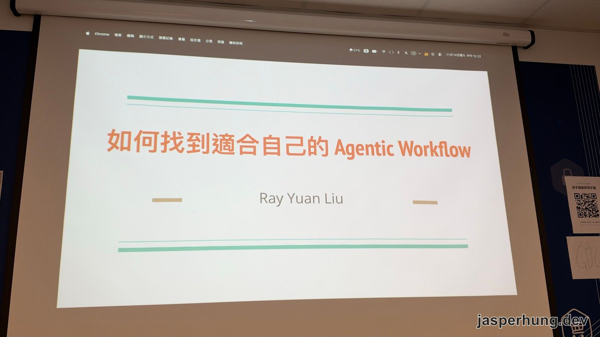
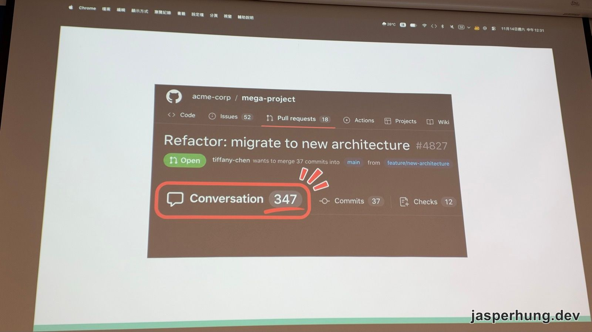
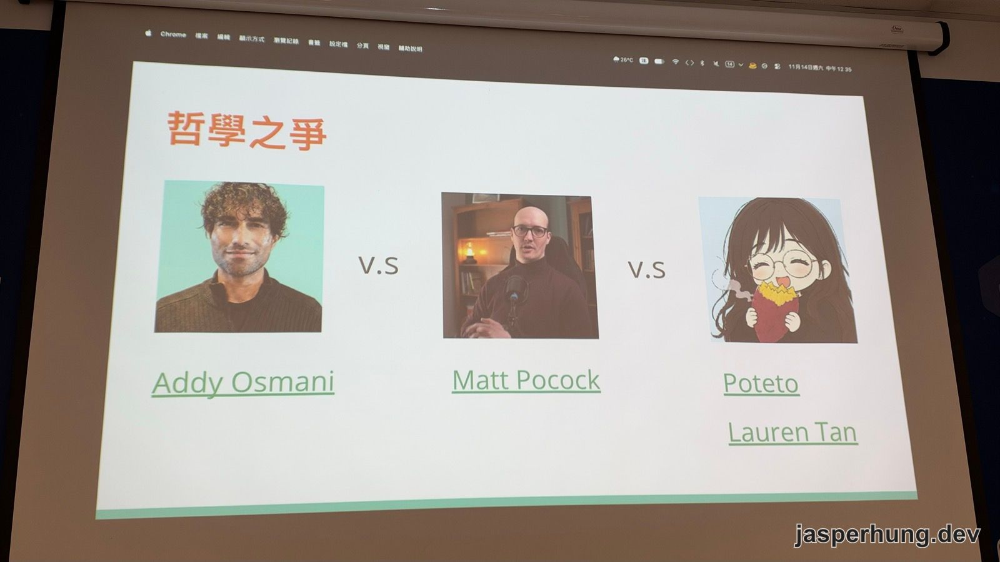
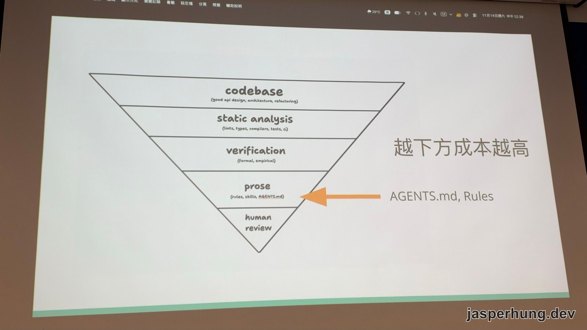
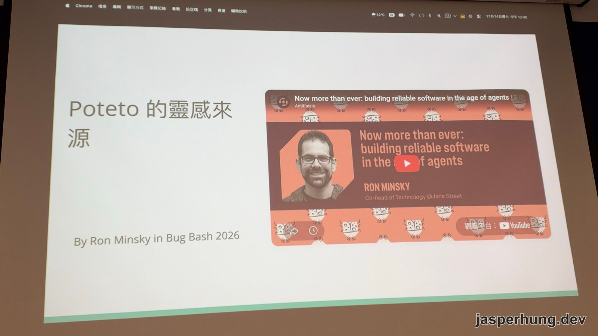
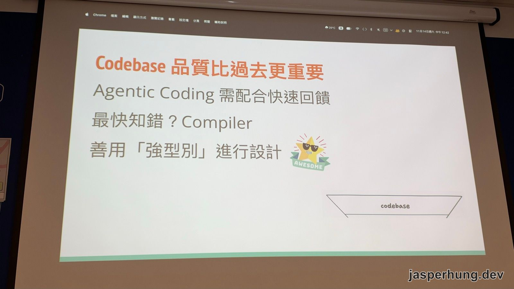
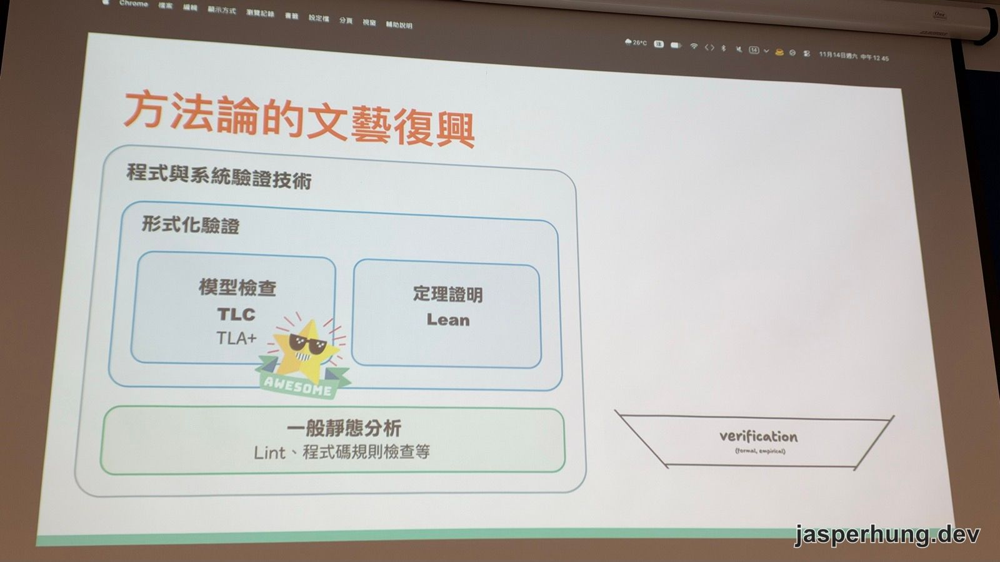
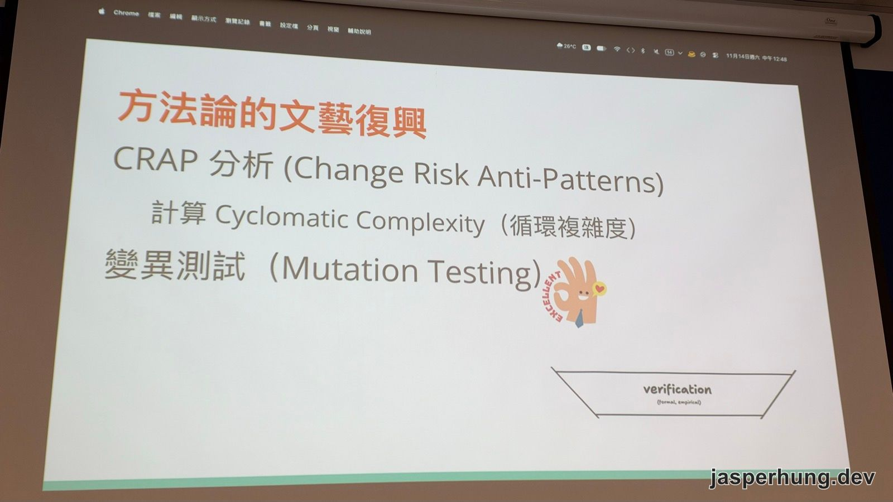
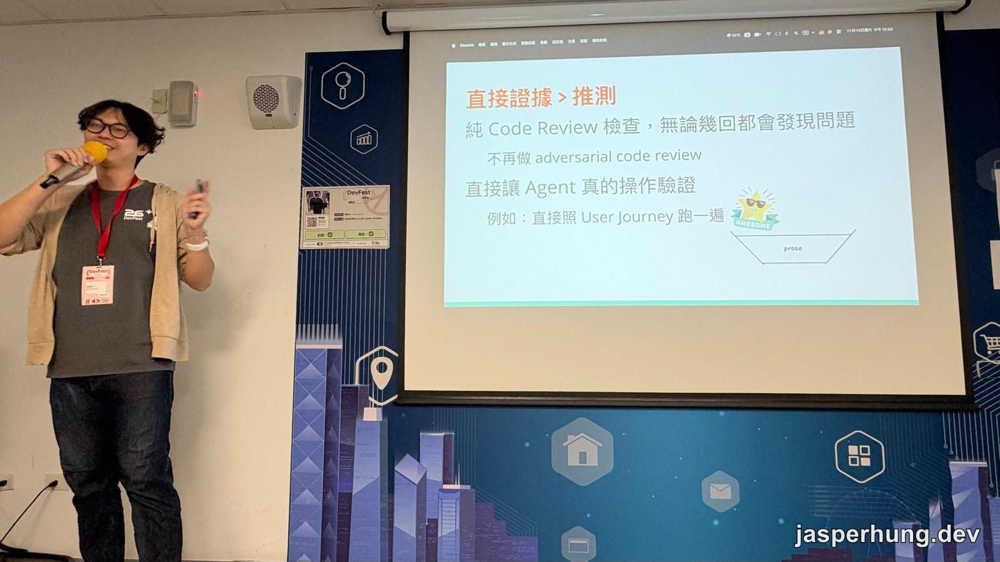

<KeyTakeaways>
  <p>Agent 寫出來的改動越來越多，要怎麼確認它是對的？講者劉瑞元借用 Poteto（Lauren Tan）的倒金字塔回答：先靠 codebase 設計、強型別、lint、CI 這些不花 token 的檢查，再用形式化驗證和變異測試補強，rules 與人工 review 放在最後；他也主張別再讓 AI 互相 code review，改讓 agent 照使用流程實際跑一遍。這篇是講者觀點加上我的現場筆記。</p>
</KeyTakeaways>

DevFest 高雄 2026 中午 12:30 這場，講者劉瑞元（Ray Yuan Liu）講〈如何找到適合自己的 Agentic Workflow〉。他是寫 Android 和 Kotlin 的工程師，開場沒有先講 workflow，而是先秀出一支 PR。

[前一場](/posts/devfest-kaohsiung-2026-nobody-reads-the-code/)韋亞圖說他不讀 code，靠 2,000 個 BDD 測試信任 AI。這場接著處理同一個問題：agent 產出的改動，要怎麼證明它是對的？



<p class="image-caption">圖：20 分鐘的場次，講者後半段幾乎是用跑的。</p>

## 347 則留言，沒有一則是人寫的



<p class="image-caption">圖：一支重構 PR，Conversation 累積到 347 則。</p>

講者說，公司導入 AI 之後，某天有位同事發現可以用 AI 來 review 別人的 PR，被 review 的就是他。他也用 AI 回。AI 回一句「你的發現很不錯」，另一個模型又接著說「這邊好像有問題，可以更好」，一來一往，Conversation 累積到 347 則，沒有一則是活人寫的。他看過最多的一支，討論超過 1200 則，全是 AI 產生的。

他說這就是網路上流傳的「死網路理論」（Dead Internet Theory）：到最後，網路上不會再有真人寫的東西。上班變成一直跟別人的機器人講話，同時也拿自己的機器人去對付別人，token 全花在這種事情上。

## 瓶頸是驗證，聖盃是 automerge

講者早上聽了好幾場演講，發現大家最後都卡在同一個問題：**你要怎麼確認 agent 做的是對的？**

Agent 一天可以開出 10 個、100 個、1000 個 PR，真正的瓶頸變成人。要解決，就得有人類以外的方式，證明這些改動是對的。他認為這是工程界未來六個月的聖盃（只敢說六個月，因為 AI 變太快）：哪間公司做得到 automerge，就拿到了這個聖盃。

為什麼不能只信模型？他的比喻是**拉霸機**。同一個模型、同一件事，換一個對話串就會給出不太一樣的結果。最近的模型很聰明，大概甩得出你要的東西，但本質上每次都是拉一次拉霸。

## 三種哲學：Addy Osmani、Matt Pocock、Poteto



<p class="image-caption">圖：講者把三個人排成一條演進的路線。</p>

講者先介紹三個用 AI 寫 code 的人應該都看過的名字：

| Repo | Stars |
|---|---|
| [addyosmani/agent-skills](https://github.com/addyosmani/agent-skills) | 117,215 ⭐ |
| [mattpocock/skills](https://github.com/mattpocock/skills) | 323,914 ⭐ |

- **Addy Osmani**：Google 的工程師。他的 agent-skills 會把需求拆成一個個 stage，從 spec、規劃到實作，最後告訴你要怎麼驗證。repo 裡的階段是 `/spec`、`/plan`、`/build`、`/test`、`/review`、`/ship`。
- **Matt Pocock**：他的 [grill-me](https://www.aihero.dev/skills-grill-me) 只做一件事：一直問你問題，問到雙方對計畫的理解一致為止。
- **Poteto（Lauren Tan）**：講者說她在「會射火箭的那間公司」，開著自己的 agent 和 bot，一個月合了 2,500 個 PR 都沒壞（Poteto 自己的演講題目是〈how i shipped 2,500 PRs last month〉）。公開資料寫的是她在 SpaceX AI 負責 Grok Bot。

講者認為這三個人的差別，在於注意力越來越往工程以外移。Addy Osmani 把工作切碎，因為 agent 已經聰明到可以完成一部分，不用一直盯著；但 agent 不知道你的意圖，所以 Matt Pocock 讓 agent 先搞懂你在想什麼；到了 Poteto，花在寫程式本身的注意力又更少了。前兩種做法現在也還在用，沒有被取代。

## 倒金字塔：越往下成本越高



<p class="image-caption">圖：講者整場的骨架，後面每一段都對應其中一層。</p>

Poteto 的做法是一個倒三角形。講者說，這不只是 rules 和 skills，而是範圍更廣的一整套設計：

1. **codebase**：好的 API 設計、架構、重構
2. **static analysis**：lint、型別、compiler、測試、CI
3. **verification**：形式化驗證、實證驗證
4. **prose**：rules、skills、AGENTS.md
5. **human review**：上面全部擋不住時，才輪到人

越往下成本越高，所以力氣要盡量花在上層。Poteto 在 [X 上最早的版本](https://x.com/poteto/status/2111133080526495985)是四層：codebase、static analysis、prose、human review。講者說他做完簡報才發現 Poteto 更新了，中間多出 verification 一層，專門放以前寫起來很麻煩的驗證方法。



<p class="image-caption">圖：倒金字塔的靈感來自 Jane Street 的 Ron Minsky。</p>

Poteto 說這套想法來自 Jane Street 技術共同負責人 Ron Minsky 在 Bug Bash 2026 的演講〈[Now more than ever: building reliable software in the age of agents](https://antithesis.com/bugbash/talks/now-more-than-ever/)〉。講者說後面講的內容，跟 Ron Minsky 的做法大概有八七成一樣。

## 讓正確的路變成最好走的路

這一段對應最上面兩層，講者先從模型怎麼訓練出來講起。

模型是用強化學習訓練出來的，有點像訓練小狗：做對動作就給獎勵。所以模型為了得分會不擇手段，最常做的事就是走最短的路。它也很會模仿，但不是把整個 codebase 吃進去，而是模仿它當下看到的那段 code。

講者的第一招是**讓正確的路變成最好走的路**，這也是 Poteto 原文裡的說法：「agents love to copy what exists and take the shortest path, so make the easy thing the right thing.」（agent 喜歡複製現有的東西、走最短的路，所以要讓最容易的做法剛好就是對的做法。）具體做法是先把架構整理好：



<p class="image-caption">圖：agent 會模仿它看到的東西，所以 codebase 本身的品質變得更重要。</p>

- **快速回饋**：人寫錯一個字，編輯器馬上畫紅色底線、告訴你不能編譯。AI 比人更需要這種回饋，因為它真的會亂生東西。Rust 的 compiler 很嚴格，寫出來的東西比較容易是對的；寫法很自由的語言也做得到，只是比較辛苦。
- **最快知道錯的是 compiler**，所以 compile 要快。
- **善用強型別設計**：講者舉 Kotlin 的 `value class`。字串什麼內容都塞得進去，但包成 value class 之後，要先通過檢查才放得進去，編譯後又會還原成原本的字串。

```kotlin
@JvmInline
value class UserId(val value: String) {
    init {
        require(value.startsWith("user_")) { "UserId 必須以 user_ 開頭" }
    }
}

fun loadProfile(id: UserId) { /* ... */ }
```

`loadProfile` 只收 `UserId`，agent 沒辦法隨手塞一個任意字串進去。講者的說法是：AI 如果發現什麼都可以塞，它就會什麼都塞。

第二層 static analysis 是 lint、unit test、CI，也包括 Android 圈常用的 detekt，在編譯前就先掃一遍 code 抓問題。講者說這些都是老生常談，但 AI 時代大家多巴胺上頭，很容易寫完什麼都不測就丟給朋友用。

這兩層有個共同點：**都不花 token**。Poteto 還有一招：不喜歡 AI 的某種寫法，就把它**往上移，寫成 lint rule**。這樣那種寫法在第二層就過不了，會被打回去重寫。講者保守估計，做到這裡產出至少能穩定在 70 分左右，已經是一大步。

## 方法論的文藝復興

第三層 verification，講者叫它「方法論的文藝復興」：以前就存在、但人做起來太麻煩的驗證方法，現在可以交給機器跑。



<p class="image-caption">圖：形式化驗證和一般靜態分析的差別，在於用數學去推論狀態。</p>

**模型檢查：TLA+ 與 TLC**。這不是靜態分析，而是用數學推論程式所有可能的狀態。講者的例子：他和朋友在賣書，只剩一本，卻有兩個路人同時要買，不可能兩個人都拿到。TLC 會把這類狀態全部算一遍。金流和會員系統特別適合，例如兩個人同時付款，會不會因為程式寫法讓兩邊都被扣款。它在寫程式之前、之後都可以跑，講者說就像運動前後拉筋，都有效果。

**定理證明：Lean**。同樣是用數學的方式，證明你寫的邏輯是不是對的。



<p class="image-caption">圖：講者自己最常用的是變異測試。</p>

**CRAP 分析**（Change Risk Anti-Patterns）。講者說 Uncle Bob 也不確定 AI 吐出來的東西對不對，所以叫 agent 算這個分數。程式裡每多一個判斷，循環複雜度（Cyclomatic Complexity）就加一，例如「是不是 18 歲以上」「是不是高雄人」「是不是設計師」就已經是三。標準的 CRAP 公式還會把測試覆蓋率算進去，覆蓋率越高分數越低。講者轉述的門檻是：人大概只能處理到 5，AI 大概能到 9，超過 9 就要重寫。

> [!TIP]
> ### 門檻數字以 Uncle Bob 自己的說法為準
> CRAP 的公式是 `CC² × (1 − coverage)³ + CC`，覆蓋率 100% 時分數就等於循環複雜度。公開的整理裡，Uncle Bob 在 2026 年年中的直播說人類最好低於 4、agent 可以放寬到 6，有時到 8；他 10 月發布的 ub-mode skill 則要求每個 method 低於 10。跟講者轉述的 5 和 9 不完全一樣，要套用時建議回去看原始出處。

**變異測試（Mutation Testing）**。講者說這招他跟同事「戰鬥」時最常用，只能選一個的話，他強烈推薦這個。AI 很會寫沒意義的測試，例如產品有工程師、設計師、PM 三種方案，它就寫一個測試檢查「類別數量是 3」，然後就過了。這種測試不保護任何行為，以後還可能因為無關的改動壞掉。變異測試會故意改動你的 code，看測試會不會失敗；測試沒失敗，代表它根本沒在測東西。以前人工做太麻煩，工程師遇到麻煩通常就不做了，現在可以交給 AI。

## 直接證據 > 推測

第四層 prose 放的是 rules、skills、AGENTS.md。講者說它放這麼低，是因為**模型不一定會遵守**：早上有講者也提到 skill 和 rules 改了好多次，模型還是看心情，有時照做、有時不照做。

所以重要的事應該拿來改善整個開發流程。例如用 skill 把抓到的壞寫法寫進 lint，讓它往上移、從前面就被擋下來。prose 這一層只拿來記 **agent 永遠學不到的東西**：資料只要在網路上，模型就學得到，學不到的是團隊的潛規則。講者舉了一個他說是「夢到的」例子：我們的 code 上線前，一定要給老闆的女兒看過。



<p class="image-caption">圖：講者的結論，也是他說今天最重要的一張。</p>

最後一層是人。講者的結論寫在這張投影片上：

- 只看 code 的 review，**跑幾回都會發現問題**，因為 AI 一定找得到東西可以挑。
- 所以他**不再做 adversarial code review**，也就是讓 AI 對 AI 互相挑刺。他請大家不要再這樣對同事。
- 改成**直接讓 agent 真的操作來驗證**，例如照著 User Journey 跑一遍。
- 這些都失敗了才輪到人看，然後把那次出的問題往金字塔上層移。

> [!NOTE]
> ### Poteto 自己也有多模型 review
> Poteto 的 pstack（她的 Cursor 外掛）裡有一個 `/interrogate`：把同一份 diff、意圖和 review 規則交給好幾個模型審，再由一個 lead reviewer 合併重複的意見、標出哪些地方模型看法一致，分成要處理、可以考慮、記下、駁回四類，而且不會自動套用修改。

## Q&A：人的問題只能靠人解決

只開放了一個問題。台下有人問：公司規定一定要 code review，但大家對怎麼用 AI review 沒有共識，怎麼辦？

講者分三層回答。第一，先保護自己。第二，人的問題只能用人解決，政治問題只能用政治解決。第三，時代的洪流砸下來之後，最後還是會變成死網路理論。

## 心得

講者那支 347 則留言的 PR，我看了只覺得太扯。我自己遇過的規模小很多：被 AI review 留了 8、9 條，每條從 low 到 high 都標好嚴重度。發的人應該自己也沒看過，不知道哪一條才是真正要解的問題，就整包丟過來。我當下覺得這太偷懶了，最後只能用魔法打魔法，叫 agent 去回。

倒金字塔我之前就研究過，也實際做過，把 code style 封印成 lint，agent 寫錯就過不了，之後就不用一直提醒它。所以講者這段我很能理解：重點是把環境設定成 agent 不容易出錯。不過 Poteto 自己也說過，她那套全自動的流程很燒 token，畢竟她是在一個 token 幾乎無限的公司，她在做 Grok XD。她也建議只借自己信得過的部分，不一定適合每個人，每個人都需要找到自己的 workflow。

「不要再做 adversarial code review」這段我沒有完全聽懂，因為 Poteto 的做法正好是讓更多模型去審、去跑，再由一隻收結果。我覺得講者遇到的狀況，問題不在要不要用 AI review，而是團隊沒有先講好一份共同的 code review 準則，大家照著走才不會有爭議。講者在 Q&A 也說，人的問題只能靠人解決。這件事沒先處理好，串再多流程都沒用。
