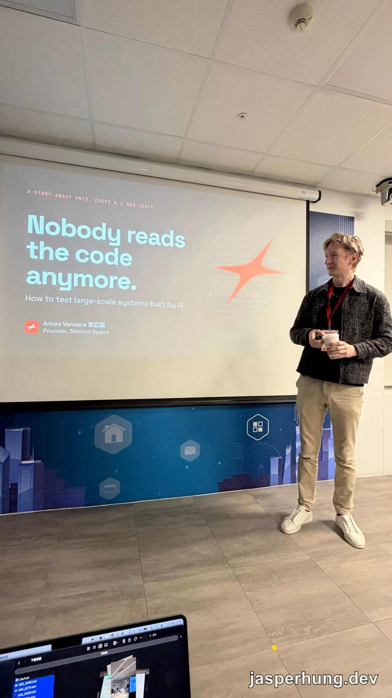
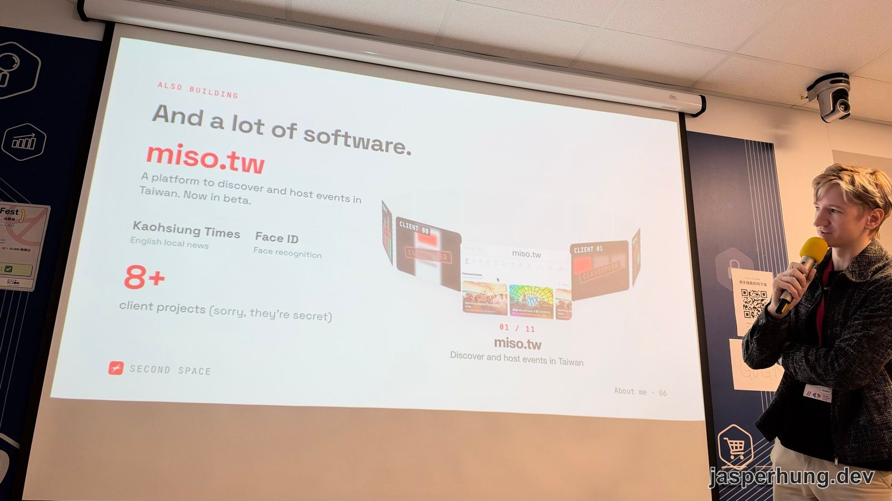
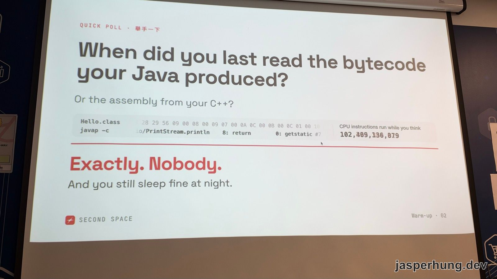
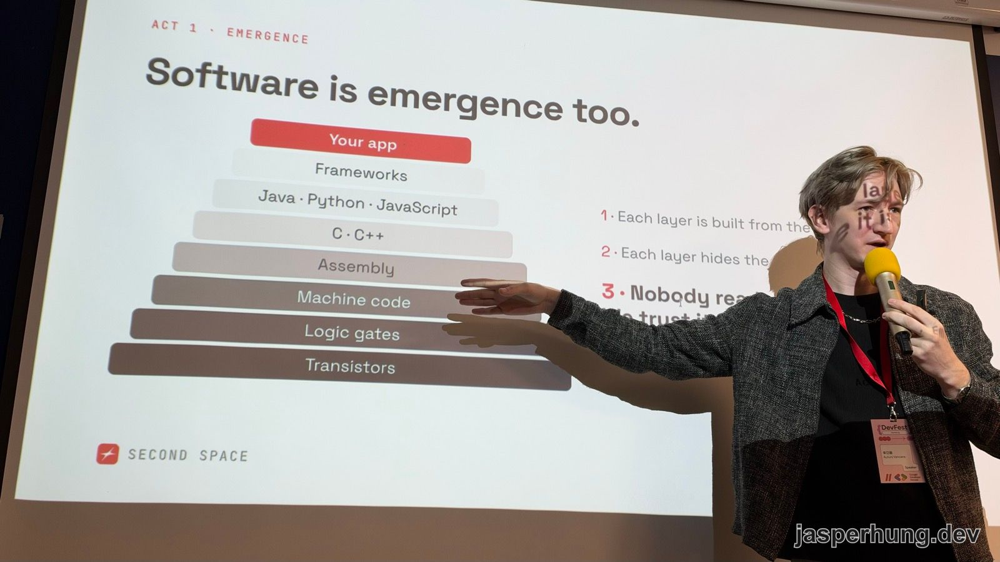
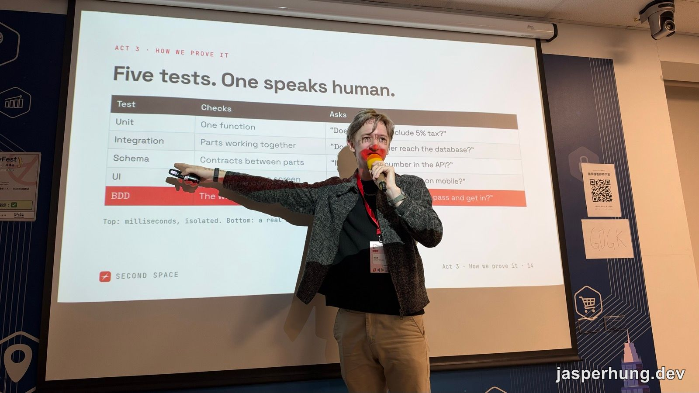
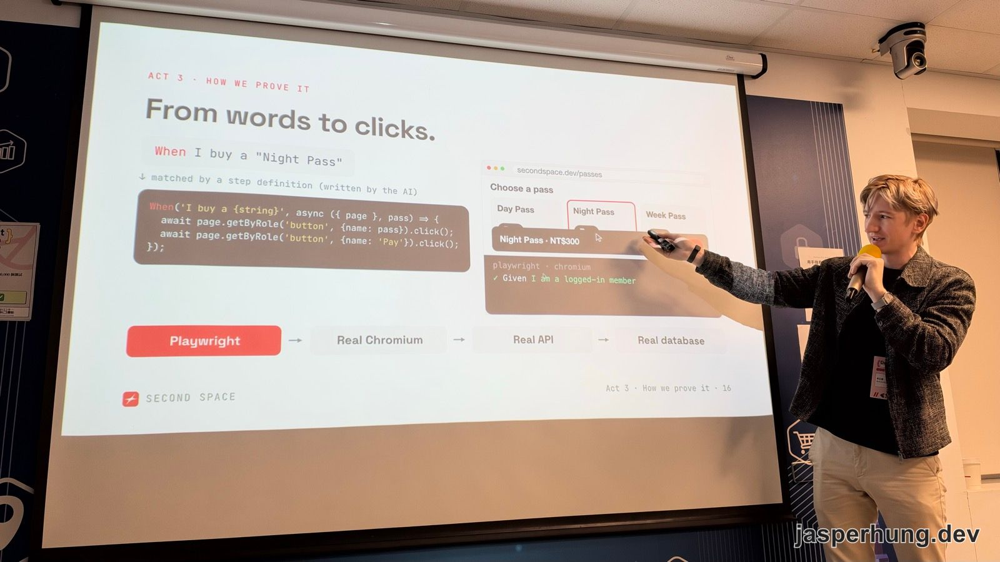
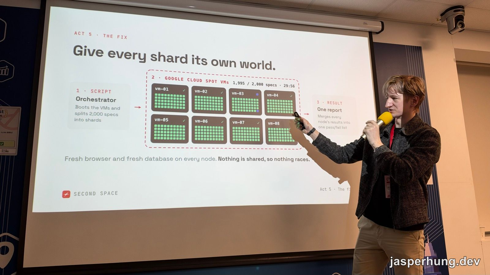
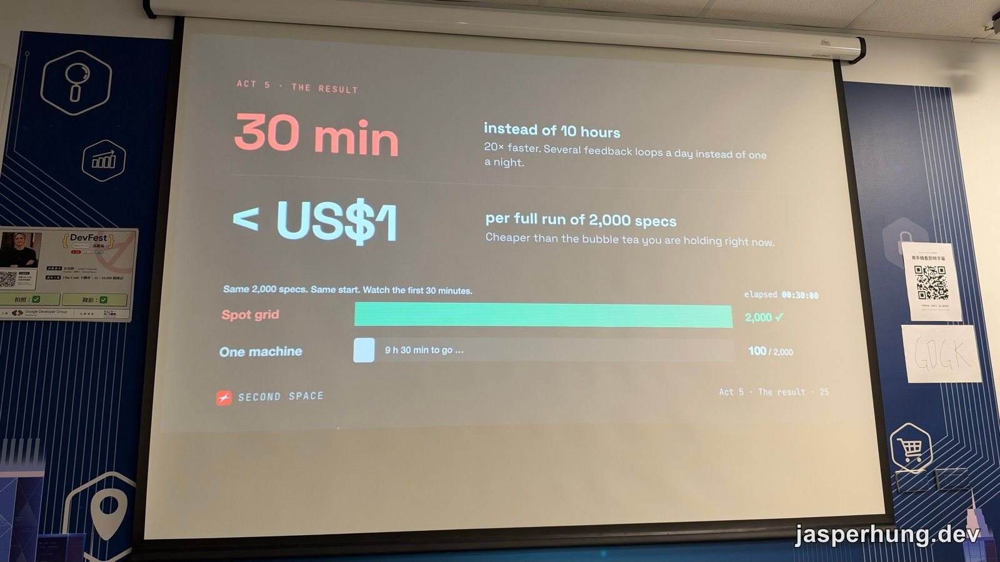
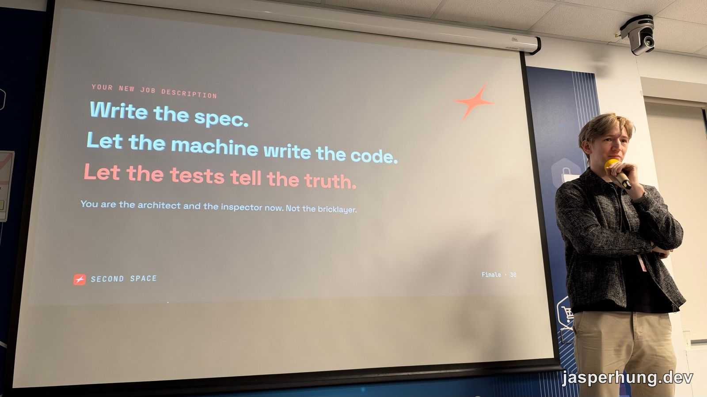

<KeyTakeaways>
  <p>不讀程式碼，要怎麼信任 AI 寫出來的程式？Second Space 創辦人韋亞圖（Arturs Vancans）在 DevFest 高雄 2026 的答案是：把需求用英文寫成 BDD 測試，讓真的瀏覽器跑完整個使用流程，再把 2,000 個測試切開，丟到 Google Cloud Spot VM 平行跑，30 分鐘、不到 1 美元跑完；這是講者觀點加上我的現場筆記，演講全程英文，Q&A 是靠錄音轉文字整理的。</p>
</KeyTakeaways>

DevFest 高雄 2026 早上 11 點這場，投影片第一頁寫著：「Nobody reads the code anymore.」副標是「How to test large-scale systems built by AI」。

[開場演講](/posts/devfest-kaohsiung-2026-agentic-era/)談的是開發者要從寫 code 轉成編排 Agent，這場的講者直接把結果攤在台上：他寫了 20 年程式，過去一年**一行 code 都沒寫**，發布的東西卻比以前任何時候都多。



<p class="image-caption">圖：標題頁上方的小字是「A story about ants, chips and 2,000 tests」。</p>

## 寫了 20 年程式，過去一年零行

講者韋亞圖（Arturs Vancans）先花一分鐘交代自己為什麼值得聽：15 歲開始創業，17 歲做出拉脫維亞最熱門的網頁遊戲，有 50 萬名玩家。之後讀 University of York 的電子工程，在 Cambridge Silicon Radio 做過藍牙低功耗的分散式運算，到倫敦的 Bank of America Merrill Lynch 做投資銀行系統，再到能源公司 OVO 做瓦斯和電力的即時 IoT 系統。2015 年他的新創進了 Y Combinator。

搬來台灣之後，他做了 Second Space，一個讓人聚在一起的空間，還有一台 AI 咖啡機器人 Kubi：它認得你的臉，會幫你開門、叫你的名字；記得你平常點什麼；聽得懂「最大杯，不要黑咖啡，不要冰的……還是小杯好了」這種反覆改口的點單。



<p class="image-caption">圖：講者用 AI 做出來的軟體，第一個就是 miso.tw。</p>

軟體則有 miso.tw、在地英文新聞 Kaohsiung Times、人臉辨識 Face ID，以及 8 個以上不能公開的客戶專案。miso.tw 是類似 Luma 的活動平台，跟 Second Space 的進場系統接在一起，報名後刷 QR code 就能進場。我在 TOOCON #47 用過，報名、進場都算方便。

這些全是 AI 寫的。他說常有人問：AI 會亂講，你怎麼敢讓別人用 AI 寫的軟體？這場演講就是他的回答。

## 沒人讀 bytecode，AI 只是另一層抽象



<p class="image-caption">圖：開場的舉手調查，答案就寫在投影片下半部。</p>

他先請現場舉手：上一次讀自己 Java 編出來的 bytecode，或 C++ 編出來的 assembly，是什麼時候？投影片下半部直接替大家回答：「Exactly. Nobody. And you still sleep fine at night.」

接著是副標題裡的「螞蟻」。一隻螞蟻、一顆神經元，單獨看都沒有意義，數量夠多才會冒出整體的行為，這叫 emergence（湧現）。他認為軟體也是這樣疊出來的：



<p class="image-caption">圖：從電晶體到你的 app，每一層都蓋在下一層上面。</p>

從電晶體、邏輯閘、機器碼、assembly，一路到 C、Java、Python、JavaScript、框架，最後才是你的 app。每一層都由下面那層組成，也把下面那層藏起來。我們不讀下面那層，但我們信任它。

所以他的主張是：**AI 只是再往上加一層抽象。** 以前用程式碼向電腦說明你要什麼，現在改用英文或中文，自然語言就是新的程式語言，code 會變成今天的 bytecode，存在、但沒人去讀。

那讀 code 為什麼還重要？大家常說是為了可讀性、可維護性。但他指出，AI 一次丟出幾千行的修改，本來就沒人逐行看。code 真正要緊的地方，是它會不會太慢、有沒有 bug、安不安全，而**每一項擔心都可以寫成一個測試**。「我希望頁面在 500 毫秒內載入」就是一個測試，測試沒過，AI 就得改到過為止。

他的結論很直接：AI 寫的 code 有 bug，該怪的是自己，代表測試寫得不夠。

## 五種測試，只有 BDD 說人話



<p class="image-caption">圖：越上面的測試越快、越隔離，最下面的 BDD 要開真的瀏覽器。</p>

投影片上的五種測試：

| 測試 | 檢查什麼 | 問的問題 |
|---|---|---|
| Unit | 一個 function | 「價格有沒有含 5% 的稅？」 |
| Integration | 幾個部分合起來能不能動 | 「訂單有沒有真的寫進資料庫？」 |
| Schema | 各部分之間的約定 | 「API 回傳的是不是數字？」 |
| UI | 畫面 | 「在手機上顯示得正不正常？」 |
| BDD | 整個使用流程 | 「會員能不能買票，然後進得了門？」 |

表格底下寫著：最上面的測試以毫秒計、彼此隔離；最下面的要開一個真的瀏覽器。他的測試絕大部分都是 BDD，也認為它最重要。

BDD 是 Behavior-Driven Development（行為驅動開發）的縮寫，做法是先用一般人看得懂的句子描述「使用者做了什麼、應該發生什麼」，再把這些句子變成可以自動執行的測試。講者是在倫敦的銀行裡接觸到 BDD 的。銀行對程式非常嚴格，牽涉到錢，出錯就會有很多人生氣；但主管看不懂程式碼，看得懂英文。所以功能先用英文寫下來，大概像這樣：

> 我是會員，我買了一張票，在「我的票券」裡看得到它，到了現場，門會認出我的臉打開。

主管讀得懂這段，也就能確認團隊做的是不是他要的東西。BDD 這個詞是 Dan North 提出的，他在 2006 年發表的〈[Introducing BDD](https://dannorth.net/blog/introducing-bdd/)〉裡說明了為什麼要把「測試」換成「行為」來想。



<p class="image-caption">圖：一句英文怎麼變成瀏覽器裡的點擊。</p>

英文句子要能執行，中間靠的是 step definition，也就是把句子對應到實際動作的程式。在講者的做法裡，這段也是 AI 寫的：

```ts
When('I buy a {string}', async ({ page }, pass) => {
  await page.getByRole('button', { name: pass }).click();
  await page.getByRole('button', { name: 'Pay' }).click();
});
```

「When I buy a "Night Pass"」這句話，會對應到「點名稱是 Night Pass 的按鈕，再點 Pay」。實際執行的是 Playwright，一套能用程式操作瀏覽器的工具，它開一個真的 Chromium，打真的 API，寫進真的資料庫。感覺就像有一個真人坐在電腦前一路點下去。

他說 AI 背後怎麼實作，他不在乎。客人買得到票、進得了門，測試就過了，他就開心。

安全和效能也用同一套寫法：

- **效能**：「假設有 20 個會員同時在瀏覽，我打開結帳頁，它要在幾毫秒內準備好。」
- **負向測試**：「我是 8 號會員，打開『我的票券』，只看得到自己的票。」除了「應該發生什麼」，也要寫「不應該發生什麼」，例如看到別人的票。

## 2,000 個測試，一台機器要跑 10 小時

BDD 的問題是慢。每個測試都要開瀏覽器、走完整個流程，2,000 個測試在一台機器上跑完要 10 小時。他希望一天能發布好幾次，10 小時根本等不了。

直覺的解法是在同一台機器上平行跑，但這會出事。測試共用同一個資料庫，一個測試剛建好的資料，可能被另一個測試刪掉或改掉，結果每次跑出來都不一樣。這叫 race condition（競爭條件）：結果取決於誰先誰後，而不是程式本身對不對。



<p class="image-caption">圖：每台 VM 有自己的瀏覽器和資料庫，什麼都不共用。</p>

他的解法是讓每一批測試都有自己的世界：

1. **Orchestrator**：一支腳本負責開好 VM，把 2,000 個 spec 切成好幾批，每一批叫一個 shard。
2. **Google Cloud Spot VM**：每台 VM 跑一個小型 Postgres 資料庫和網站伺服器，加上一個全新的瀏覽器，各自跑自己那批測試。
3. **One report**：每台 VM 的結果合併成一份通過／失敗清單。

投影片上那句話是重點：「Nothing is shared, so nothing races.」什麼都不共用，就不會互相干擾。

Spot VM 是 Google Cloud 拿閒置機器出來便宜賣的方案。[官方文件](https://docs.cloud.google.com/compute/docs/instances/spot)寫的是最多可以比一般價格便宜 91%，代價是 Google 需要資源時隨時可以把機器收回去。拿來跑正式服務很危險，拿來跑測試剛好：機器被收走，重跑那一批就好。他還做了一個畫面，即時顯示每台 VM 的進度和目前花了多少錢。



<p class="image-caption">圖：同樣 30 分鐘，平行跑完 2,000 個，一台機器只跑完 100 個。</p>

結果：

- **30 分鐘，原本要 10 小時**。快了 20 倍，一天可以拿到好幾輪回饋，不用等一整晚。
- **跑一次完整的 2,000 個測試，不到 1 美元**。投影片上的原話是：「比你現在手上那杯珍奶還便宜。」

## 你的新工作：寫 spec，讓測試說真話



<p class="image-caption">圖：演講的最後一張投影片。</p>

最後一張投影片：

> Write the spec. Let the machine write the code. Let the tests tell the truth.
> You are the architect and the inspector now. Not the bricklayer.

寫 spec，讓機器寫 code，讓測試說真話；你現在是建築師和驗收的人，不是砌磚的工人。他說，現在 bug 不在 code 裡了。產品做錯了，是你的 spec 寫錯了，spec 和測試才是新的 code。

## Q&A：不讀 spec，漏掉的靠現場回報

**會不會讀 spec？** 有人問他會不會讀自己的 spec。他說不讀，因為他很懶。他的做法是讓好幾個 AI 互相審，包括 Grok、Codex、Claude Code，再叫 AI 把 spec 拆成一個個測試。

**測試沒抓到的問題怎麼辦？** 他先問台下有誰去過 Second Space、用過他的 app。他的軟體實際跑在空間裡，像前面提到的 miso.tw，會員和來參加活動的人每天都在用，壞了就會當面告訴他。接下來他就跟 AI 說：「嘿，Jack 說這裡不能用，去修。」

他也補充，跟錢有關的關鍵功能會多寫測試，盡量把出 bug 的機會降到最低。

## 心得

這場聽下來，「不看 code」不等於放手不管。他把力氣花在幫 agent 建環境：每批測試有自己的瀏覽器和資料庫，2,000 個測試 30 分鐘跑完，agent 改完很快就知道有沒有壞東西。

方向還是他定的，要做什麼、使用者要能完成哪些事，由他決定；實作交給 agent，spec 讓好幾個 AI 互相審，code 交給測試驗。出了問題就馬上迭代，再部署上去。

我目前的做法其實也差不多。
