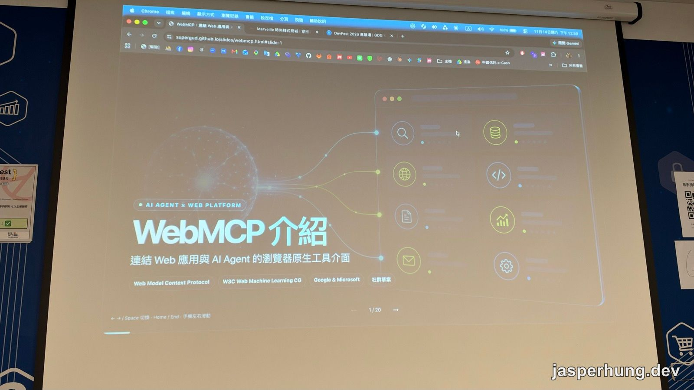
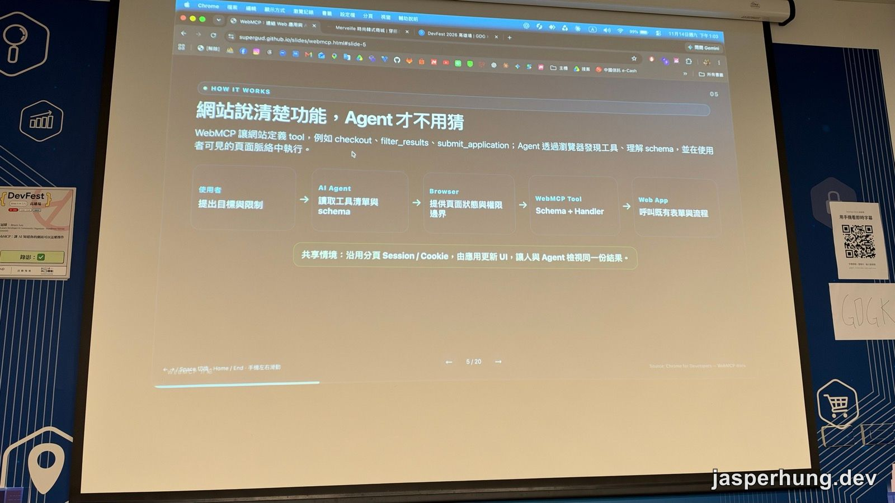
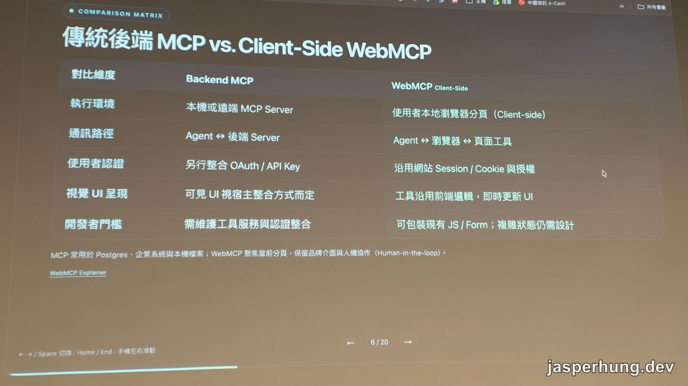
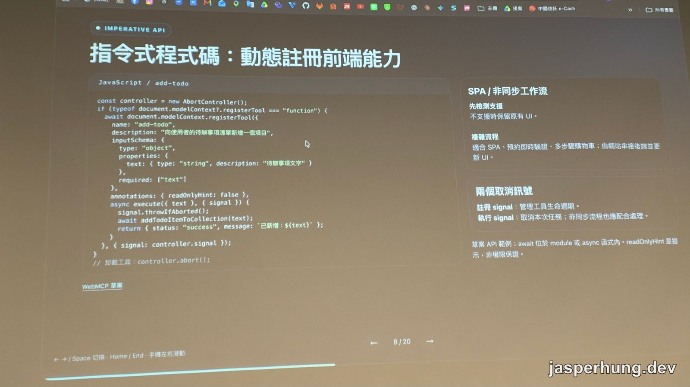
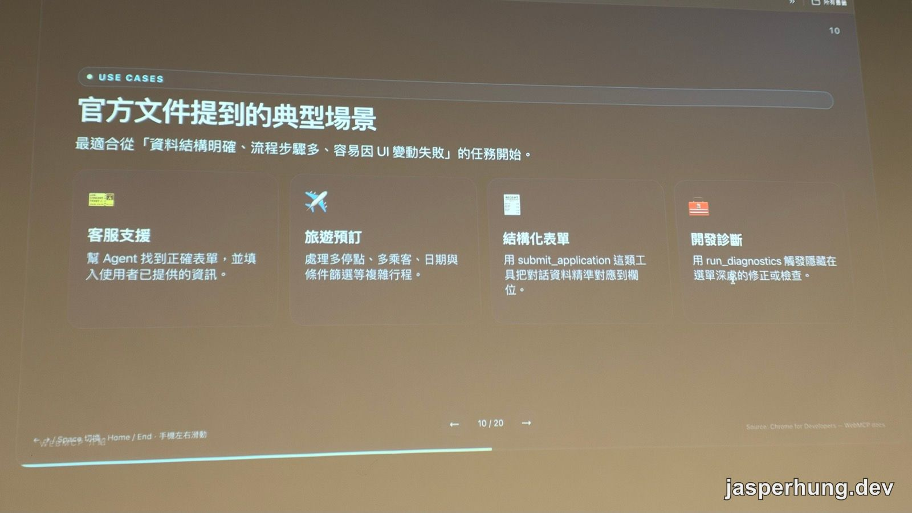
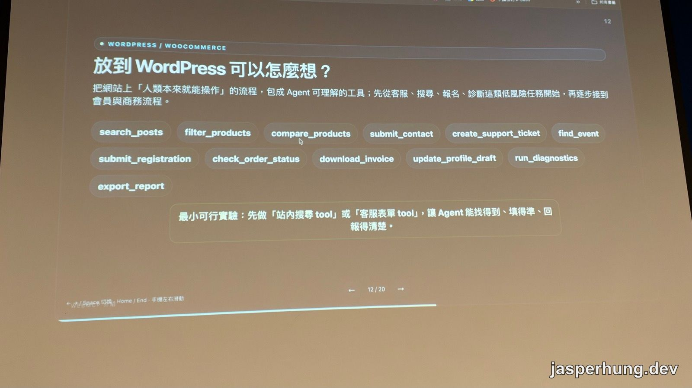
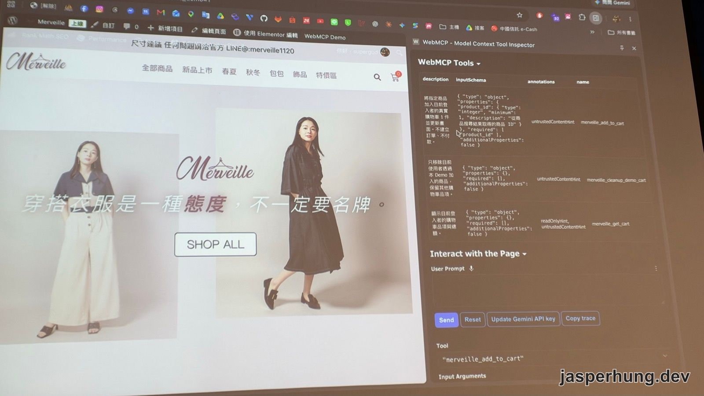
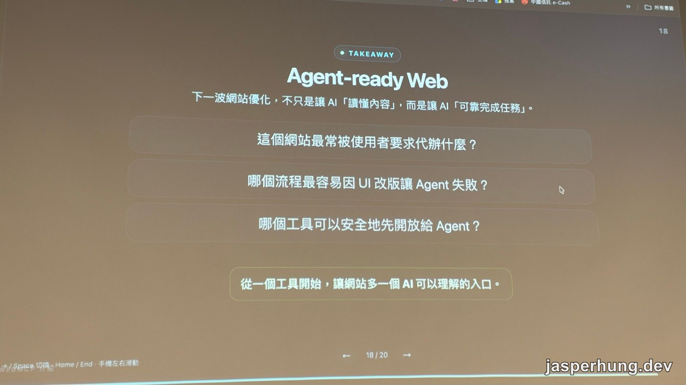

<KeyTakeaways>
  <p>AI agent 要操作一個網站，一定得讀 DOM、看截圖去猜按鈕在哪嗎？WebMCP 讓網站在瀏覽器裡把功能註冊成 tool，附上名稱、描述和輸入 schema，agent 直接呼叫，沿用使用者已登入的 session；它目前還是提議中的網頁標準，要用 Chrome 的 flag 或 origin trial 才能測。這篇是講者觀點加上我的現場筆記。</p>
</KeyTakeaways>

DevFest 高雄 2026 下午 1 點這場，講者李冠緯講〈WebMCP：讓 AI 知道你的網站可以怎麼操作〉。他來自 WordPress 社群，整場 demo 用的是一個 WooCommerce 電商網站。

[前一場](/posts/devfest-kaohsiung-2026-inverted-pyramid/)劉瑞元談怎麼驗證 agent 寫出來的 code。這場換一個方向：agent 要來操作你的網站時，網站能幫它什麼。



<p class="image-caption">圖：20 分鐘的場次，講者的投影片本身就是一個網頁。</p>

## WebMCP 是什麼：Agent 不用再猜網頁

講者先講現在的 agent 操作網頁有多辛苦。任務一複雜，它就得自己判斷畫面上哪個東西能點、點了會發生什麼。網站本身寫得不標準時更麻煩，例如連結用 `<div>` 做，而不是 `<a>` 或 `<button>`，agent 就很容易判斷錯，或花一堆 token 去試。

WebMCP（Web Model Context Protocol）的做法是反過來：**網站自己宣告它有哪些功能**，agent 讀了就知道能做什麼，直接呼叫，不用在畫面上摸索。Chrome 官方文件把它描述成「一個提議中的網頁標準」。投影片上的標籤寫的是 W3C Web Machine Learning 社群小組、Google 與 Microsoft 推動的社群草案。

講者也提到開發者這一端的好處：網站開放了哪些功能給 agent，自己看得一清二楚。UI 改版或畫面上的小錯誤，也比較不會讓 agent 做出錯的決定。

## 網站說清楚功能，Agent 才不用猜



<p class="image-caption">圖：從使用者的一句話，到網站既有的表單與流程。</p>

網站定義的 tool 像是 `checkout`、`filter_results`、`submit_application`，流程是這樣：

1. 使用者提出目標和限制。
2. Agent 讀取網站提供的工具清單，以及每個 tool 的 JSON Schema。
3. 瀏覽器提供目前的頁面狀態和權限邊界。
4. Agent 呼叫 tool，執行網站寫好的 handler。
5. Handler 呼叫網站既有的表單與流程。

投影片下方那一行是我覺得最關鍵的一點：**沿用分頁的 Session 和 Cookie**。使用者已經登入的話，agent 就直接在這個登入狀態下做事，不會再跑來說「我幫你開的分頁沒有登入，請先登入」。UI 也由網站自己更新，人和 agent 看到的是同一份結果。

## 跟後端 MCP 差在哪

講者說常有人問：已經有 MCP 了，WebMCP 又是什麼？他整理了一張表。



<p class="image-caption">圖：兩者解決的是不同位置的問題。</p>

| 對比維度 | Backend MCP | WebMCP Client-Side |
|---|---|---|
| 執行環境 | 本機或遠端 MCP Server | 使用者本地瀏覽器分頁（Client-side） |
| 通訊路徑 | Agent ↔ 後端 Server | Agent ↔ 瀏覽器 ↔ 頁面工具 |
| 使用者認證 | 另行整合 OAuth / API Key | 沿用網站 Session / Cookie 與授權 |
| 視覺 UI 呈現 | 可見 UI 視宿主整合方式而定 | 工具沿用前端邏輯，即時更新 UI |
| 開發者門檻 | 需維護工具服務與認證整合 | 可包裝現有 JS / Form；複雜狀態仍需設計 |

MCP 要另外架 server、處理 OAuth 或 personal token，回傳的資料要怎麼接回 UI 也得自己想。WebMCP 直接跑在網頁裡，用的是現有的前端和 JavaScript，不需要太複雜的後端就能開始做。

講者的分工是：機密資料、需要存取後端系統的，用 MCP；**把人在網頁上的操作交給 agent 代勞**，用 WebMCP。投影片的說法是：MCP 常用在 Postgres、企業系統和本機檔案；WebMCP 只處理目前的分頁，保留網站自己的介面，也保留人介入確認的空間。

## 兩種宣告方式：HTML 表單與 JavaScript

**宣告式**最簡單：在既有的 HTML 表單上加幾個屬性，寫明 tool 名稱、要做什麼、欄位要填什麼。講者說這有點像先替 agent 寫好 prompt，agent 理解之後，就把整理好的資料填進表單送出。Chrome 文件也只說「在標準 HTML 表單上加註解」，具體屬性名稱還沒定下來，所以我這邊不列。

**命令式**用 JavaScript 註冊，彈性大很多：handler 裡可以打後端、發 AJAX、改狀態，畫面上任何變動都能在這裡處理。



<p class="image-caption">圖：投影片上的範例，是新增一筆待辦事項的 tool。</p>

```js
const controller = new AbortController();
if (typeof document.modelContext?.registerTool === "function") {
  await document.modelContext.registerTool({
    name: "add-todo",
    description: "向使用者的待辦事項清單新增一個項目",
    inputSchema: {
      type: "object",
      properties: {
        text: { type: "string", description: "待辦事項文字" }
      },
      required: ["text"]
    },
    annotations: { readOnlyHint: false },
    async execute({ text }, { signal }) {
      signal.throwIfAborted();
      await addTodoItemToCollection(text);
      return { status: "success", message: `已新增：${text}` };
    }
  }, { signal: controller.signal });
}
// 卸載工具：controller.abort();
```

投影片右邊整理了幾個重點：

- **先檢測支援**：瀏覽器不支援時，保留原本的 UI。
- **適合複雜流程**：SPA、預約時的即時驗證、多步驟購物車，由網站串接後端並更新 UI。
- **兩個取消訊號**：註冊時傳的 signal 管理 tool 的生命週期，`abort()` 之後 tool 就被移除；執行時拿到的 signal 用來取消這一次的任務，非同步流程也要記得處理。
- **`readOnlyHint` 只是提示，不是權限保證。**

## 依頁面切換工具，不讓 Agent 在商品頁結帳

那個註冊時的 signal，講者接著示範了用途。電商網站有商品列表頁、結帳頁，每一頁能做的事不一樣。

如果所有 tool 一次全註冊，agent 可能在商品頁就以為可以直接結帳，然後花 token 去試。所以他用 `AbortController` 依頁面切換：商品頁只註冊搜尋和篩選，結帳頁才註冊結帳和查訂單。進到新頁面就 abort 掉不需要的 tool，再註冊新的。這樣 agent 每次只看到當下用得到的工具，也省下不少 token。

## 官方文件提到的典型場景



<p class="image-caption">圖：先挑資料結構明確、步驟多、容易因 UI 改版而壞掉的任務。</p>

- **客服支援**：使用者一段話裡講了姓名、email、電話和問題，agent 拆開來填進正確的欄位，後端收到的就是整理好的資料。
- **旅遊預訂**：多停點、多乘客、日期和條件篩選，使用者用對話講，agent 負責填表。
- **結構化表單**：用 `submit_application` 這類 tool，把對話內容準確對應到欄位。
- **開發診斷**：用 `run_diagnostics` 觸發藏在深層選單裡的修正或檢查。講者也提到，有開發者把它接進自己的工具，debug 時用來拆解功能。

## 放到 WordPress 上可以怎麼想



<p class="image-caption">圖：從 WordPress 網站本來就有的流程，列出可以包成 tool 的功能。</p>

講者把網站上「人本來就能操作」的流程，包成 agent 看得懂的 tool。順序是先做客服、搜尋、報名、診斷這類低風險的任務，再慢慢接到會員和交易流程。投影片的建議是：

> 最小可行實驗：先做「站內搜尋 tool」或「客服表單 tool」，讓 Agent 能找得到、填得準、回報得清楚。

這張圖也剛好示範了講者強調的**命名**。格式沒有限制，底線或駝峰都可以，但名稱要有意義，讓自己和 AI 一看就懂。用 `search_`、`get_`、`filter_` 這類動詞開頭，agent 很快就知道這個 tool 做什麼、需要什麼。隨便取一個 function 名稱，agent 就得再猜一次。

## Demo：一句話把耳環加進購物車

Demo 的網站是一個 WooCommerce 女裝電商，講者加了五個 tool：搜尋商品、取得商品詳情、加入購物車、取得購物車，以及一個清掉 demo 購物車的 tool。



<p class="image-caption">圖：右邊的 Inspector 會列出頁面上註冊的所有 tool。</p>

測試工具是官方推薦的 **Model Context Tool Inspector**，一個 Chrome 擴充功能。它會列出頁面上每個 tool 的 description、inputSchema、annotations 和 name；填入 Gemini API key 之後，可以直接在 User Prompt 打一句話讓 agent 跑。從畫面看得到幾個細節：

- 加入購物車的 tool 收一個 `product_id`（整數），description 寫明「加入購物車並更新畫面、不建立訂單、不付款」。
- 取得購物車的 tool 標了 `readOnlyHint`。
- 三個 tool 都標了 `untrustedContentHint`。

講者也指出，有些 tool 的 description 沒寫清楚，Inspector 裡就看不出它是做什麼的，agent 也一樣看不懂。**JavaScript 裡定義得越清楚，agent 用得越準。**

他打了一句話，要 agent 搜尋耳環、把符合條件的加入購物車。Agent 先呼叫搜尋，找到一件「復古方形耳環（銀色）」，加進購物車後就停下來，沒有結帳。回到網頁上，購物車圖示的數字從 0 變成 1。

講者的重點是：agent 沒有去點「全部商品」、翻頁找東西，也沒有在畫面上找加入購物車的按鈕，只呼叫了兩個 tool，token 花得很少。他認為以後網站之間的差別，可能就在 agent 能不能輕鬆用你的網站完成事情。

## 付款、刪除前還是要停下來

Agent 可以代辦，但決定權要留在使用者手上。像剛才只加入購物車、不直接結帳，就是為了避免金錢糾紛。講者說可以在付款、送出、刪除這類地方強制中斷，等使用者確認；Chrome 文件的說法是，tool 可以帶一個指令，用確認對話框請使用者互動。

目前的狀態：

- 還是草案。Chrome 文件寫的是從 Chrome 149 起可以加入 origin trial；本機開發要到 `chrome://flags/#enable-webmcp-testing` 開啟後重新啟動。
- 講者建議測試一律用 Chrome。Edge 這類 Chromium 瀏覽器可能有些功能會失效。
- 除了 Inspector，也有 DevTools 可以除錯，React、Vue 這些框架都已經有相關的方案。

## Agent-ready Web



<p class="image-caption">圖：講者的結論，三個問題留給台下回去想。</p>

講者的結尾是：大家用 Google 搜尋的次數越來越少，越來越多人改問 AI。下一波網站優化，不只是讓 AI「讀懂內容」，而是讓 AI「可靠完成任務」。他留了三個問題：

1. 這個網站最常被使用者要求代辦什麼？
2. 哪個流程最容易因為 UI 改版讓 agent 失敗？
3. 哪個工具可以安全地先開放給 agent？

從一個工具開始，讓網站多一個 AI 可以理解的入口。

## Q&A：已經有 Playwright，為什麼還要 WebMCP？

第一個問題：現在測試也可以用 Playwright 或 browser-use，跟 WebMCP 比起來怎麼選？

講者說差別就在一開始講的那件事。Playwright 這類工具是讀 DOM 或截圖，根據按鈕附近的元素去猜這裡可以按、按了大概會發生什麼。WebMCP 是直接告訴 agent：「你不用按按鈕，呼叫這個 function 就加入購物車了。」它不用讀 DOM、不用截圖，所以省 token。提問的人追問：tool 要自己定義吧？講者說對，**沒定義到的功能，agent 才會像 Playwright 一樣回去讀網頁、猜畫面。**

第二個問題接著追：如果按鈕被改掉、內容變了，或變成 disabled，用 WebMCP 測的時候是不是照樣會成功，但實際上使用者根本按不下去？

講者的回答是：會。只要 function 定義好了，agent 就直接走 function，不經過網頁上的 UI，按鈕是不是 disabled 它不會知道。**除非 function 自己帶了狀態**，例如回傳「現在不能加入購物車」。也就是說，WebMCP 是一條跳過 UI 的路，UI 上的限制要另外寫進 function 才擋得住。

## 心得

講者整場用的都是正式的 WebMCP API，demo 也是 WordPress 電商網站，示範得很完整。但聽完我還是覺得，我[之前那篇](/posts/agent-friendly-web-app/)的做法比較通用，畢竟它還不是標準。

那篇我也評估過 WebMCP，最後沒用，原因跟今天看到的一樣：它要 Chrome 149 的 origin trial 或手動開 flag，使用者預設的瀏覽器不會有，我也不知道使用者會用哪一種 agent。所以我改用 llms.txt 指路、SKILL.md 教 agent 怎麼操作，再加一張操作對照表，寫明每個控制項是什麼、怎麼選到它、可以填什麼。任何讀得到網址的 agent 都能用，網站本身也不用改。

{/* 待作者補：Q&A 第二題說 WebMCP 會跳過 disabled 的按鈕，你上一篇剛好是「規則留在 web、由畫面擋下不可行的設定」。這段對照你有沒有想法？有的話補一兩句；沒有就刪掉這行。 */}

{/* 待作者補：聽完有沒有哪一點讓你覺得 WebMCP 比你的做法好，或會讓你想等它變成標準後轉過去？上一篇有寫「對照表日後要轉成 WebMCP 的工具清單會很順手」，可以接在這裡收尾。 */}
