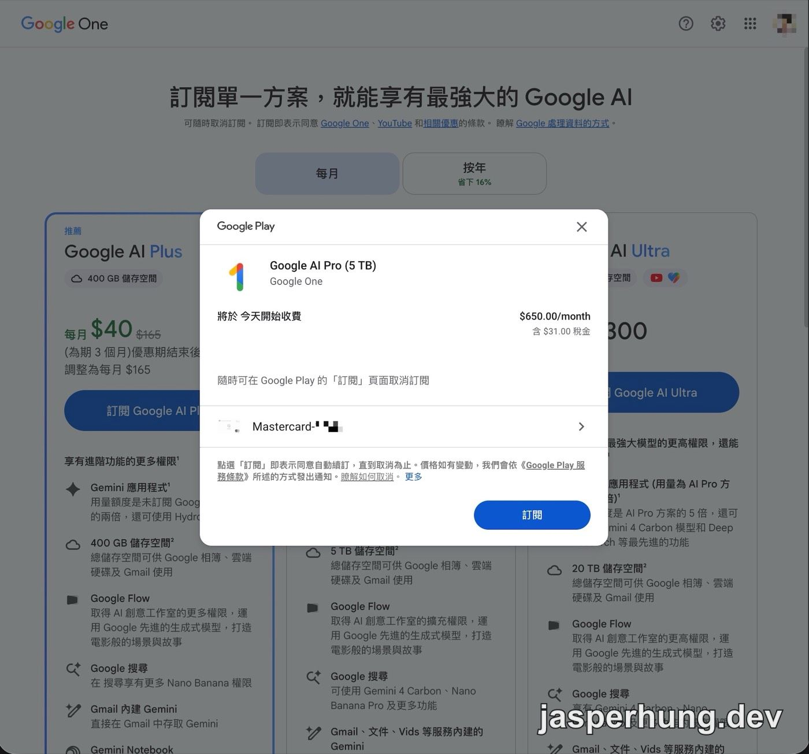
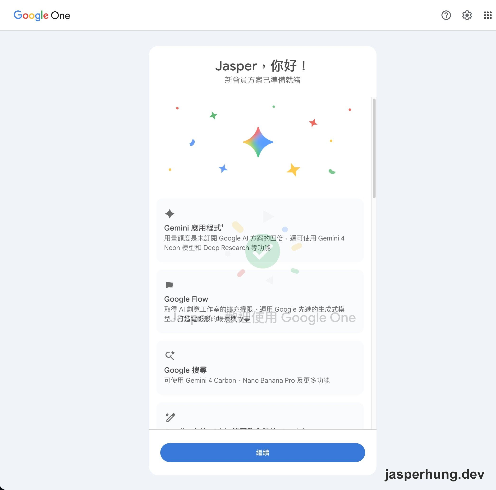
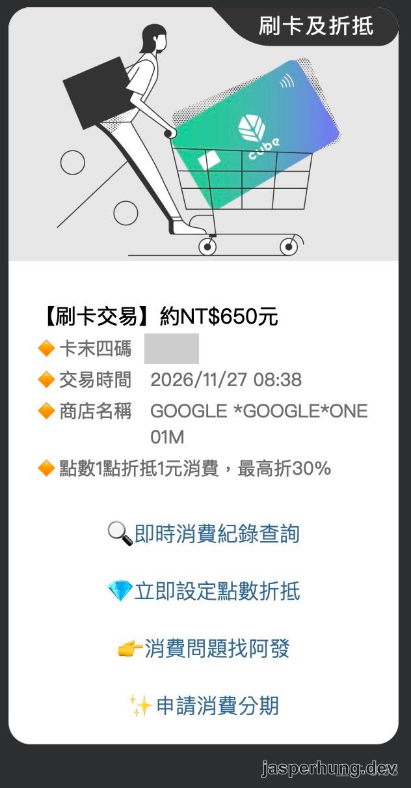
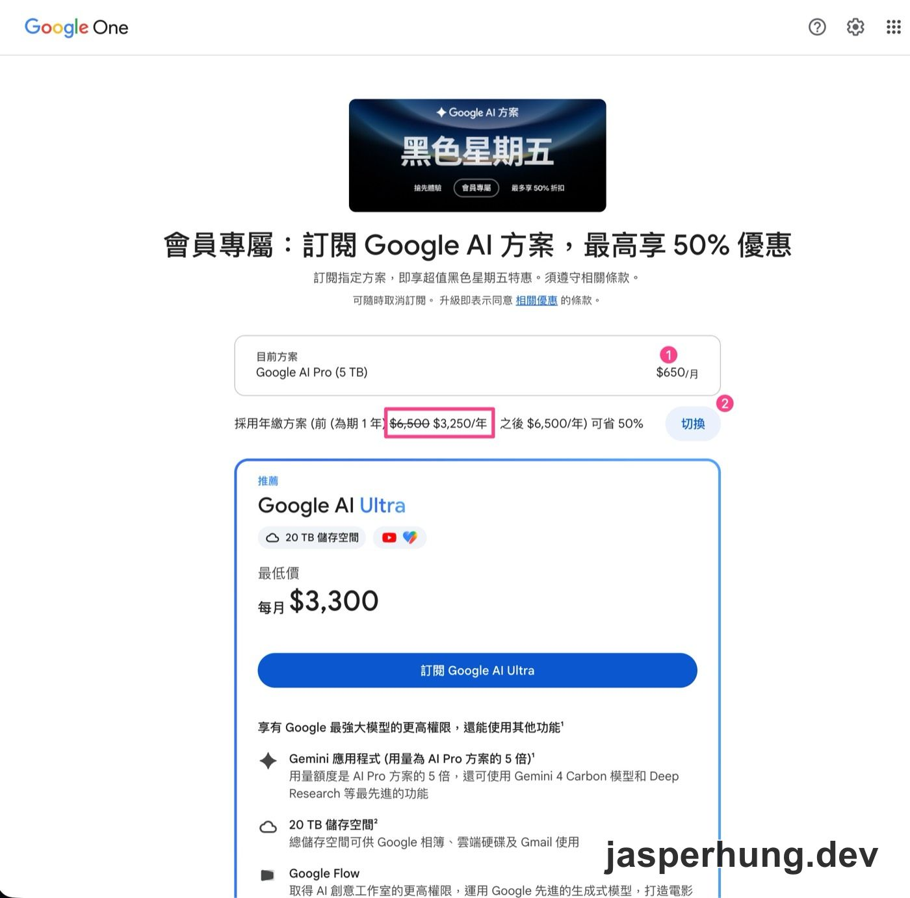
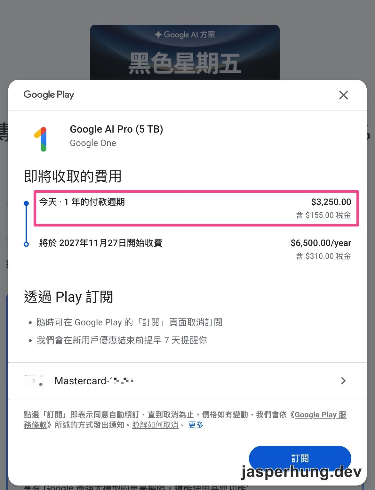
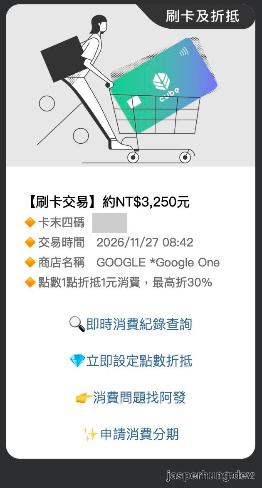
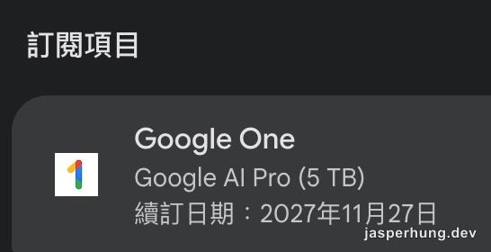
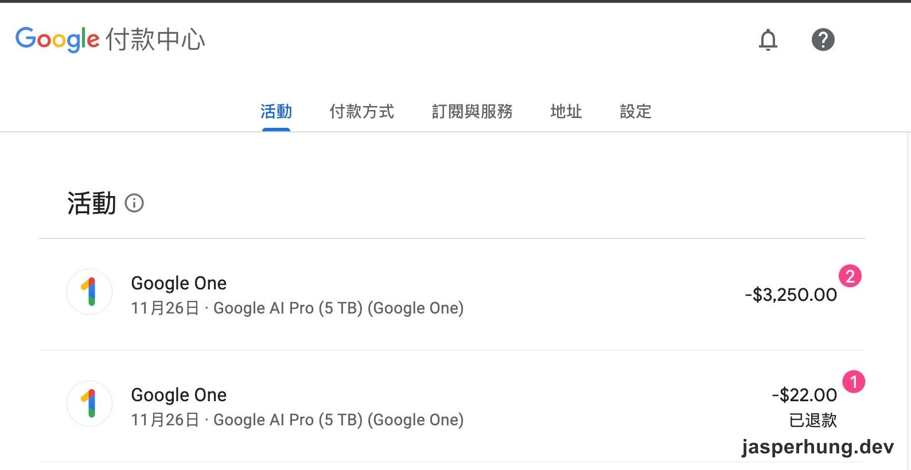

<KeyTakeaways>
  
原本沒付費的 Google 帳號，能不能拿到 Gemini 黑色星期五「會員專屬」的年繳半價？可以，先訂一個月 Google AI Pro 成為會員，再回優惠頁把方案切換成年繳，就能用 $3,250 訂到原價 $6,500 的一年；這是我 2026/11/27 早上在台灣實測一次的結果，先訂的月繳只按一天計費 $22，第二年起恢復原價。

</KeyTakeaways>

11/27 早上，我想看看 Google 這次黑色星期五到底給新用戶什麼優惠，打開 Google One 的方案頁，結果不如預期。剛好這一整週在 Threads 上一直看到有人分享：先訂閱一個月，再切換成一年方案，一樣是半價。

我就動手了。這篇把整個流程、每一筆扣款與退款都記下來。

## 訂閱步驟

1. 到 [Google One 方案頁](https://one.google.com/about/google-ai-plans/)，用**月繳**訂閱 Google AI Pro（$650），先成為會員
2. 回 Google One 的黑色星期五頁面，在「採用年繳方案」那一行按**切換**
3. 確認第一年 $3,250，按「訂閱」
4. 到 Google Play「訂閱項目」確認續訂日變成一年後；月繳只按一天計費，收 $22，其餘退款

## 黑色星期五半價，為什麼原本沒付費的人看不到

先說這次的優惠是什麼。Google 的 Gemini 訂閱產品負責人 Vikas Kansal 在 11/20（美國時間）[宣布](https://x.com/vikaskansalHQ/status/2123833450297995624)黑色星期五活動：現有的 Google AI 與雲端儲存訂閱者，從 11/20 到 11/26 可以先拿到 Google AI Plus 與年繳 Google AI Pro 最高 50% 的折扣，台灣 AI Pro 年繳從 $6,500 降到 $3,250；還沒訂閱的人，優惠從 11/27 黑色星期五開始。兩波優惠的整理我在[上一篇](/posts/gemini-black-friday-2026/)寫過。

也就是說，半價年繳一開始是「會員專屬」。Google One 的優惠頁標題也直接寫著「會員專屬：訂閱 Google AI 方案，最高享 50% 優惠」。

新用戶拿到的是「Pro 前三個月優惠」，各區已經有明確金額回報，但跟大家本來期待的「年繳 5 折」有落差：

- **台灣**：Pro 前 3 個月每月 $160（原價 $650，約 2.5 折），第 4 個月起恢復原價 $650 自動續訂（[PTT Lifeismoney](https://www.ptt.cc/bbs/Lifeismoney/M.1795262534.A.764.html)、[104 職場力](https://blog.104.com.tw/gemini-black-friday-2026-google-ai-pro-discount/)）。
- **美國**：多數回報是前 3 個月每月 US$4.99（原價 US$19.99，約 2.5 折）（[TechVerdict](https://www.techverdict.io/articles/best-ai-subscription-black-friday-deals-2026)）；部分人看到的是前 3 個月約 5 折，或 2 個月特價。
- **日本**：有人看到的是首月 1 折。

我想要的是 Pro 年繳半價，新用戶這邊沒有。

{/* 待作者補：如果還記得當時看到新戶頁的第一個反應，可以補一句 */}

## 第一步：先訂一個月 Google AI Pro

Threads 上流傳的做法很簡單：既然半價是給會員的，那就先成為會員。

在 Google One 方案頁選 Google AI Pro（5 TB），用每月方案訂閱。Google Play 的確認視窗寫著「將於 今天開始收費」，每月 $650（含 $31 稅金）。

圖：先用月繳訂閱 Google AI Pro，確認視窗顯示今天就會收第一個月 $650。

按下「訂閱」後，畫面跳出「新會員方案已準備就緒」。

圖：月繳訂閱成功，帳號正式變成 Google AI Pro 會員。

信用卡也馬上收到 $650 的扣款通知，商店名稱是 GOOGLE *GOOGLE*ONE 01M。

圖：第一筆扣款，月繳 $650。

## 第二步：回優惠頁，把方案切換成年繳

變成會員之後，回到 Google One 的黑色星期五頁面，這次看到的東西不一樣了：

- 「目前方案」顯示 Google AI Pro（5 TB），$650／月
- 下面多了一行：「採用年繳方案（前（為期 1 年）~~$6,500~~ $3,250／年 之後 $6,500／年）可省 50%」，旁邊有一個「切換」按鈕

圖：成為會員後，黑五頁面出現年繳半價與「切換」按鈕。

按「切換」之後，Google Play 的確認視窗把費用列得很清楚：

- 今天：1 年的付款週期 $3,250（含 $155 稅金）
- 2027 年 11 月 27 日開始：每年 $6,500（含 $310 稅金）
- 會在新用戶優惠結束前提早 7 天提醒

圖：切換年繳的確認視窗，第一年 $3,250，第二年起恢復 $6,500。

按下「訂閱」，信用卡收到第二筆扣款，$3,250。

圖：第二筆扣款，年繳 $3,250。

> [!CAUTION]
> ### 半價只有第一年
> 確認視窗寫得很清楚：2027/11/27 起會自動以 $6,500 續訂。Google 說會在優惠結束前 7 天提醒，到時候再決定要不要續，不想續就到 Google Play 的「訂閱」頁面取消。

## 確認方案與退款：月繳只算一天 $22

到 Google Play 的訂閱項目看，Google One 的續訂日期已經變成 2027 年 11 月 27 日，代表帳號現在是年繳方案。

圖：訂閱項目的續訂日已改成一年後，確定是年繳方案。

那先付的第一個月 $650 呢？我到 [Google 付款中心](https://payments.google.com/)的「活動」頁看，裡面列出兩筆：一筆是年繳的 -$3,250，另一筆是月繳，金額變成 -$22，下面標示「已退款」。

圖：付款中心的紀錄，月繳最後只收 $22，其餘已退款。

這筆 $22 是月繳最後實際收的錢，不是退回來的金額。$650 ÷ 30 天 ≈ $21.67，四捨五入剛好 $22，也就是說月繳只算了用掉的那一天，其餘的錢都退回去了。

所以這次一共花了：

| 項目 | 金額 |
|---|---|
| 月繳（只算一天） | $22 |
| 年繳（第一年） | $3,250 |
| **實付** | **$3,272** |

跟原價年繳 $6,500 比，只多付了一天的月費，幾乎就是半價。
## 這次訂到的 Gemini：目前的 Gemini 4 模型

既然都訂了，順便整理一下 Google AI Pro 現在拿得到什麼。Gemini 這一代是 Gemini 4，Google 用元素來替模型命名，目前常見的有三個：

- **Gemini 4 Carbon**：目前最強的模型。Google 在介紹 Neon 時說它負責「your hardest, long-horizon projects」（最難、需要長時間處理的專案）。
- **Gemini 4 Neon**：11/18 發表，Google 的定位是複雜的寫程式、分析推理和企業工作流程，在深度和效率之間取得平衡。Google 說它在預設的思考強度下，每個任務的成本比 Carbon 低 32%。
- **Gemini 4 Hydrogen**：處理「fast everyday execution」，也就是快速的日常任務。

最強的 Carbon 一開始只給最貴的 Ultra 方案，這個月才陸續開放給 Pro：

- **11/10**：Carbon 正式推出，Gemini 應用程式、Google 搜尋的 AI 模式、Antigravity 都先給 Google AI Ultra 訂閱者。
- **11/16 左右**：Google 搜尋的 AI 模式開放 Carbon 給 Pro 訂閱者（[Search Engine Roundtable](https://www.seroundtable.com/google-ai-mode-drops-gemini-label-42540.html) 報導）。
- **11/23**：Google 宣布付費的 AI Pro 訂閱者也能在 Antigravity（Google 的 AI 寫程式工具）使用 Carbon，原本這要 Ultra 才有（[9to5Google](https://9to5google.com/2026/11/23/antigravity-gemini-4-carbon/) 報導）。

所以 Pro 現在用得到 Carbon 的地方是 Google 搜尋的 AI 模式和 Antigravity。Gemini 應用程式裡，Pro 能選的是 **Gemini 4 Neon**（[Google 的 Neon 發表文章](https://blog.google/innovation-and-ai/models-and-research/gemini-models/introducing-gemini-4-neon/)寫明 Pro 和 Ultra 都能在模型選單裡選），Carbon 在 App 裡仍然是 Ultra 專屬；我的方案頁也是這樣寫：Ultra 的 Gemini 應用程式欄位寫 Carbon，Pro 寫 Neon。

對我來說，寫程式的時候能在 Antigravity 用到 Carbon、日常在 App 裡用 Neon，這筆年費就有價值了。

## Google AI Pro 除了 Gemini 還包含什麼

年繳 $3,250 買到的不只是 Gemini。依照 [Google One 的 AI 方案頁](https://one.google.com/about/google-ai-plans/)，Google AI Pro 還包含：

- **5 TB 雲端儲存空間**：Gmail、Google 雲端硬碟、Google 相簿共用
- **家庭共享**：最多可以跟 5 位家人共用
- **Gemini 用量**：是沒訂閱 Google AI 方案的四倍，加上擴充的 Deep Research
- **Gmail、文件、試算表內建 Gemini**：校對、起草（需滿 18 歲，支援語言有限制）
- **Google Flow**：AI 影片創作工具，每月 1,000 點；Flow Music 每月 3,000 點
- **Gemini Notebook**：更多功能和模型可用
- **寫程式相關**：Antigravity、Google AI Studio 的 Neon 用量提高，Google Colab 每月 200 運算單元，Android Studio 的 AI 用量提高，Google Developer Program 每月 US$10 的 Google Cloud 額度
- **YouTube Premium Lite**：台灣在[適用名單](https://support.google.com/googleone/answer/17101453)內。非音樂類影片大多沒有廣告（Shorts 除外），可以離線和背景播放；只給方案管理員，不跟家人共享；已經有 YouTube Premium 的人不會另外啟用
- **Google Health Premium**：台灣在[適用名單](https://support.google.com/googlehealth/answer/14237941)內。需要滿 18 歲，並配對 Pixel Watch 或 Fitbit 裝置

方案頁上還有 Google Home Premium Standard，但[開通名單](https://support.google.com/googlehome/answer/14674938)裡沒有台灣。Gmail 的 AI 收件匣摘要、Google 相簿 Remix、AI 模式的 Deep Search 只限美國。

## 心得

做完之後想了一下：就算 11/27 真的有新戶優惠，也不太可能比會員的續約折扣還便宜。而這個做法我整個禮拜都在 Threads 上看到，其實禮拜一就可以直接訂下去，而不是拖到最後一天，還在想會不會有更好的方案。

所以我的結論就是早買早享受。Gemini 現在確實有比較強的模型，而且一直在變好。歡迎 Gemini 加入我的開發協作。
