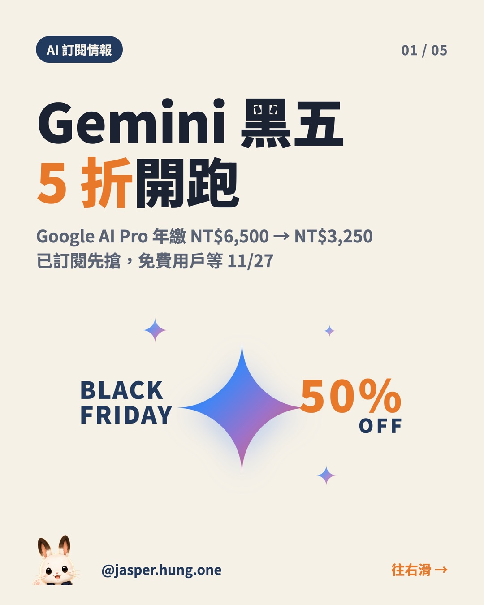
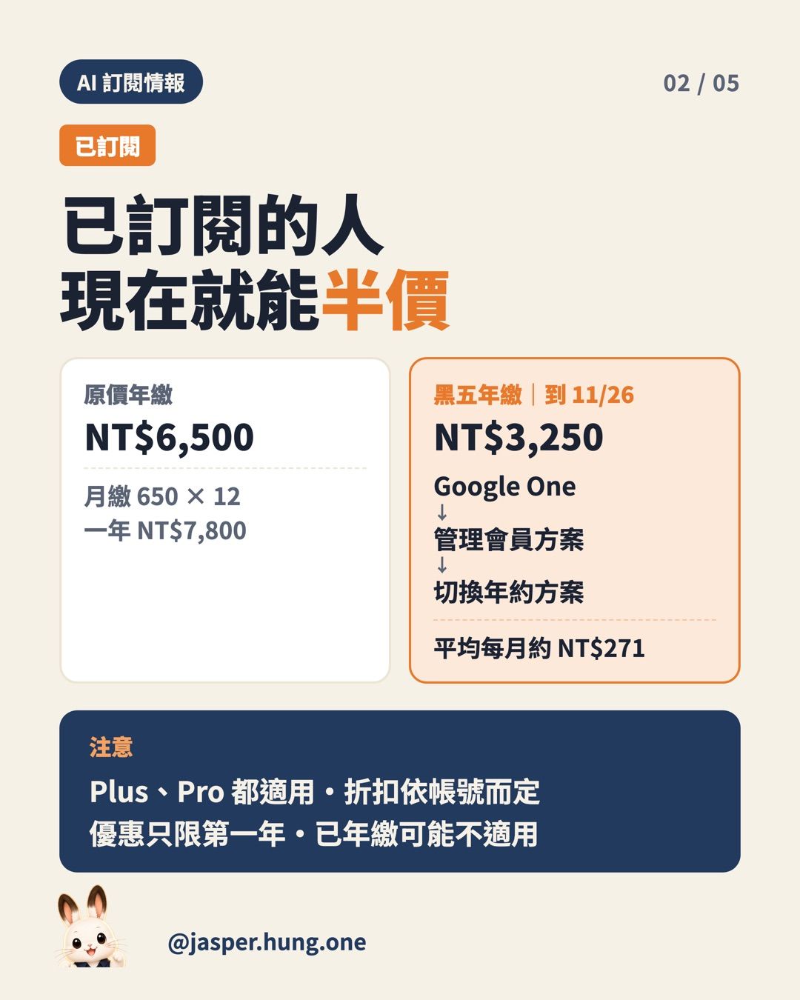
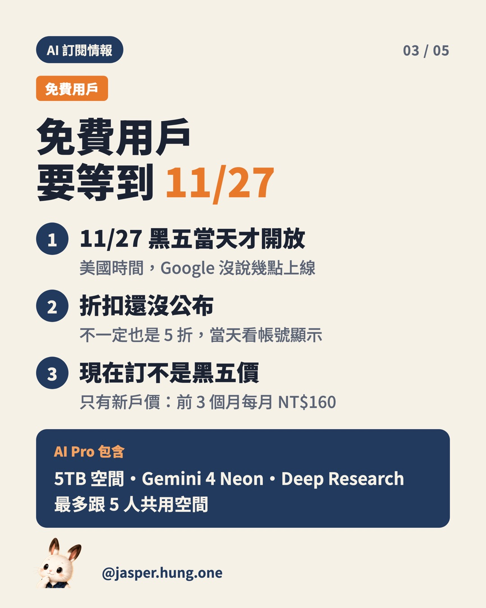
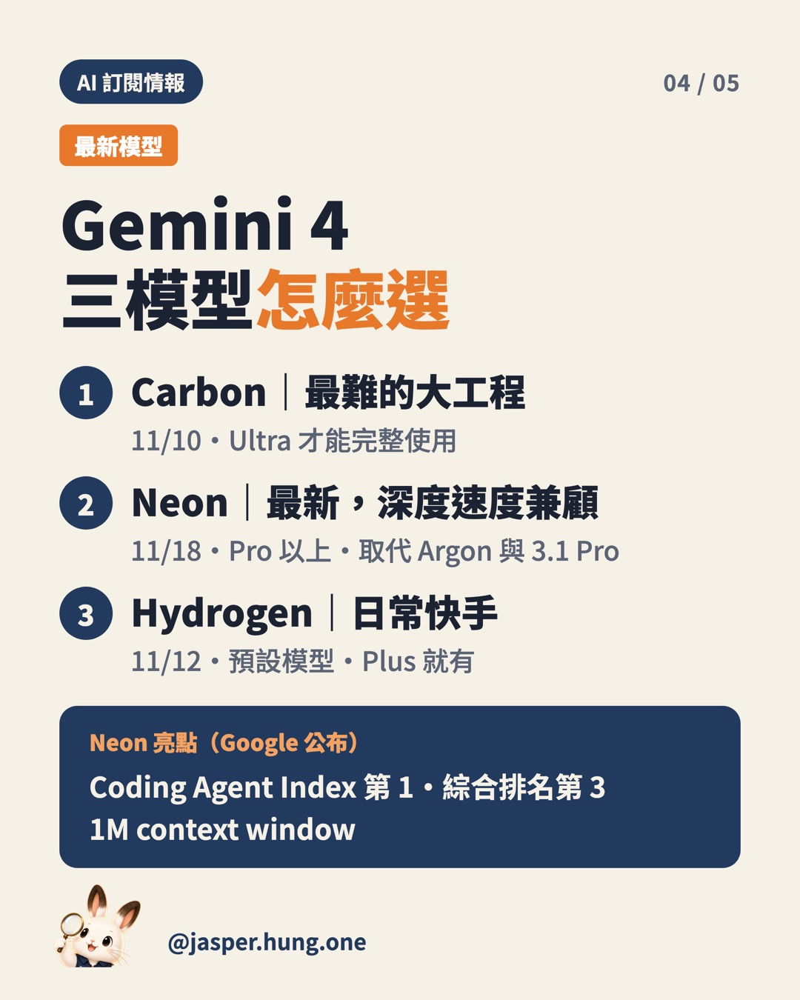
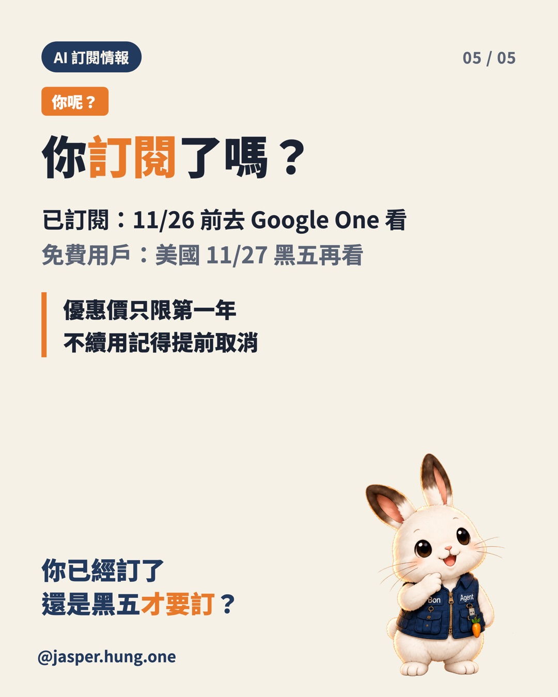

<KeyTakeaways>
  
Google AI 的 2026 黑五優惠分兩波：已經付費的 Google AI 或 Google One 用戶，即日起到 11/26 改年繳最高 5 折，台灣 AI Pro 年繳從 NT$6,500 降到 NT$3,250；還沒訂閱的免費用戶要等美國時間 11/27 黑五當天，折扣還沒公布。這是 2026 年 11 月 21 日整理的資訊，實際折扣以自己帳號顯示為準。

</KeyTakeaways>

Google AI Pro 是 Google One 的 AI 訂閱方案，包含 Gemini 進階模型和 5TB 雲端空間。今年黑五 Google 把優惠拆成兩波，先給已經付費的人，免費用戶要等黑五當天。我把重點做成 5 張圖卡，文末可以下載原圖。

圖：AI Pro 年繳 NT$6,500 降到 NT$3,250。

## 已訂閱的人：11/26 前改年繳最高 5 折

Gemini 訂閱負責人 Vikas Kansal 在 11/20 宣布，黑五先開放給現有的 Google AI 和雲端儲存空間付費用戶，AI Plus 和 AI Pro 年繳都在範圍內，期間到 11/26。

- 台灣 AI Pro 年繳原價 NT$6,500，優惠價 NT$3,250，平均每月約 NT$271。
- 查法：登入 Google One，點「管理 Google One 會員方案」，有資格的話會看到「採用年約方案可省下 XX%」，按切換就好。
- 折扣依帳號而定，不一定都是 5 折；優惠價只限第一年，之後恢復原價。
- 有網友回報，已經是年繳的人好像不適用。

圖：已訂閱的人從 Google One 切換年約方案。

## 免費用戶：要等到 11/27

Kansal 的原話是 "We've got offers coming for you too beginning ON Black Friday"，也就是美國時間 11/27 黑五當天才開放，Google 沒說幾點上線，也還沒公布折扣。

現在 Google One 頁面上看得到的是新戶價，AI Pro 前 3 個月每月 NT$160，之後恢復 NT$650，這不是黑五優惠。

圖：免費用戶現在訂的是新戶價，不是黑五價。

## Gemini 4 三模型怎麼選

Gemini 4 系列一共發了四個模型，名字都是元素。Neon 推出後取代了 10/13 的 Argon，現在 Gemini App 裡的分工是這三個：

| 模型 | 發布日 | 定位 | 方案 |
|---|---|---|---|
| Carbon | 11/10 | 最難、最長的任務 | Ultra 完整使用 |
| Neon | 11/18 | 深度和效率平衡 | Pro、Ultra |
| Hydrogen | 11/12 | 日常快速，預設模型 | Plus 以上 |

Google 公布的數據裡，Neon 在 Artificial Analysis 的 Coding Agent Index 排第 1、綜合指數排第 3，context window 1M。

圖：買 AI Pro 用得到 Neon 和 Hydrogen，Carbon 要 Ultra 才能完整使用。

圖：優惠價只限第一年，不續用記得提前取消。

## 圖卡原圖下載

2160×2700 PNG，沒有網站浮水印，點開後長按存圖。

- [01 封面](/images/posts/gemini-black-friday-2026/cards/gemini-black-friday-01.png)
- [02 已訂閱](/images/posts/gemini-black-friday-2026/cards/gemini-black-friday-02.png)
- [03 免費用戶](/images/posts/gemini-black-friday-2026/cards/gemini-black-friday-03.png)
- [04 Gemini 4 三模型](/images/posts/gemini-black-friday-2026/cards/gemini-black-friday-04.png)
- [05 你訂閱了嗎](/images/posts/gemini-black-friday-2026/cards/gemini-black-friday-05.png)

## 資料來源

- [ETtoday：Google Gemini 黑五大特價](https://www.ettoday.net/news/20261121/3275925.htm)
- [自由時報 3C：Google Gemini 黑五大特價](https://3c.ltn.com.tw/news/68376)
- [Gemini 台灣訂閱方案頁](https://gemini.google/tw/subscriptions/?hl=zh-TW)
- [Vikas Kansal 的 X 貼文](https://x.com/vikaskansalHQ/status/2123833450297995624)
- [Google Blog：Introducing Gemini 4 Neon](https://blog.google/innovation-and-ai/models-and-research/gemini-models/introducing-gemini-4-neon/)
- [9to5Google：Gemini 4 Neon announcement](https://9to5google.com/2026/11/18/gemini-4-neon-announcement/)
