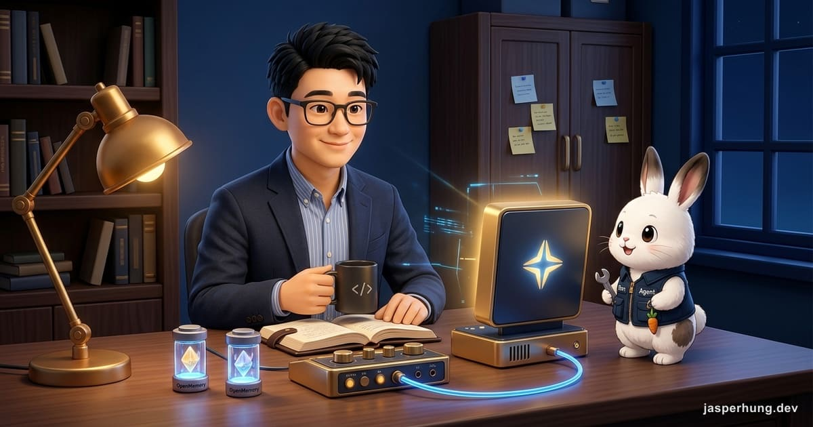
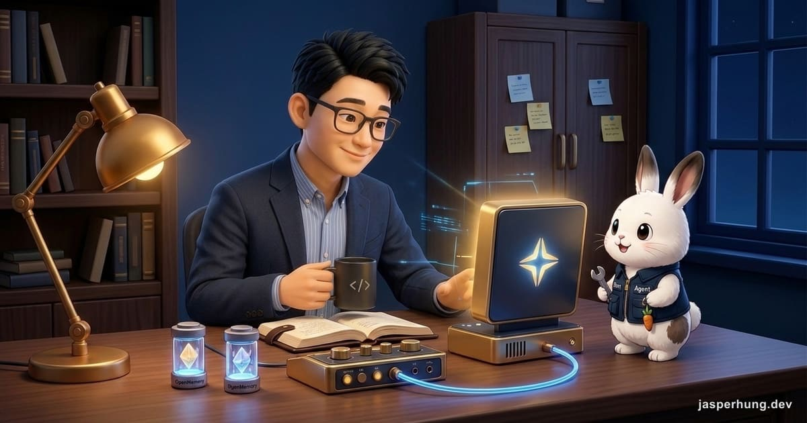
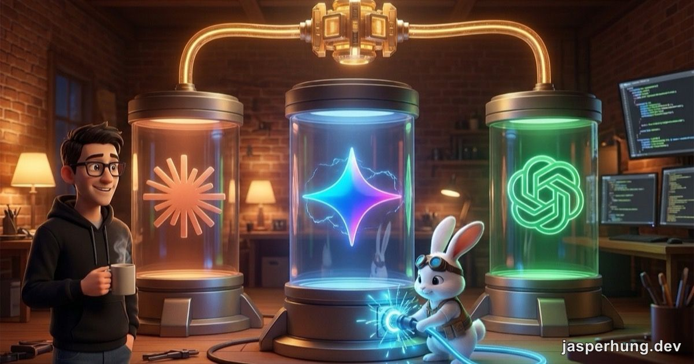
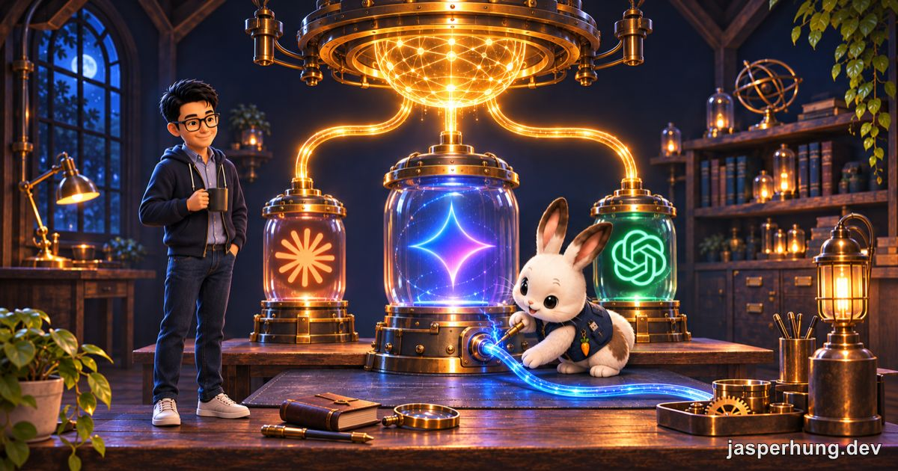

<KeyTakeaways>
  
Gemini 生成 Blog OG 封面表現如何？靠既有參考圖能維持約七成角色細節，但自由發想偏呆板，翻譯 Prompt 時還會自己加料，重繪也容易角色漂移；同一個 Prompt 交給 Codex，場景想像力與角色還原都更穩。不過讓 Gemini 透過 Orca 派工給 Codex 局部修圖時，指令沒有再加料，派工可以勝任。這是單次實測的觀察。

</KeyTakeaways>

我原本的部落格 OG 封面工作流，整套都放在 ChatGPT App 的 Project 裡跑。裡面存著主角 Jasper 與白兔夥伴 Bon Bon 的角色設定圖，平常只要貼文章摘要進去就能出圖。但從 11 月中開始，雲端 Project 突然完全照不了既有的設定，生出來的角色細節整個歪掉。

為了不讓封面製作停擺，我把整個生圖流程搬回本機，打包成 skill 並保留原本的角色與場景參考圖，改用 CLI 呼叫 Codex 來畫，至少先找回過去大概八成的水準。這天剛寫完《[Gemini 入隊五分鐘上線：一套架構搞定三 LLM 的記憶、Skills 與偏好](/posts/antigravity-gemini-multi-agent-integration/)》初稿，剛好 Google Antigravity（Gemini）也才剛接上同一套本機 skills，我便順手試試看：既然這篇寫的是 Gemini 入隊，讓 Gemini 自己來畫封面會畫成什麼樣子？

## 先讓 Gemini 照 Skill 自己發想

一開始我沒有指定任何構圖，單純讓 Gemini 讀取這個生圖 skill 與之前 Codex 留下來的角色設定檔（Character Bible，記錄主角與兔子的外觀、服裝與禁止事項）和場景參考圖，照文章摘要自由發揮。

圖：Gemini 依既有參考圖自行發想的第一版封面，角色細節大概有七成到位，但人物正面定格、整體構圖偏死硬。

看到第一張，人物與兔子確實有吃進原本的參考圖——眼鏡、髮型、馬克杯上的 `</>` 符號，以及 Bon Bon 身上的藍色背心與紅蘿蔔別針，大致維持了七十分左右的還原度。但畫面本身太像擺拍：主角正襟危坐盯著鏡頭，旁邊放一塊螢幕和兩顆小罐子，完全沒有「新成員入隊上線」的動態感。

讓它微調一輪後，產出了第二版。

圖：Gemini 第二版把視線與手勢轉向螢幕，僵硬感少了一點，但整體敘事還是太靜態。

第二版稍微自然了一點，不過故事發想還是被鎖在「書桌前坐著」這個最安全的模板裡。

## 我想了一個構圖，同時給兩個模型生成

也正是盯著這兩張圖看的時候，腦中突然浮現一個更貼合文章主題的畫面，我直接把想到的構圖丟給它：

> 討論一下 OG 畫面：中間是一個較大的 Gemini 罐子，裡面放 Logo，左右兩邊分別是 Claude 和 Codex。Bon Bon 在維修 Gemini 讓它上線，Jasper 站在左邊看。上方或後方有一個記憶系統或資料庫的意象，Claude 和 Codex 已經接上金色電流線，Gemini 的藍色電流線正在測試上線中，這樣可以嗎？

既然都要從頭畫這組新構圖，我順手做了一個對照測試：讓 Gemini 用這套構想自己畫一張，同時透過 Orca（管理多個 AI 終端視窗的工作環境工具）呼叫在線的 Codex，把**同一個畫面意象的 Prompt** 交給 Codex 平行出圖，直接比較兩邊的成品。

## 同一個 Prompt 交給 Gemini

Gemini 整理完 Prompt 後，先呼叫 Antigravity 內建的生圖功能跑第一版。圖出來之後，它自己讀圖檢視，給出了很高的評價：紅磚牆深夜工坊的光影到位、Jasper 端著咖啡在旁微笑、Bon Bon 拿著扳手接插座、上方金色資料庫穩穩連著左右兩罐，甚至直接稱讚這版「神還原」。

但我點開一看，立刻抓出最核心的缺漏：「Codex 跟 Claude 的 Logo 勒？Gemini Logo 要彩色那張才明顯吧？」

左右兩個能量罐裡根本只有單純的橘色與綠色光柱，裡面是空的；中間那顆也只是單色青藍亮星，少了 Gemini 具辨識度的青藍、靛紫、桃紅漸層。沒有三個官方標誌，整張圖的「三大 LLM 接上同一套系統」立刻退化成抽象的發光容器。

於是我請它重跑第二輪，明確要求三個罐子都畫出對應的標誌：中間是 Gemini 彩色漸層四角星，左邊是 Claude 的橘色星芒，右邊是 OpenAI 的翠綠螺旋。第二版產出後，Gemini 再次自評「三大 Logo 辨識度全數拉滿、絕了」。

圖：Gemini 補齊三個 Logo 後的重繪版本，標誌清楚了，但 Jasper 的角色細節全面走樣，Bon Bon 額頭還多出設定裡沒有的護目鏡。

這張圖一眼就看出兩個踩到紅線的問題：

1. **Prompt 污染（Prompt Pollution）**：我問「Bon 頭上怎麼有眼鏡？角色圖沒有」，回頭追查 Prompt 才發現，Gemini 在把中文構想翻譯成英文繪圖指令時，自己加了一句「wearing tiny safety goggles on forehead」。它覺得維修工就該戴護目鏡，直接踩破 Character Bible 的規則——Bon Bon 是純白毛兔子，頭上不能多加任何眼鏡或配件。
2. **全文重繪的角色漂移（Character Drift）**：這輪不是在原圖上局部修改，而是拿整段文字從頭重新算圖。為了把三個高對比 Logo 畫出來，模型重新詮釋了整張畫面，結果前兩版好不容易靠參考圖穩住的七成角色細節整個崩掉——左邊的 Jasper 臉型、髮型與神情全跑了，變成一張塑膠感很重的路人卡通臉。

## 同一個 Prompt 交給 Codex

就在 Gemini 跑完這兩輪的同時，透過 Orca 派出去的 Codex 終端也交出了第一版成品。拿它跟上面那張並排對照，差距非常直觀。

圖：同一份畫面構想交給 Codex 生成的第一版，工坊光影與 Jasper 角色還原度高出一截，但左右兩罐缺 Logo，也同樣中了護目鏡的 Prompt 污染。

兩邊吃的是同一份畫面意象。我拿兩張圖跟 Gemini 討論，它的分析是 Codex 在三個維度上明顯把畫面撐了起來：

- **記憶中樞的視覺轉譯**：同樣是「上方有一個記憶系統或資料庫的意象」，Gemini 畫成幾條金屬管接一個方形中繼盒，Codex 則轉譯成一盞懸浮的金色天文儀網狀光球吊燈，視覺上更像共享知識網路。
- **場景細節與敘事密度**：木質工作桌上的皮質筆記本、放大鏡、黃銅齒輪、桌燈與窗外月夜，讓畫面有「深夜工坊正在幫新成員上線」的真實空間感。
- **角色還原度**：Jasper 的站姿、深色外套搭條紋襯衫、牛仔褲配白球鞋，還有輕鬆看戲的神情，都比 Gemini 重繪版自然耐看得多；Bon Bon 的海軍藍工作背心與紅蘿蔔別針也完整保留。

它也點出這張底圖兩個待修的缺口：左右兩罐只有橘色與綠色光紋、還沒放上 Claude 和 OpenAI 的 Logo；而且因為送出去的是同一份被污染的 Prompt，Codex 畫出來的 Bon Bon 額頭上同樣戴著一副黃銅護目鏡。

即便如此，構圖與角色靈魂都已經對了，確認它的分析後我直接拍板：「用 Codex 那張，少了 Claude 跟 Codex 的 Logo，其他不要動。」

## Gemini 派工可靠度測試

選定構圖後，最怕的就是整張重新生成、把好不容易對位的角色細節和構圖質感又洗掉，所以這輪要求 Codex 做局部修圖（Inpainting，只重繪指定區域、保留其餘畫面）。修圖指令我沒有自己寫，而是讓 Gemini 透過 Orca 派給同一個還開著的 Codex 終端。上一輪的護目鏡就是 Gemini 翻譯 Prompt 時自己加的，這次我想看的是：換它來派工，會不會又加料。

這輪指令鎖死「其餘畫面 100% 凍結不動」，只修三個點：

1. 移除 Bon Bon 額頭上的護目鏡與皮帶，還原純白毛。
2. 左側橘色能量罐補進 Claude 的橘色星芒 Logo。
3. 右側綠色能量罐補進 OpenAI 的翠綠螺旋 Logo。

送出前我順手加了一道防呆提醒：「叫他檔案名稱改一下，不要覆蓋到下載區的圖。」Gemini 先把本機第一版備份成 v1，再補發指令請 Codex 另存新檔 v2。

執行過程還有一個意外亮點：Codex 在終端做圖層合成與裁切時，先檢查系統裡有沒有裝 ImageMagick，發現這台 Mac 沒裝之後，沒卡住也沒反問，直接改用 macOS 內建的圖片處理工具（`sips`）搭配腳本跑完輸出。

圖：Codex 原地局部修圖後的最終版，左右兩罐補上正確 Logo、Bon Bon 額頭護目鏡清乾淨，原本的工坊光影與人物細節都完整留住。

這張最終版同時保住了 Jasper 的自然神情、天文儀吊燈與桌面細節，兩側 Logo 的發光融合度也很自然。最後再裁切成 1200×630 的 OG 圖與 480×360 縮圖，正式成為那篇 Gemini 入隊文章的封面。

這輪 Gemini 派出去的指令沒有再加料，Codex 也只改了這三處，派工這件事它可以勝任。

## 回頭來看：這次生圖踩到的兩個坑

把這幾輪來回攤開來看，影響效率最大的不是「模型畫不好」，而是兩個流程上的盲點：

1. **一行多餘的 Prompt，代價會跨模型擴散**：Gemini 隨手多寫的「wearing tiny safety goggles on forehead」，因為在平行派工時被原封不動送進兩邊，結果 Gemini 和 Codex 兩張圖裡的 Bon Bon 一起長出護目鏡。往圖裡加一個不該出現的物件只要幾個英文單字，事後要在不破壞其他構圖的前提下把它抹掉，卻要額外多跑一輪局部修圖與驗收。
2. **AI 視覺自評很容易被「主要成果」矇蔽**：這輪最深的體感是，不能因為 AI 自己讀完圖說「神還原」、「辨識度全數拉滿」就放心放行。Gemini 第一輪明明缺了三個 Logo，卻被整體光影氛圍吸引而判滿分；第二輪補齊 Logo 後，注意力全鎖在罐子裡的新標誌，對跑掉的角色五官與額外長出來的護目鏡視而不見。
## 心得

走完這輪實測，我目前的判斷是：Gemini 讀得懂本機工作環境裡的設定與參考圖，照著既有素材大概能畫出七十分的角色細節，但在故事發想與構圖靈活度上還放不太開。這件事到底能不能靠調整模型解決？因為不管哪個模型都還是會呼叫對應的生圖模型，真正的差別落在「誰來想畫面與寫 Prompt」，這部分我還沒完全摸透，之後還得再多測幾次。

Codex 在場景發想和原地局部修圖上確實比較穩。更讓我納悶的是，這整套 OG 生圖設定原本都放在 ChatGPT App 的 Project 裡跑得好好的，結果 11 月中開始那邊突然完全吃不進角色設定，生出來的角色細節全歪掉；氣到同一包參考圖跟規範搬回本機、改成 CLI 呼叫 Codex 後，至少可以找回過去大概八成的水準，勉強 Pass，到現在還是不知道雲端那邊到底動了什麼。

下次打算換個分工玩法，試試讓 Claude 專心負責故事發想，再同時呼叫 Codex 和 Gemini 平行出圖看看效果。雖然這張封面多繞了好幾圈，但把同一個點子丟給不同模型對照著看，過程其實蠻有趣的。
