<KeyTakeaways>
  
Google AI Pro 每月 10 美元的 API Credits 怎麼領？訂閱權益和 API 帳單分開計算，要在 Google AI Studio 走完領取流程，新開的 Prepay 帳單帳戶還要預付至少 5 美元（台灣選 NT$150），專案才會升到 Tier 1。第一次手動領取並勾選自動套用後，每月 10 美元會自動入帳，每筆效期 12 個月，連續訂閱一年共 120 美元。只在 AI Studio 網頁裡使用不需要開通，要讓外部工具呼叫 API 才需要。

</KeyTakeaways>

訂閱 Google AI Pro 之後，我第一件想做的事是去領方案附的每月 10 美元 API Credits，讓手邊的外部工具可以呼叫 Gemini API。打開 Google AI Studio，左下角帳號旁已經掛上 PRO 徽章，但「API Keys（API 金鑰）」頁面上專案的「Billing Tier」還是 Free，整個介面也找不到領取的地方。

## 原廠怎麼說：訂閱權益跟 API 帳單分開算

我乾脆直接在 AI Studio 裡問 Gemini。它的回答跟官方文件一致：PRO 徽章生效的是網頁端，Playground 和 Build 模式的每日配額變高，也能用方案內含的模型；API Keys 底下的專案看的則是背後的 Google Cloud 專案有沒有連結 Cloud Billing 帳單帳戶，訂閱不會讓它自動變成付費層。

要升級，流程重點是：

1. 點左側選單的「Claim free API credits」或「Redeem」卡片。
2. 選 Google Cloud 專案，連結 Cloud Billing 帳單帳戶。
3. 新的 Prepay 帳戶預付至少 5 美元。
4. 兌換點數，把 API Key 切到這個專案。

Gemini 後來幫我總結成一句：「第一次手動領取並綁定，之後每個月系統自動發放，每筆各有 12 個月期限且會自動累積。」

## 入口藏在 Try Gemini 4 Neon 後面

問題是，照著去左側選單找，根本沒有「Claim free API credits」。最後是亂按到左下那張「Try Gemini 4 Neon」卡片，左下角才冒出「Redeem $10 in API credits」。藏得真深 XD

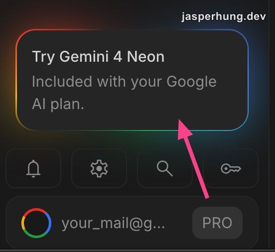

圖：PRO 徽章已經掛上，上方是「Try Gemini 4 Neon」卡片，但畫面上看不到領取 API Credits 的入口。

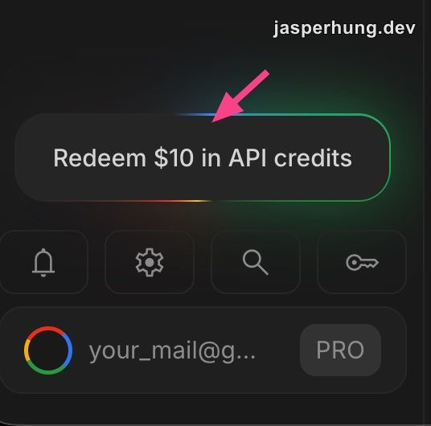

圖：點過「Try Gemini 4 Neon」卡片後，左下角才出現「Redeem $10 in API credits」入口。

點下去會打開「Claim Google Cloud Credits」精靈，分成四步：

1. Choose project and API key（選擇專案與 API 金鑰）
2. Set up billing（設定帳單）
3. Claim credits（領取點數）
4. Link API key（連結 API 金鑰）

下面是我實際跑一次的過程。

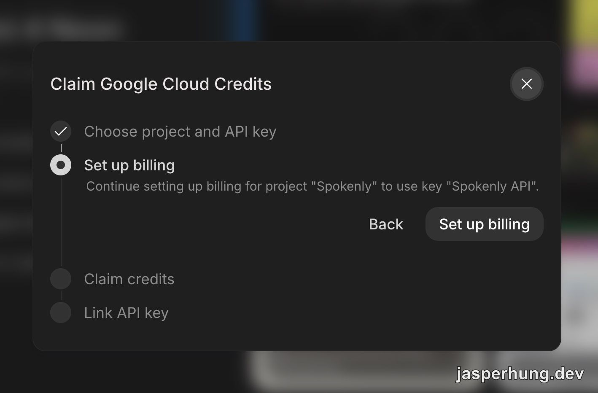

圖：領取精靈分為四個步驟，選完專案與金鑰後就會進入「Set up billing」階段。

## Set up billing：建立帳單帳戶

### Set up your Google Cloud Billing account

1. Country：選 Taiwan。
2. Email updates：不用勾。這是 Google Cloud 與合作夥伴的新聞、產品更新和優惠信，跟開通無關。
3. 按「Agree & continue」。

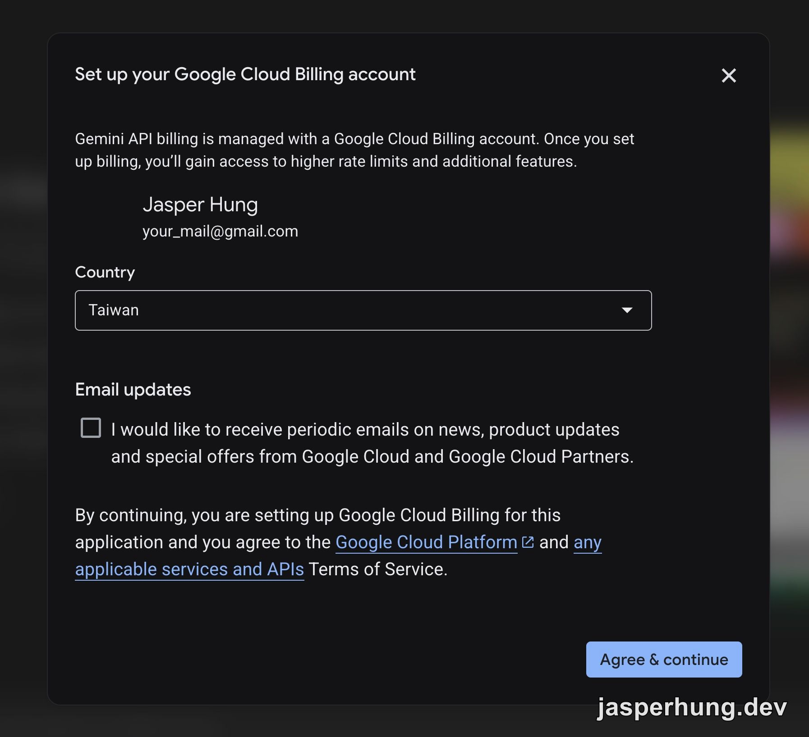

圖：建立 Google Cloud 帳單帳戶的第一頁，確認帳號與國家「Taiwan」後即可繼續。

### Add your billing account details

1. Contact information：帶入 Google 帳號的聯絡資料，確認即可。
2. Tax information：點「Add tax information」，下一段說明。
3. Payment method：在 Google Play 或 Google One 綁過的信用卡會自動帶入。
4. 右側的 $300 Welcome credit：小字寫著「Excludes Gemini API」，用不到 Gemini API 上。
5. 稅務資訊填完，按「Submit」。

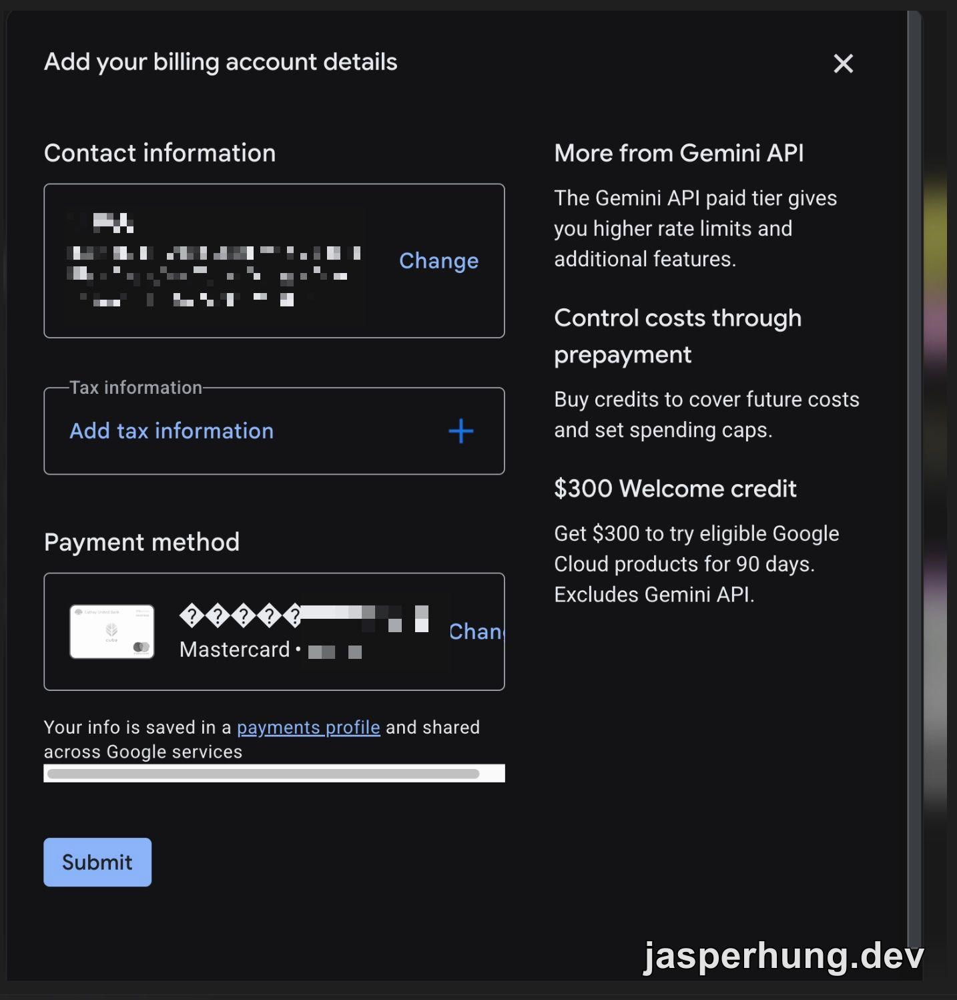

圖：帳單詳細資料頁左側有「Add tax information」入口，右側也標明 300 美元歡迎贈金不適用於 Gemini API。

### 稅務資訊選 Unregistered individual

我原本以為按 Submit 就能直接拿到贈金，結果卡在稅務資訊。點開「+ Add tax information（新增稅務資訊）」後，畫面會跳出「Taiwan tax info（台灣稅務資訊）」視窗，要求在下拉選單二選一：

- Registered individual（已辦理稅籍登記的個人）：名下有申請營業登記、持有 8 碼統一編號的用戶才需要選這個。
- **Unregistered individual（未辦理稅籍登記的個人）**：一般自然人、沒有統一編號的個人用戶。

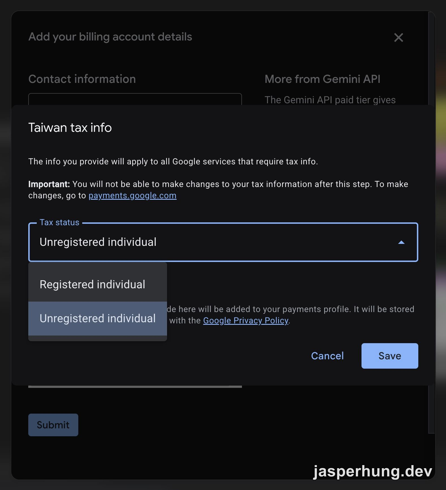

圖：一般個人用戶在「Taiwan tax info」視窗選擇「Unregistered individual」，上方同時提醒送出後無法在此步驟修改。

在測試過程中，如果誤選到需要稅籍登記的項目，或表單狀態未正確切換，按下儲存就會直接跳出「Taiwan VAT ID number is required」（必須填寫台灣統一編號）而卡死在這個視窗。

> [!CAUTION]
> **遇到統編提示千萬不要隨便填入身分證字號或假數字**：這個彈窗上方明確標示送出後無法直接修改（You will not be able to make changes to your tax information after this step）。若選了 Unregistered individual 仍遇到統編必填提示，直接按「Cancel（取消）」關掉選填的稅務小視窗，退回上一層主畫面按「Submit（送出）」即可通過。

### 預付 5 美元：Buy credits 選 NT$150

送出帳單資料後，流程並沒有直接進到第三步，而是先彈出一個「Buy credits（購買點數）」視窗，右上角顯示「NT$0.00 credit balance」。原因是新開的 Prepay（預付型）帳單帳戶，付費餘額要大於 0，贈金才能套用。官方規定的最低預付是 5 美元，換算台幣是 NT$150。

如果要繼續開通，這個畫面有兩個地方要確認：

1. **金額選 NT$150**。
2. **確認 Auto-reload（自動儲值）維持關閉**：開關旁邊雖然掛著綠色的「Recommended」標籤，但維持關閉狀態，才能確保未來額度用完時不會自動刷卡補款。

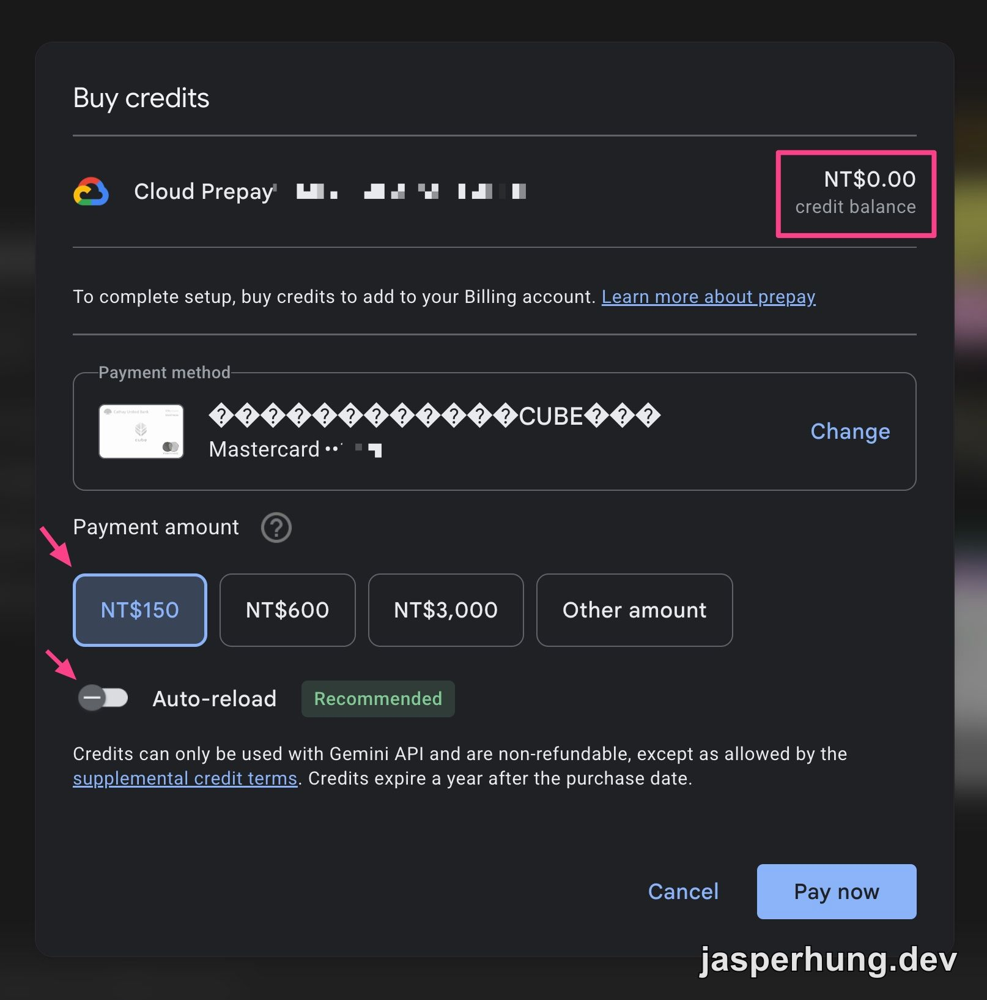

圖：預付購買點數畫面選「NT$150」，並確認「Auto-reload」維持關閉。

> [!TIP]
> **先確認自己是否真的需要外部 API 金鑰**：如果只是打算在 AI Studio 網頁裡測試或對話，在這裡直接按「Cancel（取消）」離開即可；唯有確定要把 API Key 串進外部軟體時，才值得按下「Pay now（立即付款）」，用 NT$150 開通一年最多 120 美元的贈金。

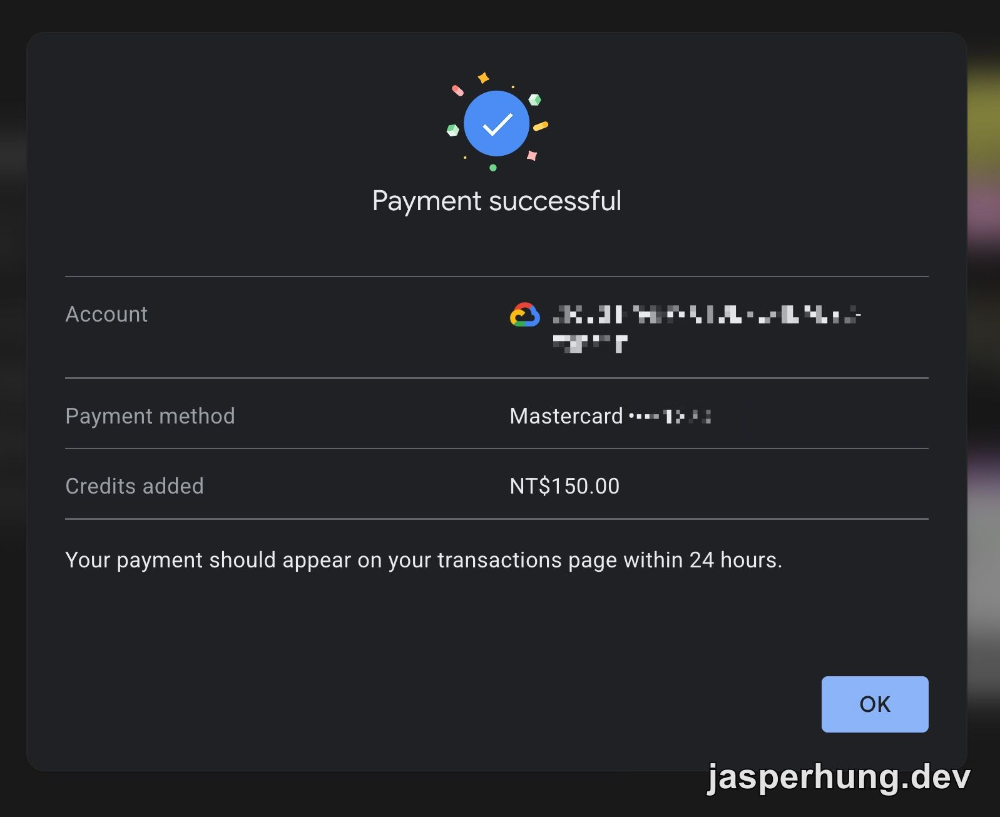

圖：完成 NT$150 預付儲值後的付款成功確認畫面。

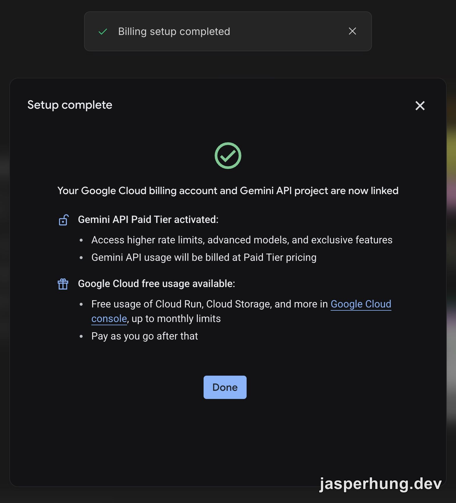

圖：帳單帳戶與專案連結完成，正式啟用 Gemini API Paid Tier。

## Claim credits：兌換 10 美元並自動套用

刷完 NT$150 預付門檻後，視窗立刻推進到第三步「Claim credits（領取點數）」。畫面上顯示首月 10 美元贈金與一年後到期的日期，底下預設勾選了「Auto-apply future Google Developer Program credits to this billing account.（自動將未來的點數套用至這個帳單帳戶）」。保持勾選並按下「Redeem and Continue（兌換並繼續）」，往後每個月的 10 美元就會自動入帳，不用每月手動重領。每筆贈金各有 12 個月效期，沒用完的會疊加，連續訂閱一年就是 120 美元。

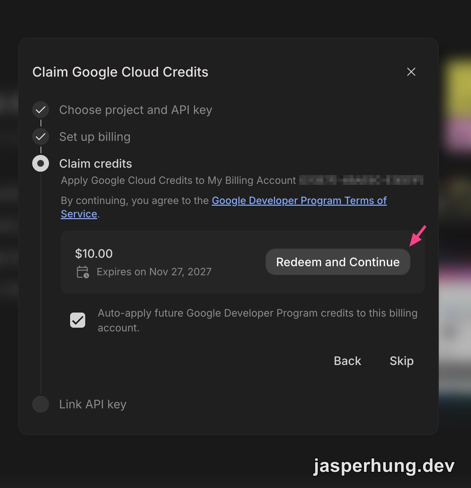

圖：進入第三步「Claim credits」即可兌換首月 10 美元贈金，並勾選自動套用未來每月點數。

## Link API key：要不要記住付費金鑰

最後一步「Link API key（連結 API 金鑰）」會出現一個是否記住本機工作階段的開關。如果這組付費金鑰只打算貼給外部工具使用、平常在 AI Studio 網頁版測試仍想走訂閱內建額度，建議把這個開關關掉。

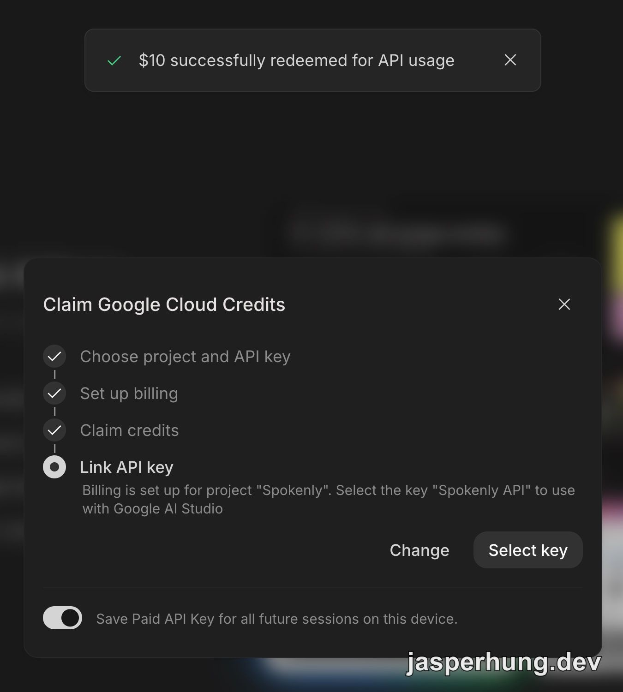

圖：第四步「Link API key」底部可決定是否為本機工作階段記住付費金鑰，僅供外部工具使用時建議維持關閉。

## 確認結果：Gemini API Billing 的三個數字

全部跑完回到 API Keys 頁面，原本的 Free 就會正式變成 **Tier 1**。點進「Gemini API Billing（Gemini API 帳單）」頁面確認狀態時，畫面上會同時出現三個很容易搞混的數字：

1. **NT$325 eligible GCP credits**：剛領到的首月 10 美元贈金。
2. **Paid 1 · $250 Billing Account Tier Cap**：Tier 1 帳單帳戶的上限，不是餘額，也不是免費額度。官方文件說使用層級決定 rate limit 和消費上限，另外也能在 Spend 頁面自己設每月上限。
3. **Credit balance NT$150.00**：剛才自費刷卡儲值的預付餘額。

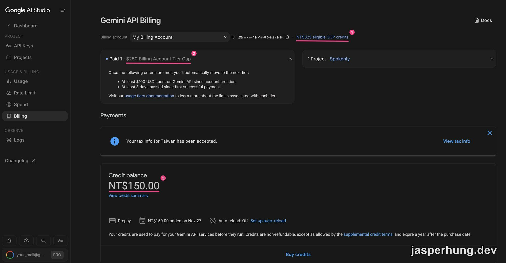

圖：「Gemini API Billing」頁面一次列出贈金、帳單帳戶上限與預付餘額三個數字。

依官方文件，呼叫 API 時會先扣贈金，再扣預付餘額。Gemini 另外說會從最快到期的那一筆開始扣，這點官方文件沒寫。要注意的是，**預付餘額歸零時，贈金也會跟著暫停，要補錢才會恢復**。在 Prepay 加上 Auto-reload: Off 的組合下，不會自動向信用卡請款。

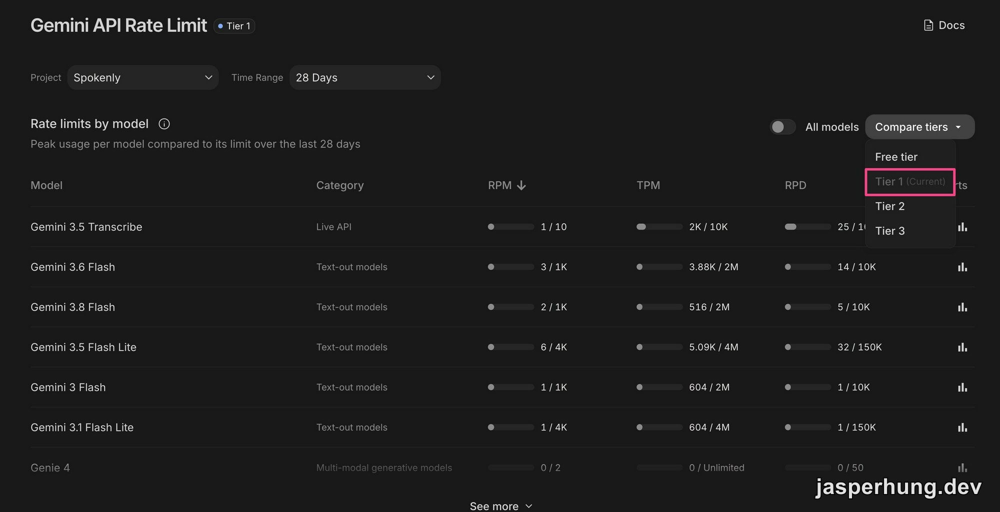

圖：回到「Gemini API Rate Limit」頁面可確認專案已切換為「Tier 1」，各模型配額同步提升。

## 心得

找不到領取按鈕這件事真的很幽默，官方文件和 AI Studio 裡的 Gemini 都說在左側選單，畫面上就是沒有，最後是亂按才按出來。搞懂之後才知道，原來要先低消 5 美元（NT$150）升到 Tier 1，之後每個月才會自動領 10 美元。花 5 美元換一年最多 120 美元的額度，好吧，也算是不錯的投資。

而且 Gemini API 對我真的有用處。我的語音辨識是用 [Spokenly 串 Gemini](/posts/spokenly-gemini-transcribe/)，之前還撞過免費層每天 25 次的上限；現在 API 額度全靠 Google 大哥，大哥幫我全包了，讚讚。

## 資料來源

- [Google AI Studio 官方教學：Use Google AI plan credits in AI Studio](https://aistudio.google.com/learn/use-google-ai-plan-credits-in-ai-studio)
- [Google AI Studio 文件：Google AI plans](https://aistudio.google.com/docs/google-ai-plans)
- [Google AI Studio 文件：Gemini API Billing](https://aistudio.google.com/docs/billing)
- [Google 官方部落格：Google Cloud credits 整合進 AI Studio](https://blog.google/innovation-and-ai/technology/developers-tools/google-cloud-credits-gdp-ai-studio/)
- [Google Developer Program：Benefits FAQ](https://developers.google.com/profile/help/benefits)
