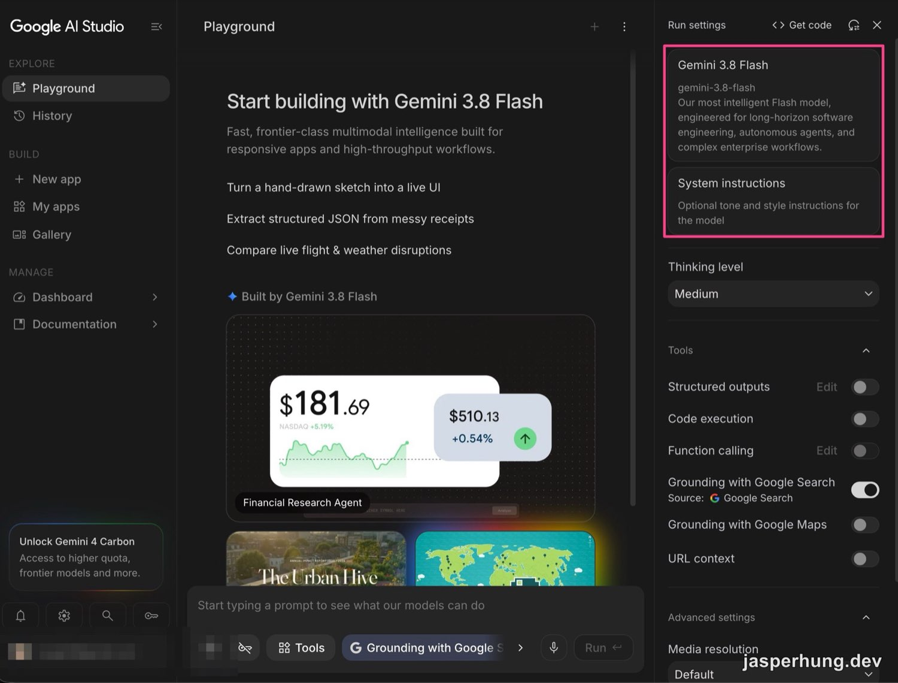
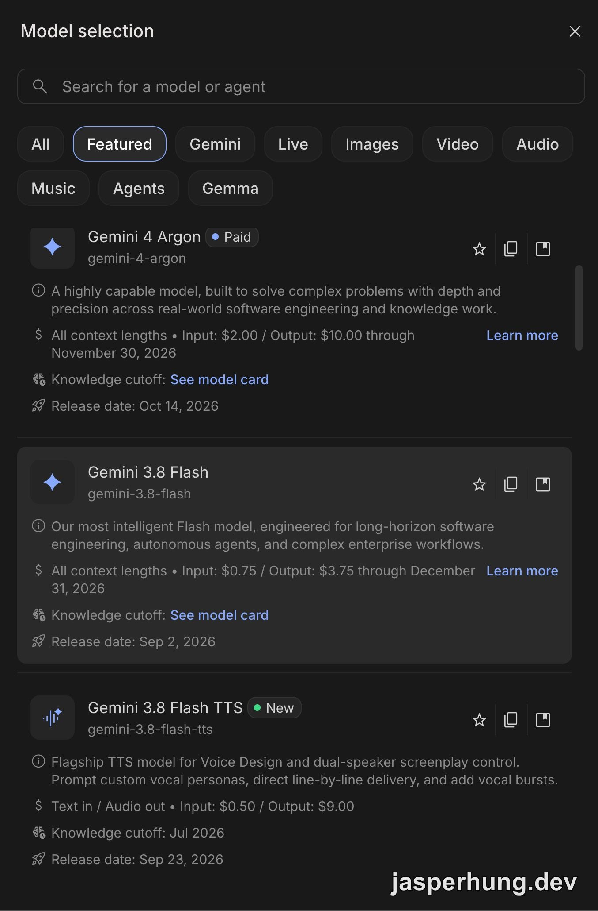
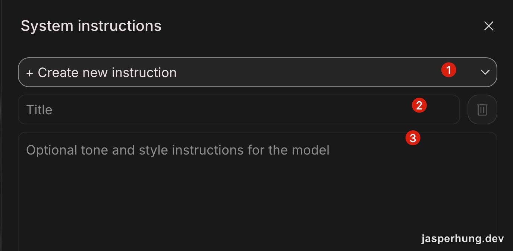
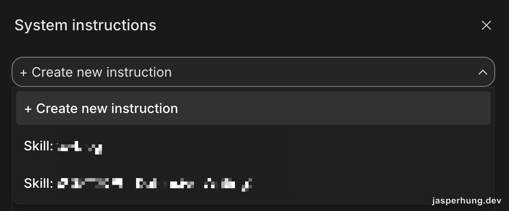
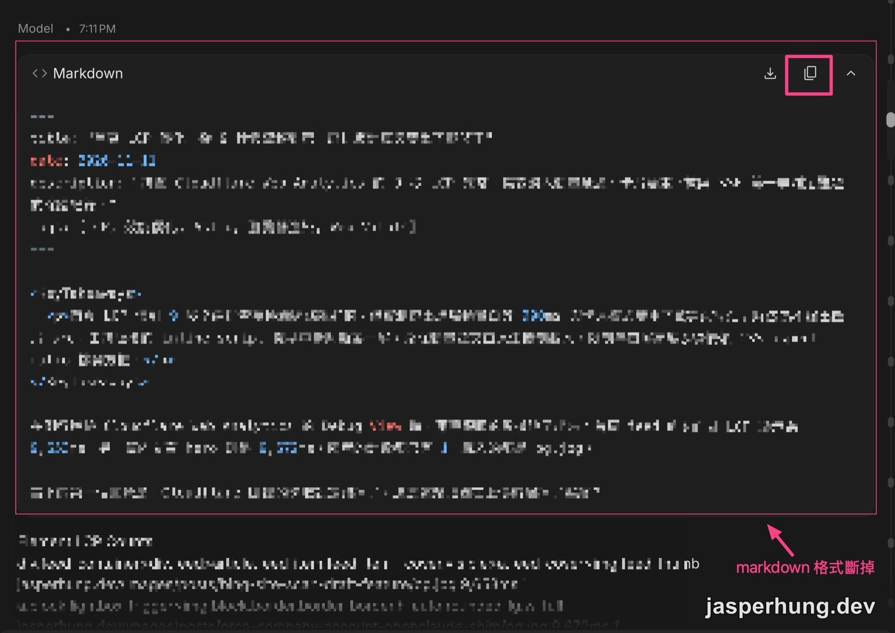
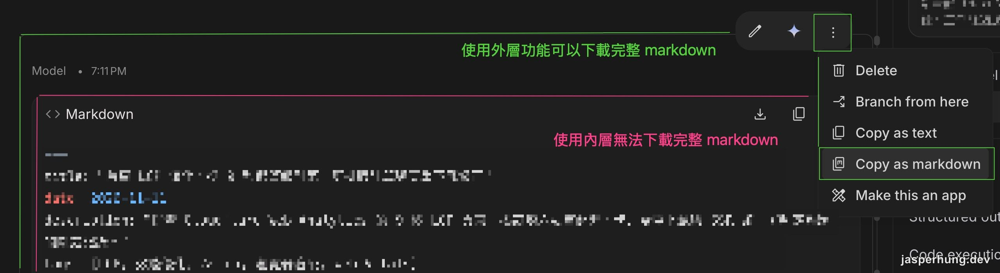
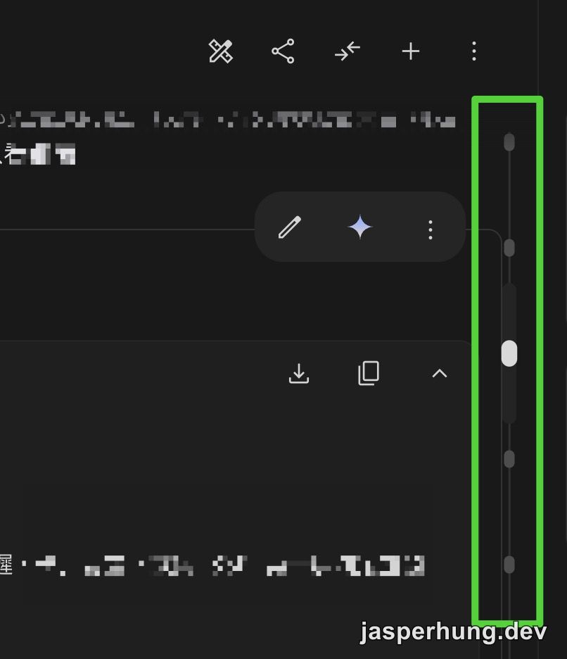
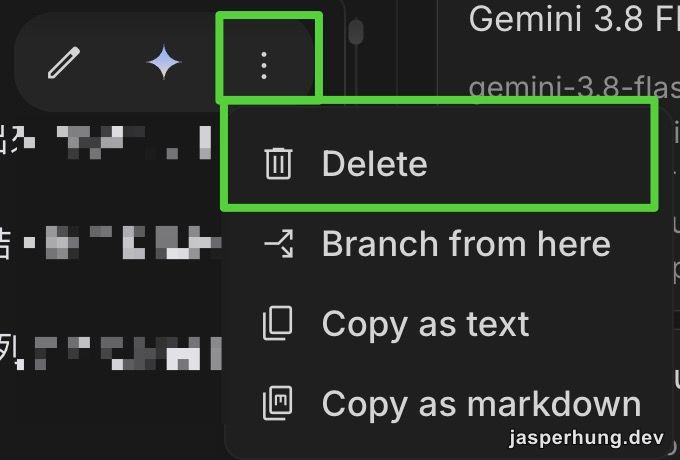

<KeyTakeaways>
  
Google AI Studio 網頁版能不能像 Claude Code 一樣掛 Skill？不能，它沒有 /skill 指令，也沒有地方上傳 Skill 檔，但可以把規則存成有名字的 System instructions，開新對話時從下拉選單挑出來套用；這是 2026 年 11 月用 <code>gemini-3.8-flash</code> 免費額度操作的觀察，介面可能隨版本改變。

</KeyTakeaways>

最近在用 [Google AI Studio](https://aistudio.google.com/) 的 `gemini-3.8-flash`，覺得很好用，而且 free tier 就能用。於是我想把本地慣用的 Skill 也搬過去，結果在對話框輸入 `/skill`、`$skill` 都沒反應，也找不到上傳 Skill 檔案的地方。

找不到入口，我就直接問 AI Studio 本身：在這裡要怎麼做出一個可以重複使用的 Skill？

## `gemini-3.8-flash` 免費就能用

Google AI Studio 是 Google 給開發者試用 Gemini 模型的網頁工具。中間是對話區，右側的 Run settings 用來調整模型、System instructions、Thinking level 和 Tools。

圖：Playground 右側的 Run settings，模型卡片下方就是 System instructions。

點模型卡片會打開 Model selection。我截圖的時候，列表中的 Gemini 4 Argon 掛著 Paid 標籤，Gemini 3.8 Flash 沒有，我用免費額度就能直接選它。卡片上寫的 Input／Output 價格是付費方案的費率。

圖：Model selection 裡，Gemini 3.8 Flash 沒有 Paid 標籤。

## 網頁版沒有 Skill，AI Studio 自己怎麼回答？

答案是不能掛載，但有替代品：Claude Code 或 Cursor 那種獨立的 Skill 模組這裡沒有，要重複使用一套規則，就放進 System instructions（系統提示詞）。

規則放進去之後，AI Studio 有兩種「存」，存下來的東西不一樣：

- **具名的 System instruction**：在 System instructions 面板建立並取名，存的只有規則本身。開新對話時從下拉選單挑出來套用，下一節截圖裡的 `Skill:` 那幾組就是這樣存的。
- **右上角的 Save**：存的是整份 Prompt，System instructions 和下方的對話紀錄會一起存。一邊貼規則、一邊拿筆記測試再按 Save，規則跟測試內容就會混在同一份裡。

AI Studio 回答時也給了 Save 的用法：

1. 開一個新的 Chat，打開右側的 System instructions，把規則完整貼進去。
2. 對話框保持空白，什麼都不輸入，直接按 Save，存成一個空白範本，例如 `[Skill] Writer`。
3. 之後要用時，打開這個範本，直接貼素材。想保留這次的結果時，不要直接按 Save，改用 `Save as` 或 `Make a copy` 另存一份，範本才會一直保持乾淨。

它給了完整步驟，我照著做是可以跑的。

## 把本地 SKILL.md 轉成 System instruction

規則本身我沒有從頭寫。我把本地的 Skill markdown 直接貼上或上傳給它，請它整理成它能處理的版本。原本 Skill 裡用到的本地 MCP 工具、資料夾路徑，在 AI Studio 網頁版都不適用，這些段落它會自己刪掉，只留下網頁版做得到的規則。

整理好的內容放進 System instructions 面板。面板上方有 `+ Create new instruction`，下面是 Title 和內容兩個欄位：

圖：建立一組新的 System instruction，依序是選單、標題、內容。

存好之後，下次打開同一個下拉選單，就能看到存過的 instruction。我的命名方式是都加上 `Skill:` 前綴，選單裡一眼就能找到：

圖：存起來的 instruction 會出現在下拉選單，用 Skill 前綴命名比較好找。

Google 在 [AI Studio 的更新公告](https://blog.google/technology/developers/ai-studio-updates-more-control/)裡也提到這個方向：System instructions 可以儲存、做成範本，並且跨對話重複使用。

跟 Claude Code 的 Skill 比，最大的差別在觸發方式。[Claude Code 的 Skill](/posts/introduction-to-agent-skills/) 會依照 `description` 判斷任務適不適合，自動載入；AI Studio 這邊要自己從下拉選單挑，一次套用一組。網頁版做不到的事（讀本地檔案、呼叫本地工具），轉換時就已經拿掉了。

## Run settings 其他欄位簡介

右側欄位的其他設定，參考 [Gemini API 的 Tools 文件](https://ai.google.dev/gemini-api/docs/tools)重點整理：

| 欄位 | 用途 |
|---|---|
| `Get code` | 把目前 Playground 的設定（模型、System instructions、Tools）轉成程式碼，測好之後可以直接搬進自己的專案 |
| `Structured outputs` | 要求輸出符合指定的 JSON Schema，適合抽資料、填欄位 |
| `Code execution` | 讓模型自己寫 Python 並在沙盒執行，再用結果回答，適合需要精確計算的題目 |
| `Function calling` | 定義外部 API 的規格，讓模型回傳「要呼叫哪個函式、帶什麼參數」 |
| `Grounding with Google Search` | 回答時用 Google 搜尋取得最新資訊並附來源 |
| `Grounding with Google Maps` | 回答地點、店家、路線這類問題時接上 Google Maps 的資料 |
| `URL context` | 在對話裡貼網址，讓模型讀那個網頁的內容 |
| `Media resolution` | 上傳圖片或影片時的處理解析度，越高看得越細、也越吃 Token |

## Markdown 輸出斷掉：改用外層的 Copy as markdown

網頁版的 AI 對話有個很常見的問題：請它輸出一整份 Markdown 文件時，只要文件裡有 code block，外層的 code block 就會被提早截斷。Gemini 也會這樣，後半段內容掉出框外，用框上的複製或下載按鈕拿到的都不完整。

圖：內層 code block 在中途斷掉，後半段內容落在框外。

AI Studio 解決這件事的方式是在整則回覆的外層提供選單。把滑鼠移到回覆上，點右上角的 `⋮`，選 `Copy as markdown`，拿到的是整則回覆的完整 Markdown，不受內層 code block 斷在哪裡影響。

圖：內層 code block 的按鈕拿不到完整內容，外層選單的 Copy as markdown 可以。

## 整理對話：側邊捲動點、Delete 與 Branch from here

對話一長，回頭找前面的段落很麻煩。AI Studio 在對話區右側有一排捲動點，每個點對應一段對話，點下去就跳回那裡。

圖：右側的捲動點，點一下就回到對應的那段對話。

同一個 `⋮` 選單裡還有 `Delete`，可以刪掉單則對話。討論過程中試錯的段落刪掉之後，最後留下的就是一份比較乾淨的對話，可以直接當成結論或下一步的素材。

圖：用 Delete 刪掉單則對話，留下乾淨的版本。

`Branch from here` 則是從某一則對話分出一條新的對話。討論時 AI 常一次給好幾個方案，想每個方案都往下聊，就從那則回覆分支出去，各自延續，原本的對話不會被打亂。

## 心得

上面這些功能，單獨拿出來都不是 AI Studio 獨有的，Copy as markdown、分支對話在別的工具也看得到。但這次用下來，AI Studio 的 UI/UX 讓我感受到更高的友善度與精確度。`gemini-3.8-flash` 不錯用，free tier 就能用，這點很讚；網頁版沒有 Skill，就用 System instructions 頂上。

所以現在需要查資料的時候，我會先讓 Google AI Studio 幫我搜尋，再接著跟它討論，畢竟搜尋是 Google 最強的強項。討論過程中不必要的資訊、額外問的問題，就在對話裡直接刪掉。最後套上存好的 Skill，也就是那組 System instructions，把內容整理成我要的結論格式，再用 `Copy as markdown` 貼到本地的 Claude 或 Codex，繼續整理、驗證或實作，最後存進 Obsidian 變成長期記憶，或寫成部落格。
