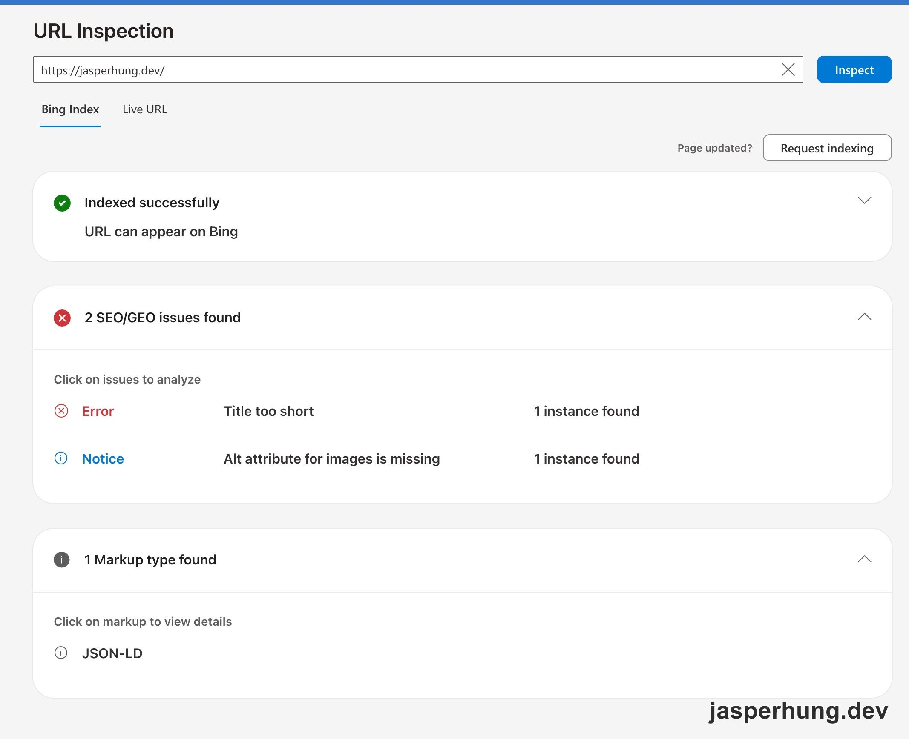
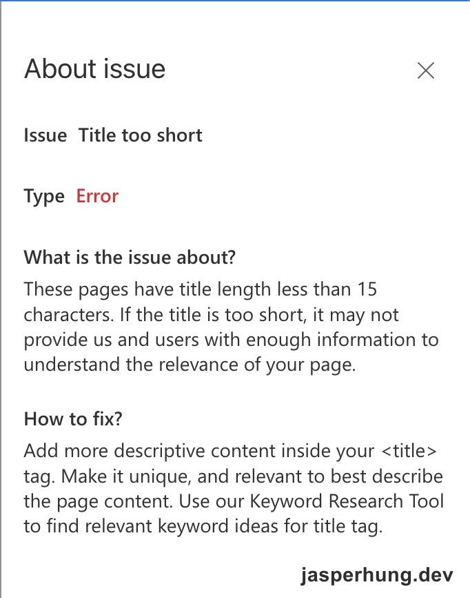
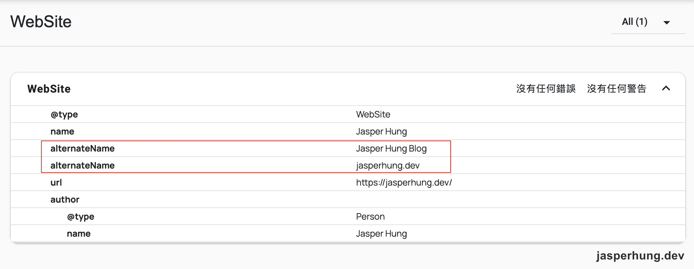
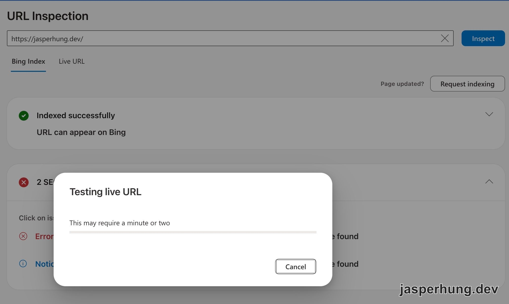
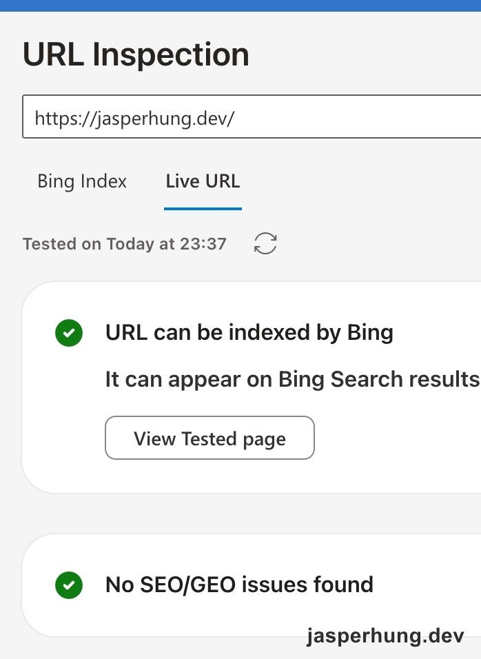

<KeyTakeaways>
  <p>首頁被 Bing 標為 Title too short；Google 搜尋結果又把 site name 顯示成網域，摘要也留著舊內容。兩件事看起來都像 title 沒更新，我原本以為能從同一個設定一起修好，查下去才發現是 site name、首頁 title 和文章摘要三個不同訊號。</p>
</KeyTakeaways>

我第一次在 Bing Webmaster Tools 的 URL Inspection 看見首頁被標成 `Title too short` 時，首頁 `<title>` 只有 `Jasper Hung`，我先以為補上一句網站主題就能處理好。

## Bing SEO Error: Title too short

Bing 的索引報告顯示，首頁 `<title>` 少於 15 個字元。把 sitemap 裡的 176 個網址逐一量過後，只有首頁低於這個長度：它沒有傳入頁面標題，Layout 就回退成 site name，長度共 11 個字元。



<p class="image-caption">圖：Bing Index 顯示首頁有 Title too short 錯誤，也列出缺少圖片 alt 的通知。</p>



<p class="image-caption">圖：Bing 的問題說明將 Title too short 定義為 title 少於 15 個字元。</p>

這看起來像是首頁 title 沒寫完整。隔天我搜尋「Claude Academy」，想確認前次調整的 site name 有沒有反映到搜尋結果，卻看到 Google 仍顯示 `jasperhung.dev`。site name 訊號來自首頁，這個搜尋結果卻是文章頁；兩件事都像 title 沒更新，我自然先以為能從同一個設定一起修掉。

## Google 搜尋發現 site name 還是 domain name

搜尋結果裡，自己的文章排在第三頁第二筆，但第一行仍是 `jasperhung.dev`，摘要還寫著「總共有 26 堂課」。


<p class="image-caption">圖：Google 搜尋結果的 site name 仍是網域，文章摘要也還停在舊內容。</p>

我先翻 git log，發現文章的 `title` 從首發後一直沒改。最近一次更新的是 `description` 和內文：課程清單從 26 堂改成挑選 18 門課。搜尋結果的舊摘要對應到一段已經刪掉的舊內文；我用 `curl` 查正式網站，`<meta description>` 和頁面內容都已經是新版。

這也符合 [Google 對搜尋摘要的說明](https://developers.google.com/search/docs/appearance/snippet)：摘要主要從頁面內容自動產生，有時才採用 `<meta description>`。所以網站上的 description 更新，不代表搜尋結果會立刻照抄新版文字。GSC 網址檢查顯示，Google 上次抓這篇，比這次更新早九天；我在部署更新兩天後檢查時，索引快照還沒反映新版。我先對文章頁提出「要求建立索引」。長期要補的 `updated` 欄位、`dateModified` 和 sitemap `<lastmod>`，則留待之後處理。

我也把搜尋結果的兩種標題分開看：第一行 `jasperhung.dev` 是 site name；藍色文章標題是 title link。Google 會參考 `<title>`、頁面標題等訊號自動組出 title link，所以結果裡沒顯示預期的 site name 後綴，不能直接推論正式頁面的 `<title>` 少了後綴。[Google 的 title link 說明](https://developers.google.com/search/docs/appearance/title-link)也提醒，結果標題不一定和 HTML 的 `<title>` 完全相同。

## 把兩個問題拆開修，再分別驗證

### Google site name：先保留現名

我檢查首頁時，`WebSite` 結構化資料的 `name`、`og:site_name` 和首頁 `<h1>` 都已經填了目前的 site name，Google 卻仍顯示網域。最初我收到的解釋是：JSON-LD 的 `url` 少了結尾斜線，或 site name 太像一般人名。後來我對照[Google 官方 site name 說明](https://developers.google.com/search/docs/appearance/site-names?hl=en)，才確認這兩個說法都沒有文件根據。

Google 說 `WebSite` 結構化資料是指定 site name 偏好最重要的訊號，而且要放在首頁；Google 也會參考首頁內容和網路上的其他提及。範例有尾斜線，不代表文件規定 URL 一定要有。相反地，官方明確建議把小寫網域放在 `alternateName` 最後當備選。`JH` 雖然是 logo 上的縮寫，但不是讀者平常用來稱呼網站的名字，所以也沒有放進去。

這也回答了我對 Astro 的疑問：網站是 SSG，每一頁都會產生 HTML，但 site name 是整個網站的訊號，不是每篇文章各自設定的標籤。即使其他非文章頁也輸出 `WebSite` 資料，site name 設定仍以首頁為準。

我們也討論過要不要把現有的 site name 改成更像品牌的名稱。若把「Coworking with AI」塞進 `name`，就是要求 Google 把更長的字串當 site name 候選；而且改品牌還要一起盤點首頁標題、`og:site_name` 和全站 title 後綴。`alternateName` 則是其他或較短的名稱，不適合塞首頁主題。最後決定先保留現名，設定如下：

```json
{
  "@context": "https://schema.org",
  "@type": "WebSite",
  "name": "Jasper Hung",
  "alternateName": ["Jasper Hung Blog", "jasperhung.dev"],
  "url": "https://jasperhung.dev/"
}
```

另一份建議曾說 `name`、`alternateName` 和 `url` 都設定好、彼此對得上，Google 就會把網域換成人名。但原本的 site name 訊號已大致一致，Google 還是顯示網域；官方也說 site name 是全自動產生。設定是在提供偏好，不能保證結果立刻改變。

### 首頁 title：用獨立的 metaTitle

修 Bing 警告時，我先試著把首頁的 `title` prop 設成 `Coworking with AI`，想讓 Layout 自動把網站主題和 site name 組成完整 title。但 `title` 不只控制 `<title>`，也會顯示在 topbar、啟用分享按鈕，並在手機版多出標題列。這個 prop 原本是文章畫面標題，拿來改首頁 metadata 會連畫面一起動。

所以我新增獨立的 `metaTitle` prop，讓它只覆寫 metadata 標題。首頁現在的 metadata title 會帶上 `Coworking with AI`，畫面維持原樣。`name` 回答網站叫什麼，首頁 title 說明網站內容；這個 `metaTitle` 只改首頁，不會改到 Claude Academy 文章自己的 title link。

### 驗證線上設定索引快照

部署後，我先用 [Schema Markup Validator](https://validator.schema.org/) 檢查首頁的 WebSite JSON-LD：`name`、兩個 `alternateName` 和 `url` 都正確，沒有錯誤或警告。



<p class="image-caption">圖：Schema Markup Validator 驗證首頁 WebSite 結構化資料，兩個 alternateName 和首頁 URL 都有輸出。</p>

GSC 顯示首頁已編入索引、canonical 也被採用，但上次檢索時間仍早於這次部署，所以索引結果還沒反映新設定。我對首頁提出重新索引；sitemap 是網址清單，首頁網址沒有變，這次不需要重送。

Bing 的索引分頁也還留著舊錯誤。我切到 Live URL 重新測首頁，畫面先顯示測試進行中，完成後確認頁面可以被索引，且沒有 SEO/GEO issues。這次的 Request indexing 只針對我送出的首頁網址，不是要求 Bing 全站重抓；其他頁面的更新由已啟用的 IndexNow 通知，設定過程寫在[Cloudflare Crawler Hints 與 IndexNow](/posts/cloudflare-crawler-hints-indexnow-cache-rule/)。



<p class="image-caption">圖：切換到 Live URL 後，Bing 正在重新測試首頁。</p>



<p class="image-caption">圖：重新測試完成，Bing 顯示首頁可被索引，沒有 SEO/GEO issues。</p>

## 心得

Bing 的警告先讓我注意到首頁 title 太短，Google 搜尋又把我帶到 site name 仍顯示網域的問題。兩個現象都跟首頁訊號有關，實際要改的設定卻不同。現在網站輸出、結構化資料和 Bing 即時檢查都對了；Google 最後會不會採用目前的 site name，還得等它下一次重新檢索。
