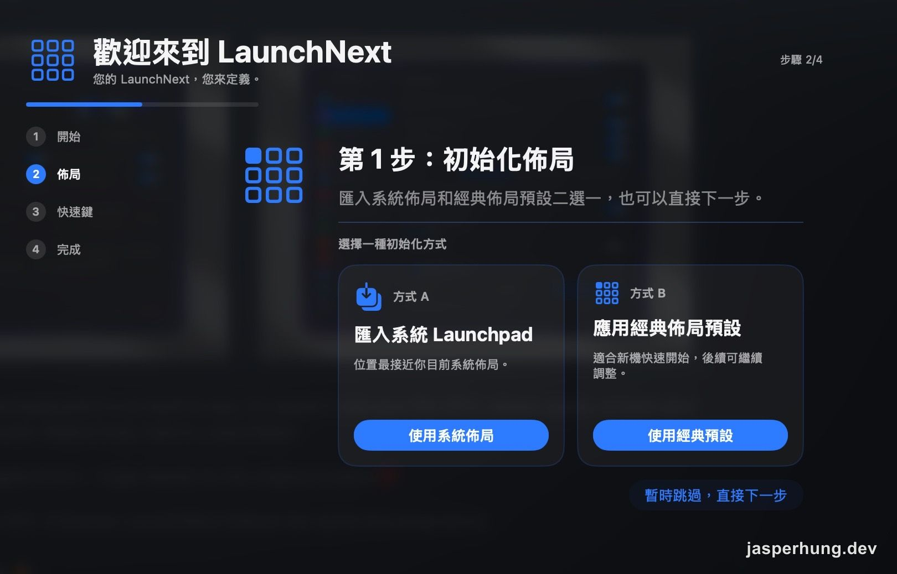
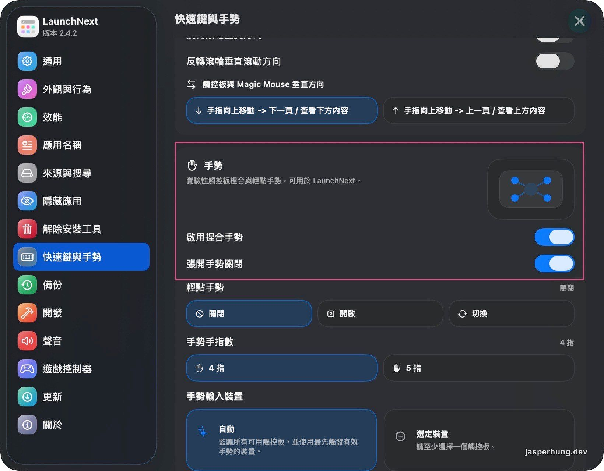
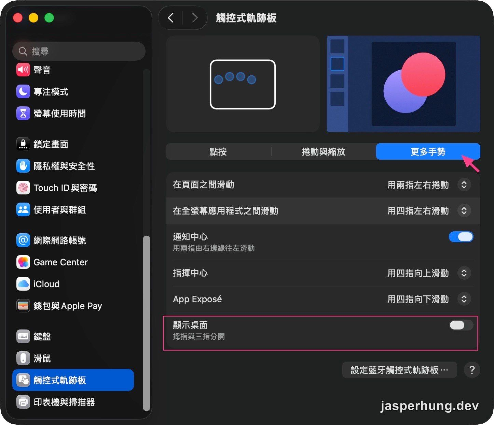
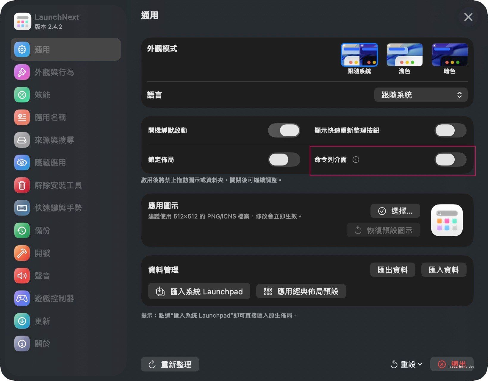

<KeyTakeaways>
  <p>macOS 26 移除 Launchpad 後，我用 LaunchNext 的捏合手勢開啟 App，匯入舊排列，再透過 CLI 讓 Agent 整理；F4 留給 Spotlight，資料夾仍需手動排序。</p>
</KeyTakeaways>

升級 macOS 26 後，我打開 Spotlight 裡的 App 瀏覽畫面找程式，等它出現的時間比預期久，顯示範圍又小，只能上下捲，操作起來不太直覺。Apple 支援頁說明，Spotlight 搜尋欄旁有「Applications」按鈕，可以瀏覽所有 App；這個入口接手了我原本用 Launchpad 做的事。[Apple Support 說明](https://support.apple.com/en-us/122868)

我想知道是不是也有人覺得不順手，開始找有沒有能把 Launchpad 裝回來的軟體，先找到 [LaunchOS 官網](https://launchosapp.com/)。

## 搜尋 Launchpad 替代方案

我把幾個問題交給 AI 一起查：LaunchOS 會不會真的取代系統 Apps、免費版能做什麼、會不會跳廣告？查到它是另外安裝的一支 App，系統 Apps 仍會保留；Basic 免費，但 F4、觸控板手勢和 Hot Corners 都列在 PRO。官網和評測沒有提到廣告，我也沒有實際安裝驗證，所以這題當時沒有答案。

後來我看了 [Dr.Buho 的替代品比較](https://www.drbuho.com/zh-tw/review/launchos-alternative)，裡面列了 BuhoLaunchpad、LaunchMe、Launchie、AppGrid 和 LaunchNext 等選項。BuhoLaunchpad 有捏合手勢，但 F4 沒有明確說明；LaunchMe 的手勢需要額外元件，Launchie 和 AppGrid 則沒有手勢。比較資料把 LaunchNext 標成不支援手勢，不過 [LaunchNext README](https://cdn.jsdelivr.net/gh/roversx/launchnext@main/README.md) 寫了實驗性的四指、五指捏合。兩種說法不一致，我先以 README 當線索，決定裝來試試。

| 選項 | 我查到的重點 |
|---|---|
| [LaunchOS](https://launchosapp.com/) | Basic 免費；F4 和觸控板手勢需 PRO |
| [BuhoLaunchpad](https://drbuho.com/buholaunchpad) | 有捏合手勢；免費版限制與 F4 支援當時未確認 |
| [RoversX/LaunchNext](https://github.com/RoversX/LaunchNext) | 免費、開放原始碼；README 列出實驗性捏合手勢 |

LaunchNext 的 GitHub repo 在 2026-10-20 查到 3,111 ⭐。最新 release 是 2.4.2，從這版開始有 Apple 簽章與公證；內建觸控板曾被誤判成 Touch Bar 的 [issue #239](https://github.com/RoversX/LaunchNext/issues/239) 已在這版修正，外接 Magic Trackpad 2 捏合沒反應的 [issue #231](https://github.com/RoversX/LaunchNext/issues/231) 當時仍未解決。[issue #157](https://github.com/RoversX/LaunchNext/issues/157) 裡，作者也說目前無法蓋過系統層級的 F4 快捷鍵。

我剛好不需要 F4 來開啟 Launchpad，也想保留 macOS 原本用 F4 呼叫 Spotlight 的功能。用捏合手勢開 LaunchNext，正好符合我想要的方式。

## LaunchNext 安裝與設定

我用 Homebrew 安裝時，新的信任檢查先擋下第三方 tap。只信任這個 cask 後就能繼續安裝：

```bash
brew tap RoversX/homebrew-tap
brew trust --cask roversx/tap/launchnext
brew install --cask launchnext
```

安裝後用 `spctl -a -vv` 驗證，系統回報 `accepted / source=Notarized Developer ID`。cask 的 caveats 仍寫著「not notarized」，和實際驗證結果不一致。

### LaunchNext wizard

第一次啟動會先看到歡迎 wizard。佈局初始化可以先跳過，進入 App 後再設定；舊 Launchpad 的排列也能稍後從「通用」匯入。



<p class="image-caption">圖：首次啟動時可以暫時跳過佈局初始化，之後再回設定處理。</p>

### 設定：快速鍵與手勢

我先在 LaunchNext 的「快速鍵與手勢」啟用捏合和張開手勢，手指數選 4 指，輸入裝置維持自動偵測。AI 起初從 App 的字串猜介面可能是英文，我貼上設定截圖後才確認實際介面是中文。



<p class="image-caption">圖：捏合與張開手勢都已啟用，手指數選 4 指，輸入裝置設為自動。</p>

### macOS 設定：觸控式軌跡板

接著我確認 macOS 端有沒有手勢衝突。AI 原先猜系統可能也有捏合叫出 Apps 的手勢；我查看「觸控式軌跡板 → 更多手勢」後，發現沒有這個項目。LaunchNext 的提示則是：如果要用張開手勢關閉 LaunchNext，需先關掉「顯示桌面」。



<p class="image-caption">圖：「顯示桌面」已關閉，符合 LaunchNext 對張開手勢關閉的提示。</p>

設定完成後實際捏合卻沒有反應。我先檢查觸控板型號和 App 是否在背景執行，接著讀手勢狀態機，看到它要求目前觸點數必須剛好等於設定的手指數。那時我還以為設定變更沒有重新載入，重開 App 也沒有改善。

最後是我自己發現：我平常習慣用五指捏，設定卻是四指。改成五指後就能觸發了。程式讀到的條件已經很接近答案，我和 AI 卻先沿著裝置偵測與重啟往下查；漏掉的是最日常的那個細節——手上到底用了幾根手指。

## LaunchNext CLI：讓 Agent 幫我排 App

升級 macOS 26 後，我這台 Mac 上的舊 Launchpad 資料庫還在，裡面有 112 個 App 和 11 個資料夾。LaunchNext 可以直接匯入，舊排列大部分都回來了。

但真的開始整理時，我發現 LaunchNext 裡直接拖 App，沒有原本 macOS Launchpad 那麼順手。我問 Agent：能不能讀舊資料庫裡記錄 App 排列的 SQLite table，再直接幫我排成想要的樣子？

Agent 確認舊資料還在，也找到 LaunchNext 內建的 CLI：`snapshot` 可以讀目前排列，`move` 可以移動 App，還能用 `create-folder` 建立資料夾，再把 App 收進去。我們就決定用這些指令讓 Agent 幫忙整理。

我從「通用」頁面匯入舊排列、開啟「命令列介面」，就能在 Terminal 使用 `launchnext` CLI。



<p class="image-caption">圖：「通用」頁面可匯入系統 Launchpad；截圖當下「命令列介面」開關尚未啟用。</p>

之後我用截圖告訴 Agent 哪些 App 要去哪裡、哪些要收在一起。像是把常用瀏覽器、VS Code 和 AI 工具拉到第一頁，或把簡報、Gmail、試算表收到 Google 資料夾。Agent 先用 `snapshot` 確認目前位置，再用 CLI 指令批次移動和收納。

下面用官方文件的範例示範兩種操作：先預覽把 Safari 移到第 12 格，再預覽把 Mail 和 Notes 建成 Utilities 資料夾。App 路徑和格號要依自己的 Mac 調整，確認預覽後再移除 `--dry-run` 執行。[LaunchNext CLI 官方說明](https://docs.closex.org/launchnext/cli-and-tui)

```bash
launchnext --cli snapshot

launchnext --cli move \
  --source normal-app \
  --path "/Applications/Safari.app" \
  --to normal-index \
  --index 12 \
  --dry-run

# ex: create a folder from two apps
launchnext --cli create-folder \
  --path "/Applications/Mail.app" \
  --path "/Applications/Notes.app" \
  --name "Utilities" \
  --index 12 \
  --dry-run
```

這裡的 `--index` 是全域格號，每頁 35 格：page 0 是 0–34，page 1 是 35–69。CLI 可以新建資料夾並把 App 收進去，但不能直接移動已存在的資料夾；要調整資料夾順序，只能挪動裡面的 App 讓資料夾往前浮。資料夾之間要照字母排序，最後還是得手動拖。

批次搬移時，也有幾個 App 出現在預期之外的位置。我沒有查明原因；當時只能記下可能和 GUI 同時操作，或 LaunchNext 的重排方式有關，沒有把猜測當成結論。

## 手勢順手，App 排列交給 Agent

我原本想裝 LaunchOS，但手勢要 PRO，對我來說有點麻煩。LaunchNext 有我想用的捏合手勢，所以最後選了它。第一次啟動比較卡，後來用起來就順了。四指、五指那次也很有趣：我平常用五指捏，設定時卻選了四指，試了半天才發現手勢和設定對不上。

LaunchNext 裡拖 App 真的很難用，我一直搞不懂旁邊的 App 什麼時候會往後推、要怎麼空出位置。後來我截圖告訴 Agent 哪些要放哪裡、哪些要收進資料夾，再讓它透過 CLI 整理，過程順很多，可能也會多用一些 Token。

設定頁面跟 macOS 26 的設定有點像，項目也很多，我還沒全部看完。以目前試過的手勢、舊排列匯入和 CLI 來說，我會推薦給想找回 Launchpad 操作的人。
