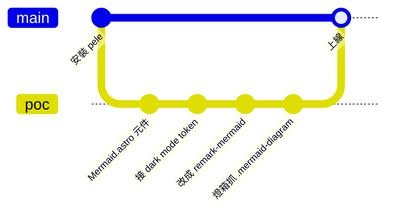
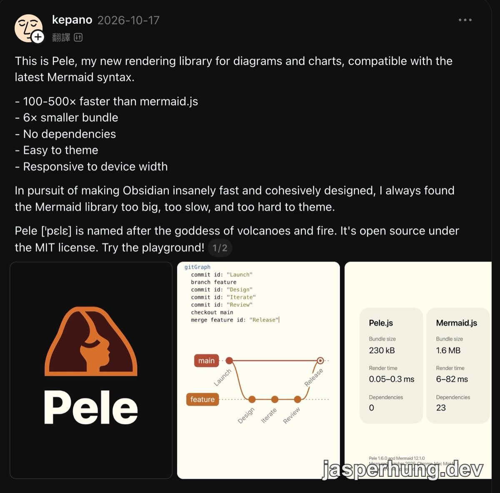
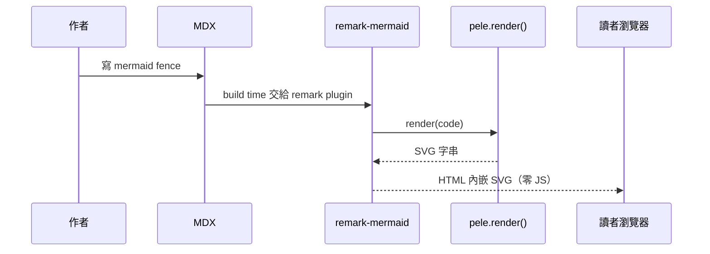
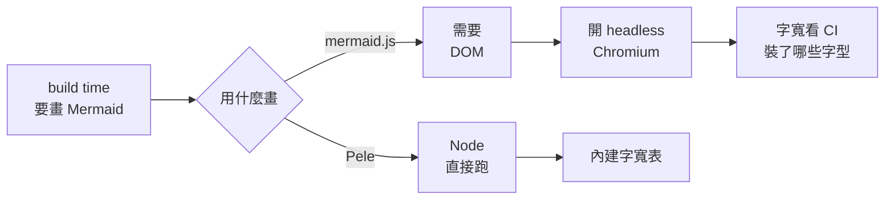
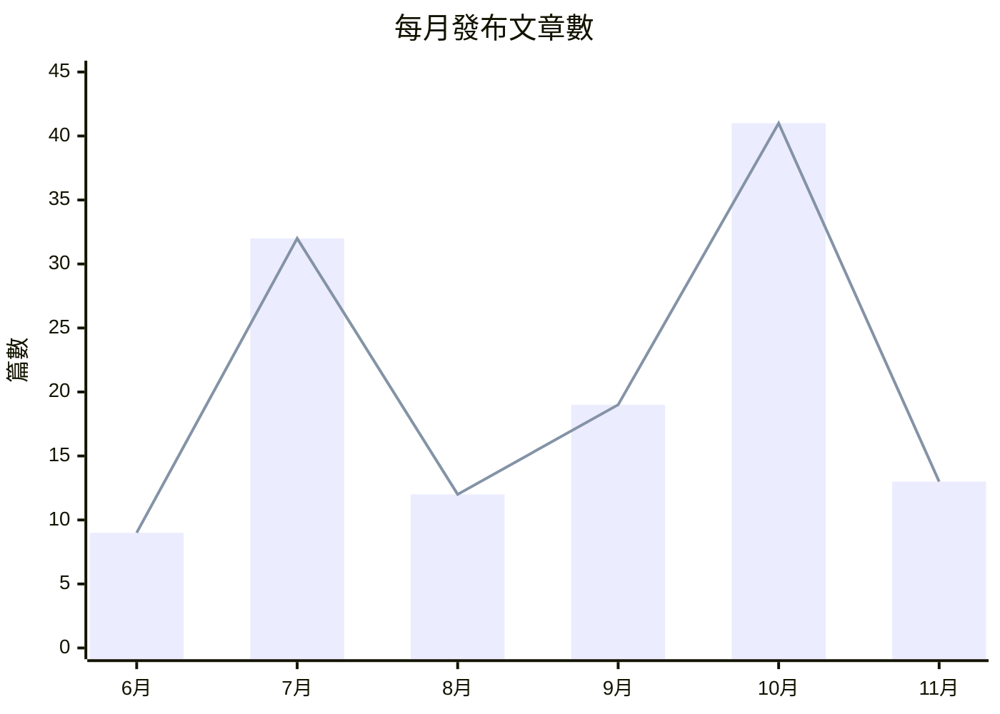

<KeyTakeaways>
  <p>Astro SSG 部落格值得用 Obsidian 的 Pele 畫 Mermaid 嗎？值得，但理由不是官方主打的速度：圖在 build time 就畫好，讀者拿到的本來就是靜態 SVG，渲染速度和 bundle 大小都用不到；真正的收穫是 build 不用開瀏覽器、本機和 CI 產出一致，以及一張 SVG 吃 CSS 變數就能跟著 dark mode 變色；這是在 Astro 6 加 GitHub Pages 的部落格上實測的結果。</p>
</KeyTakeaways>

在 Threads 上看到 Obsidian 1.15.1 發布的消息，順著滑到 Obsidian 作者 kepano [介紹 Pele 的貼文](https://www.threads.com/@kepano/post/DemdPuSG0H6)：一個相容 Mermaid 語法的圖表 renderer，號稱比 mermaid.js 快 100–500 倍。我的部落格到那天為止一張 Mermaid 圖都沒有，第一個念頭是：這能不能直接加進來？

結果加是加進來了，但做完回頭看，kepano 列的賣點裡最大的兩個：快 100–500 倍、bundle 小 6 倍，這個部落格一個都沒用到。真正用到的是排在後面的兩項：零依賴的純 JS，在 Node 裡就能跑，build 不用開瀏覽器；還有容易換主題，吃 CSS 變數，一張 SVG 就能跟著切 dark mode。整個過程用 Mermaid 的 gitGraph 畫出來是這樣，這張圖本身也是 Pele 畫的：



## Pele 是什麼

Pele 是 kepano 開源的 Mermaid renderer，把 Mermaid 語法畫成 SVG，MIT 授權。kepano 說他一直覺得 Mermaid 函式庫「太大、太慢、太難換主題」，所以自己重寫了一個，之後會成為 Obsidian 的 Mermaid renderer。



<p class="image-caption">圖：kepano 2026-10-17 在 Threads 介紹 Pele 的貼文，右邊是官方的量測比較。</p>

官方比較卡片的數字是 Pele 1.6.0 對 Mermaid 12.1.0，在 Mac Mini M4 的 Chrome 上量的：

| | Pele | mermaid.js |
|---|---|---|
| Bundle size | 230 kB | 1.6 MB |
| Render time | 0.05–0.3 ms | 6–82 ms |
| Dependencies | 0 | 23 |

| Repo | Stars |
|---|---|
| [obsidianmd/pele](https://github.com/obsidianmd/pele) | 4,504 ⭐ |

README 裡有三件事決定了後面怎麼接：

- 支援 Mermaid 12.1.0 內建的所有圖表類型，但版面和視覺是 Pele 自己的，畫出來不會跟 mermaid.js 一模一樣。
- `render()` 是同步函式，輸入 Mermaid 文字，直接回傳 SVG 字串。
- 顏色和字型全部走 `--pele-*` CSS 變數。

## 先包成元件：build time 轉成 inline SVG

`render()` 只回傳字串、不碰 DOM，那它應該能在 Node 裡跑。這代表可以在 build time 呼叫它，讀者端完全不用載 Pele。在 Node 裡直接試，四種圖都畫得出來，SVG 開頭長這樣：

```html
<svg class="pele pele-flowchart" viewBox="0 0 676 152"
  style="max-width:100%;height:auto;--_bg:var(--pele-bg,#fff);--_fg:var(--pele-fg,#1f1f1f);...">
```

Astro 元件的 frontmatter 本來就在 build time 執行，所以第一版是一個元件：

```astro title="src/components/Mermaid.astro"
---
import { render } from 'pele';
const { code } = Astro.props;
const { svg } = render(code.trim());
---
<figure class="mermaid-diagram"><Fragment set:html={svg} /></figure>
```

MDX 裡這樣用：

```mdx
<Mermaid code={`flowchart LR
  A[筆記] --> B[to-blog] --> C[MDX]`} />
```

SVG 要直接嵌在 HTML 裡（inline），不能輸出成檔案再用 `` 引用。`` 裡的 SVG 是一份獨立文件，讀不到頁面上的 CSS 變數，也看不到 `html.dark`：

| | inline `<svg>` | `` |
|---|---|---|
| 讀得到頁面的 CSS 變數 | 可以，`--pele-*` 能對應到 blog 的 token | 不行 |
| 切 dark mode | 自動跟著變色 | 要輸出兩張圖再切換 |
| 圖上的文字 | 可以選取、複製 | 跟點陣圖一樣 |

我在 Node 裡掃過 flowchart、sequence、state、pie 四種輸出：SVG 裡除了變數的預設值，沒有任何寫死的色碼。所以 dark mode 只要把 `--pele-*` 接到 blog 既有的 token：

```css title="src/styles/global.css"
.mermaid-diagram {
  --pele-bg: var(--bg);
  --pele-fg: var(--article-text);
  --pele-line: var(--muted);
  --pele-surface: var(--surface);
  --pele-border: color-mix(in srgb, var(--muted) 50%, var(--border));
  --pele-accent: var(--accent);
  /* ...其餘變數同理 */
}
```

blog 的 dark mode 本來就是 `html.dark` 覆寫 token，圖不用重新渲染，切換時直接跟著變色。字型刻意不改：版面是 build time 照 Pele 預設字型量的，換成 blog 的字型可能讓文字超出框。

## 元件把 Markdown 語法丟了，改成 remark plugin

元件能動，但我接著問了一個問題：那原生的 ` ```mermaid ` 語法呢？

我的 Slidev 簡報裡有一些 Mermaid 圖表，之後可能會搬進文章。用元件的寫法，就得把每張圖改寫成 `<Mermaid code={...} />`。而且這個寫法只有這個 blog 看得懂：

| | ` ```mermaid ` fence | `<Mermaid code={...} />` |
|---|---|---|
| Obsidian、GitHub | 原生渲染 | 只看到一段 JSX |
| `.md` endpoint 給 AI 讀 | 原樣輸出，本來就是標準 Markdown | 要另外寫轉換，不然是雜訊 |
| 寫法 | 標準 Markdown | 要包反引號 template literal |

這個 blog 有一個 [raw markdown endpoint](/posts/cloudflare-markdown-for-agents/)，讓 AI crawler 直接讀 `.md`。文章裡的語法越標準，AI 讀到的就越乾淨。這跟之前把 admonition [改成 GitHub alert 語法](/posts/astro-github-alerts-markdown-migration/)是同一個方向：作者寫標準語法，渲染交給自己的 plugin。

麻煩的是，code block 會被 [Expressive Code](/posts/dark-mode-expressive-code/) 拿去上色。它在 rehype 階段處理 `pre > code`，所以 plugin 要在更早的 remark 階段，就把 `lang` 是 `mermaid` 的 code 節點換掉：

```ts title="src/plugins/remark-mermaid.ts"
export const remarkMermaid: Plugin<[], Root> = () => (tree, file) => {
  let count = 0;
  visit(tree, "code", (node, index, parent) => {
    if (node.lang !== "mermaid" || !parent || index === undefined) return;

    // SVG 內的 marker / clipPath id 是全頁共用的，同頁多張圖要各自加前綴
    const idPrefix = `mermaid-${count++}-`;
    let svg = "";
    try {
      ({ svg } = render(node.value, { idPrefix }));
    } catch (error) {
      const message = error instanceof Error ? error.message : String(error);
      file.fail(`Mermaid 渲染失敗：${message}`, node);
    }

    parent.children[index] = { type: "html", value: `<figure class="mermaid-diagram">${svg}</figure>` };
  });
};
```

註冊在 `astro.config.mjs` 的 `markdown.remarkPlugins`，MDX 會沿用。語法寫錯時 Pele 會丟出 parse error，`file.fail` 讓 build 直接失敗並指出位置。壞掉的圖不會悄悄上線。

整條流程就是這張圖，它本身也是用 fence 寫的：



npm 上其實已經有人包好了，我看過之後還是自己寫：

| Repo | Stars | 說明 |
|---|---|---|
| [t128n/pele-x](https://github.com/t128n/pele-x)（`astro-pele`） | 1 ⭐ | Astro integration，fence 轉靜態 SVG |
| [yue1123/pele-markdown](https://github.com/yue1123/pele-markdown)（`remark-pele`） | 0 ⭐ | remark plugin，同樣的事 |

兩個都是 Pele 發布後兩週內出現的 0.x／1.0 版本，各只有一位維護者。自己寫的這支只依賴官方的 `pele`，輸出的 HTML 結構和 class 也由自己決定，接下來的燈箱就靠這個 class。

## 燈箱抓不到 inline SVG

文章內文有限制寬度，流程圖常常被縮得很小。sequence diagram 在手機上，文字小到要瞇眼看。所以圖一定要能點開放大。

這個 blog 的[圖片燈箱](/posts/astro-blog-image-lightbox/)用 PhotoSwipe，選取條件是：

```js
gallery.querySelectorAll('img:not(a img)')
```

圖確實在文章內文裡，但燈箱篩的是元素類型。Pele 的圖是 `<svg>`，不是 ``，所以點了沒反應。我印象中 SVG 會被燈箱抓到，那是因為以前是用 `` 引用 SVG 檔，產生的是 ``。

那能不能改成抓所有 `svg`？不行。內文裡每個 H2、H3 旁邊的[複製連結 icon](/posts/heading-anchor-copy-link/)，也是 JS 插進去的 inline SVG。燈箱抓 `svg` 的話，這些 icon 都會變成可以放大的圖，點標題複製連結的功能也會被燈箱攔截。之後內文再放其他 icon，也會遇到一樣的問題。

所以要用一個專屬的 class 劃出範圍。remark plugin 輸出的 `<figure class="mermaid-diagram">` 剛好就是。這個 class 是自己定的，不用 Pele 自帶的 `svg.pele`，Pele 改版調整 class 名稱也影響不到燈箱：

```ts title="src/pages/posts/[slug].astro"
const lightbox = new PhotoSwipeLightbox({
  gallery: 'article',
  children: 'a.lightbox-trigger, .mermaid-diagram',
  pswpModule: () => import('photoswipe'),
});
lightbox.addFilter('domItemData', (itemData, element) =>
  element.classList.contains('mermaid-diagram') ? diagramSlide(element) : itemData,
);
```

抓到之後還有一個問題。PhotoSwipe 的圖片 slide 才能雙指或滾輪放大，但圖片 slide 用的是 ``，剛才那張表說過，`` 讀不到 CSS 變數。

解法是在開燈箱的那一刻做轉換：複製一份 SVG，用 `getComputedStyle` 讀出 figure 上 `--pele-*` 目前的實際值，寫死進複本，補一塊頁面底色，再轉成 data URL：

```ts title="src/pages/posts/[slug].astro"
function diagramSlide(figure: HTMLElement) {
  const svg = figure.querySelector('svg')!;
  const clone = svg.cloneNode(true) as SVGSVGElement;
  const styles = getComputedStyle(figure);
  for (const name of PELE_VARS) clone.style.setProperty(name, styles.getPropertyValue(name).trim());
  // ...補一塊 --pele-bg 底色與留白，燈箱底是黑的，light mode 的深色字才看得到
  return {
    src: `data:image/svg+xml;charset=utf-8,${encodeURIComponent(new XMLSerializer().serializeToString(clone))}`,
    width: Math.round(w * DIAGRAM_ZOOM),   // 宣告成 3 倍大，燈箱才有放大空間
    height: Math.round(h * DIAGRAM_ZOOM),
  };
}
```

顏色是開燈箱當下才讀的，所以 light mode 開出淺色、dark mode 開出深色。SVG 是向量，宣告成 3 倍大放大也不會糊。圖表會和文章裡的一般圖片排在同一組，可以左右翻頁。figure 另外加了 `role="button"` 和 `tabindex`，用鍵盤按 Enter 也能打開。

## SSG 用不到速度，那 Pele 幫到什麼？

做燈箱的時候我才想通一件事：這個 blog 是 SSG，圖在 build time 就畫好了。讀者拿到的是靜態 SVG，換成 mermaid.js 在 build time 畫，讀者拿到的也是靜態 SVG。

「快 100–500 倍」量的是在瀏覽器裡即時渲染的速度，例如 Obsidian 邊打字邊預覽。「bundle 小 6 倍」省的是讀者要下載的 JS。對 SSG 來說，前者只發生在 build 的時候，後者讀者根本不用下載。兩個賣點剛好都沒吃到。

真正有差的，是其他做法在 build time 需要什麼：

| 做法 | 怎麼畫 Mermaid | Stars |
|---|---|---|
| [rehype-mermaid](https://github.com/remcohaszing/rehype-mermaid) | peer dependency 是 `playwright`，build time 開 Chromium | 194 ⭐ |
| [mermaid-cli](https://github.com/mermaid-js/mermaid-cli) | peer dependency 是 `puppeteer`，build time 開 Chromium | 5,166 ⭐ |
| [astro-mermaid](https://github.com/joesaby/astro-mermaid) | 讀者的瀏覽器載 mermaid.js 自己畫 | 125 ⭐ |
| Pele | 純 JS，在 Node 裡直接跑 | 4,504 ⭐ |

mermaid.js 需要 DOM 才能排版，所以要在 build time 用它，就得在 Node 裡開一個 headless Chromium。不想開，就只能讓讀者端載 mermaid.js 自己畫，Pele 的體積優勢在這條路上才用得到。



### build 不用開瀏覽器，本機和 CI 產出一樣

這個 blog 部署在 GitHub Pages，CI 是 GitHub Actions 的 `ubuntu-latest`，只跑 `pnpm install` 和 `pnpm build`。走 Chromium 路線的話，CI 要多一步安裝瀏覽器，build 變慢，也多一個可能壞掉的環節。

更麻煩的是字型。Chromium 用系統裝了的字型量字寬，再決定節點框要畫多大。我的 Mac 有蘋方，本機預覽一切正常。Ubuntu runner 通常沒有中文字型，同一張圖在 CI 上可能框的大小算錯，或中文直接變成方塊。這個情況 `pnpm dev` 和本機的 `pnpm build` 都看不出來，要等部署上線才會發現。這是推論，我沒有實際在 CI 上跑過 Chromium 版本。

Pele 不會有這個問題。原始碼裡量字寬的邏輯是：有 canvas（瀏覽器）就用 canvas 量，沒有 canvas（Node）就用套件內建的字寬表估算。中文這類全形字一律算一個字寬，跟系統裝了什麼字型無關。所以我 Mac 上的 build 和 CI 上的 build，會算出同一份 SVG。

代價是字寬是估出來的，讀者的瀏覽器用真實字型顯示，框可能稍微偏鬆或偏緊。目前測過的中文節點都剛好，字很多的節點還沒測。

### 一張 SVG 跟著切 dark mode

mermaid.js 在 build time 輸出的 SVG，顏色是寫死的，要支援 dark mode 就得畫兩張再切換。Pele 吃 CSS 變數，一張就夠，前面接 token 的那段 CSS 就是全部的工作。

## 踩到的兩個坑

**xychart 的軸標籤要加引號。** 想試長條圖，x 軸寫了 `[6月, 7月, 8月]`，頁面直接 500：

```
Lexical error on line 3. Unrecognized text.
  x-axis [6月, 7月, 8月]
-----------^
```

數字開頭接中文的標籤，Pele 的 parser 不認得，要寫成 `["6月", "7月", "8月"]`。加上引號就正常了，下面是這個 blog 每月發布的文章數（11 月算到 11/13）：



這也剛好驗證了「語法錯就讓 build 失敗」是有效的：錯的圖不會畫成空白悄悄上線。

**改了 plugin 檔，dev server 可能卡在舊狀態。** `remark-mermaid.ts` 是 `astro.config.mjs` import 的，改它會觸發 Astro 自動重載 config。有一次重載之後，fence 全部變回 Expressive Code 的程式碼區塊，plugin 沒有生效。另開一個乾淨的 dev server，同一頁就正常了。正式 build 每次都從頭跑，不會遇到。改完 config 或 plugin 之後，如果 fence 沒變成圖，先重開 dev server。

## 心得

實際接到 blog 上，有些地方要調整，但都不複雜。最值得的決定是回到 ` ```mermaid ` 原生語法：Obsidian、GitHub、AI 讀到的都是同一份標準 Markdown，對 AEO 比較好。燈箱也是必要的，內文寬度有限，流程圖常常只能縮小顯示，能點開放大才看得清楚。

我一直覺得 Mermaid 放在部落格裡太技術、太宅，畫出來的圖也偏死板。不過 Pele 的主題可以客製化到很細，之後也許能改一版比較圓潤、繽紛的樣式。這個等真的有文章要用圖時再來調。至少這次先測試、研究過，確認它對這個部落格是有益處的。
