<KeyTakeaways>
  

    Orca Mobile 透過 Tailscale 配對桌面 Orca，讓我能用 iPhone 或 iPad 接續既有
    Agent 對話，以 message bubbles 閱讀和回覆；需要直接操作工作電腦時，也能另開
    Terminal 執行 CLI、測試工具或啟動 dev server。
  

</KeyTakeaways>

把工作交給 Agent 後，買午餐或等事情的空檔，我會用手機連回工作電腦確認進度。最常做的是接回正在等我回覆的對話；需要自己測 CLI 或啟動 dev server 時，就另外開 Terminal。這篇聚焦 Orca Mobile 的配對、接續既有 session，以及開 Terminal 的操作。

桌面版 Orca 如何管理 workspace 和 Agent，我在[前一篇 Orca ADE 操作介紹](/posts/orca-ade-remote-agent-workflow/)寫過；這篇直接從手機配對開始。

## 先把 Orca Mobile 配對到工作電腦

電腦與 iPhone 或 iPad 都先連上[同一個 Tailscale 網路](/posts/tailscale-dev-server-access/)，確認兩端可以互相連線。我這次用 TestFlight 安裝 Orca Mobile；現在也可以從 [App Store 下載 Orca IDE（Orca Mobile）](https://apps.apple.com/tw/app/orca-ide/id6766130217)。如果走 TestFlight，先安裝 [TestFlight](https://apps.apple.com/tw/app/testflight/id899247664)，並使用 Orca 提供的測試邀請。

桌面 Orca 開啟 **Set up Mobile**，進入 **Pair this Mac**，選 **LAN** 和目前連線的 Tailscale 網路。手機打開 Orca Mobile，點 **Pair Desktop**，掃描桌面上的 QR code。

Orca 的 [Mobile companion 配對說明](https://www.onorca.dev/docs/mobile#pairing)也說明桌面端啟動配對、手機端選擇 Pair，並要求兩端共用可連線的網路路徑。App Store 上的 Orca IDE 頁面則確認這是 Orca Mobile companion，並說明桌面會顯示 QR code 供手機掃描。

### 桌面端 Pair this Mac QR code

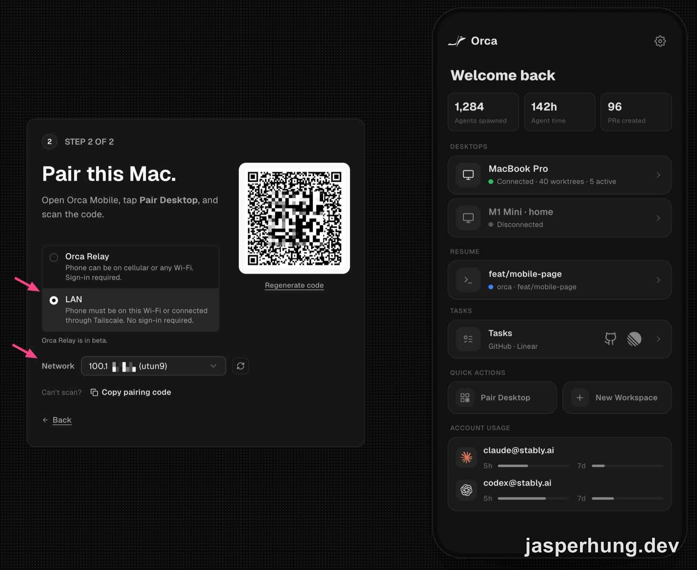

  圖：桌面先開啟 Set up Mobile，選擇 LAN 與 Tailscale
  網路，再由手機掃描已處理過的配對 QR code。

配對完成後，手機首頁會列出已連線的桌面、連線方式和最近使用的 workspace。從 **Resume** 或桌面卡片進入，就能接著找要處理的工作。

### 配對完成後的手機首頁

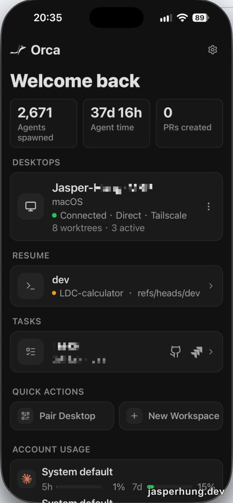

  圖：首頁顯示桌面透過 Tailscale 連線，並列出可接續的 workspace。

## 怎麼接回既有 Agent 對話

在首頁點 **Resume** 裡的 workspace，或先點已連線的桌面，再從 worktree 清單選專案。進入 workspace 後，點上方 tab 列裡要接續的 Agent session。清單可以同時看到不同 Agent 的工作位置；不用重新開一個 Agent 才能回到原本的對話。

### 從 worktree 清單進入對話

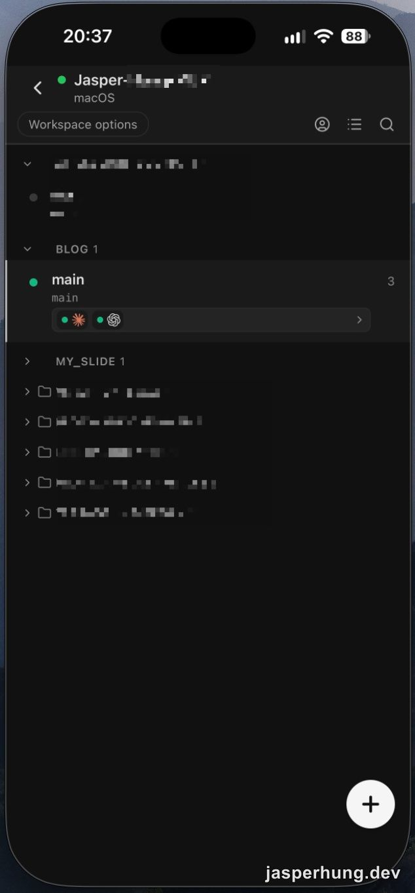

  圖：選擇 worktree 進入專案；上方 tab 列可切換該 workspace 的工作。

如果目前看到的是 Terminal，長按上方的 session tab，選 **Switch to chat view** 就能切回 Chat UI；Orca 官方的 [Mobile companion 文件](https://www.onorca.dev/docs/mobile#chat-ui)也列出這個切換方式。

### 用 message bubbles 閱讀和回覆

這不只是把 Terminal 畫面直接縮小搬到手機。Orca 官方把 Chat UI 分成 structured/native chat 和 terminal-backed Chat UI：支援的 Agent 會以 Orca 的結構化對話介面呈現 transcript 和輸入框；手機開啟的仍是配對桌面上的 session，不是另一個雲端 Agent。沒有 structured chat 實作的 Agent，以及 WSL 或 SSH session，則使用 terminal-backed Chat UI。官方文件說明了兩種呈現方式，但沒有公開 transcript 轉成前端訊息泡泡的底層 parser 或傳輸實作；可參考 [Chat UI 文件](https://www.onorca.dev/docs/agents/native-chat)。

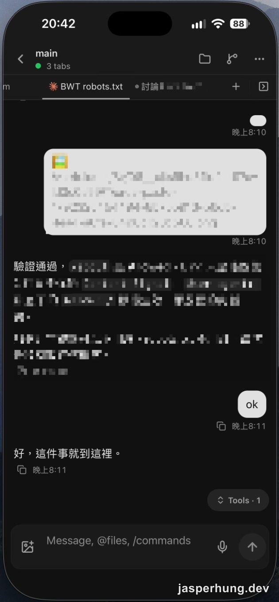

  圖：Orca Mobile 顯示既有 Agent session 的對話與輸入框。

如果要找更早的工作，打開 **Agent Session History**。頂端可以選 **Workspace**、**Project** 或 **All**，也能搜尋 session；清單裡會看到 Claude、Codex 等不同 Agent 的紀錄，點選要接續的那一筆，就能回到那段工作。

### 從 Agent Session History 找回舊 session

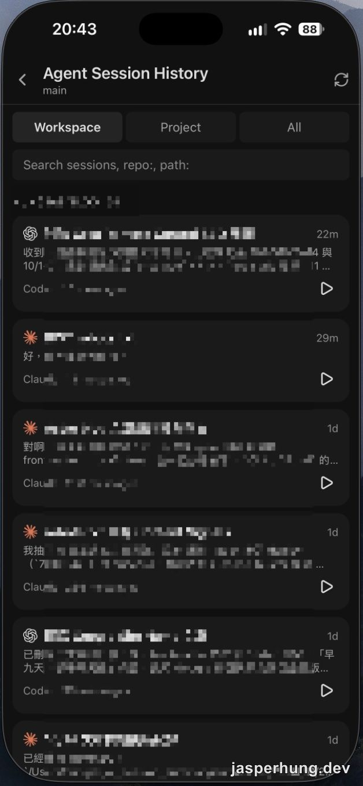

  圖：Agent Session History 可依 Workspace、Project 或 All 篩選，並列出不同
  Agent 的過往 session。

## 遠端也能開獨立 Terminal

在 workspace 上方 tab 列點 **+**，再從 **New Tab** 選 **Terminal**。它會以自己的 tab 開啟，可以直接輸入命令，不必先讓 Agent 替你執行。

### 在 New Tab 建立 Terminal

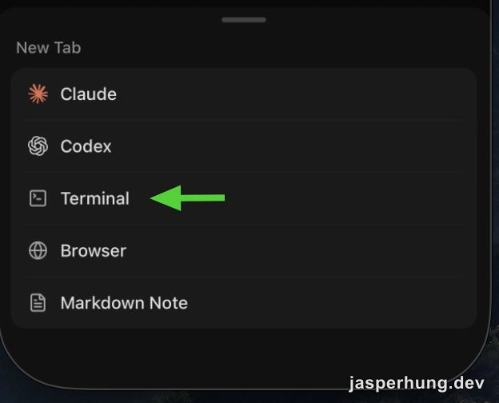

圖：點 tab 列的加號，從 New Tab 選單選 Terminal。

### 查看輸出並用快捷鍵操作 Terminal

Terminal tab 會顯示工作電腦上的命令輸出和錯誤訊息，也能直接輸入命令、操作 CLI。需要啟動 dev server 時，我會在獨立的 Terminal tab 執行 `pnpm dev`，讓它和 Agent session 分開管理。手機下方的快捷鍵列有 **Tab**、**Enter**、**Shift+Tab** 和 **Ctrl+C**；點 **Live input** 可以直接輸入，少切換手機鍵盤。Orca 官方的 [Mobile companion 文件](https://www.onorca.dev/docs/mobile)也列出這些手機 Terminal 操作。

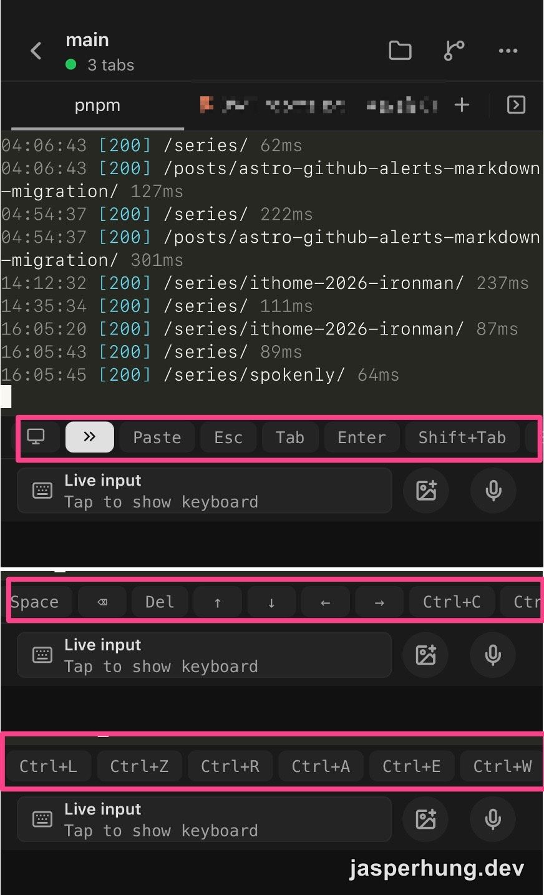

  圖：Terminal 顯示命令輸出；下方快捷鍵列和 Live input 可直接操作 CLI。

如果在 Agent session 裡以前景方式啟動 server，結束該 session 時程序可能一起停止；實際情況取決於啟動方式和 process 管理。需要讓預覽持續跑時，我會從獨立 Terminal tab 啟動，分開管理 server 和 Agent 對話。

### 殺手級應用

我用過的 Claude Code Remote Control 和 Codex Remote，主要是從手機接回 Agent session；Orca Mobile 配對的是桌面 Orca，除了切換或啟動 Agent，也能在同一個 workspace 另開 Terminal，操作工作電腦上已有的 CLI 和工具。對我來說，這就是接管 ADE 的差異：遠端回來的不只 Agent 對話，還有整個開發環境；實際能做什麼仍受電腦上的工具、登入狀態和權限限制。

我遇過一個很實際的情境：公司提供 Claude Team 帳號，但 IT 管理員在後台關掉 Claude Code Remote Control。Anthropic 的[官方文件](https://code.claude.com/docs/en/remote-control#requirements)也說，Team 和 Enterprise 組織需要由 Owner 開啟這項功能。Orca Mobile 連回桌面 ADE 後，Terminal 還是能操作那台電腦上已登入的 Claude CLI，讓我接著使用公司帳號額度。從使用效果看，這形同繞過 Claude Code Remote Control 的開關；但是否違反公司政策，要看 IT 原本限制的是哪一種遠端操作。我會先確認公司是否允許透過 Orca 遠端使用公司帳號，不能把這個入口默認當成政策授權。

參考：[Claude Code Remote Control 官方說明](https://code.claude.com/docs/en/remote-control)、[Codex Remote 官方介紹](https://developers.openai.com/blog/mastering-codex-remote-for-engineering)。

## 其他常用的手機入口

### Files

Orca Mobile 的畫面名稱是 **Files**。它會列出目前 workspace 的資料夾與檔案；點開資料夾就能沿著目錄瀏覽專案結構，快速找到要看的檔案。Orca 官方的 [Mobile companion 文件](https://www.onorca.dev/docs/mobile)也列出手機檔案瀏覽功能。

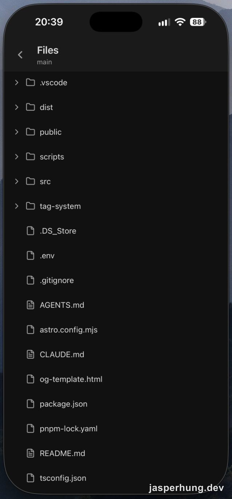

圖：Files 顯示 workspace 的資料夾與檔案。

### Source Control

**Source Control** 裡有 **Changes**、**Pull Request** 和 **Commits** 分頁。Changes 可檢查檔案差異、暫存或取消暫存；Pull Request 可查看或建立 PR；Commits 可瀏覽提交紀錄。整理好 staged files 後，也能從手機按 Commit。Orca 官方的 [Source Control 說明](https://www.onorca.dev/docs/mobile#source-control-on-mobile)列出手機檢查變更、stage / unstage 和 commit 的操作。

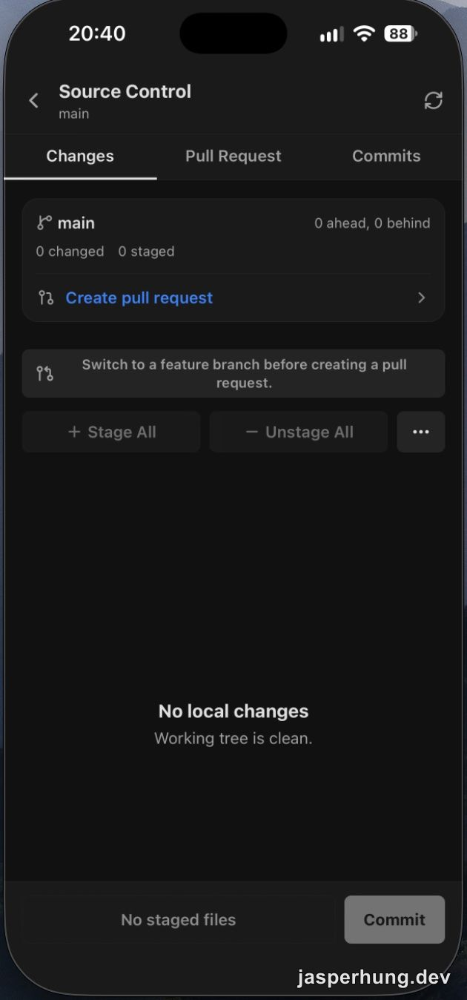

  圖：Source Control 提供 Changes、Pull Request 和 Commits 分頁。

### 用 New Browser 直接開 localhost

Orca Mobile 的 **New Browser** 可以直接開 `http://localhost:4321/`，查看配對電腦上的本機 dev server；網址保留 localhost 和 dev port 就能連，不必改用 Tailscale IP。這次我在 iPad 上實測成功；載入和操作比較卡，但臨時想確認頁面時很方便。

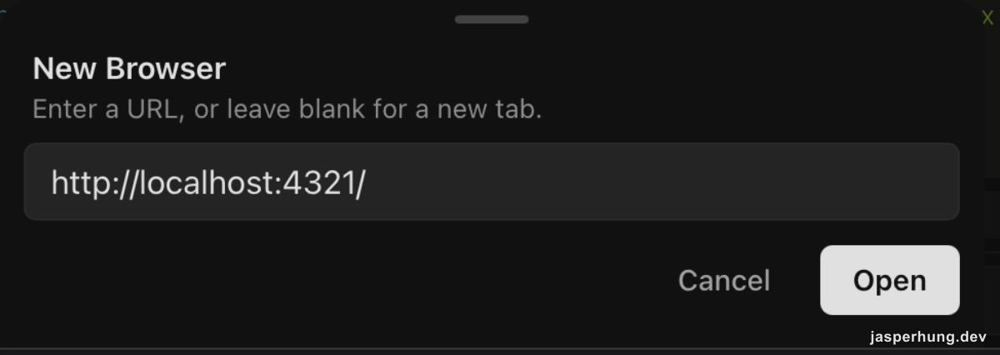

圖：在 New Browser 輸入 `http://localhost:4321/`，直接開啟配對電腦上的本機服務。

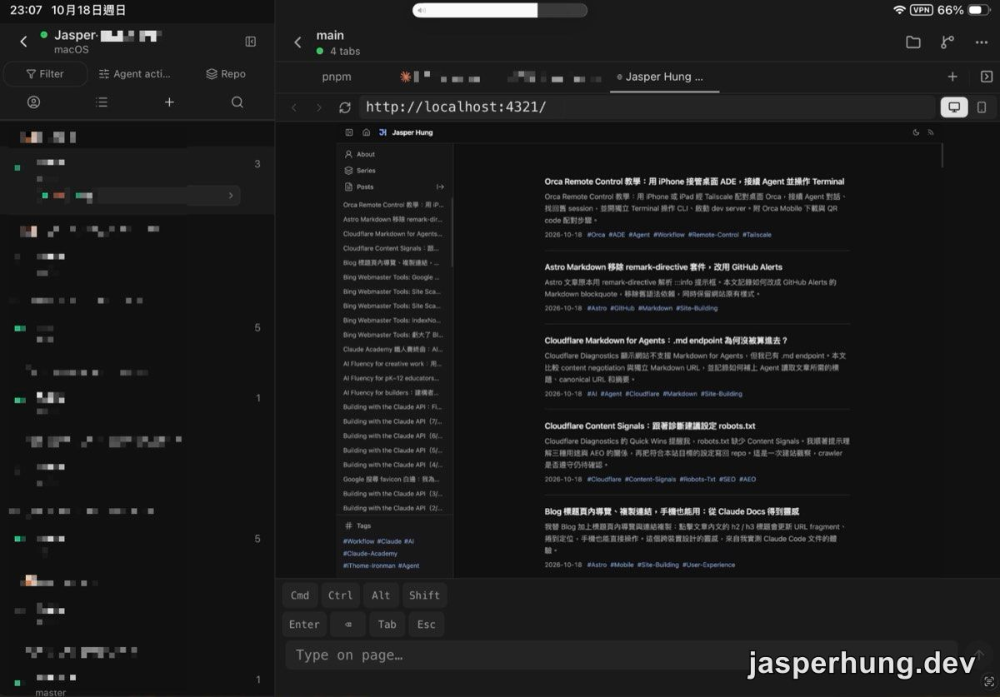

圖：Orca Mobile 在 iPad 上載入本機 Blog 預覽；網址使用 localhost。

## 回到工作電腦後，按 Restore 還原視窗

手機的 Browser session 結束後，回到工作電腦，Orca 會提示視窗仍維持手機尺寸。按 **Restore** 就能把目前視窗調回桌面尺寸；如果要一次還原全部視窗，按 **Restore all**。

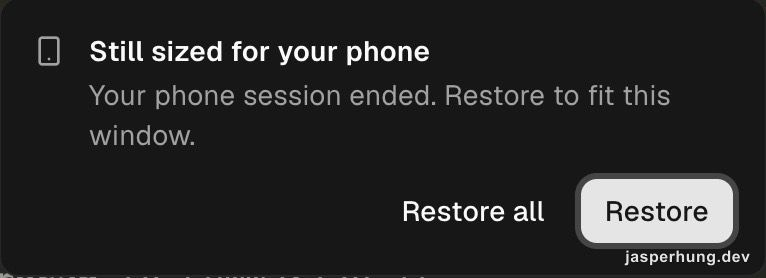

圖：手機 session 結束後，桌面 Orca 提示還原瀏覽器視窗尺寸。

## 目前體感最強的遠端控制軟體

Orca 讓我在零碎時間也能接著推進工作。午餐時間是最直接的例子：Agent 工作到中午，我就能先休息、出門買午餐。途中再用手機連回去看進度；如果有需要我回覆或做決定的地方，就能馬上接手。

逛街或通勤途中想到一個 library、方法，或臨時想整理幾份筆記，也可以連回桌面 Orca，請 Agent 先做小型測試或整理。OpenMemory、Obsidian 和專案資料都留在工作電腦上，討論時能沿用原本脈絡。

我也試過把資料、筆記整理成簡報或 Blog，再透過 Tailscale 從手機開本機 dev server 檢查版面。用 iPad 時，還能把 Orca Mobile 和預覽頁分割並排：左側跟 Agent 討論、請它修改，右側馬上查看畫面結果，再來回調整，整個開發過程都能在 iPad 上進行。

對我來說，Orca Mobile 最實用的是兩個入口：先回到正在進行的 Agent 對話，需要直接動手時再開 Terminal。工作電腦上的 workspace、工具和資料都能接著用，零碎時間也能拿來做小決定或補一段工作。
