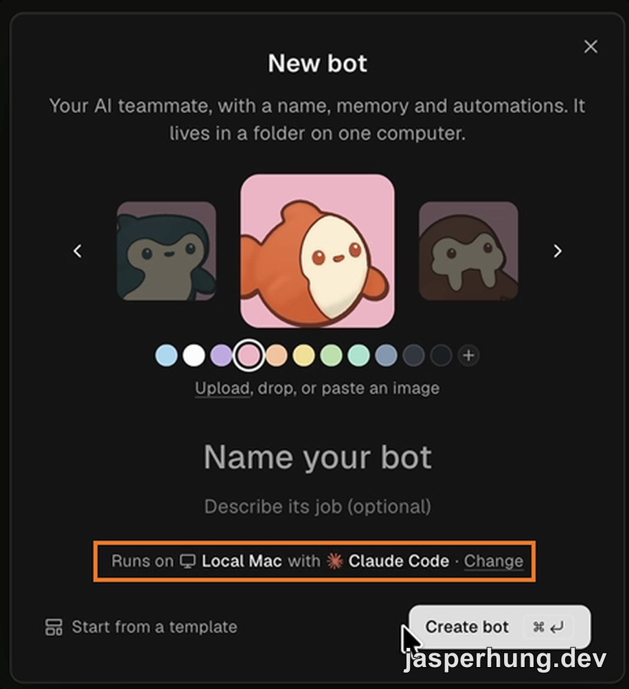
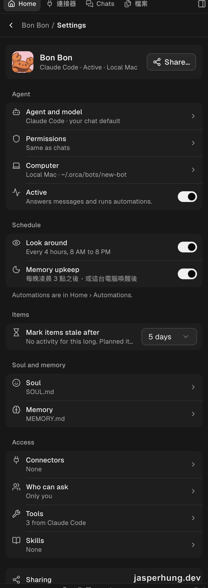

<KeyTakeaways>
  <p>Orca Bot 是什麼、跟自己開 Claude Code 差在哪？它就是 Claude Code 加上一個資料夾（SOUL.md 放人設、MEMORY.md 放記憶），跑在你自己的訂閱額度上；多出來的是會被排程或事件叫醒，以及會派 worker 到專案的 worktree 做事；這是我 2026 年 11 月建一隻 bot 實查的結果，派工流程是 bot 自己的說法，還沒實際看它派過工。</p>
</KeyTakeaways>

Orca 更新後，我看到多了一個 New bot 功能，就順手建了一隻。建立畫面上寫著「Your AI teammate, with a name, memory and automations. It lives in a folder on one computer.」，最下面還有一行小字：Runs on Local Mac with Claude Code。



<p class="image-caption">圖：建立 bot 的畫面，橘框那一行就是後面所有問題的答案。</p>

bot 建好之後，我第一句話不是交辦工作，而是問它：「你是 Claude？說說背後原理是什麼，現在是用哪個帳號額度？」

這篇照當時問的順序走：它是誰、它跟一個資料夾差在哪、它能不能掛上 Slack、Settings 能改什麼、它怎麼派工，最後是我對「各家 bot 差在哪」的看法。

## 你是 Claude 嗎？用哪個帳號的額度？

它沒有憑印象回答，先去查。`CLAUDE_CONFIG_DIR` 是空的，代表走預設的 `~/.claude`；接著讀 `~/.claude.json` 的 `oauthAccount`，帳號是我的個人帳號，`billingType` 是 `stripe_subscription`，也就是吃 Claude 的訂閱方案，不是 API key 計費。

它也看了自己的父 process，啟動參數長這樣：

```bash
~/.local/bin/claude \
  --input-format stream-json \
  --output-format stream-json \
  --setting-sources=user,project,local \
  --add-dir=...
```

據此它給了第一版原理說明：

1. **本體就是一般的 Claude Code CLI**。Orca 用 stream-json（一行一個 JSON 的雙向串流）跟它傳訊息，畫面上的對話框只是外殼。
2. **身份靠資料夾**。home 在 `~/.orca/bots/new-bot/`，`SOUL.md` 是人設、`MEMORY.md` 是記憶、`bot.json` 記 id、名字和用哪種 agent。
3. **能力靠 Orca 在 system prompt 裡教的 `orca` 指令**，例如 `orca bot reply`、`orca automations`、`orca orchestration worker-start`。
4. **我的全域設定照樣載入**。因為有 `--setting-sources=user,...`，`~/.claude/CLAUDE.md`、skills、MCP 都會跟著進來。

官網的說法一致。[orca.dev/bots](https://orca.dev/bots) 寫「It runs on the subscription you already pay for. No new model bill, no markup.」，[官方文件](https://orca.dev/docs/bots)也寫「It runs on your own Claude Code or Codex sign-in, or another supported agent.」。bot 沒有另外的帳單，它做的事都算在你原本的方案裡。

## 所以只是一個資料夾加一個 UI？

聽完我把理解壓成一句話去驗證：「所以等於 Orca 自創一個資料夾，SOUL.md 是人設、MEMORY.md 是長期記憶？……我本身也有長期記憶，所以對我來說沒差別，這等於是 Orca 自己做一個紀錄，UI 上多一個 bot 畫面？」

我會這樣問，是因為我本來就有一套跨對話的記憶系統（[OpenMemory](/posts/openmemory-local-setup/) 加 Obsidian），`MEMORY.md` 對我來說不是新東西。

home 資料夾裡的東西確實不多：

| 檔案 | 用途 |
|---|---|
| `SOUL.md` | 人設，可以自己改 |
| `MEMORY.md`、`memory/` | 記憶 |
| `bot.json` | id、名字、agent 種類 |
| `AGENTS.md`、`CLAUDE.md` | Orca 自動產生，手改會被覆蓋 |

最後一列是我自己試出來的。聊到一半，我故意把 bot 改名成 Bon Bon，想看這個改動會傳到哪裡：資料夾裡的 `AGENTS.md` 馬上被 Orca 重寫，手機上的 Orca 也立刻同步成新名字。資料夾名稱倒是沒變，還是 `new-bot`。這點官方也有對應的 [issue #45321「Rename a bot's home folder」](https://github.com/stablyai/orca/issues/45321)：home 資料夾在建立時就決定，Orca 用這個路徑追蹤 bot，手動改名不安全，目前還在提案階段。

至於「是不是只是多一個 UI」，Claude 當時同意記憶不是重點，但把差異重新定在兩件事：

- **會被事件叫醒**：Slack 被 @、CI 失敗、新 issue、排程，都能自動開一個對話去處理，再回報。
- **有對外身份**：在 Slack 上以 bot 的身份發言，別人也能直接找它。

如果平常都是自己開對話、手動派 agent，bot 多出來的就是「被動觸發」加上「對外身份」。這是當時的答案，下一個問題就把它修正了。

## Slack 真的能掛嗎？機制不一樣吧？

「事件會叫醒它」這句聽起來太順，我直接挑出來問：「現在你可以掛上 Slack？機制不同吧？」

這次它先跑 `orca bot connectors` 看實際狀態：

- Slack：as New bot，Not connected
- GitHub：`gh` 有登入，但身份是我本人；要被 @ 或監看，得另外用 `--offer github` 接
- Linear、Google：都沒登入
- 另外一行提示：Orca isn't connected to Orca Cloud

也就是說，前面講的「Slack 被 @ 就會叫醒它」，在我這台電腦上一個都還沒接。它把兩種 Slack 分開講：

| | 我在 claude.ai 接的 Slack MCP | Orca bot 的 Slack |
|---|---|---|
| 誰的身份 | 我本人授權給 Claude 的工具 | Orca 的 Slack app，以 bot 身份裝進 workspace |
| 什麼時候動 | 只有對話開著時，主動去讀寫 | 事件發生就叫醒它 |
| 事件怎麼進來 | 不會有東西因為新訊息被叫醒 | Slack → Orca Cloud → 本機 Orca → 開一個 Claude Code 處理 → 用 `orca bot reply` 回原 thread |

MCP（Model Context Protocol）是讓 AI 呼叫外部工具的標準介面；差別在於 MCP 是「AI 拿著你的鑰匙去開門」，bot 的 Slack 則是「門鈴響了會叫它」。

官方文件把界線寫得很清楚：

> To reach the bot from Slack, GitHub or Linear: sign in to Orca. Chat, schedules and Google work without it.

所以不登入 Orca，對話、排程和 Google 照樣能用；Slack、GitHub、Linear 才需要登入，事件經 Orca Cloud 轉到你的電腦，官網寫「nothing needs an open port」，不用自己開 port。Google 則是「connects from your computer straight to Google, not through Orca Cloud」，從本機直連。

不論哪一種，bot 都住在一台電腦上，那台電腦要開著、連得上網，它才接得到事件；文件提到電腦睡著時，請求最多會等一天。

> [!NOTE]
> ### 這段的修正
> 前一段「事件會叫醒它」不是錯，但講得像現成功能。實際上每一種外部事件都要先接上對應的 connector；追問「機制不同吧」之後，它才去跑指令看實際狀態。

## 打開 Settings：能改什麼、什麼時候會自己醒

理解原理之後，我回頭去看 bot 的 Settings 畫面，前面講的每一層在這裡都有對應的欄位。



<p class="image-caption">圖：Bon Bon 的 Settings，Schedule 區塊的兩個排程預設就是開的。</p>

能改的有三類：

- **廠牌和模型**：Agent and model 預設跟著我的對話預設，寫著 Claude Code；可以換成 Codex 或其他支援的 agent。
- **靈魂和記憶**：Soul 對應 `SOUL.md`、Memory 對應 `MEMORY.md`，就是 home 資料夾裡那兩個檔。
- **工具**：Tools 寫著「3 from Claude Code」，我本地原本設定的 MCP 直接接上，不用重設。Connectors 寫著 None，跟前面 `orca bot connectors` 的結果一致。

比較意外的是 Schedule 區塊：**什麼都不設定，它也會自己醒**。

- **Look around**：Every 4 hours, 8 AM to 8 PM
- **Memory upkeep**：每晚凌晨 3 點之後，或這台電腦喚醒後
- **Active**：Answers messages and runs automations，關掉就不回訊息、不跑排程

Look around 醒來具體看什麼、做什麼，官方文件沒寫，我也還沒看到它跑過一次，這部分先留白。

想讓它在其他時間醒，可以自己加 automation（自動化排程）。依 `orca automations create --help`，大概長這樣：

```bash
orca automations create --bot "Bon Bon" --name 早上待辦 \
  --trigger weekdays --time 09:00 \
  --prompt "整理昨天沒做完的待辦"
```

`--trigger` 接受 hourly、daily、weekdays、weekly，或 cron、RRULE。事件型的觸發改用 `--on`，例如 Gmail 新信（`gmail.new_email`）、會議快開始（`calendar.starting_soon`），前提是先在 Connectors 打開 Google。排程和事件不能寫在同一個 automation 裡，兩種都要就建兩個。這些是照 help 整理的，我還沒實際建過。

## 它怎麼派工？

官網對 bot 的定位是住在 agent IDE 裡、會被事件叫醒的助手：自己少寫 code，主要派 Claude Code 或 Codex 的 worker 到各自的 git worktree 去做，做完回報到原本發問的地方。git worktree 是同一個 repo 另開一個工作目錄，有自己的分支，幾個 worker 同時做事不會互相踩到。

我請 Bon Bon 自己說明它怎麼派工，它的流程是：

1. **先看有哪些專案**：跑 `orca repo list`，只從 Orca 登記的專案清單裡挑，不會去翻我的資料夾。
2. **從我的話對到專案**：例如我說「blog 的 OG 圖壞了」，它就對到 blog；對不到或有好幾個都像，就問我一句「是哪個專案？」，不自己猜。
3. **確認沒有人在做**：跑 `orca worktree ps`，那個專案已經有進行中的 workspace 或 worker，就把訊息傳過去，不重複開。
4. **開 worker**：

   ```bash
   orca orchestration worker-start --repo blog --worktree new-child --agent claude --spec "..."
   ```

   在那個專案下開一個新的 worktree，裡面起一個 Claude Code。要做什麼寫在 `--spec`：目標、完成條件、要不要開 PR。

它特別強調一點：**派工前它不看專案的檔案，連 `ls` 都不跑**。讀 code、判斷要改哪裡，全部交給 worker 在它自己的 worktree 裡做；worker 是在專案裡啟動的，會照常讀到那個專案的 `CLAUDE.md`、`AGENTS.md` 和我的全域設定。做完後 worker 回報給它，需要我決定的事，它會用按鈕問我。

這是 Bon Bon 對自己的描述，我還沒看它實際派過一次工。派工本身倒不是新能力：Orca CLI 本來就能從一個 agent 派工給另一個（見〈[Orca CLI：跨 LLM 派工，Agent 協作更順手](/posts/orca-cli-agent-launch/)〉），bot 是把這件事包成它的預設工作方式。

## 各家 bot 都是同一副骨架

問到這裡，我把問題拉高一層：「其實不是在說 Orca bot，而是各家公司的 bot 對我來說功能都一樣，只是 Orca 搭上這風潮，把本來就能做的事情做出來了，很讚。」

Claude 同意，把「bot」拆成四個零件：

```
bot = agent loop + 持久身份(SOUL/MEMORY) + 觸發(event/cron) + 對外通道(Slack app…)
                    └─ 這三層是「接線」，各家差異只在這裡
```

- **agent loop**：模型加上工具呼叫。自己開一個 Claude Code 對話就有。
- **持久身份**：人設檔加記憶檔，讓每次叫醒它都是同一個「它」。
- **觸發**：事件或排程把它叫醒。
- **對外通道**：在 Slack 之類的平台上有自己的身份，別人能直接找它。

模型能做的事，自己開對話一樣做得到；各家差的是接線：OAuth 授權、事件中繼、批准的 UI、手機通知。這些是工程上的瑣事，不是智慧。

Orca 做得好的地方，是把接線疊在你**已經在用的東西**上：自己的 Claude Code 訂閱、`~/.claude` 的設定和 skills、本機的 worktree。不是另起一個雲端 agent 要你搬家，所以轉換成本幾乎是零。它甚至有 `orca bot import sources`，會列出這台電腦上 OpenClaw、Hermes、OpenBot 這類 bot app 存的 bot，方便搬過來。

有趣的是，同一天官方 repo 也開了 [issue #45229「Explain Orca Bots through use cases and onboarding」](https://github.com/stablyai/orca/issues/45229)，好幾位使用者在問同一題：bot 跟一般 coding agent 到底差在哪。官方也承認這部分需要補說明。

## 心得

拆完之後，Bon Bon 我先放著。我對 bot 的用處還沒有很深刻的體會，它能做到的事，大概都跟我原本的做法一樣。

原因是那四個零件我手上大多已經有了：Orca 本來就能調度本地的 LLM 派工，本來就有[手機版](/posts/orca-ade-remote-control/)，我本來就有跨對話的記憶系統。對我來說，bot 不是必要的東西。Orca 應該也知道這些本來就做得到，所以在 UI 上切一塊出來就好：同樣的功能，不同的包裝。

但我覺得這個包裝本身有價值。對還沒有這些零件的人，Orca 直接內建做好，不用另外去裝 OpenBot 之類的東西，額度也是自己原本的訂閱。
