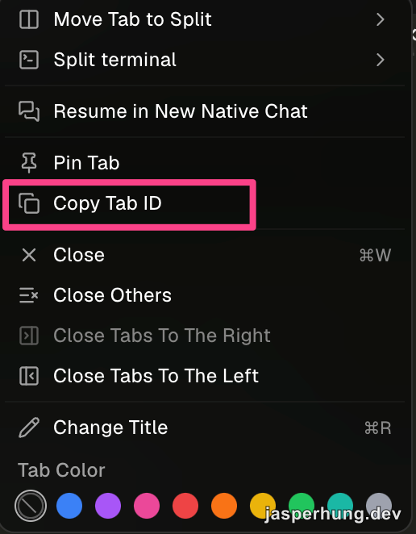
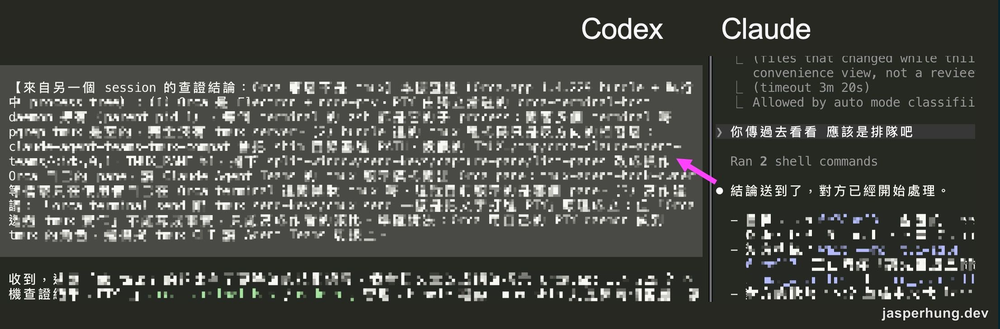

<KeyTakeaways>
  <p>Orca CLI 能從 Claude 啟動 Codex，再把訊息傳到指定 tab；Claude 原生的傳訊和 Agent Teams 只在 Claude Code 之間。拆解後發現 Orca 跟我用 cmux 做的原理差不多，都是送 terminal 輸入，只是包得更好用；要追蹤任務與回報，再用 experimental 的 Orchestration。</p>
</KeyTakeaways>

之前我用 cmux 做過一套召喚 Agent 的流程：〈[用 cmux CLI 召喚一個有明確職責的 AI](/posts/summon-agent-skill/)〉寫的是 `summon-agent`，〈[把輪詢式 Skill 拆成 summon script](/posts/summon-agent-script/)〉整理了怎麼把 cmux 指令抽出來。Codex 召喚得出來，但傳訊息給它一直有問題；我後來沒有再深究，開發改用 sub-agent。

{/* TODO：補一兩句 cmux 當時傳訊給 Codex 具體出了什麼問題（文字卡在輸入框？Enter 沒送出？） */}

我還是希望開發流程裡有其他 LLM 介入，當驗證的斷點或討論的交叉點。先整理現有的官方做法，再用 Orca CLI 實測。

## Claude 官方有哪些溝通方式？

Claude Code 自己有兩種傳訊方式，但都只在 Claude Code session 之間。

### 跨 session 傳訊

[跨 session 傳訊](https://code.claude.com/docs/en/cross-session-messaging)讓 Claude 把進度摘要或指令傳給本機另一個 Claude Code session，不用我切視窗重講一次。macOS、Linux 和 WSL 2 要 v2.1.224 以上，原生 Windows 要 v2.1.234 以上，符合版本就預設開啟。`/list-agents`（也可以打 `/peers`）會列出能傳的 session，先用 `/rename` 替它們命名比較好認。

### Agent Teams

[Agent Teams](https://code.claude.com/docs/en/agent-teams) 由一個 lead 協調多位 teammates。每位 teammate 是獨立的 Claude Code session，有自己的 context window，大家共用 task list，透過 mailbox 直接互傳訊息。這項功能目前是 experimental，要設 `CLAUDE_CODE_EXPERIMENTAL_AGENT_TEAMS=1` 才會開。

### OpenAI 官方的 Codex 整合：codex-plugin-cc

要讓 Claude 叫 Codex，另一條路是 OpenAI 官方的 [codex-plugin-cc](https://github.com/openai/codex-plugin-cc)。裝好之後，可以在 Claude Code 裡用 `/codex:review` 請 Codex review，或用 `/codex:rescue` 把工作派給它；它用本機的 Codex CLI 和登入狀態，底層包的是 Codex app-server。

這幾種方式解決的問題不一樣：Claude 原生傳訊只在 Claude Code session 之間；codex-plugin-cc 能跨到 Codex，但由 Claude 端發起。我想要的是像 summon-agent 那樣，每個 LLM 有自己的工作現場，我能指定正在運作的 tab，也能隨時切進去接手。接下來用 Orca CLI 實測這種流程。[Orca](https://www.onorca.dev/docs/cli/overview) 是一個 agent development environment（ADE），它的 `orca` CLI 能從任何 shell 操作正在執行的 Orca，包括開 Agent terminal、讀取畫面和傳訊。

## Orca 實測：召喚 Codex、指定 tab 傳訊

我在 Claude Code 裡用 `orca agent launch` 啟動 Codex，再用 `terminal wait/read/send` 等待、讀取並繼續傳訊：

```sh
orca agent launch --agent codex --prompt "只回覆：收到，我是 Codex" --json
orca terminal wait --for tui-idle --timeout-ms 90000
orca terminal read
orca terminal send --text "請回覆第二則測試" --enter --wait-submit 10
```

`orca agent launch --help` 說明，Agent 會照新 tab 的設定開成 native chat 或 terminal；我的設定開出來是 terminal tab。這幾行我跑得通，但沒帶 `--terminal` 時，`wait/read/send` 打的是目前 worktree 的 active terminal，而 `agent launch` 預設不會切 focus。要穩定指到某個 Codex，還是得指名。

### Copy Tab ID

要把訊息送到一個已經開著的 Codex tab，先在 tab 上按右鍵選 Copy Tab ID，再把 tab ID 貼給 Claude，請它傳給這個 tab。[Orca 文件](https://www.onorca.dev/docs/model/tabs-panes-splits)說這是指向特定 tab 的穩定參照，用途就是讓 Agent 指到那個 tab。



<p class="image-caption">複製 tab ID，先確認要送訊息的 terminal tab。</p>

但 `terminal send --terminal` 收的是 runtime-scoped terminal handle，所以 Agent 要先在 `orca terminal list --json` 裡找出 `tabId` 相符的那一筆，取它的 `handle` 再送。複製出來的內容像 `orcaTabId: abc123`，比對時只用冒號後面的 ID：

```sh
handle=$(orca terminal list --json \
  | jq -r '.result.terminals[] | select(.tabId=="<複製的 tab ID>") | .handle')

orca terminal send --terminal "$handle" \
  --text '請處理這段訊息' --enter --wait-submit 10 --json
```

send 的回報會把輸入已接受、觀察到提交、Agent 開始處理分開列出；加上 `--wait-submit`，Orca 才會在指定秒數內等著觀察提交。



<p class="image-caption">這次的成功測試：Orca 回報訊息已送出，並觀察到 Codex 開始處理。左側文字已模糊，僅示意訊息傳遞過程。</p>

## 拆解：Orca 送的是鍵盤輸入，不是訊息通道

我查了本機 Orca.app 1.4.229 的 bundle 和 process tree：terminal 的 PTY 由常駐的 `orca-terminal-host` daemon 透過 `node-pty` 管理，沒有 tmux server。bundle 裡另有一層給 Agent Teams 用的 tmux 相容層，設定假的 `TMUX`、`TMUX_PANE`，把 Agent Teams 發出的 `split-window`、`send-keys`、`capture-pane`、`list-panes` 轉成 Orca pane 操作。Agent Teams 的 split pane 官方只支援 tmux 或 iTerm2，這層相容讓它也能開在 Orca pane 裡。

Codex TUI 自己還有一層輸入／提交狀態：PTY 注入模擬的是鍵盤輸入，文字可能先進入 TUI 的 composer，是否成為已提交的新 turn，要看當下的輸入狀態和送出的按鍵。所以「文字寫進 terminal」不等於「Codex 已收到一個新 turn」；文字可能只留在 draft，也可能和人正在輸入的內容互相干擾。[Codex 官方 repo 的一項開放 feature request](https://github.com/openai/codex/issues/15355)描述的就是這些風險。Codex 另有 [app-server 的 thread／turn API](https://learn.chatgpt.com/docs/app-server) 能結構化地開始 turn，codex-plugin-cc 走的就是這條路；那項 feature request 要的，是替已經開著的互動 session 也補上正式的輸入入口。

這也跟我原本 `send-agent` skill 的做法相似：先查出 cmux 的 surface ID，再呼叫共用 script，依序執行 `cmux send` 和 `cmux send-key Enter`。它像是遠端替目標 terminal 打字並按下 Enter，能把工作交給另一個 Agent，但沒有 sender、delivery receipt 和對話 turn ID；Orca 的 `terminal send` 原理相同。

Orca 另有 [Orchestration](https://www.onorca.dev/docs/cli/orchestration)，包含 Run、task、dispatch、worker 和 mailbox，worker 的提問和回報走明確流程，不必從 TUI 畫面猜狀態。這部分目前仍標示為 experimental；如果只是要對正在看的 Agent 發一個簡短 prompt，`terminal send` 就夠了。

## 心得

拆完之後，我發現 Orca 跟我用 cmux 做的事原理差不多，都是把文字送進另一個 terminal，只是用的套件不同。這至少說明之前那些 skill 和流程的方向是對的；現在不用自己維護那一層，直接用人家包好、更好用的 CLI。

如果你只用 Claude，跨 session 傳訊和 Agent Teams 就夠了。要讓 Codex 這類其他 LLM 進到開發流程裡當驗證斷點，我推薦 Orca CLI。
