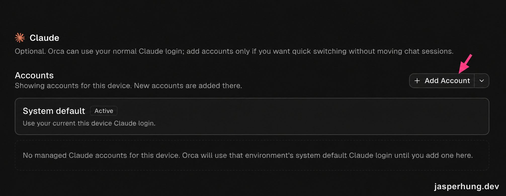
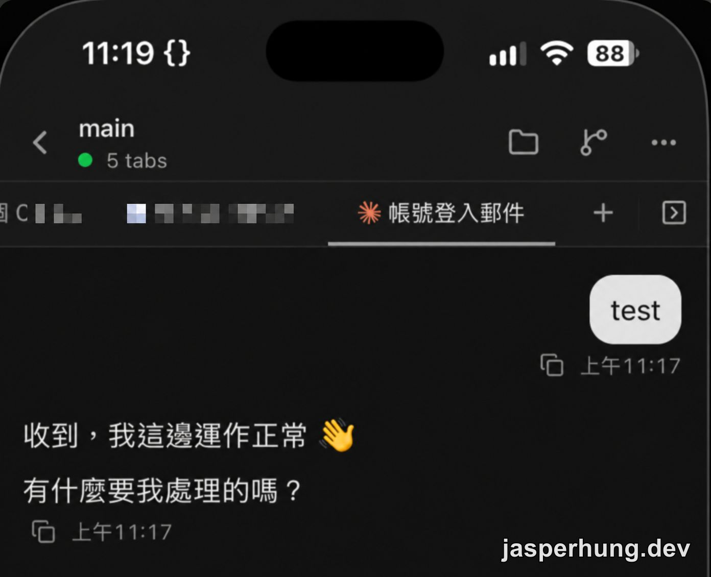
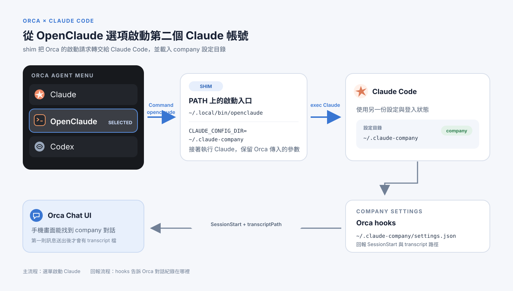

<KeyTakeaways>
  <p>Orca 支援管理多個 Claude 帳號，但啟動 agent 時不能從下拉選單指定帳號；我用閒置的 OpenClaude slot 和 shim 將它導向 <code>~/.claude-company</code>，再補上 hooks 讓手機 Chat UI 找到對話。這是 Orca 1.4.229 的本機實測。</p>
</KeyTakeaways>

我想在手機上用 Orca 啟動 company 帳號的 Claude。桌機上，自訂快速命令已經能叫出 `claude-company`；但它實際上仍是往 terminal 送一行指令，手機遠端操作就不那麼順手。Orca 的手機接管方式我另寫在[這篇操作紀錄](/posts/orca-ade-remote-control/)；這次想解決的是能不能把閒置的 LLM slot 接到 `claude-company`，直接從 Orca 開？

## Orca 支援多個 Claude 帳號，為什麼啟動 agent 還要先切設定？

我先確認 Orca 1.4.229 的帳號管理方式。`orca account add --agent claude` 可以登入並登記 Claude 帳號，但 `orca account select` 不支援切換 Claude；Claude 帳號要到 Settings 裡切換。也就是說，Orca 能管理多個帳號，卻不能在啟動 agent 的下拉選單裡指定這次要用哪一個。若想從手機快速開 company 帳號，手動切設定不是我想要的操作。



<p class="image-caption">圖：Orca 的 Claude 帳號管理區可以新增帳號；這次實測的重點，是啟動 agent 時仍沒有帳號下拉選單。</p>

## 閒置的 OpenClaude slot 能不能直接改 Command？

我檢查 Orca 的設定，看到每個 agent 有 Command 和 Environment 之類的啟動設定。最初以為只要把 OpenClaude 的 Command 指向 Claude，再把 `CLAUDE_CONFIG_DIR` 指向 company 設定目錄就行。這是當時的答案；接著我在 UI 裡找欄位，卻只看到 OpenClaude 的啟用開關和安裝連結。

再查 Orca 的偵測方式才知道，它要先在 PATH 找到名為 `openclaude` 的執行檔，才會顯示 Command override。那個箭頭只是連到安裝頁，啟用開關也不會替我安裝程式。原本的 `claude-company` 是 shell alias，Orca 啟動 agent 時不走互動式 shell，讀不到它；所以我把同名 shim 放在 PATH 上的 `~/.local/bin/openclaude`，由它直接執行 Claude：

```sh
#!/bin/sh
CLAUDE_CONFIG_DIR="$HOME/.claude-company" exec "$HOME/.local/bin/claude" "$@"
```

`"$@"` 會把 Orca 傳來的參數原樣交給 Claude。加上執行權限、在 Orca 按 Refresh 後，OpenClaude 出現在設定裡，桌機也確認能用 company 帳號啟動。選單名稱則寫在 Orca app 裡，沒有使用者設定可以改；我沒有去改 app，避免更新後被覆蓋。

## 桌機能啟動，手機 Chat UI 為什麼找不到對話？

桌機啟動成功後，我改用手機測試，畫面卻顯示「Can't find this conversation yet」。我先追 Orca 怎麼找 Claude 的對話紀錄：Claude 是在 shim 裡收到 `CLAUDE_CONFIG_DIR`，Orca 本身看不到這個設定，所以它仍去預設的 `~/.claude/projects` 找 transcript；Claude 寫入的路徑卻在 `~/.claude-company/projects`。另外，`~/.claude-company/settings.json` 還沒有 Orca hooks，Orca 收不到 `SessionStart` 等事件。

我原本想在 Environment 欄位補上變數，但本機的 OpenClaude 根本沒有這個欄位。檢查 UI 後才知道，Environment 只有在 agent 有預設值、已存過 override，或連上遠端 host 時才會顯示；本機介面沒有新增入口。剩下兩個方向：在 company 帳號設定裡補 hooks，或直接修改 Orca 自己的設定資料，加入 `agentDefaultEnv.openclaude`。後者看起來能讓 Orca 找對路徑，但會動到 Orca 的資料；我決定先試只改 Claude 設定檔的 hooks。

## 為什麼補 hooks 最後變成一支合併腳本？

我比對另一份 Claude 設定裡的 Orca hooks，發現 company 設定缺少 `SessionStart` 等事件。直接合併設定時，auto mode 擋下了對 Claude 設定檔的修改，我便改成寫一支可重跑的合併腳本：先備份，只加入 Orca hooks，保留原有的其他 hooks 和 statusLine，再由我自己執行。

腳本加進 13 個 Orca hook 事件後，`SessionStart` 開始回報正確的 transcript 路徑。這確認 hook 已經接通，但新對話仍然顯示空白；當時我還不知道是另一個原因。

## hook 已經收到事件，為什麼畫面還是空白？

我查看 Orca 的狀態紀錄，看到 `SessionStart` 已抵達，指向的 jsonl 路徑也正確；只是檔案當時還不存在。Claude Code 會等第一則訊息送出後才建立 transcript。送出測試訊息後，手機 Chat UI 就能顯示對話。加 hook 前開著的舊 tab 沒有回報 `SessionStart`，關掉再開即可。



<p class="image-caption">圖：送出第一則訊息後，Orca 手機 Chat UI 顯示 Claude 回覆。</p>

我接著問自己：個人帳號是不是也一樣？我一開始把「第一則訊息前沒有 transcript」當成推論；回頭對照 Orca 的狀態紀錄，才找到個人帳號也有 `SessionStart` 已到、jsonl 尚未建立的 session。這才確認延遲建立跟 company 帳號無關。平常開了對話就馬上輸入，空白畫面通常一閃而過；這次剛好和缺少 hooks 疊在一起，才像是整個 Chat UI 壞掉。

## 要不要安裝真的 OpenClaude？

我也確認了最後一個岔路：安裝真的 OpenClaude 會不會比較省事？不會。它會和 shim 使用同一個命令名稱，PATH 順序會決定 Orca 跑哪一個；真的 OpenClaude 也使用自己的 `~/.openclaude` 設定，Orca 自動放進那裡的 hooks 不會替 `~/.claude-company` 補設定。它能不能用 company 訂閱登入，我沒有驗證，所以最後保留 shim。

現在的路徑是 Orca 選單啟動 `openclaude` shim，shim 設定 `CLAUDE_CONFIG_DIR` 後執行 Claude，company 設定中的 hooks 再把 session 和 transcript 路徑回報給 Orca。hook 合併腳本留在 `~/.claude/scripts/merge_orca_hooks.py`；Orca 更新後若 Chat UI 或通知異常，可以再跑一次。我也把設定原因與重跑方式記進自己的帳號筆記。Orca 若改了 hook 指令文字，舊 hook 可能不會自動移除；`--prefill` 和 managed account 路線則還沒實測。



<p class="image-caption">圖：OpenClaude slot 透過 shim 啟動讀取 company 設定的 Claude Code；hooks 再回報 session 與 transcript 路徑。</p>

我本來只想少在手機 terminal 裡打一行指令，最後查的是 agent 啟動和對話追蹤兩條路徑。以 Orca 1.4.229 這次實測來說，留一個閒置 slot 給 `claude-company` 確實可行，但 shim 和 hooks 都得自己維護。對我目前的使用方式，這比每次從手機切進 terminal 方便一些。
