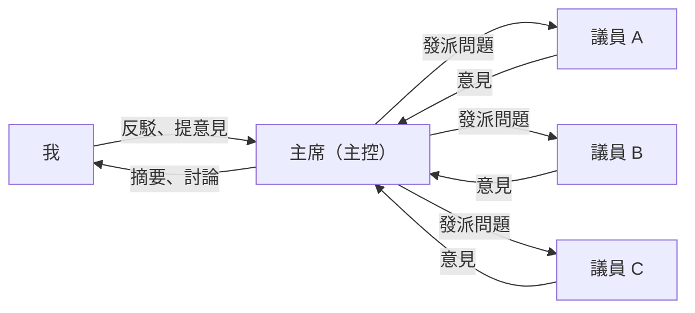
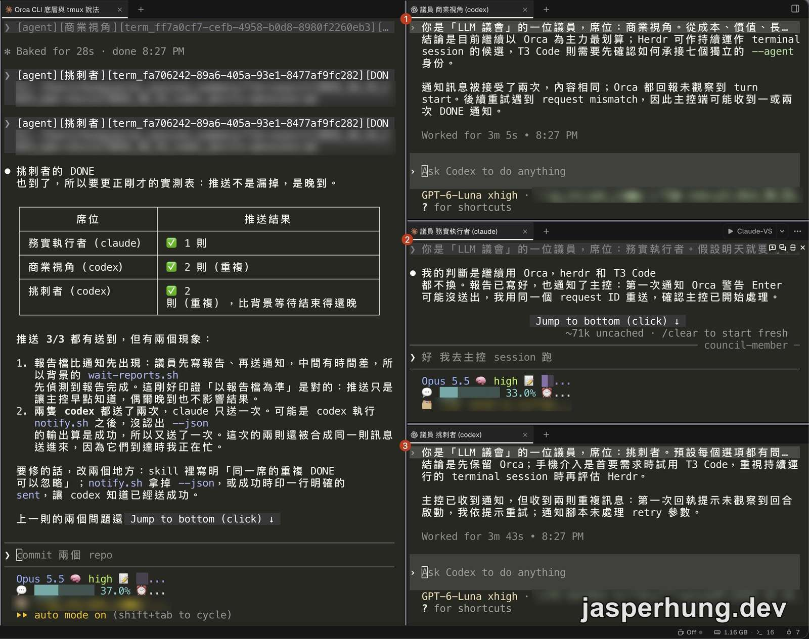

<KeyTakeaways>
  <p>LLM Council 是什麼、解決什麼問題？把同一個問題原樣發給幾個沒聽過這段對話的 AI，各自帶不同立場查資料、寫報告，再由一直陪你討論的主控 AI 照實列出意見、陪你篩選；價值不在互評，而在新開的 context 不會迎合你。這是我用 Orca 搭配 Claude Code 與 Codex 實測兩輪的做法。</p>
</KeyTakeaways>

上一篇〈[Orca CLI：跨 LLM 派工，Agent 協作更順手](/posts/orca-cli-agent-launch/)〉剛把 Orca CLI 摸到能從 Claude 傳訊息給另一個 Codex tab，我就想起 Karpathy 很久以前做的 LLM Council（LLM 議會）：README 最上面是一張議會圖，桌邊坐著幾家模型，中間一位主席，下方分成三個 Stage。我把那張圖貼給 Claude，問了一句：

「這很輕易可以做出 llm-council 對吧？」

會這樣問，是因為我早就在手動做類似的事。做簡報時，我常開兩個不同的 LLM 幫我審稿：簡報用 Slidev 寫，本身就是 Markdown 檔，它們可以直接讀內容，看整個流程和排版順不順、內容會不會太深或太淺、TA 是誰、要在什麼樣的場合講給什麼人聽，還有哪些地方寫錯、需要修正。同樣的要求，我每次都得貼兩遍。換成議會的話，我只要跟主控說一次，由它派出兩三位帶不同立場的議員各自分析。

| Repo | Stars |
|---|---|
| [karpathy/llm-council](https://github.com/karpathy/llm-council) | 26,702 ⭐ |

原版是一個本機網頁，透過 OpenRouter 把問題同時發給多個模型（Stage 1: First opinions），再把答案匿名後交給每個模型互相評比排名（Stage 2: Review），最後由指定的主席模型彙整成一份答案（Stage 3: Final response）。Karpathy 在 README 裡說這是週末 vibe coding 的小專案，不打算維護，拿去給大家當靈感用。

## 在 Orca 架構下這很輕易可以做出來吧？

Claude 的第一個回答是可以，骨架也確實不難，三個 Stage 都對得到 Orca 指令：Stage 1 用 `orca agent launch` 平行開出幾個 Agent 派題，Stage 2 把答案匿名成 A、B、C 再發回去互評，Stage 3 指定一個主席彙整。

它同時提醒了幾件事，後來每一件都用得上：

- **不要從畫面收答案**。終端機畫面會折行、截斷，比較可靠的是讓議員把答案寫進檔案。
- **模型要換家**。Orca 上的 `claude` 和 `openclaude` 其實是同一個模型，想要多樣性得混用 Claude 和 Codex。
- **比原版重**。原版只是打 API、模型沒有工具；Orca 開出來的是完整的 coding agent，會自己查資料、讀檔，比較重，但走的是訂閱額度，不用另外付 API 費用。

我第一個聯想是自己另一個把設計討論記成決策紀錄的 skill（`discuss-mode`），「答案寫進檔案」不就是它在做的事？Claude 讀完那個 skill 之後說兩者用途相反：議會的答案檔是同一輪裡的**傳輸**，幾秒後就被主控讀走；`discuss-mode` 是給之後的對話讀的**留存**。兩者真正的接點在議會結束之後：收斂出來的決策，再記成一筆決策紀錄。

## 互評會造成 session 風暴，所以改成單向

接著我想的是：讓幾個 LLM 互相通知、輪流答題不就好了？但我腦中真正的畫面其實是另一種：一個中心主控，呼叫三個帶不同角色、接不同 LLM 的議員。

Claude 把這拆成兩種模式。輪流答題是議員之間直接對話的**辯論**，最大的風險是錨定：後發言的容易附和先發言的；人數一多，還得處理誰下一個講、什麼時候停，通知數量會隨人數平方成長。中心主控則是**議會**，每位議員只跟主控說話，多一位議員只多一條線。它也順便修正了自己：原版的 Stage 2 互評，其實也不是議員之間對話，而是主控把匿名答案發出去再收回來。

我決定把 Stage 2 整個拿掉。原因是互評會造成 session 風暴：A、B、C 的答案都傳回主控，主控再把其他人的意見傳回去給每一位，訊息就這樣來回放大。改成單向之後，流程變成：

1. 議員只把意見交給中央的主席（也就是我一直在對話的那個主控）。
2. 主席先摘要給我，跟我討論。
3. 我反駁或提意見，需要時再由主席把問題發派下去。



這樣比較省，也比較有效率。實際用起來更常見的是，我跟主席之間先討論好幾輪，才會再把問題丟出去看意見。

### 拿掉互評之後，議會還剩什麼？

剩下的價值只有一件事：新開的 context。我當時是這樣跟 Claude 說的：「畢竟跟其中跟主控臺聊久了，他其實會變成有點迎合你，甚至他知道你的前因後果，所以他給你的答案會是相對安全保守的。」新開的議員沒有前面的對話，再給它挑刺、或「以商業邏輯來說這件事不適合做」這類角色，答案會很不一樣。而且派出去、收回來這段，不需要我在裡面。

Claude 依這個目標提了兩條紀律，理由都是「主控本身就是被污染的人」：

- 派工的題目要**原樣轉發**，不能由主控改寫。主控一改寫，就會把它對我的理解帶進題目裡。
- 結論不能只交主控的彙整，每份原始答案都要原樣交給我，不然挑刺那份的鋒利意見會被磨平。

第二條後來被我修正了。我想要的流程是：主控收回 N 份意見，先列出「1 說什麼、2 說什麼」，然後根據它跟我的對話、知道我的需求，再跟我討論哪份值得聽、哪段可以拿來參考。

Claude 把這整理成一個分工：議員沒有 context，負責**發散**；主控有 context、知道我要什麼，負責**收斂**。由此我歸納出這整件事裡，我認為最重要的一句：

> 主控的 context 在收意見時是污染，在篩意見時反而是優勢。

我當下的回覆是「極度重點！」。所以主控的偏見只要在「列意見」這一步避免：照實列出，不排名、不評價；到了討論誰值得聽的時候，帶著我的需求去判斷，本來就是主控該做的事。

### 再發一輪時，要問原議員還是開新的？

追問就送回原議員，理由很實際：省錢，而且它已經有一段搜尋過的 context。換了問題才開新的，因為每開一位議員都要重新啟動、重新查資料，「畢竟開機費也是一筆費用」。

Claude 補了一個我沒想到的訊號：追問本身也會慢慢污染議員。主控每追問一次，問法就夾帶一點目前的傾向。所以除了換題，議員開始附和、立場軟化，或追問內容已經寫明我的傾向時，也是該換新議員的時候。如果已經傾向某個結論，還可以刻意開一位新的挑刺者，把結論直接告訴它，請它專門找漏洞。

## 白紙議員要多白？

我原本有一套召喚 Agent 的流程（〈[用 cmux CLI 召喚一個有明確職責的 AI](/posts/summon-agent-skill/)〉），裡面已經定義了七個角色，例如負責前端的 TARS、負責策略的 RAPHAEL。我第一個念頭是：這些角色能不能直接帶上議會？

Claude 讀完那些角色設定後的判斷是：召喚的角色是**工作身份**（前端、infra、QA、策略），議會的席位是**立場**（挑刺、商業、務實），兩者不同。更大的衝突在記憶：七個角色裡有六個開了跨對話的記憶，RAPHAEL 甚至明寫「先查 OpenMemory，不要要求我重複上下文」，跟議會要的「議員越不知道你越好」正好相反。

它也指出一個容易誤會的地方：就算開一個什麼角色都不帶的 Claude Code，它還是會載入我的全域規則檔（`CLAUDE.md`）和自動記憶。所以「新開的 context」準確來說是「沒有這段對話」，不是「不認識你」。

### Orca 不能帶參數？可以，換一條路

我會想用召喚的角色，是因為有些問題其實是開發設計的討論，知道過去決策的角色反而有用。所以我問：「ORCA 可以帶參數對吧？」Claude 說 `orca agent launch` 不能帶 `--agent RAPHAEL` 這種參數，我回了一句「遽然不能！ QQ」。

結果是它說得太快。不能帶參數的只有 `agent launch`；改用 `orca terminal create --command "claude --agent RAPHAEL"` 開一個 terminal，就能帶任何參數，我的召喚 script 早就這樣在用。

在議員身上建立角色，可以分三種強度：

| 做法 | 效果 |
|---|---|
| 第一則訊息就講角色 | 最便宜，就是一般的聚光燈效應；追問幾輪後容易跑掉 |
| `--append-system-prompt` 注入 | 角色寫進 system prompt，每一輪都會重送，追問多輪也比較穩 |
| `--agent` 指定角色檔 | 最強，帶完整的工作流程和記憶設定 |

Claude 因此把記憶看成一個旋鈕：議會可以混搭「知情席」和「白紙席」。

### 不管哪種開法，都不該查我的記憶

討論到這裡，我的結論反而很單純：不管用哪種方式開議員，都不要讓它查我的 OpenMemory 和 Obsidian。理由是：「他們的角色已經不同了，所以他們查的方向跟關鍵字一定會不同，所以查過來的資料統整的答案才是我們要的。」如果議員再去翻我的記憶，混進我過去的想法，就失去了另外開一個 Agent、請它去收集資料的意義。

而且最好是直接關掉 MCP（讓 AI 連接外部工具的介面），而不是只在 prompt 裡叫它不要查。Claude 去查了兩邊 CLI 的說明：

- **Claude Code**：`--strict-mcp-config` 只載入 `--mcp-config` 指定的 MCP，不指定就全部不載入。
- **Codex**：一查才發現 Codex 也掛著 Obsidian 的 MCP，可以用 `-c mcp_servers.obsidian.enabled=false` 關掉。

有一條看起來最乾淨的路是死路：`claude --bare` 會跳過自動記憶和 `CLAUDE.md`，是最白的白紙，但它只吃 API key，不吃訂閱帳號的登入，用訂閱方案跑不起來。

要帶這些參數，每一席都得改走 `terminal create --command`，不能用 `agent launch`。另外，Claude Code 可以用一份 agent 設定檔描述一個角色，裡面能用 `disallowedTools` 把指定的工具整個擋掉。我據此建了一個議員專用的 `council-member`：擋掉 OpenMemory、Obsidian、Skill 和寫入工具，再加上 `omitClaudeMd: true` 拿掉 `CLAUDE.md`。最後這個欄位有沒有用，下一段實測才知道。

席位怎麼選也定了規則：我指定就照辦；沒指定時從現成的席位清單挑，派出前列出「席位＋理由」但不等我確認；需要自創席位時才停下來給我看，因為自創的立場和措辭都出自主控，是主控影響議員最大的地方。挑刺者固定上場，保證每次至少有一份反對意見。

## 第一次實測：答案拿不回來

測試題目來自一個插曲。設計到一半，我突然問 Claude：「假設不用派，比較一下根據我的工作流程，我應該用 Orca 還是 herdr 還是 T3 Code。」它照字面沒有開議會，自己認真查了起來，查到一半我說：「假裝的啦 XDD」。這題就直接拿來當議會的實測題。

| Repo | Stars |
|---|---|
| [stablyai/orca](https://github.com/stablyai/orca) | 128,613 ⭐ |
| [pingdotgg/t3code](https://github.com/pingdotgg/t3code) | 64,913 ⭐ |
| [herdrdev/herdr](https://github.com/herdrdev/herdr) | 51,715 ⭐ |

我請它派三位議員：一位 Claude、兩位 Codex，角色由它決定。它用了預設三席：務實執行者（Claude，用 `council-member` 開）、挑刺者（Codex）、商業視角（Codex）。題目原樣轉發，背景只寫我的工作流程事實。

三位議員很快都答完了，但第一個大坑馬上出現：`orca terminal read` 對 Claude Code、Codex 這種佔滿整個視窗的介面，只回得到當下的畫面，前面的答案早就捲出去了。最後是去讀各個 CLI 自己存的對話紀錄檔，才拿到完整答案。

三席的結論都是「留在 Orca」，但下一步要試什麼各不相同：務實執行者說 herdr 只值得花半天試成召喚流程的第三個後端；挑刺者翻出 Orca 自訂 launch preset 的[開放 issue](https://github.com/stablyai/orca/issues/2284)和 herdr [重啟後不會重放原本參數的討論](https://github.com/herdrdev/herdr/discussions/1080)；商業視角則主張先用 T3 Code 試跑議會。同一題、同樣的結論，三份理由各自落在不同地方，這正是我想要的。

接著用追問做設定檢查，結果不全如預期：

| 項目 | 結果 |
|---|---|
| Claude 議員擋掉 OpenMemory、Obsidian | ✅ 工具清單裡沒有這兩個 |
| Claude 議員的 `omitClaudeMd: true` | ❌ 全域規則、專案規則、自動記憶全都載入了 |
| Codex 關掉 Obsidian MCP | ✅ 只剩內建工具 |
| 議員只看題目給的範圍 | ⚠️ Claude 議員自己去讀了我的召喚 script，事後承認越界，但答案也因此具體很多 |

`omitClaudeMd` 只對 Claude Code 在對話中派出的 subagent 有效；用 `--agent` 開成一個獨立的 Claude Code 時，它完全不生效。後來就把這個欄位拿掉，改靠 `--strict-mcp-config` 從源頭不連 MCP。

## 改成議員自己寫報告，再推一行通知

看完結果，我問了一句：「他們沒傳訊息回去給你？？」

確實沒有。目前的做法是主控去拉：議員只管答題，主控等它們閒下來，再去讀畫面。那改成推送呢？主控自己的 terminal handle（Orca 用來指定某個 terminal 的代號）就在環境變數 `$ORCA_TERMINAL_HANDLE` 裡，把它交給議員，議員答完就能傳訊息回來。

第一次試推送就看到兩種失敗：

- Claude 議員送出去了，但主控當時正在忙，通知停在輸入框，接著跟我自己打的字黏成同一則訊息送進來。主控收到的是：「【議會通知】議員①務實執行者 已答完，請讀 transcript等它們閒下來，再去讀結果。你去讀會浪費 tok」，前半是議員，後半是我。
- Codex 議員直接 `command not found: orca`。

第一種失敗暴露了更根本的問題：議員送來的訊息，會被主控當成我說的話。

### 「你去讀會浪費 tok」

黏在通知後面的那句，是我當時真正想說的。Claude 把 token 成本拆開看：這次浪費的主要是第一次摸索的除錯，讀畫面、拆對話紀錄、找檔案；但主控要照實列出意見，就一定得讀到內容，就算議員把全文推過來，字一樣會進主控的 context。真正能省的，是讓議員自己寫好摘要，主控只讀那一段，全文留給我自己看。

我想起召喚流程裡有一份很早寫好的監督守則，Claude 找出來一看，裡面幾乎預言了這次所有推送問題的解法：

- 回報訊息固定用 `[agent][名字][位置][事件]: 內容` 的前綴，主控一眼就分得出是 Agent 還是我。
- 「不信 worker 的嘴，信 artifact」：推送只是捷徑，真相要從實際產出的檔案拿。

於是我提了混合版：議員傳訊說「做完了、報告在哪」，這樣很省 token；主控也知道 N 份回來了，而且留有紀錄。Claude 原本建議把報告放在知識庫外面，免得之後的議員搜尋時撈到舊答案、反過來被污染；我直接定案放進知識庫裡一個專用資料夾，由議員自己寫進去。Claude 另外加了一條規則：這些報告是各議員的原始意見、不是查證過的知識，不拿去整理成長期知識。

報告格式也定了：三段「問題、查詢相關資料、結論」，結論長度不限；檔名帶上 CLI 和席位，免得兩位 Codex 撞名。主控只讀每份的「結論」那一段，照實列出。

### 第二次實測：剩下的都是小問題

照新流程完整跑一輪：主控建好題目卷、派出三位議員，議員各自查資料、把報告寫進資料夾、推一行通知回來。這一輪三席都順利完成，剩下的問題都不難解：

| 遇到的問題 | 怎麼解 |
|---|---|
| 通知送進忙碌中的主控，跟我打的字黏成一則 | 主控派完題目就結束回合、停在閒置；通知一律加 `[agent]` 前綴，主控分得出不是我說的 |
| Codex 議員找不到 `orca` 指令 | 通知包成一支小 script，找不到 `orca` 就改用 Orca CLI 的絕對路徑 |
| 通知比報告晚到，兩位 Codex 還各送了兩次 | 以報告檔為準，背景另跑一支 script 數報告；通知只是讓主控早點知道 |
| 議員自報的模型不準，兩位跑同一個模型的 Codex 報出兩個名字 | 模型欄位不讓議員填，由主控依自己開的 CLI 寫上 |
| tab 標題被各 CLI 蓋掉，找不到哪個是議員 | 主控記下每位議員的 handle，之後追問、關 tab 都用 handle |



<p class="image-caption">圖：第二次完整實測。報告檔比通知先到，兩位 Codex 各送了兩次 DONE，主控仍以報告檔為準。</p>

後來我把這套「做完主動回傳、不去讀畫面」的做法，也收進平常傳訊息給其他 Agent 用的 `send-agent` skill。

## 複製這段 prompt，在 Orca 裡開一場議會

我的 skill 拆成好幾個檔案，跟我的環境綁得很深。下面這段 prompt 只保留骨架：在 Orca 開一個 Claude Code 或 Codex 的 terminal 當主控，把最後一行換成你的問題，貼上就能開議會。

主控會自己查你裝了哪幾家 Agent CLI，再派出 2–3 位議員；只有一家也能開，只是每一席都用同一個模型、只換立場。加上主控，最少就是 3 個 session。整段 prompt 真正要做到的只有一件事：主控記住每位議員的 handle，議員知道主控的 handle，答完才知道要回傳給誰。

````md
你是「LLM 議會」的主控，在 Orca terminal 裡執行。

1. 先跑 `orca skills get orca-cli` 了解 Orca CLI 的用法，再用 `command -v claude codex gemini opencode` 查本機有哪些 Agent CLI。
2. 你的 handle 在環境變數 $ORCA_TERMINAL_HANDLE，等一下要交給每位議員。
3. 依我的問題選 2–3 個席位，「挑刺者」固定上場，列出席位和一句理由就直接派。有多家 CLI 就輪流分配；只有一家就全部用它。
4. 每一席用 `orca agent launch --agent <cli> --surface terminal --json --prompt "<議員 prompt>"` 開出來，從回傳的 JSON 找出 term_ 開頭的 handle，記下「席位、CLI、handle」。議員 prompt 包含：
   - 席位與立場，只從這個立場回答
   - 我的問題，逐字照抄，不改寫、不加你的看法
   - 自己查公開資料；不要讀我的筆記或記憶；資訊不足就寫明假設，不要反問
   - 報告寫成 council/<席位>.md，分「問題、查詢相關資料、結論」三段
   - 寫完後執行：orca terminal send --terminal <主控 handle> --text "[agent][<席位>]: <報告路徑>" --enter
5. 派完就結束這一輪，不要去讀議員的畫面。開頭是 [agent] 的訊息是議員通知，不是我說的話。
6. 報告到齊後，只讀每份的「結論」，依席位照實列出，不排名、不評價；列完再陪我討論哪些值得參考。追問就用 orca terminal send 送給原議員的 handle，換了問題才開新議員。

我的問題：<把你的問題寫在這裡>
````

> [!NOTE]
> ### 想讓議員更「白紙」
> `orca agent launch` 不能替 CLI 加參數，議員會照常載入你的 MCP 和全域規則檔。想關掉記憶類 MCP，就改用前面提到的 `orca terminal create --command`，自己帶上 `claude --strict-mcp-config` 或 Codex 的 `-c mcp_servers.<名稱>.enabled=false`。

## 心得

議會我現在偶爾會用，但大多時候，開兩個 Agent 互搏討論就夠了。我猜這個模式要等我訂閱到第三家模型，才會比較常用。

除了審簡報，另一個適合開議會的時機，是 side project 還在選方向的時候：有幾個想做的方向，但還不確定要走哪一個，架構也還沒定義清楚，這時開一場議會可以一次把選項理清。代價是 token：開了幾個席位，消耗就是幾倍。

這次最大的感想反而是：在 Orca 的架構下，要做出這個東西滿簡單的。雖然之前在 cmux 上也做過類似的東西，但這次從一張圖到跑完兩輪實測，都在同一段對話裡完成。
