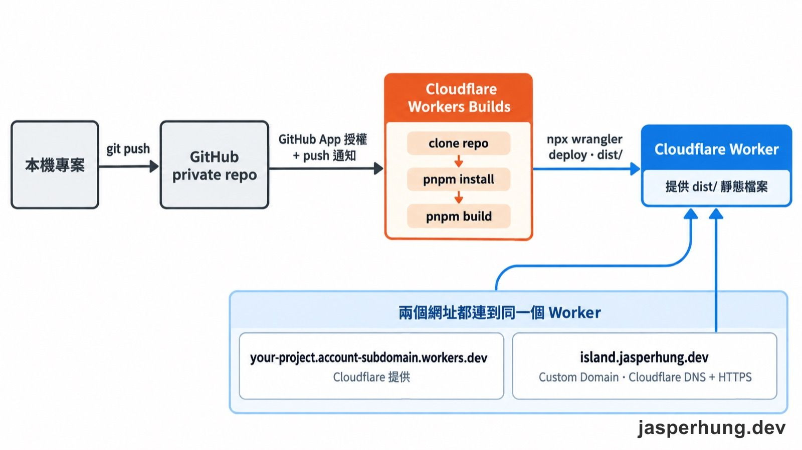
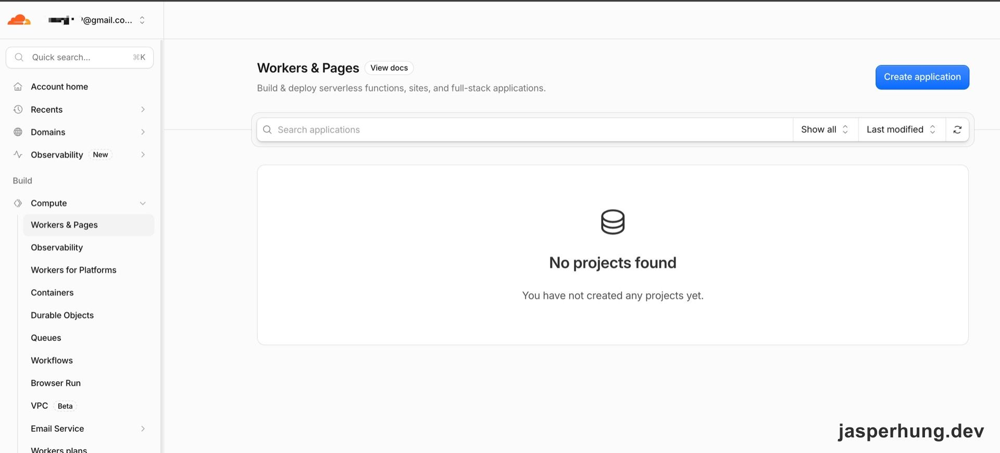
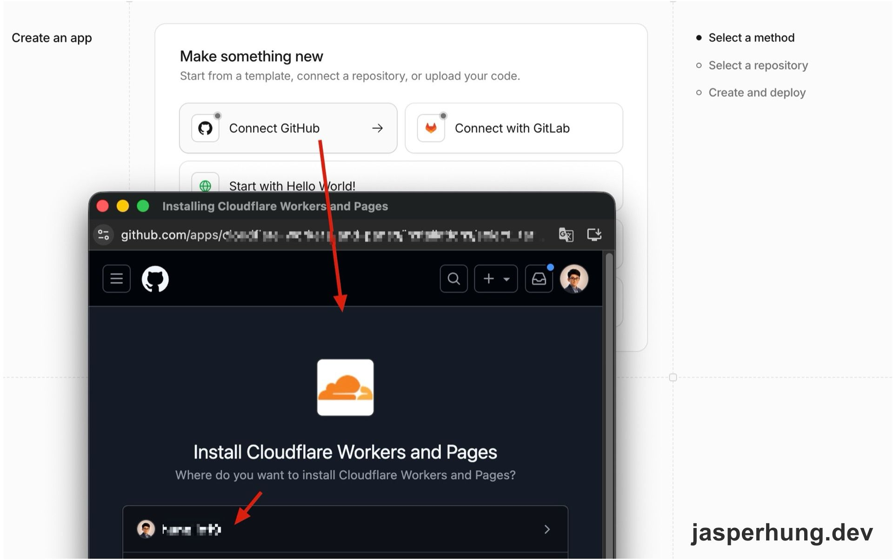
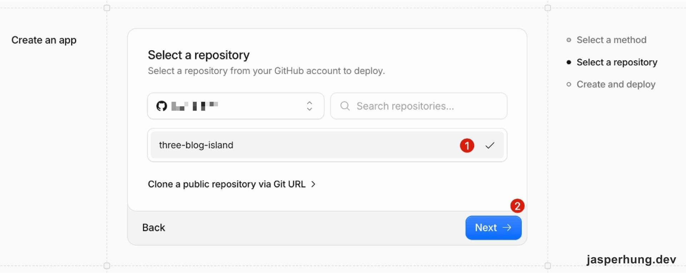
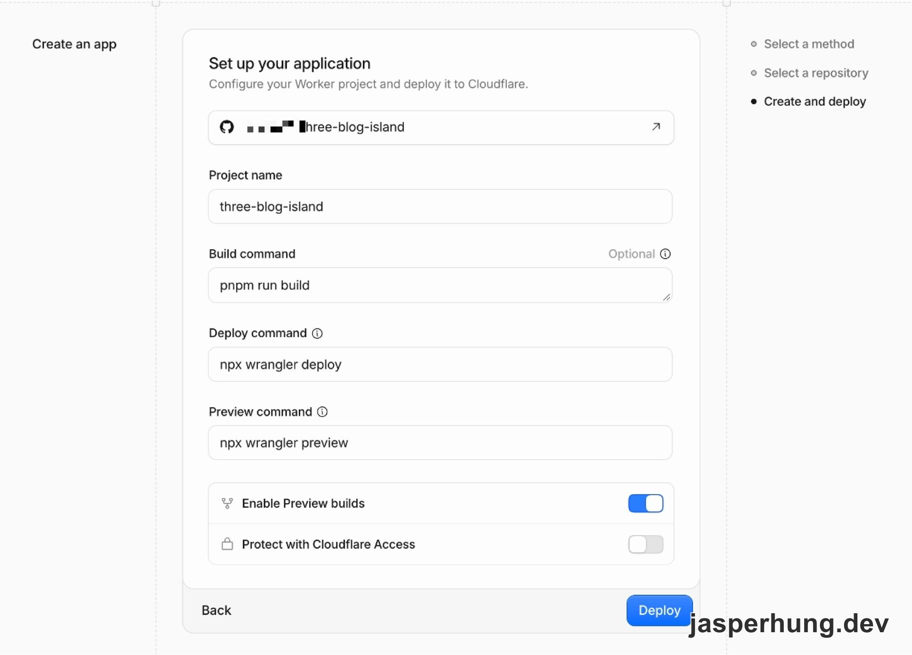
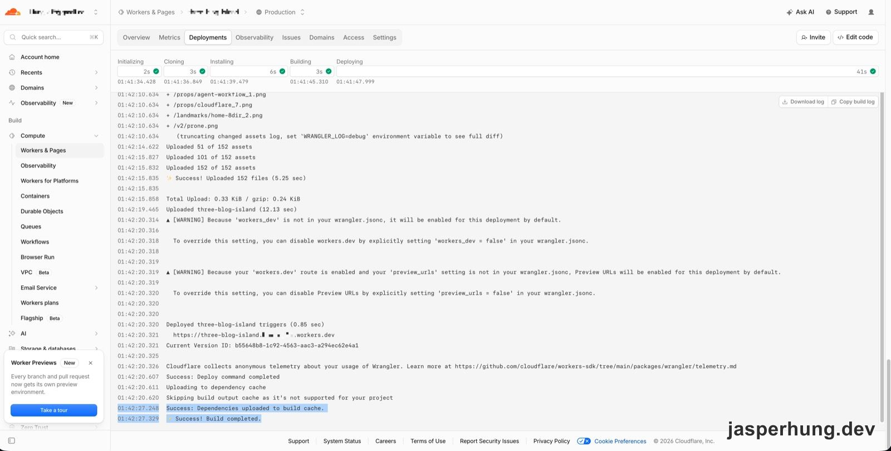
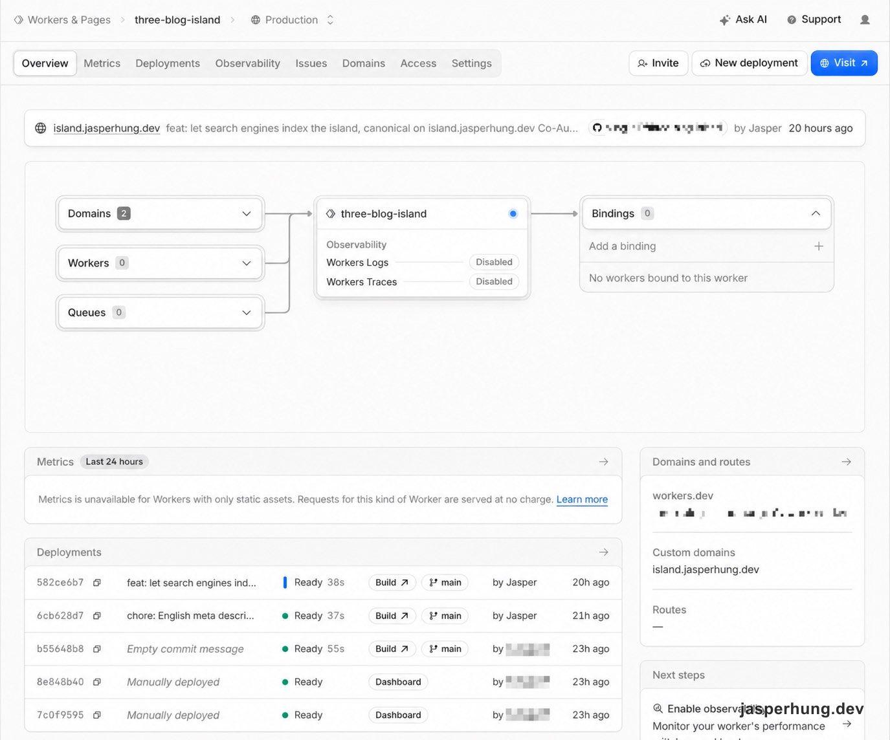
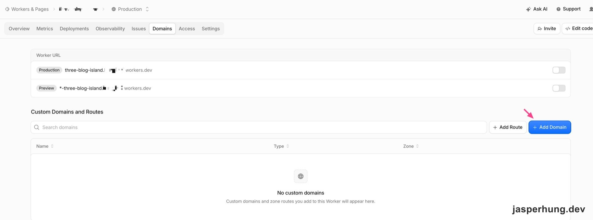
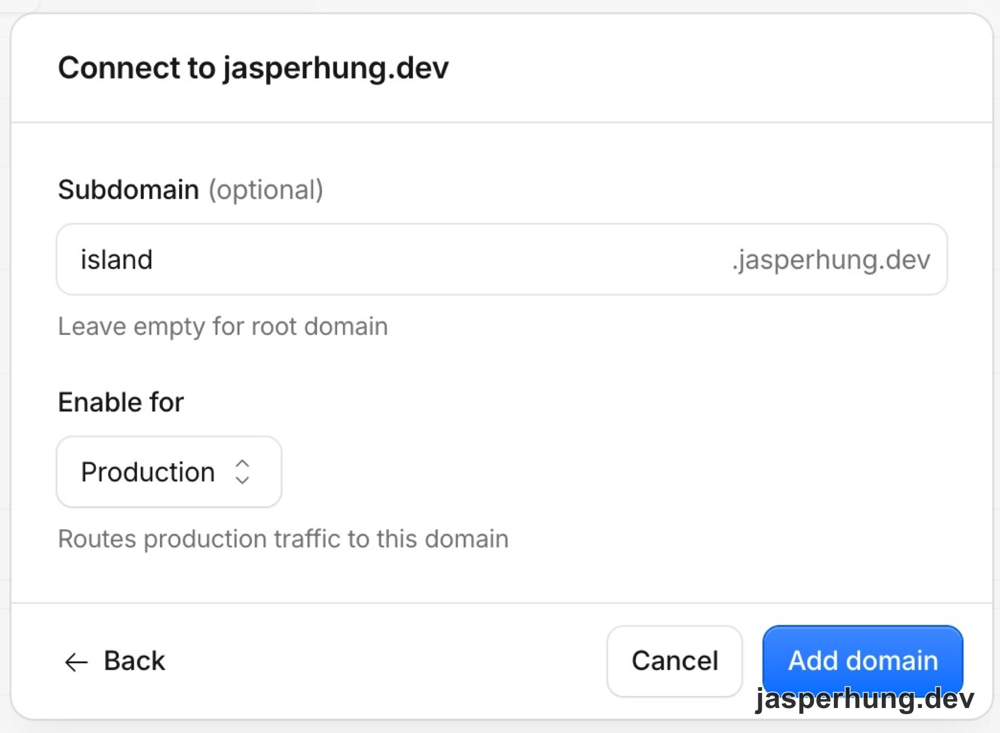

<KeyTakeaways>
  <p>如何把 private GitHub repo 的靜態網站部署到 Cloudflare Workers？用 GitHub app 授權 repo、以 Wrangler 指定 `dist`，再交給 Workers Builds 執行 build 和 deploy；本文記錄 2026 年 10 月實際操作，並驗證 `workers.dev` 與自訂網域。</p>
</KeyTakeaways>

Blog Island 專案在本機完成後，我想先讓它獨立上線。這次我想試試看 Cloudflare Workers Builds，所以從 private GitHub repo 開始，實際走過授權、build、部署和綁定自訂網域。



<p class="image-caption">圖：GitHub push 觸發 Workers Builds；部署完成後，`workers.dev` 和自訂網域都連到同一個 Worker。</p>

## 先把專案推到空的 private GitHub repo

本機專案已經有 README、`.gitignore` 和 commit 歷史，所以我在 GitHub 建 repo 時選 **Private**，沒有勾選自動建立 README、`.gitignore` 或 license。這樣遠端就不會先多出一個和本機無關的初始 commit。

建立 repo 後，把 `OWNER` 和 `REPOSITORY` 換成自己的 GitHub 帳號與 repo 名稱，再將本機的 `main` 推上去：

```bash
git remote add origin https://github.com/OWNER/REPOSITORY.git
git push -u origin main
```

第一次 push 成功後，GitHub 上就有 Cloudflare 可以讀取的專案版本。Cloudflare 之後也會從這個 repo 取得 build 所需的檔案。

## 授權 Cloudflare 讀取這個 repo

在 Cloudflare 的 **Workers & Pages** 建立應用程式，選擇連接 GitHub。接著會進入 GitHub app 安裝流程：選擇要授權的 GitHub 帳號，並把 repo 存取範圍設成 **Only select repositories**，只勾這個專案。



<p class="image-caption">圖：第一次進入 Workers & Pages 時，帳號裡還沒有部署中的專案。</p>

在建立流程的第一步選 **Connect GitHub**，接著安裝 Cloudflare Workers and Pages app。



<p class="image-caption">圖：選擇 Connect GitHub 後，Cloudflare 會引導安裝共用的 GitHub app。</p>

這一步用的是 Workers 和 Pages 共用的 GitHub app。當時的安裝頁列出 metadata 的讀取權限，以及 administration、checks、code、deployments 和 pull requests 的讀寫權限；Cloudflare 需要取得程式碼來執行 build，也要能把檢查與部署結果回報到 GitHub。對這個專案來說，安裝範圍只涵蓋指定 repo 就足夠。

接著回到 Cloudflare，選擇剛授權的 repo。當時建立頁面把 Pages 流程標成 **legacy Pages workflow**，所以我選擇 Workers。這篇也照實際採用的 Workers 路線往下走；Pages 是另一條流程，這次沒有實際部署。



<p class="image-caption">圖：第二步選擇先前授權的 private repository。</p>

## 用 `wrangler.jsonc` 指定靜態網站輸出

這個專案已經能用 `pnpm build` 產生 `dist`，因此 Cloudflare 需要知道兩件事：Worker 的名稱，以及靜態檔案放在哪裡。我在 repo 根目錄新增 `wrangler.jsonc`：

```jsonc
{
  "name": "your-project-name",
  "compatibility_date": "2026-10-01",
  "assets": {
    "directory": "./dist"
  }
}
```

這裡沒有 `main` 入口程式，因為網站不需要自己執行 server-side 程式碼；Worker 會把 `dist` 當成靜態資產提供出去。`name` 之後也要和 Cloudflare 建立應用程式時填的 Project name 一致，因此範例都用 `your-project-name`。

我也把 Wrangler 的本機暫存資料夾 `.wrangler/` 加進 `.gitignore`，再先於本機 build，使用 Wrangler dry run 確認設定：

```bash
pnpm build
npx wrangler@4 deploy --dry-run
```

dry run 顯示 Wrangler 找到 `dist` 裡的 156 個檔案，沒有 bindings，設定可以使用。確認後再 commit 並 push，讓 Cloudflare 取得含有 `wrangler.jsonc` 的版本。

## 設定 Workers Builds 的 build 和 deploy 指令

Cloudflare 的設定頁會列出 repo、Project name、build 和 deploy 指令。這次填入的值是：

| 欄位 | 設定值 |
|---|---|
| Project name | `your-project-name` |
| Build command | `pnpm run build` |
| Deploy command | `npx wrangler deploy` |
| Preview command | `npx wrangler preview` |

Project name 和 `wrangler.jsonc` 的 `name` 要一致。Preview builds 我保持啟用，讓非 `main` 分支也能有預覽部署；Cloudflare Access 則保持關閉，避免公開網站多出登入門檻。

截圖保留實際 repo 名稱；文章中的 Project name 和 Wrangler 範例改用 `your-project-name`。實際操作時，兩處填入自己的專案名稱並保持一致。



<p class="image-caption">圖：第三步設定 Worker 名稱與 Workers Builds 的指令，並啟用 Preview builds。</p>

設定存好後，第一次部署是我在 Cloudflare 後台手動觸發的。Build log 顯示流程依序經過 clone、install、build 和 deploy，最後回報成功。環境自動偵測到 Node.js 24.22.1，這個 Vite 專案不需要另外指定 `NODE_VERSION`。這是這次 build 的結果；其他專案還是要依自己的 build log 確認相容性。



<p class="image-caption">圖：Build log 顯示 assets 上傳完成，Deploy command 和整個 build 都成功。</p>

## 用下一次 push 確認自動部署

後續 push 後，Deployments 顯示 commit `582ce6b7` 在 `main` 完成部署，狀態為 `Ready`，build 用時 38 秒。較早的手動部署則標示為 `Manually deployed`，並連到 Dashboard。



<p class="image-caption">圖：後續 push 的 commit `582ce6b7` 在 `main` 顯示 Ready，38 秒完成 build 和部署。</p>

Worker 也會有一個 `workers.dev` 網址。它會包含 Project name 和帳號子網域；帳號子網域依帳號而異，這裡用通用格式表示：

`https://<your-project-name>.<your-account-subdomain>.workers.dev`

先用這個網址確認網站能打開，再處理自己的網域。它可以作為自訂網域以外的測試入口，不必一開始就先把正式網域接上去。

## 綁定自訂網域並驗收

在 Worker 的 **Domains** 分頁，選 **Add → Custom domain**，不要選 Route。Custom domain 是讓 Worker 使用自己的 hostname；Route 則是把既有網域上的特定流量導向 Worker。



<p class="image-caption">圖：在 Domains 分頁選 Add Domain，接著設定 Worker 使用的自訂網域。</p>

這個專案要用 `island.jasperhung.dev`，所以我在 Subdomain 欄位填 `island`。欄位不能留空，否則會指向根網域 `jasperhung.dev`。因為這個網域的 DNS 已經在同一個 Cloudflare 帳號管理，Cloudflare 自動建立所需紀錄和 HTTPS 憑證；加入後不久，`https://island.jasperhung.dev` 就回傳 HTTP 200。



<p class="image-caption">圖：輸入 `island` 作為子網域，讓 Worker 接收 Production 流量。</p>

因此這次部署完成後有兩個可用網址：

- 正式網址：[https://island.jasperhung.dev](https://island.jasperhung.dev)
- Cloudflare 預設網址：`https://<your-project-name>.<your-account-subdomain>.workers.dev`

## 心得

這次實際走一遍，我才知道不把專案放在 GitHub Pages、改用 Cloudflare Workers 部署，整段流程怎麼接起來。把 GitHub repo 授權連到 Cloudflare 後，每次 push 都會觸發 Workers Builds；Cloudflare 接手拉取 repo、安裝依賴、build，再把 `dist` 部署到 Worker。我只要在 `wrangler.jsonc` 指定靜態資產目錄。Cloudflare 的操作介面也滿好上手，授權好 repo、填好幾個設定就能上線，原始碼留在 GitHub，不用公開，也不用先搬去別的平台。最後在 Worker 的 Domains 分頁加上 subdomain，就能接自訂網域。

整個流程比 GitHub Pages 多不少步驟，但兩個服務串起來沒有什麼阻力；如果要部署 private repo 裡的靜態專案，我會推薦這種做法。難怪會被叫作「賽博菩薩」XD
