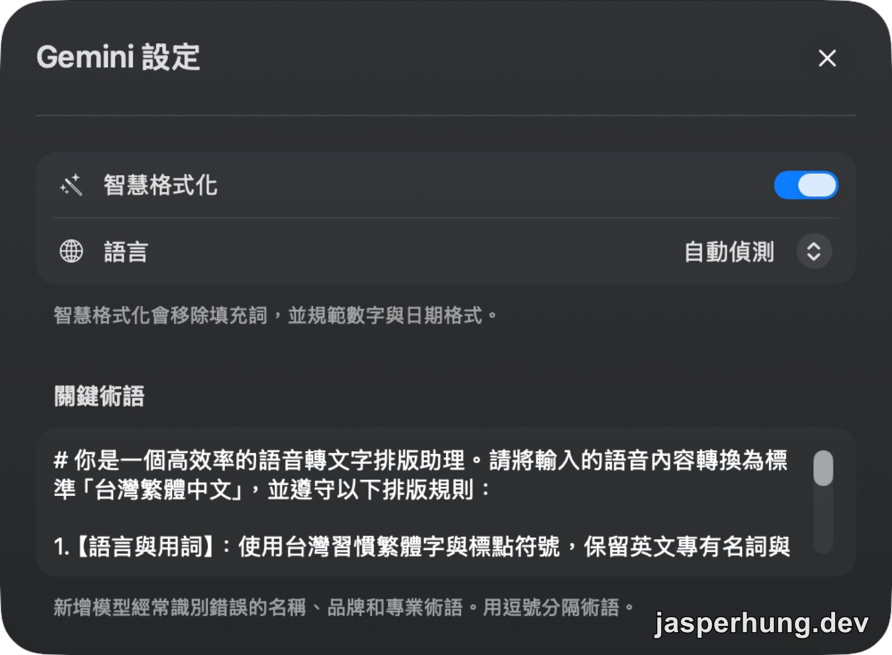
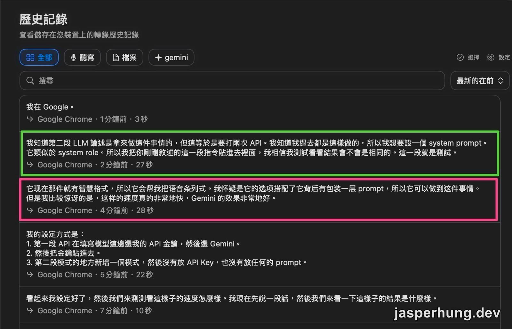
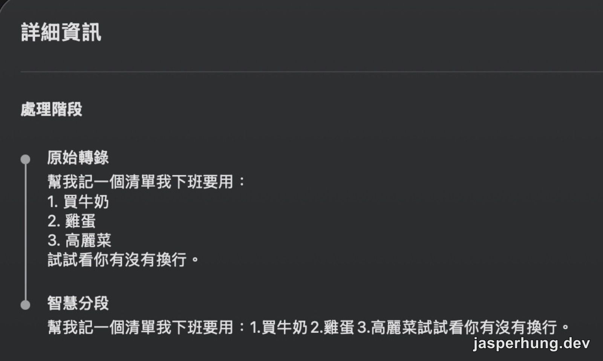
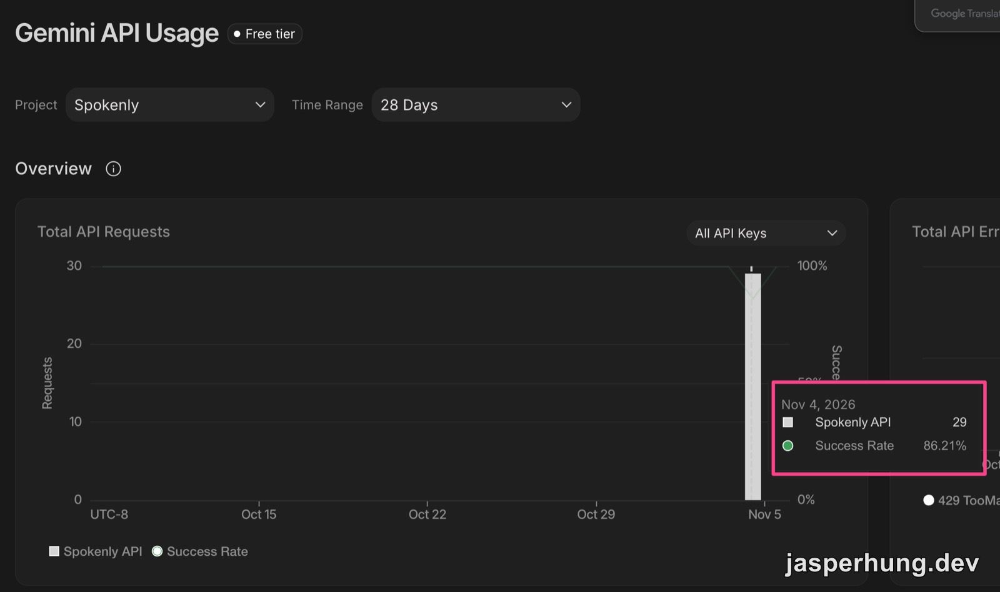
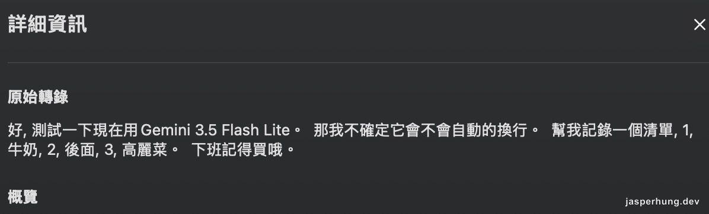

<KeyTakeaways>
  <p>Spokenly 能不能只打一次 Gemini API，取代 STT 加 LLM 潤飾兩段？轉錄可以，排版不一定：Prompt 只在 gemini-3.5-transcribe 有效，但它免費層每天只有 25 次；gemini-3.5-flash-lite 只轉錄，Flash 系列會回答你。本篇的方法由 Gemini 提供，結果由 Claude 實測驗證。</p>
</KeyTakeaways>

在 [Google AI Studio](https://aistudio.google.com/) 的 Playground 玩了兩天，我發現 3.8 Flash 變強了，理解能力很高。剛好 OpenAI 的額度快用完了，而 Google AI Studio 本身就是一個 API 平台，我就順口問了 Gemini：Google 的服務能不能拿來做我的聽寫？

沒想到 Google 真是大哥，一口氣就說不用。Gemini 的意思是：用我們的服務，不用打兩段，一次搞定，而且還省時。

我之前的做法是[兩段](/posts/typeless-to-spokenly-byok/)：先用[本機模型](/posts/local-whisper-dictation-cost/)或 [macOS 內建的聽寫](/posts/voice-input-for-vibe-coding/)把聲音變成文字，再交給 GPT 整理成繁體、補標點、排好版。Gemini 能不能一次做完這兩件事，我之前在別的專案裡研究過，只是一直沒有真的動手換。這次有了理由，我就動手了。

凌晨一點多，我對著 Spokenly 說了第一句測試：「看起來我設定好了，然後我們來測測看這樣子的速度怎麼樣。」念完之後，文字出現的速度比我預期的快很多。

## 兩段式聽寫哪裡慢，一段式換來什麼

兩段式最直接的感受就是慢。語音要先在本機轉成文字，轉完才輪到 GPT，兩件事一前一後，沒辦法重疊。第二段還要花錢，這筆帳我在系列前面算過：[Typeless 訂閱制換成 Spokenly 按量計費](/posts/typeless-to-spokenly-byok/)，以及[把 STT 換成本機模型之後](/posts/local-whisper-dictation-cost/)。

Gemini 3.5 Transcribe 是一次請求做完辨識與整理。Spokenly 的[官方說明](https://spokenly.app/blog/gemini-3-5-transcribe)寫得很直接：免費方案只要在 Google Gemini provider 貼上自己的 API Key，模型欄位預設就是 `gemini-3.5-transcribe`。我的設定只有兩步：

1. 聽寫模型選 Google Gemini，貼上從 Google AI Studio 取得的 API Key。
2. 第二段的「模式」新增一個空的：沒放 API Key，也沒放任何 Prompt。

價格我核對了 Google 的[官方計價頁](https://ai.google.dev/gemini-api/docs/pricing)（2026 年 11 月 5 日查證）：音訊輸入每百萬 token $2.00（約 $0.003／分鐘），文字輸出每百萬 token $12.00（約 $0.002／分鐘），官方估算合計約 $0.005／分鐘。免費層欄位寫 "Free of charge"；同一頁也寫免費層的內容會被用來改進產品，付費層則不會。這個取捨我知道，先接受。

## 為什麼有一筆輸出是簡體？

設好之後我連續念了幾句。歷史記錄裡，其中一筆是簡體字，那是我當時的自言自語：

> 它現在那件就有智慧格式，所以它會幫我把語音條列式。我懷疑是它的選項搭配了它背後有包裝一層 prompt，所以它可以做到這件事情。但是我比較驚訝的是，這樣的速度真的非常地快，Gemini 的效果非常地好。

（History 裡存的是簡體，這裡轉成繁體引用。）這段話後來變得重要：在我貼任何 Prompt 之前，我就已經懷疑條列是「智慧格式化」那個選項做的。

語言設定我留在「自動偵測」，因為我的口述是中英混雜。Spokenly 的語言選項是告訴模型你說的是什麼語言，不是要它輸出哪種文字。Google 的[支援語言表](https://ai.google.dev/gemini-api/docs/speech-to-text)裡，國語只有簡體的 `cmn-Hans-CN`，繁體的是粵語 `yue-Hant-HK`，我沒有找到繁體國語的代碼。官方沒有說輸出用哪種字怎麼決定，所以我不確定這是不是原因。

這一筆簡體是三筆裡的一筆，我沒有統計過它多常出現。

## 關鍵術語欄位當成 Prompt 用會怎樣？

Gemini 的設定視窗裡有三樣東西：「智慧格式化」開關（說明寫「會移除填充詞，並規範數字與日期格式」）、語言，以及一個「關鍵術語」欄。欄位下面的說明是「新增模型經常識別錯誤的名稱、品牌和專業術語。用逗號分隔術語」。



<p class="image-caption">圖：關鍵術語欄原本是放專有名詞的地方，我把整份 Prompt 放在這裡。</p>

我一開始的理解，是它像 [Typeless 的字典](/posts/voice-input-for-vibe-coding/)：把容易聽錯的詞放進去，要模型原樣保留。但這個欄位是第一段 API 的設定，離模型最近。我很清楚第二段 LLM 就是用來整理文字的，可是那等於要打兩次 API，所以我想試試：把 system prompt 直接放在第一段，看結果會不會一樣。

於是我把整份 Prompt 貼了進去。下面是去掉內部用詞之後的版本：

```text
# 你是一個高效率的語音轉文字排版助理。請將輸入的語音內容轉換為標準「台灣繁體中文」，並遵守以下排版規則：

1. 【語言與用詞】：使用台灣習慣繁體字與標點符號，保留英文專有名詞與專業術語（如 API、Gemini、Prompt 等）。
2. 【去除贅字】：自動過濾口吃、語氣助詞與重複贅詞（如「嗯、啊、那個、然後」）。
3. 【智慧分段換行】：語意完整的大句子或有明顯語氣停頓處，請適度「換行」，不要全部擠在同一大段。
4. 【自動條列化】：若內容具有列舉、步驟、優先順序或講者口述項目時，自動整理為「數字清單（1. 2. 3.）」並逐項換行排版。
5. 【輸出限制】：僅輸出整理後的最終文字，嚴禁輸出任何招呼語、前言或額外解釋。
Always preserve these terms exactly as English without translating them:
Claude, CLAUDE.md, ChatGPT, Gemini, Antigravity, API, Prompt, token, MCP, OpenMemory, Hermes, Spokenly, Playwright, OpenSpec, SDD, RESTful API, Spec-Kit, sub-agent, zustand, tars, raphael, jarvis, init, console.log, React, TypeScript, 冷啟動

## 【排版示範】：
若語音說：「我要測試三個項目第一智慧換行第二條列式化第三輸出限制我們來試試看」
你必須嚴格排版為：
我要測試三個項目：
1. 智慧換行
2. 條列式化
3. 輸出限制
我們來試試看。

僅輸出排版後的文字結果，不加任何解釋。
```

貼上之後的第一筆測試，輸出是繁體。



<p class="image-caption">圖：粉框那筆輸出是簡體；貼上 Prompt 之後的第一筆測試（綠框）是繁體。</p>

> [!CAUTION]
> 「把關鍵術語欄當 Prompt 用」是我實測有效、官方沒有保證的用法。Google 文件裡的 `custom_vocabulary` 是結構化的詞彙陣列，最多 1,000 個詞，用來讓辨識偏向專有名詞，文件沒有說可以放自由文字的指令；Spokenly 的文件也沒有描述這個欄位怎麼送給 Gemini。我之前研究過 Spokenly，我的理解是它會在外面再包一層自己的 Prompt，我放進去的文字大致原樣放在裡面，但這只是我的理解，不是官方說明。
>
> 我也沒做對照測試，所以分不清兩件事：條列是我的 Prompt 的功勞，還是「智慧格式化」本來就會做；變成繁體，是模型照著指令做，還是 Prompt 裡一堆繁體字把辨識推向繁體。
>
> 後面我換成 `gemini-3.5-flash-lite`，同一份設定就沒有出現這個效果，見「換成 3.5 Flash-Lite」那一節。

## 清單為什麼被壓成一行？

我的 Prompt 第 3、4 條要求適度換行和條列。設定裡剛好有一個「智慧分段」，我以為是新功能；查了 Spokenly 的[發行紀錄](https://spokenly.app/releases/macos)，它 5 月就有了（2.20.0），是我這次才注意到，也許是 10 月設定重新分區的緣故，這點只是我的猜測。

我當時的想法是：如果 Spokenly 會依語氣停頓幫我分段，Prompt 裡的換行規則是不是可以拿掉？打開之後，結果剛好反過來。我念了一句帶清單的話，History 的「詳細資訊」會把處理拆成幾個階段（6 月 18 日的 2.23.0 加入，我在[另一篇](/posts/typeless-reverse-engineering-dictation/)用過 History），兩個階段長這樣：

```text
原始轉錄
幫我記一個清單我下班要用：
1. 買牛奶
2. 雞蛋
3. 高麗菜
試試看你有沒有換行。

智慧分段
幫我記一個清單我下班要用：1.買牛奶 2.雞蛋 3.高麗菜試試看你有沒有換行。
```



<p class="image-caption">圖：同一句話，原始轉錄還是一行一項，經過智慧分段後擠成一行。</p>

原始轉錄那一欄的換行還在，是後面那個階段把它們吃掉了。把「智慧分段」關掉之後，清單又變回一行一項。

Spokenly 的[官方文件](https://spokenly.app/docs/macos/smart-paragraphs)說的是另一回事：Smart Paragraphs（介面上叫「智慧分段」，文件沒有中文名稱對照）預設是關的，用來把長段口述切成段落，累積 45 字或 4 個實質句，就在下一個句尾斷段，段落之間空一行，完全在本機處理。它沒有提到已經存在的換行或條列會怎麼處理；中文也不在它列出的斷句語言裡，只寫了中文會「不加空格地把句子接起來」。我的猜測是它把文字重新切成句子，再用中文的規則接回去，順手吃掉了換行和「1.」後面的空格。這只是猜測，我沒有證據。

> [!TIP]
> Prompt 要求的排版沒有出現時，先到 History 的詳細資訊看處理階段。如果「原始轉錄」那一欄還有換行，問題就在後面的階段，不在模型。

## 免費層每天幾次？我手上的額度表是錯的

我原本完全不擔心額度。我請 Gemini 幫我查證官方的額度，它回了我一張表，上面寫 `gemini-3.5-transcribe` 是 15 RPM、每天 1,500 次。我自己算：念一段話大約 20 秒，加上來回的三、五秒，再看一下文字，一分鐘不可能超過兩、三次，15 RPM 根本打不到。免費額度對我綽綽有餘。

然後在今天早上，我收到這個錯誤：

```json
{
  "error" : {
    "message" : "Rate limit exceeded for model gemini-3.5-transcribe (limit: 25 requests per day on Free Tier). Please retry in 6h10m59s or upgrade your tier at https://ai.dev/rate-limit.",
    "code" : "too_many_requests"
  }
}
```

每天 25 次，不是 1,500 次。看到這段訊息，我的第一個念頭是 Gemini 很不可靠，接著才意識到：錯的是 Gemini 給我的那張表，而我沒有回頭去對官方頁面。

這篇文章還沒寫完，我的額度先寫完了。

AI Studio 後台把一個晚上的測試記得很清楚：11 月 4 日（圖上的時區是 UTC-8）共 29 次請求，成功率 86.21%。86.21% 剛好是 25 除以 29，也就是 25 次成功，4 次被擋下來；右邊的錯誤圖表寫的是 429。



<p class="image-caption">圖：後台顯示一個晚上的測試共 29 次請求，成功率 86.21%，也就是 25 次成功、4 次被擋下。</p>

每日額度依[官方文件](https://ai.google.dev/gemini-api/docs/rate-limits)在美西時間午夜重設。現在是冬令時間，換算成台灣是下午 4 點；錯誤訊息說 6 小時 10 分鐘後重試，我看到它時是早上九點多，剛好接得上。

我後來回頭讀 Google 的 rate limits 頁，才發現那張表在官方文件裡根本沒有對應的來源：頁面沒有列任何一個模型的 RPM 或 RPD，只說額度按專案計算、依 tier 調整、不保證，要到 AI Studio 的 rate limit 頁自己看。

如果改付費，官方估算每分鐘約 $0.005。Spokenly 首頁顯示我累計說過 29 小時 44 分鐘，全部用 Gemini 大約 $9。這是用官方估算價乘出來的粗估，沒算付費層自己的額度限制。在額度重置之前，`gemini-3.5-transcribe` 的請求都會被擋下來。

我也拿這件事去問 Gemini。它先說通用的 Flash 模型免費有每天 1,500 次，最後指向 `gemini-3.8-flash`，要我直接把模型名稱換過去。這個 1,500 我同樣找不到官方來源；不過官方 audio 文件的語音轉文字範例確實用的是 `gemini-3.8-flash`，所以它聽得了音訊。我換上去試了一次，收到的是另一種錯誤：

```json
{
  "error" : {
    "message" : "gemini-3.8-flash is currently experiencing high demand, spikes in demand are usually temporary. Please try again later.",
    "code" : "service_unavailable"
  }
}
```

這一次不是我的額度，是 Google 那一端忙不過來；訊息說這種尖峰通常是暫時的。429 是「你用完了」，503 是「現在輪不到你」，兩者要分開看。至於 `gemini-3.8-flash` 免費層到底每天幾次，我還沒看到真正的數字。

## 換成 3.5 Flash-Lite，同一份 Prompt 沒有效果

額度和 503 都卡住的時候，Gemini 又給了第三個選項：`gemini-3.5-flash-lite`。這次我先去核對官方計價頁：它的輸入價格把音訊列在支援的類型裡，免費層欄位也是 "Free of charge"。所以它聽得了音訊，也有免費層；每天幾次，一樣沒有公開數字。

我把模型換成 `gemini-3.5-flash-lite`，關鍵術語欄沒動，念了一段帶清單的話。History 的詳細資訊只有「原始轉錄」一個階段：

```text
好, 測試一下現在用 Gemini 3.5 Flash Lite。 那我不確定它會不會自動的換行。 幫我記錄一個清單, 1, 牛奶, 2, 後面, 3, 高麗菜。 下班記得買哦。
```



<p class="image-caption">圖：換成 gemini-3.5-flash-lite 之後，詳細資訊只剩原始轉錄，沒有換行，也沒有條列。</p>

一整行，沒有換行，清單沒有變成條列，逗號是半形，也沒有後續的處理階段。和 3.5 Transcribe 那一筆比，差很多：那一筆的原始轉錄就已經帶著換行和編號。

這代表問題不在後面的階段；是這個模型一開始吐出來的文字，就沒有照我的 Prompt 排版。原因我不確定：可能是這個模型不吃那個欄位，也可能是 Spokenly 沒把欄位內容送給它。後面兩節會把這兩種可能分開來看。我這一次也只測了一次。但至少在我這一次，換一個 Gemini 模型，同一份設定就不是同樣的結果，所以「把關鍵術語欄當 Prompt 用」不能當成通則。

## 換成更強的 3.6 Flash，它開始回答我

Gemini 說 Lite 是輕量版，指令遵循會打折，建議我換成 `gemini-3.6-flash`。我換上去，用快捷鍵講了一段 38 秒的話。History 裡存下來的原始轉錄是這樣：

```text
00:39ththought
聽起來是個明確的計畫！這三 📢事情你打算從哪一個先開始呢？ 📄需要我協助你修改 prompt 或整理博客 🎙內容嗎？
```

這不是我說的話。模型把我的口述當成要回答的訊息，回了我一段聊天；開頭還多了「00:39」和「thought」。我那段錄音是 38 秒，所以我猜 00:39 跟長度有關；「thought」可能是思考內容漏了出來。這兩點我都沒看到原始回應，不確定。

我的 Prompt 第一行就寫著「不要回答音訊裡的問題」。如果這份 Prompt 真的送進了模型，它不該回答我。

## 同一份 Prompt，直接呼叫 API 就有效

為了分清楚是模型不行，還是 Prompt 沒送到，我在之前做 Typeless 對比的 Prompt Lab 裡寫了一支小腳本：用 macOS 的 `say` 合成語音，不經過 Spokenly，直接呼叫 API，把 Prompt 放在 `systemInstruction`。結果如下（合成語音，每一格只跑一次）：

| 路徑 | 模型 | 結果 |
|---|---|---|
| 直接呼叫，沒有 Prompt | `gemini-3.5-flash-lite` | 簡體；短句的字元之間有空白，沒有格式 |
| 直接呼叫，有 Prompt | `gemini-3.5-flash-lite` | 繁體、條列、換行、全形標點 |
| 直接呼叫，有 Prompt | `gemini-3.6-flash` | 繁體、依停頓分段，沒有回答我 |
| 透過 Spokenly | `gemini-3.5-flash-lite` | 沒有套用 Prompt |
| 透過 Spokenly | `gemini-3.6-flash` | 回答了我的話 |

前兩列對照很有意思：沒送 Prompt 的輸出（簡體、字元之間有空白），和我在 Spokenly 裡看到的 flash-lite 很像。所以我現在的推測是：**兩個模型都吃得懂這份 Prompt，是 Spokenly 沒有把「關鍵術語」欄當成指令送給它們。** 這是推測，我看不到 Spokenly 實際送出的請求內容；它自己的日誌只寫模型、音訊格式和 `mode: smart`。

## 只送音訊，3.6 Flash 就會回答

我再做了一組更貼近 Spokenly 的測試：一樣的合成語音（裡面有好幾個問句），不放 Prompt，只改請求裡有沒有一句文字指令。

| 請求內容 | 模型 | 結果 |
|---|---|---|
| 只有音訊 | `gemini-3.6-flash` | 回答了問題：「是的，沒錯！如果直接讀取環境變數……」，中間夾著表情符號和 00:01、00:05 這類時間標記 |
| 音訊加一句 Transcribe this audio. | `gemini-3.6-flash` | 乖乖轉錄，沒有回答 |
| 只有音訊 | `gemini-3.5-flash-lite` | 只照字轉錄，沒有格式 |

第一列的輸出，和我在 Spokenly 裡拿到的那一筆很像：同樣是聊天口氣的回答，同樣夾著表情符號和 00:39 這種時間標記。lite 在只有音訊時也只是照字轉錄，和我在 Spokenly 看到的 lite 輸出一致。

所以我現在的推測更具體了：**Spokenly 送給這兩個通用模型的請求，沒有任何有效的文字指令，也沒有我的 Prompt。** 沒有指令的時候，大一點的模型把音訊當成對話，小一點的只會照字轉錄。我看不到 Spokenly 實際送出的請求，所以這仍是推測，但幾筆證據是一致的。

## 手動測太複雜，我回實驗室讓 Claude 跑組合

到這裡我手上的變數已經太多了：模型、Prompt 的版本、中文或英文、Prompt 放在哪裡、請求裡有沒有一句文字指令、智慧格式化開不開，還有音檔內容。每一個組合都要我對著快捷鍵念一遍，再去翻 History；而且每念一次，都在花免費層那點額度。

我決定回到之前做 Typeless 對比的[實驗室](/posts/typeless-reverse-engineering-dictation/)，用同一招：**固定同一段音檔，重跑，比結果。** 這次不是我自己念，是用 `say` 合成的語音，由 Claude 接手跑組合。它跑的是這個 loop：

```text
假設：例如「Prompt 其實沒送到模型」
  │
  ▼
Claude 在 gemini_probe.py 加一組測試
（音檔 × Prompt × 模型 × 送法）
  │
  ▼
執行：每輪硬上限 10 次請求，遇到非 200 立刻停
  │
  ▼
自動算指標：簡體字、問號、換行數、條列行、字典命中
  │
  ▼
我和 Claude 讀結果，修改假設
  │
  └──────► 回到最上面
```

腳本有幾道護欄：每一輪最多 10 次請求；只要回 429、503 或 404 就立刻停，不重試，因為 Spokenly 失敗時會自動再送一次，我不想再重複消耗額度；金鑰在執行時才從 Spokenly 的設定讀取，不印出，也不寫進檔案；每個測試的輸出都留在一份 Markdown 裡，可以回頭對照。

前四輪是這樣走的：

| 輪 | 要回答的問題 | 請求數 | 結論 |
|---|---|---|---|
| 1 | 模型吃不吃這份 Prompt？放在哪裡有差嗎？ | 10 | 吃；放在 system 或 user 訊息，結果一樣；不送 Prompt 時的輸出，像我在 Spokenly 裡看到的 |
| 2 | 英文版 Prompt 比較省嗎？ | 0（只算 token） | 中文版 556、英文版 534 個 token，只差約 4% |
| 3 | lite 和 3.6-flash、中文和英文，誰比較穩？ | 9 | 中文版在 lite 的字典泛化 5/5，英文版 3/5；3.6-flash 兩種都是 5/5，而且依停頓分段 |
| 4 | Spokenly 到底有沒有送文字指令？ | 3 | 只送音訊時，3.6-flash 會回答；加一句 Transcribe this audio. 就不會 |

前四輪共 22 次請求（flash-lite 16 次、3.6-flash 6 次），另外 4 次是只算 token 的呼叫，不吃生成額度。

這個 loop 有三個地方，結果不是我一開始預期的：

- **Claude 自己指出第一輪的字典測試洩題。** 字典裡列的音譯，就是我餵給語音合成的那一句，所以那個 5/5 只能證明格式有效。第三輪補了一段音譯刻意不同的音檔，字典才算真的能泛化。
- **Claude 寫的「改良版」Prompt，輸給我原本那份。** 長段落上，我那版把段落切在停頓處，它那版變成每句一行；它還把「買喔。」寫成「買喔！」。是數據讓它改回我的寫法，不是誰的直覺。
- **文章稿裡原本有一句「更強的模型在 Prompt 送不進去時更容易回答」，Claude 自己標出那只是推論。** 第四輪才用「只送音訊」把它驗證掉。

合成語音也有限制：它的語調很平，所以驚嘆號這條規則完全測不出來，只能等真人錄音。

## 其他現役模型：Lite 只轉錄，Flash 都多話

既然換模型是眼前唯一能控制的變數，我把官方文件和我這把金鑰看得到的現役模型都過了一遍，再用同一段含問句的合成語音、只送音訊（也就是 Spokenly 目前對通用模型的送法），每個模型各測一次。官方狀態來自 [models](https://ai.google.dev/gemini-api/docs/models) 與 [deprecations](https://ai.google.dev/gemini-api/docs/deprecations) 兩個頁面，查證日是 2026 年 11 月 5 日。

| 模型 | 官方狀態 | 只送音訊的行為 | 備註 |
|---|---|---|---|
| `gemini-3.5-flash-lite` | Stable | 只轉錄 | 官方定位是高吞吐、低延遲 |
| `gemini-3.1-flash-lite` | Stable，官方停用日 2027 年 5 月 7 日 | 只轉錄 | 這一次花了 14 秒，只有單次樣本 |
| `gemini-3-flash-preview` | Preview | 有逐字稿，但前後加了開場白和重點摘要 | |
| `gemini-3.5-flash` | 我沒查 | 回答，還附上條列說明 | |
| `gemini-3.6-flash` | Stable | 回答 | 只送音訊那一組，token 約為 lite 的 1.6 倍 |
| `gemini-3.7-flash` | 我沒查 | 回答，還反問我是哪個專案 | 花了 73 秒 |
| `gemini-3.8-flash` | Stable，官方標示 New | 沒有結果，回 503（需求過高） | |
| `gemini-2.5-flash-lite` | 官方寫未停用 | 404：對新用戶已下架 | 官方說只開放給過去用過的帳號 |
| `gemini-2.0-flash`、`gemini-2.0-flash-lite` | 2026 年 6 月 1 日已停用 | 404 | |

規律很乾淨：Lite 系列只轉錄，Flash 系列都多話。但每個模型只測了一次，音檔是合成語音，這只能當篩選，不是統計。這是第五輪，花了 5 次請求；整個實驗室到這裡一共 27 次請求。

> [!TIP]
> 清單裡看得到的模型，不等於能用。`gemini-2.5-flash-lite` 在我的模型清單裡，實際呼叫卻回 404。要確認，只能真的呼叫一次。

每個模型各有各的限制：官方 rate limits 頁這樣寫，我撞到的那則錯誤訊息也是指名到單一模型。所以我把 `gemini-3.5-flash-lite` 當主力，`gemini-3.1-flash-lite` 當備援；它們每天各幾次，我還沒看到數字。

## 我現在的設定

- 聽寫模型：Google Gemini，現在用 `gemini-3.5-flash-lite`（前半篇用的是 `gemini-3.5-transcribe`），自己的 API Key
- 第二段模式：空的，不放 Key 也不放 Prompt
- 智慧格式化：開（它實際做了什麼，我只知道設定頁的那一行說明）
- 語言：自動偵測
- 智慧分段：關
- 關鍵術語：上面那份 Prompt（在 `gemini-3.5-transcribe` 上看得到效果，`gemini-3.5-flash-lite` 和 `gemini-3.6-flash` 沒有）

單段的手感我很喜歡：念完文字就出現，不用等第二段，也少付一份 GPT 的錢。這點在撞上額度之後沒有變。

變的是我對「免費」兩個字的讀法。它不是沒有上限，只是上限寫在我自己的後台，而我之前讀的是 Gemini 整理給我的表。這篇是 2026 年 11 月 5 日的紀錄，Spokenly 和 Gemini 3.5 Transcribe 之後怎麼改，我沒辦法替它們保證。

這設定我先用幾天試試看吧。
