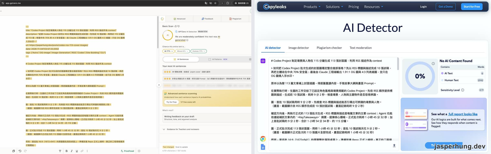
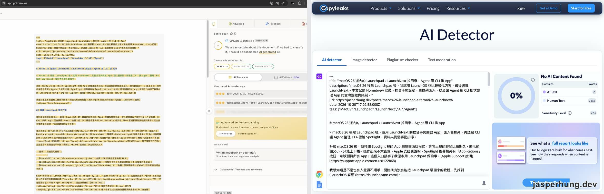
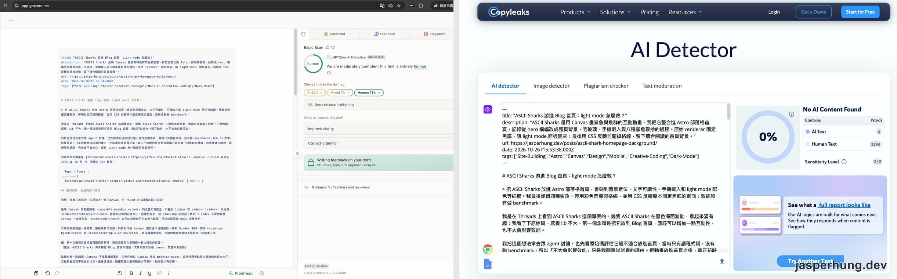
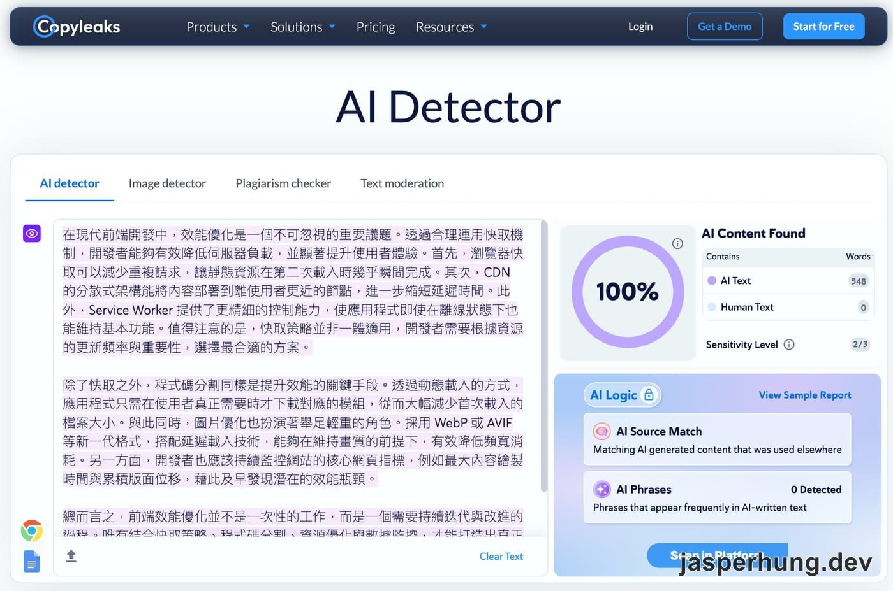
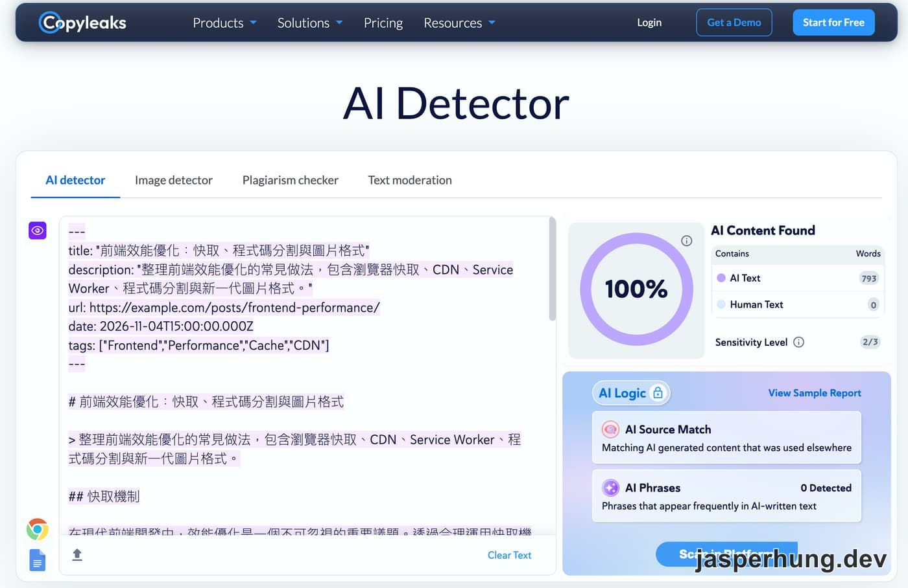
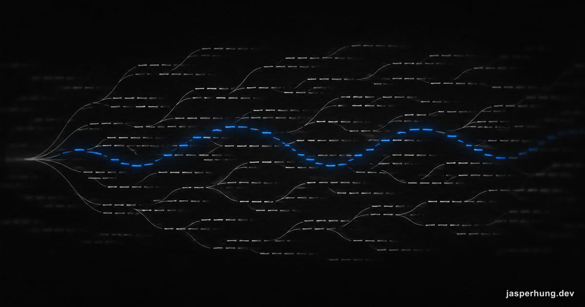

<KeyTakeaways>
  
文章定稿後跑去 AI 味 skill、只改部分詞彙，會打破 LLM 文字浮水印嗎？不會。浮水印是模型挑字時留下的統計訊號，每個位置只看前面幾個 token，沒改到的組合照樣帶著原模型的訊號；GPTZero、Copyleaks 這類 AI 偵測器沒有廠商的金鑰，量不到浮水印，實測三篇文章，分數跟著文風走。

</KeyTakeaways>

文章主體寫完，我會自己唸一遍。如果讀起來「防衛性寫作」太多，每句都在留後路，「可能」、「通常」、「在多數情況下」塞滿整段，我的最後一步就是跑一次去 AI 味的 skill，看能不能把這些過度保守的限定詞消掉。

跑這一步的時候，我想到一個問題：聽說 LLM 生成的文字也有浮水印，那這樣改，會不會把它打破？主體已經完成，skill 只是修改部分詞彙，改得不多，但也不是完全沒動。

## LLM 文字浮水印是什麼？藏在用詞選擇裡的統計訊號

LLM 文字浮水印，是模型在挑下一個字的時候刻意留下的統計偏好。讀者看不出來，文字裡也沒有多塞任何字元；只有握有金鑰（key）的偵測器，才算得出這個偏好存不存在。

這跟在字和字之間塞零寬空格那種做法不一樣。[Anthropic 的說明](https://www.anthropic.com/news/claude-text-watermark)寫得很直接：文字裡什麼都沒有加，也沒有隱藏字元。[OpenAI 的說明](https://openai.com/zh-Hant/index/eu-text-provenance/)也一樣，浮水印是加在「模型的用詞選擇」裡。

最早被廣泛引用的做法來自 [Kirchenbauer 等人 2023 年的論文](https://proceedings.mlr.press/v202/kirchenbauer23a/kirchenbauer23a.pdf)：

1. 模型每要產生下一個 token，先用「金鑰 + 前一個 token」當亂數種子，把整個詞庫分成綠名單和紅名單，例如各一半。
2. 綠名單的候選字加一點分數，再照常抽樣。語意上本來就合理的候選字有很多，被推一把的通常是其中幾個同樣合理的字。
3. 偵測時沿著同一把金鑰重算每個位置的綠名單，數數看有多少字落在綠名單。人寫的文字大約一半，帶浮水印的文字會明顯偏高，再用 Z-score 判斷這個偏高是不是巧合。

Anthropic 用了一個比喻：玩大富翁時，原本擲骰子決定走幾步；改成照著圓周率的數字一位一位走，對玩家來說一樣是隨機。但如果你知道圓周率、又看得到整局的每一步，就能回頭判斷這局是不是照著圓周率走的。

各家的實際演算法不同。Google DeepMind 的 [SynthID-Text](https://www.nature.com/articles/s41586-024-08025-4) 不是加分，而是用 tournament sampling 讓候選字一輪輪淘汰；Claude 用的是 SynthID-Text 的一個版本；OpenAI 的 textGrain 則有自己的技術報告。但它們有兩個共同點：都在模型抽樣挑字時動手，都依賴金鑰和前面幾個字。

這也代表浮水印需要「選擇空間」。Anthropic 舉的例子是：寫到「牛頓最有名的著作叫《Principia……》」時，下一個字只能是 Mathematica，浮水印沒有地方發揮。程式碼也是同樣的道理，大部分地方寫錯一個字就跑不動，所以帶的浮水印比一般文字少。

## 誰真的在加浮水印？textGrain 只在歐盟，Claude 全球

歐盟 AI 法案從 2026 年 8 月起，要求服務歐盟市場的生成式 AI 供應商讓生成的文字可以被機器辨識，幾家大廠陸續公布了做法：

| 廠商 | 方法 | 適用範圍 |
|---|---|---|
| OpenAI | textGrain | 2026-10-05 公告：未來幾週在歐盟境內符合條件的 ChatGPT、Codex 輸出加入；全球 API 客戶可自行選擇開啟，預設關閉 |
| Anthropic | SynthID-Text 的一個版本 | 2026-08-14 說明：未來的 Claude 模型會加入，推出時全球套用，因為還沒有可靠的方式按地區區分 |

偵測器也不是誰都能用。OpenAI 的偵測器初期只開放給核准的研究人員與專業組織申請，考量到誤判風險，推出時不對大眾開放。

套回我的情況：我人在台灣，Codex 寫的草稿依 OpenAI 的公告，大概沒有 textGrain。Claude 則是全球套用，只是「未來的 Claude 模型」包含哪些，以 Anthropic 的官方文件為準；我這次用到的模型有沒有在裡面，我手上沒有工具能驗。

## 定稿後只改部分詞彙，浮水印會被打破嗎？

回到一開始的問題。關鍵在「每個位置只看前面幾個 token」這件事。

skill 換掉一個詞，受影響的是這個詞本身，以及後面那幾個拿它當亂數種子的位置；最早的 Kirchenbauer 版本只看前一個 token，所以一處修改大約打掉兩個位置的訊號。沒被改到的句子，token 和前後組合都沒變，偵測器重算時，綠名單還是落在同一個地方。

用 Kirchenbauer 的設定算一次示意，數字是假設，不是實測：

- 一篇 3,000 token 的文章，綠名單占一半，帶浮水印時有 70% 的 token 落在綠名單，Z-score 約 21.9。
- 去 AI 味改了 10% 的 token，約有 20% 的位置訊號變成隨機，綠名單比例降到 66%，Z-score 約 17.5。
- 論文常用的判定門檻是 Z = 4。改完還是遠遠超過。

OpenAI 公布的數據方向一致，但也提醒了長度的影響。在 400 個 token 的英文段落裡，同義詞替換 10% 後，偵測率從約 92% 降到 66%；替換 25% 後降到 17%。文章越短、改得越多，訊號掉得越快。部落格文章通常比 400 token 長很多，只改部分詞彙，離「打破」還很遠。

改稿那一方留下的印也很少。Anthropic 的說明提到，Claude 校稿時交回來的文字通常只輕度修改，幾乎所有字都是原作者的，浮水印能附著的地方很少，有時根本不足以被偵測到。

我的 skill 跑在 Claude Code 裡，改稿是用 Edit 工具做字串替換：沒被替換到的段落，連一個 token 都沒有重新生成。這跟「把整篇貼進對話叫它改寫」是兩回事。整篇改寫時，每個 token 都會重新抽樣一次，原模型的訊號被稀釋得多，改稿模型如果有開浮水印，也會蓋得多。

## A 模型寫、B 模型改：「換成 B 的浮水印」只對一半

我把這個問題換個方式丟去問 Google 的 AI：A 模型寫的文章交給 B 模型去 AI 味，會怎樣？它的回答是，B 會換上自己的浮水印，換字時也有機會換到能延續浮水印的連接詞。

前半句要加條件，後半句不成立。B 不知道 A 的金鑰，所以分成兩種情況：

| 改稿的 B | 換上去的字，對 A 的金鑰來說 |
|---|---|
| 跟 A 同一家、同一把金鑰 | B 偏好的也是同一份綠名單，換上去的字照樣偏綠，A 的訊號保得住 |
| 不同家 | B 偏好的是自己的綠名單，對 A 來說是隨機的。換上去的字落在 A 綠名單的機率，跟人隨手寫一樣 |

第二種情況下「有機會換到綠名單」只是隨機的基準機率，不會讓 A 的 Z-score 變高，談不上延續。

至於「換上 B 的浮水印」：B 的印只會出現在 B 實際改過、而且有選擇空間的地方，前提還是 B 的廠商有開浮水印。A 的訊號沒有消失，只是被稀釋。兩家各用各的金鑰，同一篇文章可能同時驗出 A 和 B。Anthropic 也寫到，用它的金鑰只能回答「這段有多大機率部分由 Claude 寫的」，不能判斷是不是其他 AI 寫的。

## 實測：把三篇文章丟進 GPTZero 和 Copyleaks

浮水印偵測器我拿不到，能測的是市面上的 AI 偵測器：[GPTZero](https://app.gptzero.me/) 和 [Copyleaks](https://copyleaks.com/ai-detector)。它們沒有任何廠商的金鑰，是用分類模型判斷一段文字「讀起來像不像 AI 寫的」。測這個，剛好可以看去 AI 味 skill 真正在改的那一層。

測試條件：2026-11-04，GPTZero 用 Basic Scan（Model 4.1m），Copyleaks 用網頁版 AI Detector（Sensitivity 2/3）。三篇都是我口述素材、交給 LLM 整理成文的文章，貼進去的是文章的 raw markdown，GPTZero 那邊含 frontmatter；Copyleaks 測 Codex 封面圖那篇時拿掉了 frontmatter。

第一篇是 [Codex 封面圖](/posts/codex-rss-113-cover-images/)。

圖：同一篇文章，GPTZero 有把握判成 AI，Copyleaks 判成完全是人寫的。

第二篇是 [Launchpad 替代方案](/posts/macos-26-launchpad-alternative-launchnext/)。

圖：GPTZero 自己標示不確定，列為最像 AI 的句子是 frontmatter 的一行日期。

第三篇是 [ASCII Sharks 首頁背景](/posts/ascii-shark-homepage-background/)。

圖：這篇兩邊都判成人寫的。

三篇在 Copyleaks 全是 0%，我一度以為是自己用錯了。於是請 Claude 現寫一段刻意塞滿 AI 腔的繁中前端效能文章，約 650 字，不修改直接貼進去：

圖：陽性對照，一段純 AI 產出的文字被判成 100% AI，代表 Copyleaks 對繁中是有反應的。

不過陽性對照是純段落，我那三篇貼的是帶 frontmatter、標題、連結和表格的 markdown，兩邊差了不只文風。所以我把同一段文字包成跟部落格 raw markdown 一樣的格式，段落一個字都沒改，再測一次：

圖：同一段文字包上 markdown 格式後，還是 100% AI，格式沒有稀釋判斷。

| 文章 | 全文「我」出現次數 | GPTZero | Copyleaks |
|---|---|---|---|
| 陽性對照（Claude 現寫，純段落） | — | 沒測 | 100% AI |
| 陽性對照（同一段，包成 markdown） | — | 沒測 | 100% AI |
| Codex 封面圖 | 0 | AI 77% | 0% |
| Launchpad | 39 | AI 59%（不確定） | 0% |
| ASCII Sharks | 29 | Human 71% | 0% |

幾個看到的現象：

- **兩邊的數字不是同一種東西。** GPTZero 寫的是「Chance this entire text is」，代表整份文件屬於某一類的信心；Copyleaks 則是把字數分成 AI Text 與 Human Text。所以 77% 不能讀成「77% 的內容是 AI 寫的」。
- **同一篇可以完全相反。** Codex 封面圖那篇，GPTZero 有把握判 AI，Copyleaks 判 0%。
- **Copyleaks 不是看不懂中文或 markdown。** 兩個陽性對照都是 100%，我那三篇的 0% 來自文風：它抓得到典型的 AI 腔，對調整過文風的文字則很寬鬆。
- **格式會干擾分數。** Launchpad 那篇被 GPTZero 列為最像 AI 的句子，是 frontmatter 的 `date: 2026-10-20T17:02:58.000Z`。
- **第一人稱有關，但不保證。** Codex 封面圖那篇一個「我」都沒有，被判 77% AI；ASCII Sharks 有 29 個，被判 Human。但 Launchpad 有 39 個「我」，GPTZero 還是偏向 AI。

只測了三篇，又是中文，這組結果只能當示範，不能當統計結論。但它足以說明一件事：這些分數反映的是文字讀起來像誰寫的，跟浮水印無關。Copyleaks 判 0%，也不代表文章裡沒有浮水印；OpenAI 自己也寫，偵測不到浮水印，不能證明文字是人寫的。

## 心得

查完之後，我對最後那一步的期待變得很單純：去 AI 味 skill 是讓文章少一點防衛性寫作、讀起來比較像我，它不負責，也做不到藏起出處。真要證明哪段是我寫的，偵測器的分數也幫不上忙，同一篇文章，一個說 77% AI，一個說 0%。

比較好笑的是，這篇的中段也是 AI 幫我整理的。如果 Anthropic 說的全球浮水印已經套到這次用的模型上，這篇大概正帶著印，而且照上面算的，最後跑一次去 AI 味也打不掉它。

圖：每一步都有很多條路可以走，浮水印只是讓其中一條被選中的機率高一點。

