<KeyTakeaways>
  
Three.js 裡的角色素材一定要做成完整 3D 模型嗎？不一定。幾何模型保不住 Bon Bon 的表情和衣服細節，我改用多方向 2.5D Sprite，依角色朝向切換圖片。1.0 先測效能與操作體驗，看到 agent 真做出討論中的雛形，我滿驚訝的。

</KeyTakeaways>

最近台灣選舉話題很熱，我看到一個把政策放進島嶼場景、可以走進去探索的作品：[HEART 政策島](https://puma.taipei/heart-island)。那個體驗讓我想到 Switch 上《集合啦！動物森友會》那種在島上走動、到處看東西的感覺。Three.js 是一套讓 JavaScript 在瀏覽器裡建立 3D 場景的工具；看到這個作品時，我開始想，如果把 AI 和 JavaScript 放在一起，能不能也把自己的部落格做成一個世界？

我想做的不是政策網站，而是把每篇部落格文章所屬的系列，變成一座座能逛的島。文章數量、系列關係和 Bon Bon agent 都已經存在，差的是另一種呈現方式：不再只是看一列標題，而是可以在島群裡走動、靠近地標、看兔子跑來跑去。

## 部落格系列，也可以變成一座座島嗎？

島嶼原本只是部落格裡的一個 Three.js 測試頁面。後來我決定把它拆成獨立專案：部落格是公開的，不想讓一個實驗中的 3D 世界一直綁在那裡；如果哪天不做了，獨立專案也能直接收掉。先拆開之後，部落格只需要留一個連結，島嶼本身可以慢慢試。

最早的 1.0（Variant A）主要測效能和操作體驗，也先確認和 agent 討論出的雛形能不能真的做出來。每個系列一座島，用低多邊形房子和小角色標出內容，島與島之間用橋連起來。背景還是淺藍色，角色和物件也很簡單，整體看起來比較像一張立體資料地圖。看到 agent 真的把這個想法搭成可以走動的原型，我滿驚訝的：部落格系列好像真的能變成一個可以探索的空間。

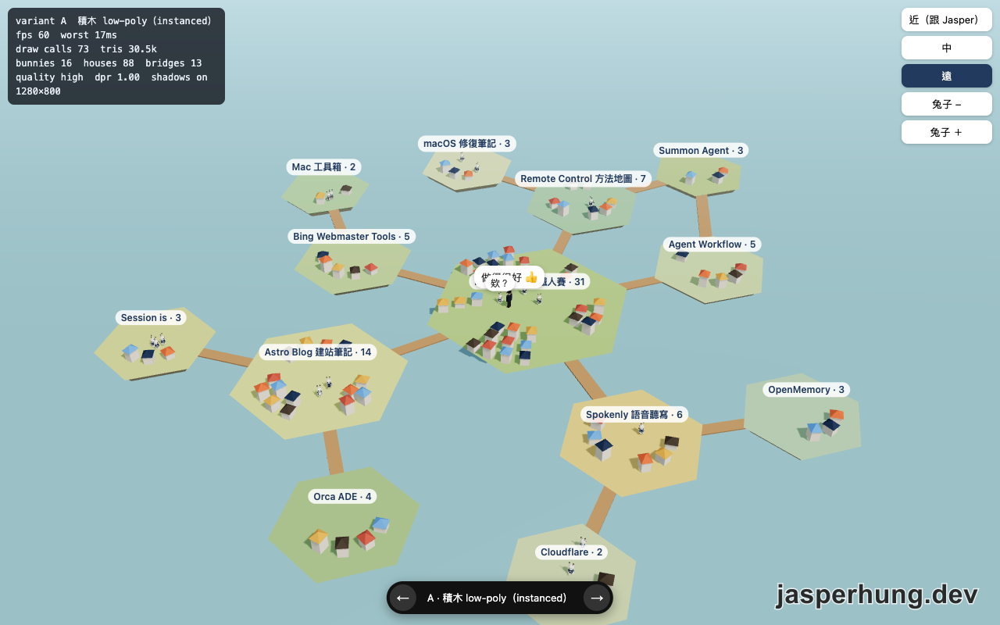

圖：最早的 A 版先把島嶼和系列關係排出來，還沒有後來的美術細節。

確認島與道路的空間關係後，才進到 2.0：路、樹、房子和 Bon Bon agent 都放進群島，系列之間也有了連結。畫面仍像一張漂在淺藍色背景上的地圖，但我已經能想像文章清單真的可以變成一個有空間感的世界。

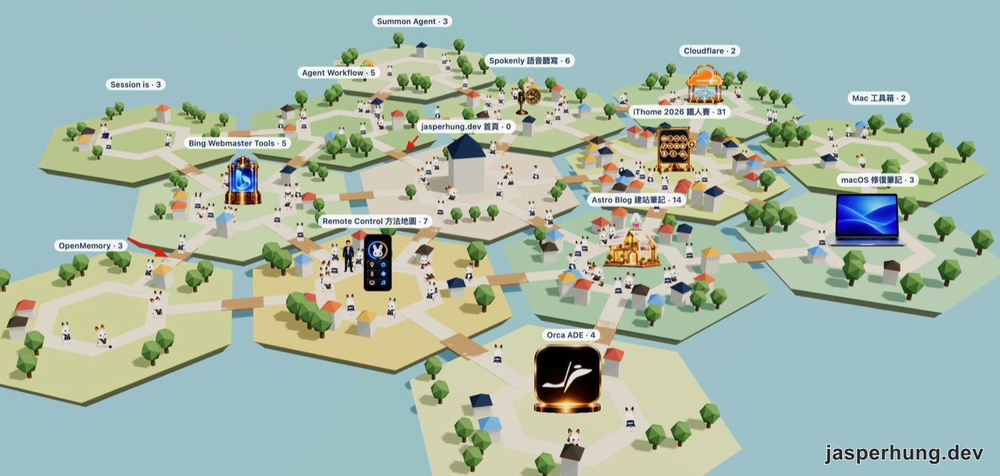

圖：2.0 版已經把系列、文章數量、道路和角色放進同一個畫面。

獨立出來也代表它暫時拿不到部落格 build 時整理好的資料。我先用當時的文章資料做快照，島嶼端可以讀取快照，也預留之後抓正式資料的方式。部落格那一半的 API 還沒做好——也就是讓島嶼取得最新文章資料的介面——所以這個 demo 可以獨立跑，內容則還不會跟著新文章自動更新。先把世界做出來，串資料留到之後再處理。

## 角色呈現：Three.js 3D 元件與 2.5D Sprite

### Three.js 幾何元件：直接捏 3D 模型

接著遇到的問題是角色。Bon Bon 是一隻有既定外觀的兔子，生成圖片裡的表情、耳朵和衣服都比較精細。我一開始想，人物是不是就用場景裡的圓柱和幾何元件一路捏出來；Codex 試做的 3D 兔子有了形狀，卻保留不了原本的可愛細節，放進場景裡看起來還有點好笑。

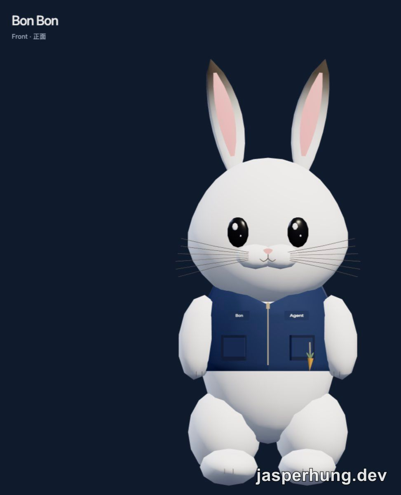

圖：第一個方向是直接捏 3D 模型，但這個版本跟原本的 Bon Bon 差得有點遠。

Jasper 的人形也試過用 Three.js 元件捏成 3D 模型。從正面、背面和側面看都能轉，但外型還是醜得讓我笑出來。兔子和人形兩條路都沒捏出想要的樣子，這才讓我認真轉向 2.5D。

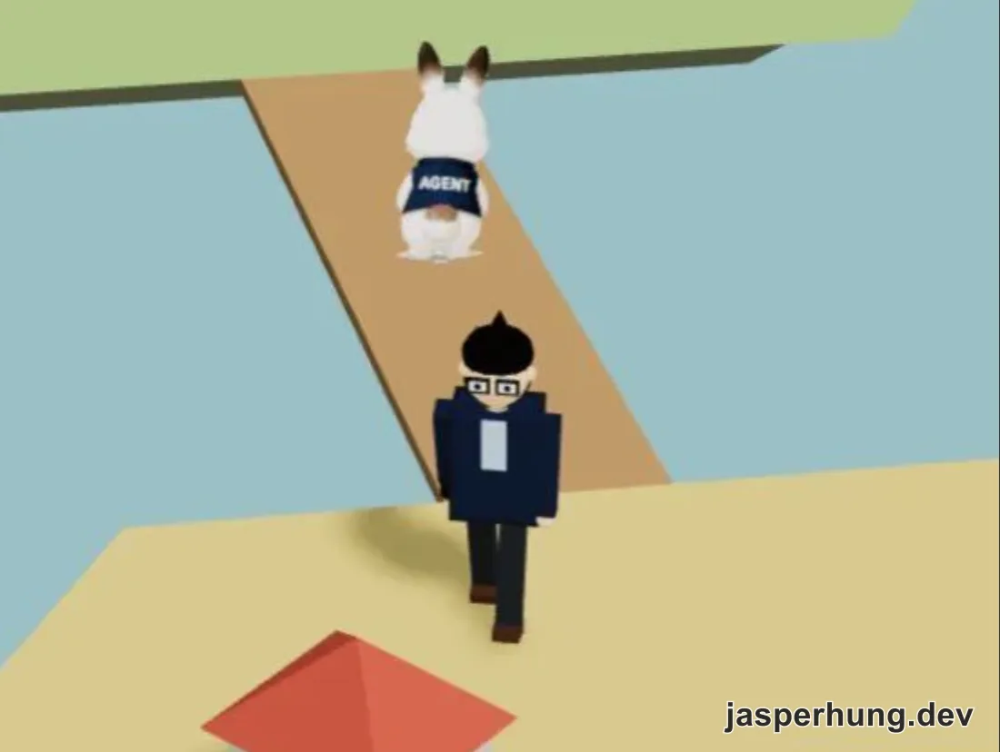

圖：直接用 Three.js 幾何元件捏 Jasper 的多角度測試，最後因為造型不合預期而放棄。

### 2.5D Sprite：用多方向圖片保留角色細節

做法改成把精細圖片貼在平面上。這種角色圖片常叫 sprite，放在 3D 場景裡的平面會面向鏡頭，稱為 billboard；轉動時再換成其他方向的圖片。它不是完整的 3D 模型，而是把 2D 圖片放進 3D 場景，這就是我後來理解的 2.5D。

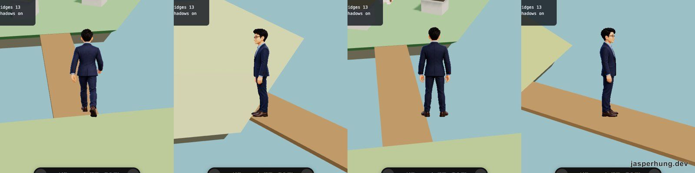

圖：C 版用三視圖和動作圖切換，讓 Jasper 在島上轉向與行走。

Bon Bon 的做法則是讓 Codex 先產生四個方向的圖，再放進 Three.js 場景裡隨著視角切換。多方向圖片要準備得夠一致，角色旋轉時才不會突然露出不一樣的臉；必要時還要補八面圖或頂圖。這比硬捏幾何模型更能留下原圖裡的表情和細節。

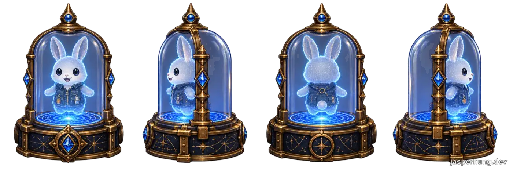

圖：Codex 生成的四向 Bon Bon 圖，放到 Three.js 裡後可依角色朝向切換。

## 場景設計：從繽紛可愛轉向宇宙科技

### 世界觀、色彩與流星

場景世界觀後來定成宇宙：漂浮島嶼像是和 agent 一起開拓浩瀚的知識世界。外圍有星空和星雲，島底加上厚度；流星則隨機帶著一篇部落格文章的標題掠過。後來我又加上《駭客任務》的文字感，讓流星尾巴上的字會跳動，偶爾閃出亂碼。

HEART 政策島讓我想到《動物森友會》那種繽紛、可愛的島嶼；自己的部落格世界後來卻轉向太空背景和漂浮島，像是和 agent 一起開拓浩瀚的知識宇宙。設計方向一轉，整個色盤都得重新抓。中間兩三個 agent 提過不少配色，有些放進場景後亮得很可怕，差點把宇宙做成霓虹招牌。

最後留下藍和紫：有固定主題的系列各自用指定色，其他島用系列識別值固定亂數分配。這段調整花時間的原因，是要讓色彩跟新的世界觀接得起來；等藍紫定下來，整座島群才有一致的宇宙科技感。

### 地標與道具：讓主題融入島嶼

主題地標也遇到相同的問題。最早每座島只有四面圖，轉到側面會像看到一片招牌。立方體招牌也試過，結果太像把 logo 貼在方盒上，只好退回去。後來讓地標保持直立，只繞 Y 軸朝向鏡頭，扁平招牌型的地標則把原本空白的背面也補上正面圖。四個方向的圖之間原本用 24° 淡化，殘影太長；縮到 10° 之後，切換自然多了。

四方向素材不只用在角色，也用在有主題的島嶼物件上。像 Astro Blog 島的屋舍就準備了四個朝向，鏡頭轉動時再切換到對應的立面。

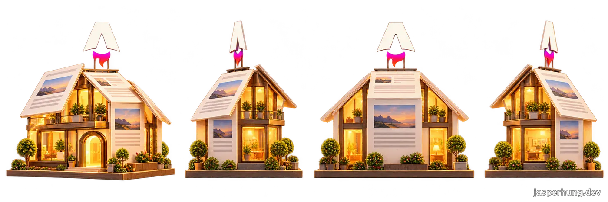

圖：主題屋舍也會準備四個方向的素材，讓島嶼轉動時能切換到對應立面。

首頁的宮殿比較特別，它直接立在地上，沒有投影台可以幫忙遮掉角度差。我只替它做八個方向的圖，讓主島轉動時比較不會一下就露餡；其他地標則先維持四面圖。這是一次很實際的取捨：要不要增加一倍的素材，要看那個物件在畫面裡有多重要。

道具先從 Cloudflare 島開始，因為那座島只有兩篇文章、空地最多，主題也很容易變成具體物件：機櫃、robots 告示牌、DNS 路標。Codex 先生成幾批道具圖，Claude 把圖接進場景；第一批黃銅色的物件看來有點突兀，第二批換成霧面海軍藍和石材底座後，比較像原本就在島上，所以第一批也跟著重做。屋頂加上暖色，道路則從島半徑的 0.42 往外推到 0.48，讓房子和道具都能有位置。

場景物件的圖片由 Codex 依主題生成，我再把圖片切開、清理邊緣、接進 Three.js。圖片有時會超出格線，照著格子切就切壞；有時不同物件又互相重疊，得改用透明區域判斷該怎麼切。這些看起來像圖片整理的小事，實際上會直接決定道具能不能放進島上。

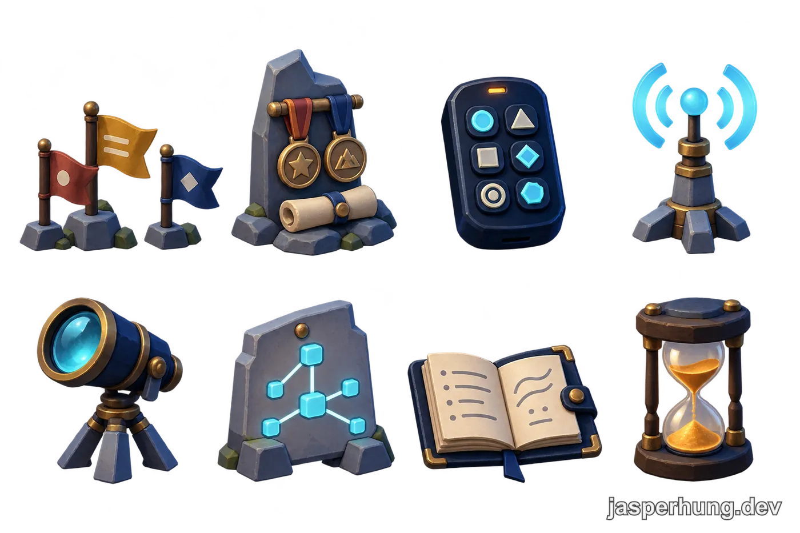

圖：Codex 依主題一次生成一批道具，再由我挑選、切成個別素材。

顏色大致定下來後，我才回頭處理道具要放在哪裡。第一版把道具集中在道路內的中央空地，算過尺寸後才發現太擠；我改用道具接地的半徑避開重疊，再用最遠點把道具分散，十四座島都能放進三到五件，但近看仍有工具箱被地標擋住、首頁宮殿旁太擠的問題。

我問能不能把道具放在「靠近內六角道路附近、不要放太外面」，一開始把它理解成道路兩側都能用，還加了路外第一排空地。Codex 接著把規則補清楚：主要位置應該沿著道路內緣，依道具接地大小往內縮，確保不壓在路上。照這個方向修正後，抽到的道具都能放下，路外的牧草和樹則回到原本的空間裡，排列也因此改變。

### 生成島：用網格光線表現萌芽中的系列

生成島代表還在萌芽的系列：內容還沒長完整，先有一塊正在形成的島。最初我把它做成小型裝飾平台，後來改成和其他島一樣大，再用六角形拼出島面和網格，讓它帶著呼吸感。這些六角不只是裝飾，而是在說「這座島還在生成」。

一開始用空心六角一圈圈亮起來，後來靈光一閃，把流動的光線接到網格上：青藍色的光沿著節點往前跑，偶爾分岔，再慢慢淡掉。第一版的線太細，調寬後才看得清楚；材質又被背面剔除，改成雙面後才完整出現。說實話，直接在 Three.js 裡看到光線沿著島面流動，成就感比做 Web 動畫高一百倍 XD。

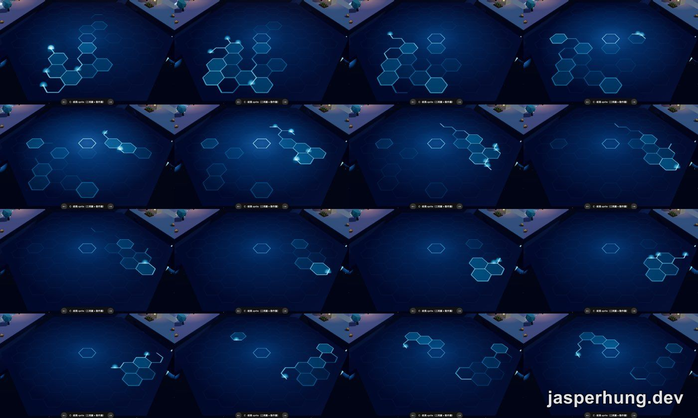

圖：16 格畫面記錄生成島上的流動光線如何沿著網格延伸。

## Agent 工作互動：把協作方式放進島裡

這個專案的分工也很直接：Claude 負責實作，場景裡需要的圖片交給 Codex 生成，我再透過 Orca 這個 agent 溝通工具傳遞不同主題和想畫的內容。圖做完後由 Claude 接進場景，我看結果再調整位置、大小和顏色。

Bon Bon agent 原本只是到處走，我後來也替牠們加上工作中的樣子：牠們會隨機冒出對話，回報進度、說遇到什麼狀況，或像平常的 agent 一樣停下來等我回覆。sub-agent 的派工則再多一層故事：主控台會隨機產生一個任務，用藍色對話框派給 agent，接到任務的角色也會隨機回覆自己要做什麼。這些互動已經做進 demo，讓群島看起來像一個正在工作的世界。

我也把平常修 bug 時主控 agent 再派 sub-agent 的情境做成場景演出：例如一個去跑測試、另一個去查資料，幾隻兔子就沿著道路各自出發。靠近系列主題島時，閃電和電流感的線條會呈現修 bug 或查資料的忙碌感。這不是把真實派工流程接進 3D 場景，而是把我平常等 agent 回報、再決定要不要介入的工作節奏，變成看得見的故事。

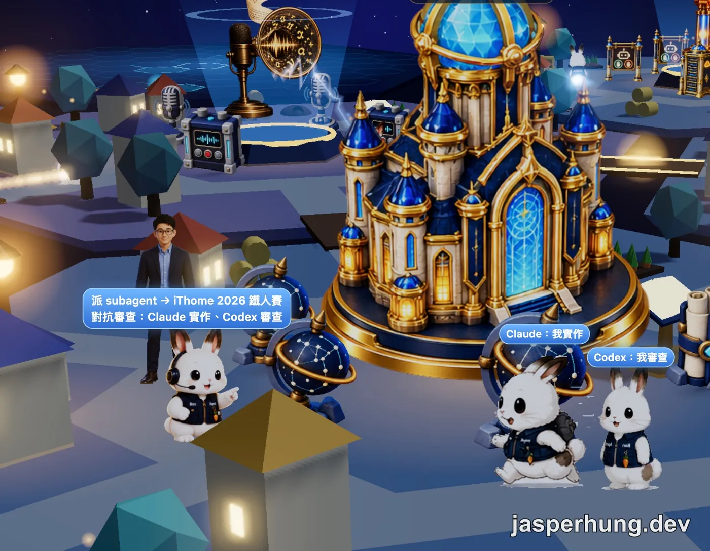

圖：把主控 agent 派工、Claude 實作與 Codex 審查的協作情境放進島嶼世界。

## 心得

第一次真的用 Three.js 做 Web 3D，我覺得很好玩。看過一個完成度很高的政策島後，我也好奇自己的部落格能不能長成一個世界：每座島是自己寫過的系列，島上的兔子、房子和主題地標則讓它們看起來不只是資料分類。這個 demo 還沒有做到完整，但每次看到 Bon Bon agent 在島上跑來跑去，我都可以看好幾個小時。這種療癒感，大概是我一開始沒有列進規格裡的功能。

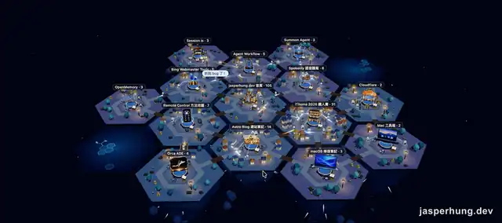

圖：生成島動畫，光線沿著網格前進、分岔後逐漸淡出。

線上體驗：[Island Blog](https://island.jasperhung.dev/)

靈感來自 HEART 政策島：把一組內容變成可以逛的島嶼。
